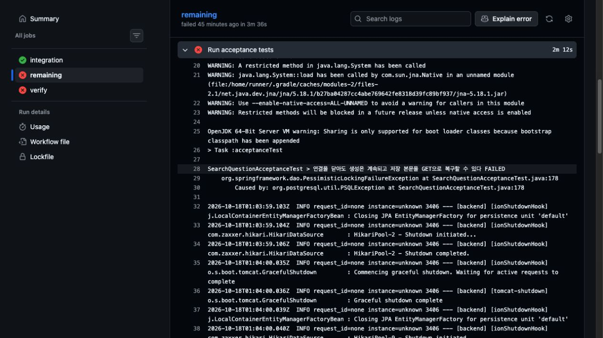

# 첫 질문 인수 테스트의 SSE 종료와 DB 정리 경합 수정

## 문제 인식

PR #769의 Backend CI 실행 39084866766에서 통합 그룹은 성공했지만 remaining 그룹의 인수 테스트 567개 중 1개가 실패했음.

- 실패 클래스: `SearchQuestionAcceptanceTest`
- 표시된 테스트: 연결을 닫아도 생성은 계속되고 저장 본문을 GET으로 복구할 수 있다
- 실제 실패 위치: 테스트 본문이 아닌 `@BeforeEach setUp()`의 `TRUNCATE TABLE members, workspaces RESTART IDENTITY CASCADE`
- PostgreSQL 오류: `deadlock detected`
- 잠금 관계: 한 세션의 `AccessExclusiveLock` 요청과 다른 세션의 `AccessShareLock` 요청이 서로 기다렸음.

실패 실행: <https://github.com/woowacourse-teams/2026-knot/actions/runs/39084866766>

## 가설과 확인

클라이언트가 SSE 연결을 닫거나 생성 worker가 끝나는 시점과 서버의 SSE 전송 작업이 끝나는 시점은 다름. 기존 테스트는 서버 작업 종료를 확인하지 않고 다음 테스트에서 DB를 초기화했음. 서버 작업은 스냅샷 조회 트랜잭션을 수행하므로 TRUNCATE와 겹칠 수 있음.

로컬 원본 클래스 20개는 통과했음. 이후 종료 직후 executor의 active count가 0인지 즉시 검증하는 임시 진단을 넣자 20개 중 4개에서 실제 값 1로 실패했음. 테스트 종료 뒤에도 SSE 작업이 남는 상황은 확인했음. CI와 동일한 PostgreSQL deadlock은 로컬에서 재현하지 못했음.

CI 아티팩트에는 상대 세션의 SQL과 PostgreSQL 서버 로그가 없어 교착에 참여한 상대 SQL까지 확정하지 않았음. 다만 확인된 잔존 작업과 정리 경합 경로를 직접 차단하는 수정으로 범위를 한정했음. 이 클래스의 스케줄러는 기본 비활성 상태였음.

## 적용한 변경

`SearchQuestionAcceptanceTest`에 기존 `searchStreamExecutor`를 주입했음. 테스트 종료와 다음 테스트의 DB 정리 전에 활성 작업 수와 대기열 크기가 모두 0인지 확인하도록 했음. 최대 5초 동안 10ms 간격으로 조건을 확인하고, 종료되지 않으면 assertion으로 실패함.

기존 `SearchFollowupQuestionAcceptanceTest`의 종료 확인 방식과 맞췄음. 테스트 본문, 기존 assertion, 실제 PostgreSQL과 Flyway, TRUNCATE를 유지했음. 운영 코드와 타임아웃 설정을 변경하지 않았고 재시도도 추가하지 않았음.

## 검증 결과

| 검증 | 결과 |
| --- | --- |
| 원본 클래스 단독 | 20개 통과, 로컬 deadlock 미재현 |
| 종료 직후 잔존 작업을 검사한 임시 진단 | 20개 중 4개에서 active count 1 관찰 |
| 수정 클래스 반복 실행 | 20개씩 3회 통과 |
| 검색 관련 인수 테스트 순서 변경, seed 715 | 133개 통과 |
| 전체 인수 테스트 | 567개 통과, 기존 CI의 테스트 목록과 일치 |
| Spotless와 bootJar | 통과 |

모든 성공 실행에서 실패, 오류, 스킵은 0개였음. 임시 즉시 검증은 진단용으로만 사용했고 최종 변경에는 조건 대기와 종료 assertion을 남겼음.

## 증거와 판단

실패 Actions 로그, 원본 XML, 임시 진단 XML, 반복 실행 XML과 로그를 `backend/output/ci-715/acceptance-deadlock-20261018/`에 보존했음. 기존 성능 비교 결과는 변경하지 않았으며 이번 수정을 성능 개선율로 계산하지 않음.

관련 이슈: <https://github.com/woowacourse-teams/2026-knot/issues/715>

관련 PR: <https://github.com/woowacourse-teams/2026-knot/pull/769>
