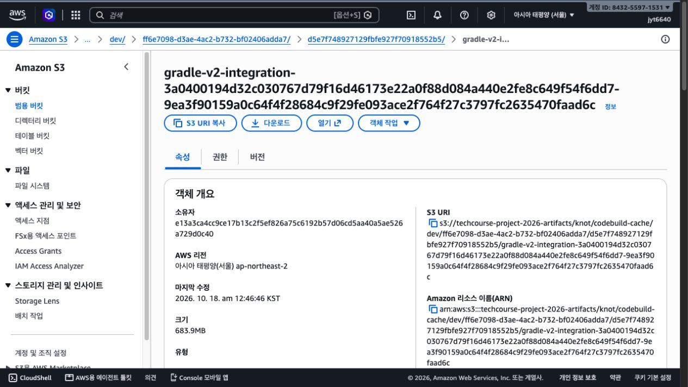
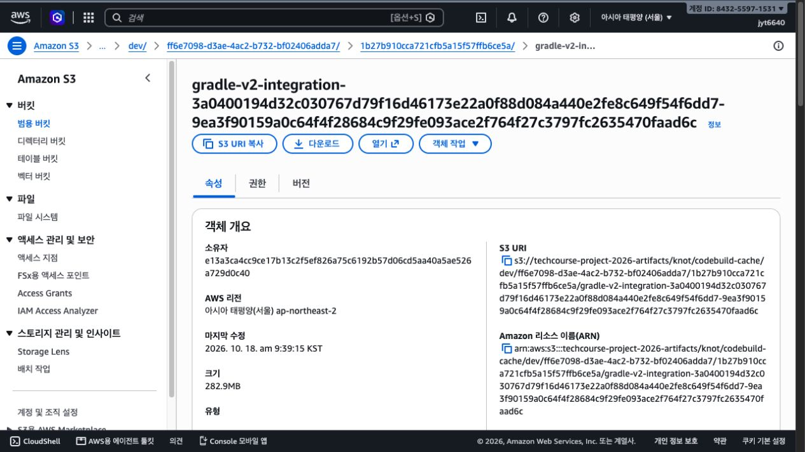
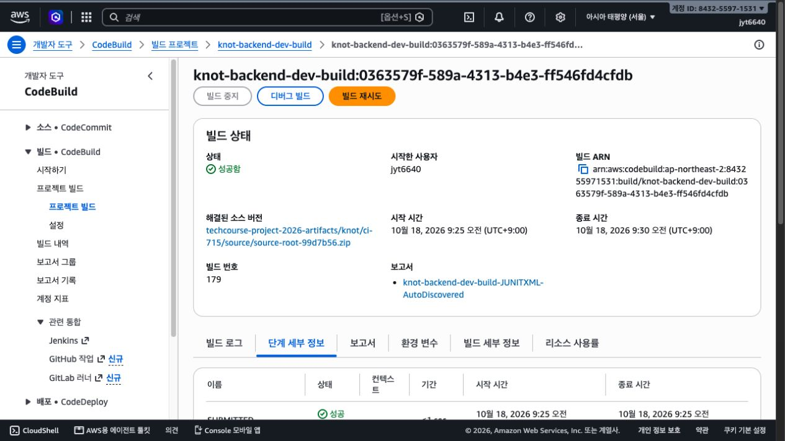
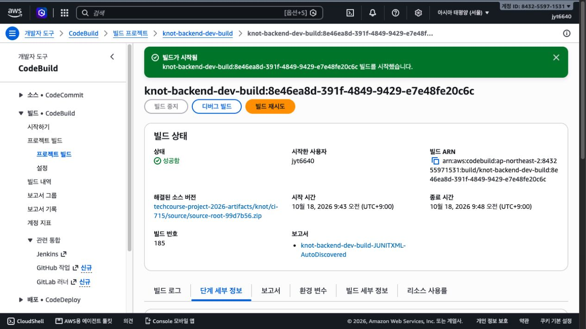
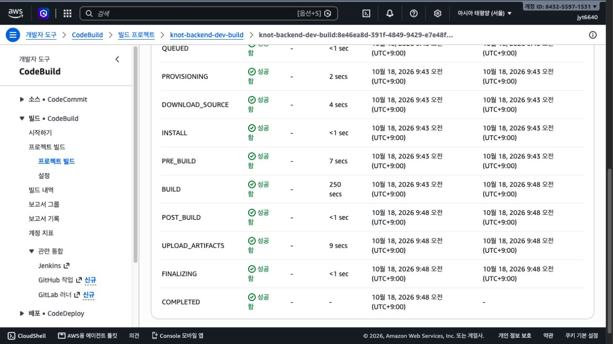
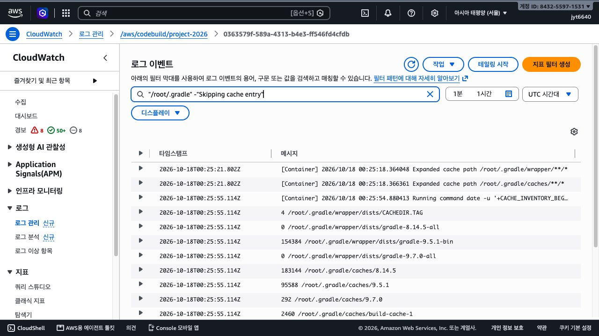

# CodeBuild 캐시 범위 축소 pilot 결과

상태: 작은 AWS A/B 비교 완료임. 캐시 축소는 후속 채택 후보로 판단함. 운영 영구 반영과 두 그룹의 반복 3회 검증은 이번 pilot에 포함하지 않았음.

통합 그룹 warm 전체 시간은 345초에서 275초로 70초, 약 20.3% 줄었음. DOWNLOAD_SOURCE는 38초에서 4초로 줄었음. A/B 각 1회 관측이며 테스트 자체도 22초 빨라졌으므로 전체 70초를 캐시만의 효과로 해석하지 않음.

## 1. 문제 인식과 가설

기존 캐시는 `/root/.gradle/wrapper/**/*`와 `/root/.gradle/caches/**/*`를 저장했음. 실제 Wrapper는 9.5.1-bin인데 구버전 Gradle 자료도 포함됐음. 필요한 버전과 공유 캐시만 남기면 테스트 검증을 줄이지 않고 복원 비용을 낮출 수 있다고 가정했음.

구버전 캐시가 발견됐다는 사실과 S3 복원 때문에 생성됐다는 주장은 구분함. B 최초 miss 호스트에도 8.14.5와 9.7.0 캐시가 있었으므로 기본 이미지 자료도 존재했음. skip 메시지 수천 줄의 기록 시간은 1초 미만이었으므로 출력 자체를 38초 지연의 원인으로 단정하지 않음.

## 2. 고정한 조건과 적용 범위

- 소스는 기존 `source-root-99d7b56.zip`이며 SHA256은 `fc00c21f522aeb0df36f92defabc376fa790d87a3ab30b6b753c71c6bd31a005`임. backend/src와 Gradle 설정은 PR #769의 b51e7829b와 동일함. 사용자 미커밋 변경은 포함하지 않았음.
- 개발 CodeBuild `knot-backend-dev-build`, Amazon Linux 표준 6.0, Java 25, Small 2vCPU/3GB, 기존 역할, `CI_GROUP=integration`을 사용했음.
- A warm 1회, B 최초 저장 1회, B warm 1회로 제한했음. timeout은 각 10분, 자동 재시도는 0회였음.
- A/B에 같은 비차단 du 관측을 넣었고, 최종 JSON은 cache.paths 외에 동일함. 테스트, DB, Flyway, 힙, 캐시 크기, 데이터 정리와 생명주기는 변경하지 않았음.
- `testClasses --build-cache` 후 `integrationTest --rerun --no-build-cache`를 유지했음. 테스트 성공 결과를 캐시로 대신하지 않았음.
- 실제 적용은 각 빌드의 inline override임. 프로젝트 영구 buildspec, 저장소 buildspec과 CodePipeline은 이번 pilot에서 수정하지 않았음. 다른 사용자가 시작한 pipeline 실행은 관측만 했음.

B 최종 경로는 다음과 같음. Wrapper 버전을 바꾸면 이 목록도 재검토해야 함.

```text
/root/.gradle/wrapper/dists/gradle-9.5.1-bin/**/*
/root/.gradle/caches/9.5.1/**/*
/root/.gradle/caches/modules-2/**/*
/root/.gradle/caches/build-cache-1/**/*
/root/.gradle/caches/jars-9/**/*
/root/.gradle/caches/journal-1/**/*
```

키의 그룹, 설정 해시, 소스 해시와 fallback은 유지했음. paths 변경으로 A/B cache version이 달라졌음. A는 `d5e7f748927129fbfe927f70918552b5`, B는 `1b27b910cca721cfb5a15f57ffb6ce5a`임. B 최초 miss는 warm 성능 비교에서 제외하고 공개함. [AWS S3 캐시 규칙](https://docs.aws.amazon.com/codebuild/latest/userguide/caching-s3.html)

## 3. 실행 식별과 결과

| 조건 | 빌드 번호 | 빌드 ID | 전체 시간 | 결과 |
| --- | --- | --- | --- | --- |
| A broad warm | 179 | 0363579f-589a-4313-b4e3-ff546fd4cfdb | 345초 | 성공 |
| B seed miss | 182 | cba43323-601a-463f-b43c-d5e540608487 | 465초 | 성공 |
| B narrow warm | 185 | 8e46ea8d-391f-4849-9429-e7e48fe20c6c | 275초 | 성공 |

전체 시간은 AWS 빌드 이력의 개별 빌드 기간임. 반올림된 phase를 더해 계산하지 않았음. 실제 CodePipeline 단계나 Source부터 Deploy까지의 시간은 아님.

| 지표 | A warm | B seed | B warm |
| --- | --- | --- | --- |
| DOWNLOAD_SOURCE | 38초 | 1초 | 4초 |
| PRE_BUILD | 11초 | 23초 | 7초 |
| BUILD | 279초 | 415초 | 250초 |
| POST_BUILD | 1초 미만 | 11초 | 1초 미만 |
| UPLOAD_ARTIFACTS | 10초 | 9초 | 9초 |
| testClasses 명령 | 15초 | 152초 | 8초 |
| integrationTest 명령 | 263초 | 262초 | 241초 |

B seed는 실제 로그에서 cache miss와 신규 저장을 확인했음. 저장 로그의 크기는 282.86MiB였음. B warm에서는 같은 버전과 primary key의 archive 다운로드 및 compileJava/compileTestJava FROM-CACHE를 확인했음. A는 두 compile 태스크 FROM-CACHE와 같은 키가 이미 존재해 저장을 생략한 로그를 확인했음.

S3 객체 화면에서 A 크기는 683.9MB, B는 282.9MB였음. 같은 화면의 반올림된 표시값 기준 약 58.6% 감소임. 이 값은 실제 저장 archive 크기이며 앞서 du로 확인한 파일 사용량과 다름. 콘솔 MB 표기와 CodeBuild 로그 MiB 표기는 그대로 인용했으며 정확한 byte 단위 감소율을 주장하지 않음.

## 4. 기존 검증과 로그 보존

A, B seed와 B warm 모두 실제 ZIP의 통합 테스트 681개, XML 파일 83개, 실패/오류/스킵 0을 확인했음. 세 번 합계 2,043개 testcase 실행이며 서로 다른 테스트가 2,043개라는 의미는 아님. 기존 raw testcase 목록과 정규화 목록 모두 일치했고 HTML을 보존했음. integration 아티팩트에 배포 JAR를 생성하지 않았음.

로컬 shell fixture는 최종 A/B 각각 15개 통과했음. 정상 그룹별 실행 순서, 각 태스크 실패의 중단, 잘못된 그룹, 이전 phase 실패와 JAR 누락을 확인했음. 이는 실제 AWS 실패 실험이나 새로운 데이터 오염 부정 사례의 통과를 의미하지 않음.

실패 처리와 XML/HTML 설정은 그대로 유지했음. 기존 실제 AWS 실패 canary와 그 ZIP은 `codebuild-batch-20261018`에 보존했음. 이번 실험에서 인증 만료로 시작이 거절된 시도는 빌드 ID 생성 전 오류였으며 테스트 실패로 세지 않았음. 처음 로컬 fixture의 du 실패도 원본을 남기고 관측 명령만 비차단으로 수정했음.

관측 로그는 콘솔에서 제공한 텍스트를 그대로 보존했음. A에는 대량 skip 기록으로 시작 구간 일부가 빠져 있음. 서버 원본은 기존 CloudWatch 그룹에 유지되며 로컬 캡처를 전체 서버 로그라고 표현하지 않음. CPU 포화나 메모리 압박은 이번 실험에서 계측하지 않았음.

## 5. 판단

**작은 실험은 성공했고 캐시 축소를 후속 채택 후보로 남김.** 실제 캐시 크기와 복원 단계가 줄었고 컴파일 적중과 기존 681개 검증이 유지됐음. 이번 B 통합 그룹 한 번은 5분 미만이었음.

warm 전체 시간 감소는 70초였지만, 캐시가 주로 영향을 주는 DOWNLOAD_SOURCE 감소는 34초였음. BUILD도 29초 줄었고 그중 통합 테스트 명령은 22초 줄었음. 테스트 내부 설정을 바꾸지 않았으므로 그 22초를 캐시 축소의 직접 효과라고 단정하지 않음. 실행은 A 후 B 순서였고 같은 물리 호스트, CPU 포화 및 네트워크 상태를 통제하지 않았음. 외부 pipeline 빌드도 동시간대에 존재했으며 원인으로 단정하지 않음.

운영 채택은 보류함. 통합 warm 한 쌍이므로 반복 3회 중앙값이나 두 그룹의 5분 달성을 주장하지 않음. remaining, 최초 저장 A/B와 새 소스 fallback 비교는 수행하지 않았음. 계획의 채택 조건인 warm 전후 각 3회 또는 동일 조건 새 키 저장 비교를 아직 충족하지 않았음. 작은 비교 3개에서 종료하며 자동으로 최대 18개 실험까지 늘리지 않았음.

후속 검증은 같은 B 경로를 유지해 integration과 remaining의 A/B 반복 및 기존 배포 아티팩트 계약을 확인하는 일임. 두 그룹 warm 각 3회 모두 300초 미만, 기존 테스트 합집합 2,792개와 보고서 및 실패 전파가 유지돼야 5분 목표 달성으로 판단함. 그때 저장소 buildspec과 AWS inline을 함께 반영함. 버전별 paths는 Wrapper 업그레이드 때 갱신해야 함.

## 6. PR과 비용

[PR #769](https://github.com/woowacourse-teams/2026-knot/pull/769)은 측정 당시 head b51e7829b에서 OPEN/CLEAN/APPROVED와 integration, remaining, verify, FE 및 governance 성공을 확인했음. 캐시 축소 pilot은 해당 PR의 검증된 코드와 구분함. 실험 중에는 merge, commit, push를 수행하지 않았음.

문서 갱신 시 `git pull --ff-only` 결과 작업 브랜치는 최신이었음. 별도로 조회한 origin/develop은 23a11fa8d까지 진행됐고 백엔드 조회 쿼리 변경도 포함했음. 이 새 develop 코드로 실험을 다시 실행한 것은 아님. 이번 기록과 증거 이미지만 문서 커밋으로 추가하며 테스트 소스와 영구 캐시 설정을 바꾸지 않음. 현재 merge 가능 여부와 체크 상태는 PR의 최신 화면을 기준으로 확인해야 함.

실행 전 Cost Explorer의 ProjectTeam=knot 필터에서 10월 누계 추정 US$47.90을 읽었음. 미태그 비용과 청구 반영 지연 때문에 실제 잔액을 보장하지 않음. 서울 Linux Small 단가 US$0.005/분을 확인하고 세 빌드 각 10분 이내로 제한했음. S3와 CloudWatch 비용은 별도임. 이번 3개 이외의 pipeline 빌드는 팀의 다른 실행이며 이 pilot 비용이나 성능 표본에 합치지 않았음.

관측 기간을 분 단위로 올림하면 6+8+5=19분이며 해당 단가의 compute 추정은 약 US$0.095임. 실제 청구 확인값은 아님. [AWS 서울 CodeBuild 가격 데이터](https://pricing.us-east-1.amazonaws.com/offers/v1.0/aws/CodeBuild/current/ap-northeast-2/index.json)

## 7. 증거 위치

- 원본: `backend/output/ci-715/cache-scope-20261018/`
- 실제 입력: `A-buildspec.json`, `B-buildspec.json`, 각 start-form
- 실행 결과: 각 log, phase-table, phases.png, ZIP, audit.json
- `B-buildspec.candidate.json`은 초기 임시 후보이며 실제 AWS 입력이 아님. 최종 B는 `B-buildspec.json`임.
- 이전 원본과 이미지: `backend/output/ci-715/codebuild-batch-20261018/`
- 별도 Notion 결과: https://app.notion.com/p/3fd0691a0023819c941ccb882da0c9bc

계획 원문과 기존 결과 이미지는 유지하며 결과만 새 문서에 기록함.

프로젝트 절차의 Persona finish는 기존 `source-read-runtime-unavailable`로 exit1이었음. 공식 절차 인증은 미완료이며 실제 AWS 세 빌드 성공과 XML 감사 결과와 구분함. 환경이나 과거 이력을 재생성하거나 무관한 전체 테스트를 재실행하지 않았음.

### A와 B의 캐시 객체 크기





S3 콘솔이 표시한 archive 크기임. du 출력의 디렉터리 사용량과 구분함.

### A와 B의 실행 식별 및 성공





### B warm 단계별 시간



### 캐시 디렉터리 관측



구버전 자료가 관측됐지만 B miss 호스트에도 존재했으므로 S3 복원이 전부의 생성 원인이라고 판단하지 않았음.

Notion의 가설 검증, 결과, 판단 페이지에도 해당 주장에 맞는 실제 캡처를 넣었음. 기존 이미지와 하위 문서는 보존했음.
