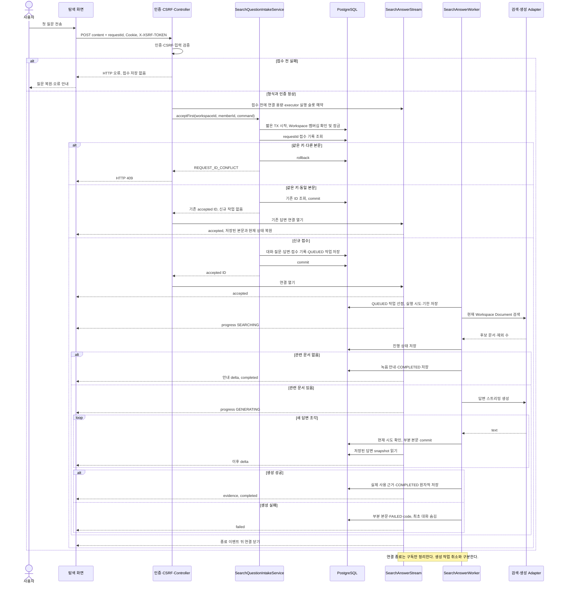

# #563 탐색 첫 질문 접수·대화 생성 구현 계획

## 2026-10-12 migration 리뷰 정합성

- #607 병합 후 develop `a72b4fa5`의 녹음 V44를 유지하고 미병합 탐색 접수·실행 migration을 V45·V46으로 이동했다. 실제 근거 rank 확장은 V47, 후속 #568의 선점 전 중지 제약은 V48을 사용한다. 아래의 V41~V44 언급은 최초 구현 당시 번호 기록이다.
- PostgreSQL의 V40 및 녹음 V44 적용 DB에서 V45·V46을 순서대로 적용하고 기존 실패 답변·부분 본문을 보존하는 테스트가 통과했다. outOfOrder를 켜지 않았고 기존 develop migration의 SQL·checksum은 변경하지 않았다.
- 운영 DB의 적용 이력은 관측하지 않았다. 탐색의 이전 번호를 이미 공유 DB에 적용한 환경에는 파일 교체를 그대로 배포하지 않고 적용 이력에 맞춘 별도 정합성 확인이 필요하다.

## 1. 범위와 브랜치

- 상태: 접수·저장·작업 실행·SSE 기반과 production MCP 탐색·LLM adapter를 구현했다. 아래 기존 설계·검증 기록은 당시 상태이며, 최신 연동 결과는 [MCP 구현 계획](563-search-document-mcp.md)과 [실제 모델 평가](../qa/563-search-mcp-live-20261011.md)를 따른다. 운영 배포 완료는 아니다.
- 확인 날짜: 2026-10-11 KST.
- MCP/LLM 연결 후 최신 전체 검증: Java 25 `spotlessCheck check bootJar` PASS, 단위 1,033·통합 488·인수 477=1,998개, 실패·오류·skip 0. 별도 실제 모델 평가 2건 COMPLETED. 이전 adapter 미연결·1,943/1,970개 기록은 과거 단계의 결과다.
- PR 리뷰 후속: 부모 #572의 Search migration V37→V39와 #574의 단일 조회 테스트 분리를 반영했다. 부모 HEAD는 `37763d30d87ae89a436a7df84294565796f0fd5c`이며, #563 고유 diff는 POST 접수·실행·SSE와 직접 검증에 한정한다. 녹음 V37/V38 → Search V39 → 근거 V40 → 접수 V41 → 실행 V42의 파일 버전 중복은 없고, 운영 DB 적용 이력은 미관측이다.
- 리뷰 반영 후 전체 검증: `./gradlew spotlessCheck check bootJar --console=plain` 통과. 단위 1,021·통합 472·인수 477, 총 1,970개 실패/오류/skip 0이다. 이후 Java 선언 간 빈 줄만 정리했고 공백을 무시한 diff가 비어 있음을 확인했다. 아래 1,943개 기록은 부모 리뷰 반영 이전 결과다.
- 대상: [Issue #563](https://github.com/woowacourse-teams/2026-knot/issues/563), `POST /api/v1/workspaces/{workspaceId}/search/conversations` 하나.
- 현재 브랜치: `be/feature/#563`. 사용자 개발 승인으로 `be/feature/#565`의 `6932506261df8c88276be3b4f66bded58b582361`에서 분기했다. [#574](https://github.com/woowacourse-teams/2026-knot/pull/574)의 메시지·근거 기반이며 부모는 [#572](https://github.com/woowacourse-teams/2026-knot/pull/572)의 `be/feature/#564`다. 두 PR은 조사 시점 미병합이다.
- 실행한 분기: `git switch -c 'be/feature/#563' 'be/feature/#565'`. 계획 작성 당시에는 분기만 수행했고, commit/push/PR은 이후 사용자 명시 승인에 따라 별도 수행한다. GitHub PR 병합은 승인 범위에 없다.
- PR base 후보: `be/feature/#565`. 부모 변경과 #563 고유 변경을 분리해 리뷰한다. 부모 리뷰 수정은 자식에도 반영하며, 부모 병합 후 실제 병합 방식과 분기 경계를 확인해 고유 커밋만 develop 위로 정리한다. 이 문서는 commit/push/PR/merge 권한이 아니다.
- 원격 develop: fetch 후 `d979c509a66a9844c176488e7ada992ccfae0816`. 저장소의 V36까지 확인했다. 로컬 조회 브랜치의 Search V37/V40은 develop에 병합된 기반으로 취급하지 않는다.
- 전체 탐색 로드맵 `563-search-v2-roadmap.md`는 로컬의 사용자 소유 문서이며 이번 PR에 포함하지 않는다. 이번 POST에 한정한 상세 계획을 별도로 둔다.

완료 범위는 첫 질문 검증, 원자적 접수, requestId 멱등성, SSE, 연결과 독립된 생성 작업, 부분 본문·근거·종료 상태 저장, 중단 복구, 실제 검색·LLM 연결이다. 검색은 ARCHIVED Document에 대한 MCP 세 도구와 lexical 검색으로 결정했다. 실제 사용 근거 전체 보존·질문 관련도 상위 3개 카드·제외 수 0을 적용한다. 후속 질문 #566, GET 재연결 #567, 중지 POST #568, retry POST #569는 이번 PR에 추가하지 않는다.

### 선별한 근거

Notion은 지정된 ignored 캐시의 관련 본문·DB 속성과 manifest/coverage를 읽었다. 실시간 운영 Notion·Figma·운영 DB는 이번 조사에서 확인하지 않았다. API 캐시의 요청/응답 표는 평탄화 본문에 빠져 있어 사용자 제공 전문과 게시 Issue로 보완한다. 아래 body/properties revision은 각 자료에서 일치했고 manifest status에 불완전 표식은 없었다. 수집 complete는 팀 승인이나 구현 완료의 증거가 아니다.

| 자료 | 출처·revision·관측 | 이번 작업에 적용 | 판정 |
| --- | --- | --- | --- |
| 사용자 결정·게시 Issue | [#563](https://github.com/woowacourse-teams/2026-knot/issues/563), 10/11 조회 | 개인 범위, SSE, requestId 대화 보존 기간 유지, 최초 실패 목록 숨김·현재 화면 retry | 사용자 채택 작업 계약. 팀 승인과 구분 |
| 질문 길이 | 현재 사용자 답변, 10/11 | 공백 포함 2,000 Unicode 코드 포인트. 원문 그대로 저장 | 이번 작업 확정 |
| 중단·시간 초과 종료 | 현재 사용자 답변, 10/11 | 실행 중 복구 불가·시간 초과는 부분 본문 보존·FAILED, 사용자 retry. 미실행 QUEUED만 재시작 후 실행 | 이번 작업 확정. 실행 중 답변 자동 재생성 없음 |
| 첫 질문 API | [Notion API](https://www.notion.so/3ebb4351752280a39871f288fbc275b6), body/properties 9/30 01:25Z, captured 9/30 02:19:13Z | POST, 접수 전 HTTP 오류, 접수 후 FAILED, 연결 해제 시 생성 지속. 속성 method=POST·도메인=검색·담당=흑곰·구현=NO | 캐시 관측·초안. 제공 전문/Issue와 대조 |
| 도메인 UseCase | [질문·답변](https://www.notion.so/820b4351752283c7b1cf01ce571f4cb9), body/properties 9/23 05:20Z, captured 9/30 02:19:19Z | USER/ASSISTANT 순서, 개인 Workspace 문맥, 녹음과 독립, 실제 사용 문서 최대 3개 | 캐시 관측. 최신 API·사용자 결정 우선 |
| ERD | [ERDiagram](https://www.notion.so/3e4b4351752280cd86c7dc92aac63fd1), body/properties 10/7 10:45Z, captured 10/7 13:07:32Z | Search 테이블·role/status CHECK·sequence UNIQUE·Evidence PK/rank/FK | 캐시 관측. 접수 기록·작업 상태·실패 code는 원 ERD에 없는 기술 추가 제안 |
| 실패 기획 | [답을 주지 못할 때](https://www.notion.so/3edb43517522815f94ecd3c8f692ba7f), body/properties 10/10 08:29Z, captured 10/10 09:04:55Z | 질문 복원, 자동 재전송 없음, 최초 실패 숨김, 근거 없으면 녹음 안내, 제외 수 생성 SSE에 표시 | 캐시 관측. 현재 작업 결정과 일치 |
| 기존 AI 연동 | [PR #534](https://github.com/woowacourse-teams/2026-knot/pull/534), MERGED 10/10 13:58:48Z; 현재 LlmClient/LmStudioClient | 공통 설정·공급자 선택·실패 분류 재사용. 현재 complete()는 stream=false·JSON schema 응답 | 실제 코드 관측. 스트리밍 구현 완료 근거 없음 |
| FE 계약 | [PR #573](https://github.com/woowacourse-teams/2026-knot/pull/573), OPEN; search.ts 본문 조회 | accepted 등 8종 이벤트, answerMessageId, 근거 documentId/title/topic/rank. 요청 DTO는 trim(), 알 수 없는 이벤트는 버림 | 미병합 구현 관측. FE 동기화 필요 |
| 저장소 지침 | [현재 V2](../product/current-v2-mvp.md), [정합성](../../../docs/harness/notion-alignment.md), [근거 탐색](../notion-context.md), Persona profile/guideline | Java 25·Spring Boot 4.1·JPA/PostgreSQL/Flyway, 계층·단위/통합/인수 구분 | 저장소 기준. 계획만 작성하므로 구현 workflow 미시작 |

### 이미 결정된 사항

SSE 전송, 개인 대화, 빈 대화 미저장, requestId 보존, 최초 실패 숨김을 재질문하지 않는다. requestId는 현재 Member·Workspace·요청 종류·대상을 묶어 비교한다. 같은 키·동일 본문은 기존 접수 ID, 다른 본문은 409다. 원문 content의 공백을 정규화하지 않으므로 `질문`과 ` 질문 `은 다른 본문이다. FE가 trim해 전송했다면 서버는 실제 수신 문자열을 기준으로 검증·저장한다.

## 2. 구현할 흐름

사용자는 content와 UUID requestId를 보낸다. 서버는 쿠키 인증·CSRF·본문·현재 활성 멤버십을 검사한다. 신규 접수는 한 트랜잭션에서 대화, sequence=1 USER RECEIVED, sequence=2 ASSISTANT STREAMING, 접수 기록, 아직 실행하지 않은 생성 작업을 함께 저장한다. 답변 content는 처음에는 빈 문자열이다. 그 중 하나라도 실패하면 모두 rollback한다.

DB 커밋 뒤에만 accepted를 보낸다. LLM은 이 트랜잭션 안에서 호출하지 않는다. 접수 후 SSE 전송이 실패해도 이미 저장된 작업은 독립적으로 진행한다. 작업은 현재 Workspace에서 준비 완료인 Document만 사용한다. 관련 문서가 없으면 모델이 사실을 만들도록 요청하지 않고 녹음 안내를 저장해 COMPLETED로 끝낸다. 오류가 발생하면 질문과 생성된 부분 본문을 남기고 FAILED·공개 실패 code를 저장하며 최초 답변 실패 대화만 목록에서 숨긴다.



### SSE 계약

| 이벤트 | JSON data | 시점·조건 |
| --- | --- | --- |
| accepted | conversationId, questionMessageId, answerMessageId | 반드시 첫 이벤트. 접수 커밋 뒤 전송 |
| progress | stage=SEARCHING 또는 GENERATING | 검색·생성 진행 알림 |
| delta | answerMessageId, text | 저장된 답변에 새로 추가된 문자열 |
| evidence | answerMessageId, items[{documentId,title,topic,rank}] | 실제 사용 Document만, 관련도 순 최대 3개 |
| excluded_documents | count | 최초 생성 POST SSE에서 알림. GET 재연결·과거 메시지에는 추가하지 않음 |
| completed | answerMessageId, status=COMPLETED | 최종 본문·근거 커밋 뒤 |
| failed | answerMessageId, status=FAILED, code | 부분 본문·실패 상태 커밋 뒤 |
| stopped | answerMessageId, status=STOPPED | 공통 전송이 지원할 상태. 사용자 중지 endpoint는 #568 |

HTTP 오류는 accepted 전에만 반환한다. 공백 질문·누락/비정상 requestId·2,000 초과는 400 VALIDATION_ERROR, 미인증은 401 UNAUTHENTICATED, 멤버십 실패는 403 WORKSPACE_ACCESS_DENIED, 같은 접수 키의 본문 충돌은 409 REQUEST_ID_CONFLICT다. malformed JSON은 기존 공통 400 INVALID_REQUEST_BODY를 유지한다. 현재 탐색 경로의 CSRF 실패는 Security가 403 FORBIDDEN으로 반환하므로 이를 멤버십 오류와 혼동하지 않는다. 인증 없는 요청에 CSRF도 빠졌을 때의 우선 결과는 실제 필터 테스트로 문서화한다.

### 중복 접수 SSE와 전송 제안

같은 requestId로 재접수해도 새 USER·ASSISTANT·실행 시도를 만들지 않는다. POST에는 snapshot 이벤트를 임의로 추가하지 않는다. 제안은 accepted 이후 현재 저장 본문을 처음 delta로 보내고 이후 추가분만 보내는 방식이다. FE는 해당 연결의 accepted에서 답변 수신 버퍼를 초기화하거나 기존 표시 본문을 교체해야 한다. 기존 화면 본문에 그대로 append하면 중복되므로 #573의 화면 연결 담당과 합의·계약 테스트가 필요하다. 이미 종료된 답변은 본문·근거·종료 이벤트를 보내고 닫는다. 첫 POST 응답 유실 후 동일 requestId로 ID를 복구하는 것과 사용자 자동 재전송은 다른 동작이다.

MVP의 기술 제안은 **SseEmitter + DB snapshot을 짧은 간격으로 읽는 연결별 전송**이다. SSE는 브라우저로 이벤트를 보내는 전송 방식이며 검색 전략과 별개다. 각 연결은 실행 ID와 마지막 전송 본문 위치를 기억한다. 한 시도 안에서 본문은 append만 허용해 저장 snapshot의 새 접미사만 delta로 내보낸다. 완료 snapshot에서도 남은 본문을 먼저 보낸 뒤 evidence·종료를 보낸다. DB를 통해 worker와 연결을 분리하면 단일 프로세스의 메모리 publisher에만 의존하지 않아도 된다.

폴링 간격·저장 batch 크기·동시 연결 수는 구현 실험에서 정하는 운영값이다. 진행 stage와 제외 수를 작업 메타데이터에 보관하는 기술 제안이 필요하며 원 ERD에 없다는 점을 공개한다. 제외 수를 SearchMessage나 과거 메시지 응답에 추가하지 않으며, 재연결 API에서도 전송하지 않는다. 작업 메타데이터 보존은 별도 제품 이력 보장으로 해석하지 않는다. 직접 publisher보다 DB 읽기가 늘어나므로 실제 지연·조회량을 측정하고 배포 전 연결 수에 맞춰 설정한다. 이 방식은 이벤트 전체 이력 저장/replay가 아니다.

SseEmitter의 send는 연결 상태에 영향을 받으므로 worker가 전송 성공을 기다리게 하지 않는다. timeout·IOException·느린 클라이언트는 해당 연결만 해제한다. 인증/CSRF는 최초 요청에서 실제로 검사하며 ASYNC dispatch에서 잘못된 401/403이 덧붙지 않는지도 검증한다. heartbeat는 data 이벤트 대신 SSE 주석으로 제안한다. 프록시 buffering·idle timeout은 실제 배포 경로 확인 전 검증됐다고 표현하지 않는다. 근거: [Spring MVC 비동기/SSE 공식 문서](https://docs.spring.io/spring-framework/reference/web/webmvc/mvc-ann-async.html).

## 3. 나올 코드와 메서드 초안

### 현재 코드에서 재사용할 책임

| 기존 위치·클래스 | 현재 관측 | 이번 작업 |
| --- | --- | --- |
| search/presentation/SearchConversationApi·Controller | 목록 GET·메시지 GET | 같은 기본 경로의 POST 선언·위임 추가. 기존 GET 변경 최소화 |
| search/domain/SearchConversation | create(), visibleInList, recordFirstAnswerStatus() | 접수 생성·최초 실패 숨김 재사용. 최근 메시지 활동 시각 변경 메서드 추가 |
| search/domain/SearchMessage | 읽기 Entity, role/status/content/sequence | 생성 factory·append·종료 전이 추가. 현재 쓰기 public 메서드 없음 |
| search/domain/SearchEvidence·SearchEvidenceId | 복합 키 읽기 Entity, V40 제약 | 생성 factory와 같은 Workspace·ASSISTANT 쓰기 검증 추가 |
| WorkspaceRepository·WorkspaceMemberRepository | Workspace/멤버십 lock, 활성 범위 조회 | 접수 중 현재 Workspace·활성 멤버십 확인. 최신 멤버십 lock만으로 탈퇴·삭제 검사가 끝나지 않음 |
| search/application의 목록·메시지 서비스 | 읽기 API·부분 본문/상태/근거 복구 | 접수·생성 결과가 조회에 일치하는지 검증 |
| global/infrastructure/llm의 LlmClient·LmStudioClient | complete(), stream=false, schema 필수 | 기존 문서 생성 계약을 유지하고 스트리밍 기능을 별도로 추가 |
| document의 Intake·Claim·Worker·Recovery·Scheduler | 원자적 등록, 실행 시도, lease, 기한 만료 복구, DB 밖 외부 호출 | 책임 분리·조건부 저장 패턴 참고. 문서 Job을 탐색 Job으로 재사용하지 않음 |
| testsupport/TestcontainersConfiguration·LlmHttpServer | 실제 PostgreSQL·외부 HTTP stub | 저장/동시성·공급자 계약 테스트 재사용·필요 기능 확장 |

### 추가·변경 제안

아래 타입 이름과 최종 파일 분리는 구현 시 실제 책임 크기에 맞춰 조정한다. 불필요한 UseCase/port 패키지는 만들지 않는다. 외부 검색·생성 인터페이스는 미정 전략을 격리하고 테스트 adapter를 주입해야 하므로 사용한다.

| 위치·클래스 후보 | public 메서드 후보 | 입력·판단·저장·반환 |
| --- | --- | --- |
| presentation/dto/request/SearchConversationCreateRequest | toCommand() | content·requestId 문자열을 검사하고 command로 변환. UUID 파싱 실패도 VALIDATION_ERROR로 맞춤 |
| presentation/SearchConversationController | createConversation(workspaceId, request, principal) | 접수 service 호출이 커밋된 뒤 SSE adapter를 열어 HTTP 200 text/event-stream 반환 |
| application/SearchQuestionIntakeService | acceptFirst(workspaceId, memberId, command) | 짧은 TX에서 멤버십·동일 접수 확인, 신규 5종 데이터 저장 또는 기존 ID 반환 |
| domain/SearchMessage | receiveQuestion(...), startAnswer(...), appendContent(text), complete(), fail(code) | USER/ASSISTANT·본문·상태 불변식. 종료 후 append·중복 종료로 덮어쓰기 금지. stop/retry 공개 동작은 후속 이슈 |
| domain/SearchConversation | recordMessageActivity(at) | 실제 저장된 메시지 활동마다 updatedAt 갱신. 조회·중복 접수만으로 활동 시각 변경 없음 |
| domain/SearchRequestReceipt | accept(...), validateRequest(command) | 접수 범위·원문 일치와 결과 ID 보존. 동일 본문은 기존 ID, 불일치는 충돌 |
| domain/SearchAnswerExecution | queue(...), claim(...), validateCurrentAttempt(...) | QUEUED/RUNNING/FINISHED 작업, 실행 식별자·기한·진행 단계. SearchMessage 상태와 분리 |
| application/SearchAnswerExecutionService | claim(), recordProgress(), append(), complete(), fail(), expire() | 각각 짧은 TX. 실행 토큰·STREAMING·기한을 확인해 현재 작업만 저장. complete는 근거까지 원자적 저장 |
| application/SearchAnswerWorker | execute(executionId) | claim 성공 시 검색·생성 실행, 외부 호출 중 DB TX 없음. 부분 결과를 execution service에 위임 |
| application/SearchDocumentRetriever | retrieve(workspaceId, question) | 준비 완료 Document 후보와 제외 수 반환. 검색 방식 확정 후 실제 구현 연결 |
| application/SearchAnswerGenerator | generate(input, textConsumer) | 신규 텍스트 전달, 최종 실제 사용 Document ID 반환. HTTP/SseEmitter를 알지 않음 |
| infrastructure/SearchAnswerScheduler | dispatchQueued(), recoverExpired() | DB의 미실행·만료 작업만 처리. afterCommit 메모리 이벤트 유실의 복구 경로 |
| infrastructure/SearchAnswerSseAdapter | open(acceptedResult) | accepted를 먼저 전송, 저장 본문 추가분·근거·종료 변환. 연결별 위치 관리·정리 |
| domain Repository 계약 및 infrastructure JPA/adapter | save/flush(), findReceipt(), findExecutionForUpdate(), readSnapshot() | 계약은 domain, SQL/lock/조회는 infrastructure. readSnapshot은 본문·작업·근거를 같은 읽기 snapshot으로 조합 |
| global/config/SearchAnswerWorkerProperties·Config | 작업 executor·기한·poll 설정 | 기존 LLM 설정 재사용, 문서 작업과 실행 용량 분리. 전역 Security 변경은 ASYNC 테스트가 요구할 때만 |

### 실제 LLM 연결

공통 LlmClient.complete()를 부른 뒤 완성된 문자열을 인위적으로 잘라 보내는 방식은 실제 스트리밍으로 취급하지 않는다. 기존 JSON-schema 문서 생성 호출을 보존하고 `LlmStreamingClient.stream(...)` 같은 별도 기능 계약과 공급자 구현을 제안한다. 연결·인증·모델·오류 설정은 기존 LlmProperties/LlmConfig를 재사용한다. 공급자 wire frame, 내부 추론 텍스트, 원시 오류·토큰은 화면에 내보내지 않는다.

LM Studio 공식 [Chat Completions](https://lmstudio.ai/docs/developer/openai-compat/chat-completions)는 stream 인자를 안내한다. 이것은 설치된 모델·버전의 스트리밍 품질이나 취소 효과를 관측한 증거가 아니다. HTTP stub에서 UTF-8 경계, 잘린 frame, 정상 종료, 잘못된 응답, 401/429/5xx, 기한 초과, 본문 한도와 로컬 취소를 먼저 검증하고 실제 공급자 연결은 별도 수행한다. 공급자 stream 닫기가 서버의 추론 자원까지 즉시 중단한다고 단정하지 않는다.

검색 후보 문서를 그대로 SearchEvidence에 저장하지 않는다. generator가 반환하는 사용 문서 ID는 후보 집합의 부분집합인지·현재 Workspace인지·중복이 없는지·최대 3개인지 검증한다. 모델의 used ID 표시만으로 답변 정확성을 증명할 수 없으므로 실제 평가에서 답변 내용과 근거도 대조한다. 사용 문서 ID를 답변 스트림에서 안전하게 분리하는 공급자 응답 형식은 실제 adapter 설계 때 검증한다. 검색 방식·준비 완료 기준 미정 상태에서 임의로 전체 Document나 Transcript를 제공하지 않는다.

## 4. 저장 기반과 주의할 점

**추가 migration이 필요하다.** 기존 대화·메시지·근거 테이블을 중복 생성하지 않고, 멱등 접수와 durable 작업(프로세스가 내려가도 DB에 남는 실행 의도), 실패 code를 추가한다.

| 모델/테이블 제안 | 필드·제약 | 이유 |
| --- | --- | --- |
| 기존 search_conversations | visible_in_list·updated_at 재사용 | 최초 FAILED 숨김과 메시지 활동 정렬 |
| 기존 search_messages | nullable failure_code 추가, ASSISTANT 실패 조합 검증; 대화별 STREAMING ASSISTANT partial UNIQUE 제안 | 실패 code 복구, #566에서도 한 대화의 생성 1건 보장. 기존 데이터가 제약을 위반하면 정리 방식 확인 전 migration 중단 |
| 기존 search_evidences | PK(message_id,document_id), UNIQUE(message_id,rank), rank1..3 재사용 | 신규 쓰기에서 ASSISTANT·같은 Workspace 확인 |
| search_request_receipts | id, workspace_id, member_id, operation, target_id, request_id(UUID), conversation_id, question_id, answer_id, created_at | UNIQUE(workspace_id,member_id,operation,target_id,request_id). 첫 질문 target_id=0 내부값. 요청 종류/대상 범위와 결과 ID 보존 |
| search_answer_executions | id, conversation_id, question_id, answer_id, status, execution_token, queued_at, started_at, deadline_at, finished_at, stage | UNIQUE(answer_id,execution_token), 실행 상태 CHECK, FK RESTRICT. token으로 retry 이후 늦은 작업 저장 차단. 첫 시도부터 사용 |
| 작업 전달 메타데이터 | execution의 excluded_document_count 후보, nonnegative CHECK | 최초 POST SSE와 worker를 DB로 분리하기 위한 기술 제안. SearchMessage/이력 응답에는 넣지 않음. 보존·정리 정책은 schema 확정 시 기록 |

접수 기록은 question_id의 원문과 요청 content를 정확히 비교한다. hash만으로 동일 본문을 확정하지 않는다. FK는 결과 데이터와 같은 TX에서 만들고 존재하지 않는 ID로 접수를 완료하지 않는다. 접수 기록은 대화 데이터가 보존되는 동안 유지하며 정상/숨김 대화 자동 삭제 기간을 이번 계획에서 새로 정하지 않는다. 실행 시도마다 새 token을 사용하므로 나중에 같은 FAILED 답변 ID를 재사용하더라도 이전 시도 결과는 덮어쓰지 못한다.

### 트랜잭션·동시성

1. acceptFirst의 짧은 TX는 기존 Workspace → 최신 멤버십 순서로 잠그고 active·deleted 범위를 검증한다. 같은 접수자의 요청은 짧게 직렬화하며, LLM 시간 동안 잠금을 유지하지 않는다. 첫 구현은 기존 Workspace lock 관례를 재사용해 정확성을 우선하고, 다른 멤버 접수까지 잠기는 비용을 측정한다. UNIQUE는 추가 DB 방어다.
2. 권한 확인 뒤 receipt 조회를 먼저 한다. 중복이면 기존 ID만 반환하며 작업·본문·updatedAt을 바꾸지 않는다. 신규면 대화/두 메시지/receipt/QUEUED 작업을 저장해 commit한다. 실패한 unique TX 안에서 예외를 잡고 재조회하는 방식은 사용하지 않는다.
3. worker는 별도 짧은 TX에서 QUEUED를 RUNNING으로 선점한다. 중복 실행 요청은 정상 no-op이며, 한 실행 token을 두 worker가 처리하지 못하게 한다. 외부 호출은 DB TX 밖이다.
4. append/complete/fail은 동일한 잠금 순서를 지키며 답변이 STREAMING이고 token이 현재 실행이며 기한이 유효할 때만 저장한다. 종료 상태를 먼저 확정한 작업이 승리하며 이후 결과 저장은 no-op다. 외부 공급자의 응답 성공과 DB 저장 성공은 구분한다.
5. append는 수신 조각을 작은 batch로 모아 commit한 뒤 SSE에서 보이게 한다. 화면에 먼저 보낸 뒤 저장 실패로 사라지는 답변을 피한다. 저장 한도와 batch 간격은 운영값이며 마지막 잔여 본문은 종료 상태 전에 저장한다.
6. 최초 answer의 실패 전이와 visibleInList=false를 같은 TX로 확정한다. 후속 답변 실패가 기존 성공 대화를 숨기지 않는 규칙은 공통 저장 method와 #566 검증에서 유지한다.
7. 미실행 QUEUED는 프로세스 재시작 후 선점해 실행한다. 이미 실행 중이던 작업은 시간 초과 또는 복구 불가가 확인되면 부분 본문을 보존하고 FAILED로 종료한다. 실행 중 답변을 자동 재생성하지 않으며 사용자가 #569로 재시도한다. 복구 불가 판별은 실행 기한·소유 정보로 확인하고 다른 인스턴스의 정상 작업을 시작 시 일괄 실패 처리하지 않는다. 종료 후 늦은 저장은 token·상태 검사로 차단한다. 요청 TX의 afterCommit 메모리 이벤트만으로 작업 시작을 보장하지 않는다.

### migration 순서

현재 develop은 V36까지, 열린 #544는 녹음 V37, #545는 V38, #572는 Search V37, #574는 Evidence V40이다. Search V37과 녹음 V37이 충돌한다. 녹음 V37/V38 → Search 기반 V39 → Evidence V40은 부모에서 조정할 후보 순서이며 팀 확정·운영 적용 관측이 아니다.

#563에서는 접수 기록/실패 상태 V41과 실행 기반 V42를 작성하고 로컬 PostgreSQL 신규 적용·V40 업그레이드를 검증했다. develop·열린 PR을 확인한 범위에서 V41/V42 사용은 없었다. 운영 적용 이력은 확인하지 않았으며 부모 V37 충돌도 남아 있으므로 병합·배포 전에 최종 번호와 순서를 확정해야 한다. 이미 적용된 migration을 수정하거나 outOfOrder로 충돌·누락을 우회하지 않는다.

### 남은 결정과 계약 연결

| 항목 | 현재 상태 | 필요한 시점 |
| --- | --- | --- |
| 질문 최대 길이 | 2,000 코드 포인트 확정. 공백 포함, grapheme 수와 구분 | 첫 입력 검증부터 적용 |
| MVP 검색 방식 | 전체 문맥/RAG/도구 검색 선택 미정. 별도 평가 후 채택 | 실제 SearchDocumentRetriever 구현 전 |
| 준비 완료·제외 수 단위 | 별도 색인 필요 여부, Document 없는 실패 Job 포함 여부 미정 | 실제 검색 adapter 연결 전 |
| 시간 초과·실행 중 프로세스 중단 | 부분 본문 보존·FAILED·사용자 retry 확정. 미실행 QUEUED만 재시작 후 실행 | expire/recovery 구현에 적용. 실행 중 자동 재생성 없음 |
| SSE 중복 접수 화면 복원 | accepted 후 현재 본문 delta 제안, FE 버퍼 교체 합의 필요 | #573 화면 연결·인수 검증 전 |
| 제외 수 작업 메타데이터 | 최초 SSE 전송용 임시 DB 보관 제안. 과거 응답 보장 없음 | DB poll transport schema 작성 전 |
| 실패 code·생성 불가 사전 오류 | 공급자 오류를 공개 Search code로 매핑, 설정 비활성은 접수 전 HTTP 오류 제안. 추가 5xx 계약 필요 | HTTP/실제 adapter 연결 전 |
| 정상/숨김 대화·작업 메타데이터 보존 정리 | 대화와 requestId 함께 보존 확정, 실제 기간 미정 | 삭제·정리 작업 전. 이번 기능에서 임의 삭제 없음 |

## 5. TDD와 검증 순서

### 단계별 작업

1. **질문 입력**: 빈/Unicode 공백·null·UUID 형식·2,000/2,001 코드 포인트·이모지·개행·원문 보존 실패 테스트 → Request/Command 검증 최소 구현. UTF-16 String.length()를 제품 길이 기준으로 사용하지 않는다.
2. **메시지 생성·상태**: USER RECEIVED seq1, 빈 ASSISTANT STREAMING seq2, append, complete/fail, 종료 뒤 append 거절·활동 시각 테스트 → SearchMessage와 Conversation의 필요한 method만 구현.
3. **접수 schema**: PostgreSQL FK/UNIQUE/CHECK·실패 code mapping·기존 데이터 업그레이드 테스트 → 접수 기록·상태 migration과 Entity/Repository 최소 구현. 기존 Search schema 생성은 재사용한다.
4. **작업 schema**: QUEUED·RUNNING·종료·token·기한·활성 생성 유일성 테스트 → 실행 상태·Repository/migration을 별도 구현.
5. **정상 첫 접수**: 실제 DB에서 멤버십 실패 0건, 신규 정상 1대화/2메시지/1receipt/1QUEUED, 중간 저장 실패 rollback 테스트 → acceptFirst() 구현. 아직 LLM 호출 없음.
6. **멱등·동시 접수**: 동일 키·본문 같은 ID, 다른 본문 409, 두 thread 동시 전송 1건, 다른 Member/Workspace 범위 분리 → receipt 조회·내용 비교·잠금/UNIQUE 검증. 다른 requestId의 동일 질문은 독립 접수다.
7. **HTTP 접수 경계**: cookie·CSRF 실제 Security, request parsing, 400/401/403/409 JSON, accept commit 뒤 첫 SSE 이벤트 테스트 → createConversation()·Api·SseAdapter 기본 연결. 작업 시작·전송 실패는 접수 실패와 분리한다.
8. **독립 작업 선점**: 두 worker 중 1건 실행, commit 이후 dispatch 유실 복구, executor 거절 시 QUEUED 보존 테스트 → claim(), dispatchQueued()·worker 조정 구현. HTTP request lifetime에 묶지 않는다.
9. **부분 본문·종료 저장**: 현재 token만 append, 늦은 complete/fail no-op, 저장 실패 뒤 실패 처리/복구, 최초 FAILED 숨김, 근거 부적합 rollback 테스트 → append()/complete()/fail() 구현.
10. **SSE 계약과 중복 복구**: 제어 가능한 generator·실제 HTTP에서 accepted 선행, delta 한글, evidence, 제외 수, 종료 뒤 EOF, 중복 POST ID/본문 복원, 클라이언트 단절 후 완료 조회 테스트 → DB snapshot 전송·연결 정리 구현. polling으로 합쳐진 delta 조각 수 자체는 제품 계약으로 고정하지 않는다.
11. **중단 복구**: 제어 가능한 Clock·PostgreSQL에서 기한 초과·실행 중 복구 불가 시 부분 본문 보존·FAILED, 정상 실행 중인 다른 인스턴스 작업 유지, 미실행 QUEUED 재시작 후 실행, 늦은 이전 시도 저장 차단 테스트 → expire()/recoverExpired() 구현. 자동 재생성하지 않으며 종료 후에는 사용자 retry를 기다린다. 기한 수치는 설정값으로 관리한다.
12. **검색·실제 AI adapter**: 검색 전략/준비 완료/제외 수 결정 → Document 범위·실제 사용 근거 테스트 → 검색 구현. 공급자 HTTP stub 스트리밍·오류/취소 테스트 → streaming adapter. 마지막에 실제 모델 평가·실제 환경 SSE 점검을 따로 수행한다.
13. **문서와 전체 검증**: 구현된 HTTP/OpenAPI·추가 오류·재접수/EOF 규칙을 API 문서에 반영하고 기존 GET 회귀를 포함한 전체 검증을 실행한다. pending 제품 조건과 실제 외부 검증 누락을 완료로 표시하지 않는다.

test → feat를 위 public method/behavior 단위로 나눈다. schema·설정·HTTP adapter·공급자 adapter·문서는 별도 커밋 후보다. RED 테스트를 먼저 커밋한다면 왜 실패하는지와 이어지는 최소 구현을 명시하고, 가능하면 컴파일 가능한 stub으로 행위 실패를 만든다. refactor 커밋은 실제 개선이 생긴 경우에만 추가한다. 이 문서는 실제 커밋 실행을 승인하지 않는다.

### 검증 표

| 테스트 후보·방식 | 검증 행동 | 기대 결과 |
| --- | --- | --- |
| presentation/...CreateRequestTest·domain SearchMessage/Receipt/ExecutionTest, 순수 Java | 입력 경계·역할/상태·본문 일치·실행 token | 정상 생성/전이, 잘못된 조합 거절, 원문 보존 |
| application/...IntakeServiceTest, Mockito | 정상 접수 조정·권한·중복/충돌 | 저장 순서·반환 ID·LLM 미호출. lock/commit의 증거는 아님 |
| infrastructure/...Receipt/ExecutionIntegrationTest, PostgreSQL/Flyway | UNIQUE/CHECK/FK·Mapping·부모 schema 업그레이드 | 부적합 저장 거절, 기존 데이터 보존 |
| application/...IntakeIntegrationTest, 실제 TX/thread | 원자적 저장·동시 중복·다른 본문·접수 후 응답 유실 | 1건 접수, 전체 rollback, 기존 ID 복구 |
| presentation/...CreateControllerTest, MVC slice | 경로·본문·HTTP/SSE 변환 | 올바른 호출/첫 이벤트, 형식 오류 JSON. 실제 cookie/CSRF는 다음 인수 테스트 |
| presentation/...CreateAcceptanceTest, 실제 Security+PostgreSQL | 로그인/CSRF·멤버십·오류·접수 저장 | 거절 시 관련 저장 0건, 정상 DB commit 뒤 accepted |
| application/...Worker/ExecutionServiceTest, Mockito | claim·검색 없음·생성 오류·사용 근거 검사 | no-op 또는 안내 COMPLETED, 실패는 FAILED·안전한 code |
| application/...ExecutionIntegrationTest, PostgreSQL/thread/Clock | 두 worker 선점·late callback·종료 경합·복구 | 하나만 실행, 종료/다음 시도 덮어쓰기 없음, STREAMING 고착 회수 |
| infrastructure/...SseIntegrationTest, RANDOM_PORT 실제 HTTP | 한글·새 본문·중복 연결·EOF·disconnect | accepted 첫 이벤트, 전송은 저장 뒤, 부분/종료 누락 없음, 생성 지속 |
| infrastructure/llm/...StreamingClientTest, LlmHttpServer | 정상 wire frame·바이트 분할·잘못된 응답·timeout·취소 | 실제 공급자 계약 파싱·실패 변환. 실제 모델 품질 증명은 아님 |
| search/...조회 회귀·document/...LLM 회귀 | 최초 FAILED 숨김, 저장 본문/근거 복구, 기존 complete() 유지 | #564/#565 및 문서 생성 기능 보존 |
| 별도 실제 모델/환경 평가 | 답변 정확성·실제 사용 문서·검색 누락·첫 delta 지연·프록시 전달 | 사전에 정한 평가 세트 결과 기록. synthetic 테스트 결과와 분리 |

### 예정 검증 명령

build.gradle의 test(단위), integrationTest(@Tag integration), acceptanceTest(@Tag acceptance), check 의존 관계와 Spotless 설정을 확인했다. 아래는 구현 뒤 실행할 명령이며 이번 계획 작성에서 실행 결과를 주장하지 않는다.

```sh
./gradlew test --tests 'com.knot.backend.search.*' --console=plain
./gradlew integrationTest --tests 'com.knot.backend.search.*' --console=plain
./gradlew acceptanceTest --tests 'com.knot.backend.search.*' --console=plain
./gradlew spotlessCheck check bootJar --console=plain
git diff --check
```

실제 구현 시작 전 `npx ph workflow implement`를 실행하고 해당 rail을 따른다. 구현·리뷰 보고서를 채운 뒤 `npx ph workflow finish implement`를 실행한다. 기존 #565의 하네스 완료 제한을 새 작업에서 자동 해소됐다고 간주하거나 사용자 pending state를 지우지 않는다.

## 6. 완료 기준과 다음 작업

- [x] 2,000 코드 포인트·UUID·인증·CSRF·현재 멤버십을 검사하고 거절 시 접수 저장이 없다.
- [x] 신규 대화·질문·답변·receipt·QUEUED 작업이 원자적으로 저장된다.
- [x] 동시 동일 요청은 한 번 접수되며 같은 본문은 기존 ID, 다른 본문은 409다.
- [x] accepted가 DB 커밋 뒤 첫 이벤트이고, 연결이 끊겨도 독립 생성이 진행된다. 로컬 실제 HTTP와 제어된 생성 adapter로 검증했다.
- [ ] 실제 생성 중 부분 본문이 보존되고, 종료 시 본문·상태·사용 근거가 조회와 일치한다.
- [x] 관련 문서 없음을 실패와 구분해 녹음 안내 COMPLETED로 끝낸다. 검색 결과를 제어한 테스트 근거다.
- [x] 최초 FAILED 대화가 목록에서 숨겨지며 질문·부분 본문·공개 실패 code가 보존된다.
- [x] 시간 초과·실행 중 복구 불가는 부분 본문 보존·FAILED로 끝내고 자동 재생성하지 않는다. QUEUED 복구와 실행 token 검사로 STREAMING 고착·오래된 결과 덮어쓰기를 막는다.
- [ ] FE 중복 접수 복원·근거 필드·종료 EOF·추가 오류 계약이 일치한다.
- [ ] 선행 migration 충돌·순서와 새 migration 버전이 병합/배포 전에 확인된다.
- [ ] 실제 검색 방식·준비 완료·제외 수 기준 확정 뒤 실제 adapter와 모델 평가를 수행한다.
- [x] 테스트 adapter 검증, 실제 공급자 관측, 실제 프록시/사용자 환경 검증을 구분해 기록한다. 실제 공급자·프록시 검증은 미수행이다.

다음 구현 단위는 **검색 방식·준비 완료·제외 수 기준 확정 → 실제 검색·스트리밍 adapter → 실제 모델 평가**다. #563 전체 완료에는 이 연결이 필요하다. 이어서 #566 후속 질문·문맥, #567 snapshot SSE 재연결, #568 명시적 중지, #569 FAILED 답변 ID 재사용 retry를 연결한다. 이때 같은 receipt·실행 token·부분 저장·종료 처리 기반을 사용한다.

### 실제 구현 결과와 초안 차이

- POST는 `SearchQuestionController/Api`로 분리해 기존 GET controller의 예외 계약을 유지했다. 요청은 `SearchQuestionRequest`이며 Jackson의 숫자·Boolean→문자열 강제 변환을 막는 deserializer를 추가했다.
- 접수 전에 `SearchAnswerStream.reserve()`가 semaphore와 executor 슬롯을 함께 예약한다. 작업 executor 거부를 접수 이후에 발견하는 문제를 회귀 테스트로 고쳤다. 접수 오류·연결 종료에서는 예약을 해제한다.
- 작업은 `answer_id`를 PK로 한 행에 현재 실행 token·기한을 저장한다. 여러 실행 시도의 이력은 저장하지 않는다. 대화별 STREAMING partial UNIQUE는 이 POST에 추가하지 않았으며 #566에서 직렬화·제약을 검증할 사항이다.
- `SearchAnswerExecutionService`는 Workspace→대화→실행 순서로 잠근다. 잠금 전에 읽힌 JPA 객체를 refresh하여 동시 선점에서 이전 QUEUED 상태가 남는 문제를 해결했다. 종료 상태·token·기한·현재 멤버십을 매 저장에서 검사한다.
- 이번 구현은 delta callback마다 짧은 TX로 저장한다. 저장 batch 최적화는 아직 적용하지 않았다. SSE는 저장 snapshot을 100ms 기본 간격으로 읽어 새 접미사를 전송하며 종료 때 잔여 본문을 먼저 전송한다.
- 기본 작업 설정은 disabled, worker 2개, QUEUED poll 1초, lease 150초, 복구 5초, SSE 8개·3분이다. 검색·생성 adapter가 없거나 disabled이면 신규 접수 전에 HTTP 500 `ANSWER_GENERATION_UNAVAILABLE`을 반환하고 저장하지 않는다. 기존 접수 ID 복원은 새 생성 설정에 의존하지 않는다.
- 연결 종료 후 이미 시작한 SSE 응답에 JSON 오류를 쓰지 않도록 범위 한정 예외 처리기를 수정했다. 재실행한 HTTP 인수 로그에서 `HttpMessageNotWritableException`과 `Failure in @ExceptionHandler` 경고가 사라졌다.
- 실제 검색 전략과 공급자 streaming wire 형식·취소는 구현하지 않았다. API 문서는 [첫 질문 API](../api/search-conversation-create.md)에 현재 동작과 남은 조건을 명시했다.

### TDD 근거

입력·Entity·접수·작업·HTTP 테스트를 먼저 작성했다. 타입 부재 compile RED 이후 의미 있는 RED도 확인했다: 동시 worker의 중복 선점, executor admission 실패, 빈 답변 완료, JSON 숫자/Boolean 변환, 이미 커밋된 SSE 오류 처리. 각 실패를 동작이나 신뢰 경계에서 수정했으며 테스트 삭제·skip·기대값 완화는 하지 않았다. 공급자 역할은 Mockito로 제어했고 DB는 PostgreSQL/Testcontainers, SSE는 RANDOM_PORT 실제 HTTP로 검증했다. 실제 모델 품질의 증거는 아니다.

### 최종 검증

후속 사용자 요청으로 12:39 KST에 실제 `llm-api.knoted.kr`의 `qwen3.8-27b`를 호출했다. 기존 LmStudioClient completion과 임시 테스트 연결을 통한 탐색 POST/SSE 두 건이 통과했다. accepted 167ms, 모델 delta18개/부분 DB 확인18회, 2,823ms 뒤 COMPLETED와 GET 본문 일치다. 생산 adapter는 여전히 미연결이며 단일 문서 후보·근거 ID는 테스트에서 고정했다. 상세 근거와 관측 범위는 [실서버 테스트](../qa/563-search-llm-live-20261011.md)를 따른다. 앞서 '실제 공급자 미관측'은 이 후속 진단 전의 상태이며 실제 검색 품질·운영 프록시 평가는 계속 미수행이다.

`./gradlew spotlessCheck check bootJar --console=plain`은 BUILD SUCCESSFUL in 2m12s였다. XML 기준 단위 1,021개·통합 462개·인수 460개, 총 1,943개가 실패·오류·skip 없이 통과했다. 부모 #565의 1,862개 대비 신규 81개다. `git diff --check`도 통과했다. 사용자 roadmap SHA-256은 `8e141a4c6becace52e13d6eda64d14ee046f9b6425cedd0cf4056baa298a0a02`로 유지했다.

Persona implementation/review report-filled는 각각 exit0이며 `npx ph workflow finish implement`는 exit1이었다. 기존 전역 `report-coverage-missing`, `java-role-read-coverage-missing`, `convention-toolchain-missing`, `workflow-loop-state-stale`, `pending-ticket`이 남았다. 과거 이력·pending을 지워 인증을 통과시키지 않았다. 현재 #563의 실제 검색·생성 연결도 미완료이므로 작업 카드는 in_progress를 유지한다.
