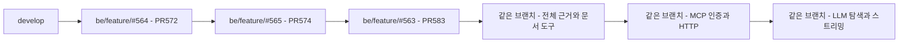
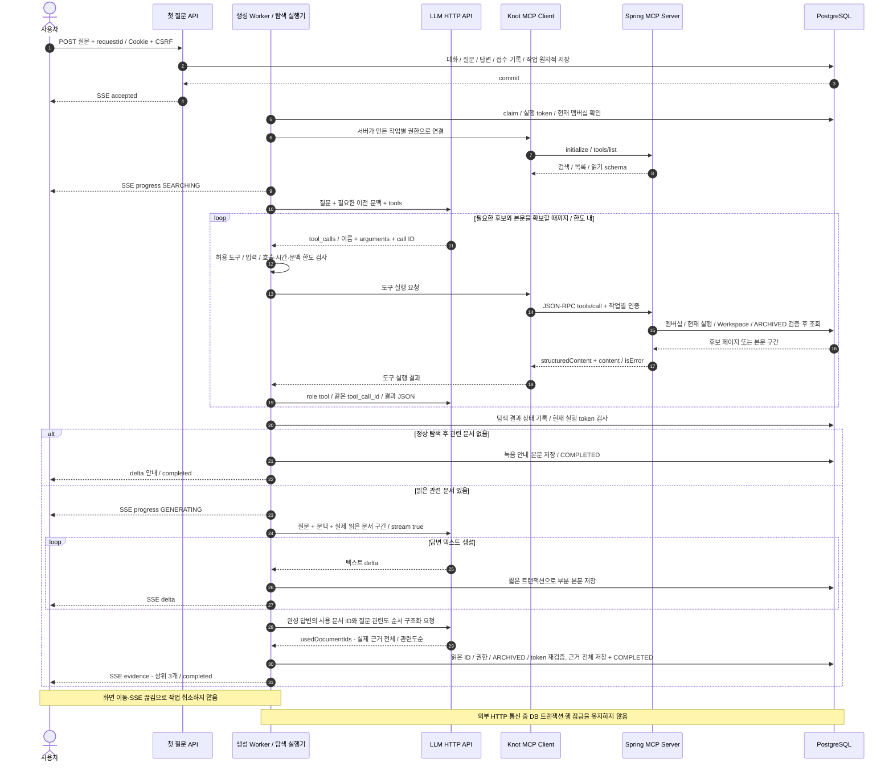
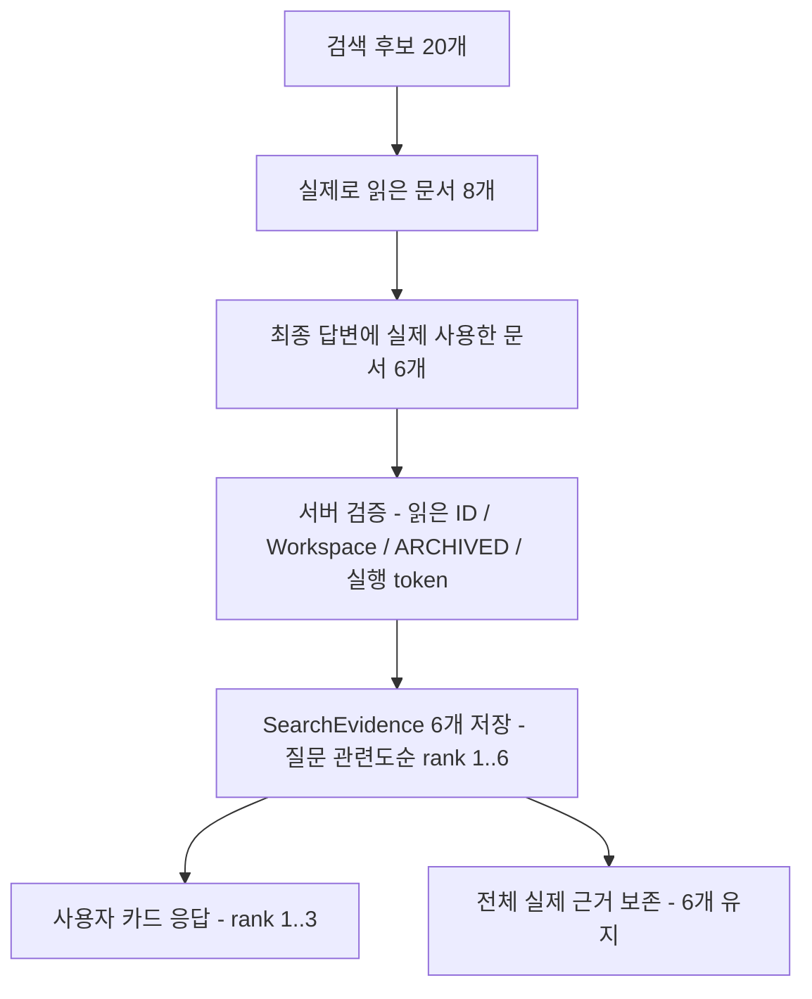

# #563 탐색 Document 도구·MCP·LLM 실행 계획

## 2026-10-12 migration 번호 갱신

#607의 녹음 V44 병합 이후 미병합 탐색 migration은 V45 접수 기록 → V46 답변 실행 → V47 전체 근거 rank → 후속 #568의 V48 선점 전 종료 제약으로 재배치한다. 기존 develop SQL은 유지하고 outOfOrder로 우회하지 않는다. 아래 V43 등은 최초 구현 당시 번호 기록이다. 운영 적용 이력과 모델 의미 품질은 별도 확인 대상이다.

## 2026-10-12 기본 시스템 프롬프트 적용

사용자가 제공한 Knot Search Assistant 프롬프트를 `backend/src/main/resources/prompts/search-answer-system.md`에 등록한다. 이번 지정 프롬프트는 현재 답변의 서로 다른 참조 문서를 최대 3개로 제한한다. 이전 계획의 전체 근거 저장 구조·과거 데이터는 보존하되, 현재 generator는 3개 초과 응답을 거절한다.

모델 응답은 `status`, `decisionState`, `answer`, `evidenceIds`, `clarificationQuestion`의 JSON이다. 서버는 답변 본문을 부분 전달하고 종료 시 JSON·허용 ID를 검증한다. 상태 분류의 사실 정확성은 별도 실제 모델 평가가 필요하며 이번 로컬 검증으로 증명하지 않는다. 별도 근거 metadata 추출 호출은 제거하고 같은 응답의 ID를 사용한다.

## 1. 범위와 브랜치

- 상태: 사용자 승인에 따라 아래 A/B/C를 현재 #563 브랜치에서 TDD로 구현했다. 최초 제안과 실제 결과를 구분하며 아래 최신 결과를 우선한다.
- 확인일: 2026-10-11 KST.
- 연결 Issue: [#563 탐색 첫 질문 접수와 대화 생성](https://github.com/woowacourse-teams/2026-knot/issues/563).
- 연결 API: `POST /api/v1/workspaces/{workspaceId}/search/conversations`.
- 구현 브랜치: `be/feature/#563`, 기존 PR #583의 base는 `be/feature/#565`다. 새 Issue·자식 브랜치는 만들지 않았다.
- 목적: 현재 접수·저장·생성 작업·SSE 기반에 실제 문서 탐색과 답변 생성 adapter를 연결한다. 특정 회의의 결정 찾기와 여러 회의의 변화 종합을 함께 평가한다.

이번 대화에서 사용자가 정한 기준은 다음과 같다. 기존 Notion·Issue의 근거 최대 3개 규칙보다 이번 구현 계획에 우선 적용한다. 팀 원문·Issue까지 변경됐다는 뜻은 아니다.

| 구분 | 이번 계획의 기준 | 상태 |
| --- | --- | --- |
| 탐색 대상 | 현재 Workspace의 `ARCHIVED` Document만 검색·목록·읽기에 포함 | 사용자 확정 |
| 실제 근거 | 답변에 실제 사용한 Document를 모두 보존 | 사용자 확정 |
| 표시 카드 | 실제 사용 근거 중 질문과 관련도가 높은 최대 3개 | 사용자 확정 |
| 문서 내용 | 정리된 주제·제목·요약·본문 사용. Transcript·오디오 직접 검색 제외 | 기존 계약 유지 |
| 검색 방법 | LLM이 검색·목록·읽기 도구를 반복 호출. 도구 뒤의 검색 알고리즘은 교체 가능 | 이번 설계 방향 |
| 색인 제외 수 | DB 직접 탐색에서 count=0. DRAFT·생성 Job 미포함 | 사용자 확정 |

**MCP는 문서를 찾는 알고리즘이 아니다.** 서버가 제공한 검색·목록·읽기를 표준 형식으로 호출하는 통신 경계다. 후보를 제대로 찾는 검색 구현과, 읽은 내용으로 답하는 모델 품질을 각각 검증한다.

### 확인한 근거

캐시는 필요한 본문만 읽었다. 아래 Notion 근거는 캐시에 관측된 수정 시각이며, 10월 11일 운영 Notion 전체를 다시 수집한 결과가 아니다.

| 근거 | 확인한 시점·상태 | 적용 사항·판정 |
| --- | --- | --- |
| `backend/docs/product/current-v2-mvp.md`, `backend/docs/notion-context.md` | 로컬 파일, 2026-10-11 확인 | 제품 기준 우선순위·원문 캐시 적용 범위. 기존 사용자 변경 보존 |
| [탐색 한눈에 보기](https://app.notion.com/p/SEARCH-3ddb4351752281229c7fca3d4fb798d8) | 수정 2026-10-10 08:54 UTC, 수집 09:04 UTC. 첨부/미지원 블록 표시 있음 | 본문 기준 진행·실패·중지·근거 규칙 확인. 이미지 세부 UI를 확인한 것으로 취급하지 않음 |
| [UseCase 탐색](https://app.notion.com/p/UseCase-3e3b4351752280cd9f06edc2ccdff1d8) | 수정 2026-10-10 12:31 UTC, 수집 13:17 UTC | 개인 대화·Workspace 분리·계속 생성·문서 기반 답변. 기존 실제 근거 최대 3개는 이번 사용자 결정과 충돌 |
| [첫 질문 API](https://app.notion.com/p/api-v1-workspaces-workspaceId-search-conversations-3ebb4351752280a39871f288fbc275b6) | 수정 2026-09-30 01:25 UTC, 수집 02:19 UTC | SSE·접수 전/후 실패 규칙. 캐시의 표 내용은 충분하지 않아 사용자가 제공한 API 계약과 #563 본문으로 보완 |
| [SearchEvidence](https://app.notion.com/p/SearchEvidence-872b43517522831aa4ba0158173dae87), [ERDiagram 탐색](https://app.notion.com/p/ERDiagram-3e4b4351752280cd86c7dc92aac63fd1) | 각각 수정 2026-09-23 03:08 UTC / 2026-10-07 10:45 UTC | message/document 복합 키·rank 제약. 기존 1..3 제한을 변경해야 함 |
| [DocumentSearchChunk](https://app.notion.com/p/DocumentSearchChunk-8eab435175228226bd0281f430bffb81) | 수정 2026-09-23 03:08 UTC, 수집 09-30 | 기술 저장 후보. MCP 도입만으로 chunk/vector 테이블을 만들 근거는 없음 |
| [#563](https://github.com/woowacourse-teams/2026-knot/issues/563), [#583](https://github.com/woowacourse-teams/2026-knot/pull/583) | 2026-10-11 원격 조회. #583 OPEN/Draft, base #565 | 접수·작업·SSE 기반은 이 브랜치에 존재. 병합·배포 완료가 아님 |
| [#572](https://github.com/woowacourse-teams/2026-knot/pull/572), [#574](https://github.com/woowacourse-teams/2026-knot/pull/574) | 2026-10-11 원격 조회. 모두 OPEN | #564 목록 → #565 메시지 → #563 접수 의존성 유지 |
| `Document`, `SearchAnswerWorker`, `SearchAnswerExecutionService`, `LmStudioClient` 및 관련 테스트 | 현재 HEAD의 실제 코드 | ARCHIVED 필터·도구 호출 adapter 미연결, 근거 3개 제한, 기존 LLM client는 단일 구조화 응답 |
| [Spring AI 시작 문서](https://docs.spring.io/spring-ai/reference/getting-started.html), [MCP 서버 starter](https://docs.spring.io/spring-ai/reference/api/mcp/mcp-server-boot-starter-docs.html) | 2026-10-11 공식 문서 확인 | Spring AI 2.0 계열의 Boot 4.1 지원 안내. 실제 설치·프로젝트 호환성은 구현 시 검증 |
| [MCP 도구 계약](https://modelcontextprotocol.io/specification/2025-06-18/server/tools), [HTTP transport](https://modelcontextprotocol.io/specification/2025-06-18/basic/transports) | 공식 2025-06-18 명세 확인 | tools/list, tools/call, JSON-RPC, content/structuredContent, HTTP 통신 경계 |

### 실제 브랜치와 PR 단위

후속 사용자 요청은 #563 계획을 구현·커밋·푸시하고 PR을 갱신하는 것이다. 아래 초기 분리 제안 대신 현재 `be/feature/#563`에 A/B/C를 구현하고 기존 PR #583에 포함한다. 부모 #565/#574, 그 부모 #564/#572의 미병합 의존성을 유지한다. 직접 필요한 내부 MCP endpoint와 메시지/SSE 카드 정책 변경도 포함하므로 기본 한 endpoint PR 기준보다 넓은 점을 PR에 명시한다. 후속 질문·재연결·중지·재시도 API는 구현하지 않는다.



최초 계획에서는 A/B/C를 자식 Issue·브랜치로 분리하는 대안을 검토했다. 현재는 사용자 요청 범위를 따라 같은 #563에서 schema·도구·인증·client·탐색·생성·설정·문서의 커밋 경계를 나눴다. 부모 병합 후 PR base를 변경할 때 실제 병합 방식과 고유 diff를 확인한다.

## 2. 구현할 흐름

사용자는 기존 첫 질문 API를 호출한다. 서버가 인증·멤버십·질문·requestId를 검증하고 접수 데이터를 커밋한다. `accepted` 이후 생성 작업이 별도로 실행된다. 모델은 도구 이름과 인자만 제안하고, **Knot 실행기가 그 호출을 검증해 MCP client로 실행한다.** 모델 공급자가 우리 DB나 MCP 서버에 직접 접속하지 않는다.

### 요청부터 답변까지



접수 후 모델·도구 오류나 시간 초과는 기존 부분 본문을 보존하고 `FAILED`로 끝낸다. 실패를 문서 없음으로 바꾸지 않는다. 마지막 근거 검증이 실패한 답변도 본문을 남기되 완료로 확정하지 않는다.

### MCP 도구 3개

모델이 선택할 `workspaceId`, `memberId`, DB SQL 인자는 없다. 현재 작업의 서버 권한에서 범위를 얻는다. `size` 기본 20·최대 100, 읽기 구간 기본 6,000 코드 포인트는 초기 기술 제안이다. 실제 모델 문맥·응답 지연 평가 후 설정으로 조절한다.

| 도구 | 입력 | 결과 | 성공·실패 판단 |
| --- | --- | --- | --- |
| `search_documents` | `query`, 선택 `topic`, `recordedFrom`, `recordedBefore`, `cursor`, `size` | ID·제목·주제·녹음 시점·관련 구간·`contentRevision`, `nextCursor` | 정상 0건과 도구/DB 오류를 구분. 검색 페이지의 후보는 아직 실제 근거가 아님 |
| `list_documents` | 선택 `topic`, `recordedFrom`, `recordedBefore`, `cursor`, `size` | 범위 내 문서 ID·제목·주제·녹음 시점, `nextCursor` | 여러 회의의 기간·주제 목록 확인용. 첫 페이지 밖의 문서도 이어서 열거 |
| `read_document` | `documentId`, 선택 `cursor` | 메타데이터·본문 구간·`contentRevision`, `truncated`, `nextCursor` | 다른 Workspace·DRAFT는 읽기 불가. 긴 본문은 같은 도구로 이어 읽음 |

검색의 추가 탐색은 새 도구를 만들지 않고 `search_documents`에 다른 검색어를 넣는다. 여러 회의 종합은 `list_documents`로 기간·주제의 대상 문서를 확인하고 읽는다. 잘린 구간만 읽었다면 문서 전체를 확인했다고 답하지 않는다.

### 실제 요청·응답 예시

첫 LLM 요청은 native tool calling 지원을 전제로 한다. 가상 도구 실험은 [초기 호스트 기록](563-llm-tools-probe.md), 실제 MCP·DB·Worker·SSE·구조화 metadata 연결은 [실제 모델 평가](../qa/563-search-mcp-live-20261011.md)에 구분해 남겼다. 아래는 wire 형태의 예시이고, 전체 JSON Schema는 실제 tools/list 테스트로 검증했다.

```json
{
  "model": "설정된-도구호출-모델",
  "stream": false,
  "messages": [{"role": "user", "content": "지난주 검색 정책이 왜 바뀌었어?"}],
  "tools": [{"type": "function", "function": {
    "name": "search_documents",
    "description": "현재 작업의 Workspace에서 ARCHIVED 문서를 검색한다",
    "parameters": {
      "type": "object",
      "properties": {"query": {"type": "string"}},
      "required": ["query"],
      "additionalProperties": false
    }
  }}]
}
```

모델 응답은 `finish_reason=tool_calls`, `tool_calls[].id=call_1`, `function.name=search_documents`, `arguments="{\"query\":\"검색 정책\"}"` 형태다. 실행기는 이를 파싱하고 MCP 요청으로 바꾼다.

```http
POST /internal/mcp
Authorization: Bearer <서버가 발급한 작업 범위 인증>
Content-Type: application/json
Accept: application/json, text/event-stream
```

```json
{
  "jsonrpc": "2.0",
  "id": 101,
  "method": "tools/call",
  "params": {"name": "search_documents", "arguments": {"query": "검색 정책"}}
}
```

```json
{
  "jsonrpc": "2.0",
  "id": 101,
  "result": {
    "isError": false,
    "structuredContent": {
      "items": [{"documentId": 42, "title": "검색 정책 회의", "topic": "탐색", "snippet": "근거 보존 정책을 변경하기로 했다"}],
      "nextCursor": null
    },
    "content": [{"type": "text", "text": "{\"items\":[{\"documentId\":42,\"title\":\"검색 정책 회의\",\"topic\":\"탐색\",\"snippet\":\"근거 보존 정책을 변경하기로 했다\"}],\"nextCursor\":null}"}]
  }
}
```

`content`와 `structuredContent`는 같은 결과를 나타낸다. 실행기가 LLM에 둘 다 중복 첨부하지 않는다. JSON-RPC `id=101`과 모델의 `tool_call_id=call_1`은 서로 다른 식별자다. 실행기가 매핑을 유지하고, 모델에 아래 결과와 앞선 assistant tool_calls 메시지를 함께 전달한다.

```json
{
  "role": "tool",
  "tool_call_id": "call_1",
  "content": "{\"items\":[{\"documentId\":42,\"title\":\"검색 정책 회의\",\"topic\":\"탐색\",\"snippet\":\"근거 보존 정책을 변경하기로 했다\"}],\"nextCursor\":null}"
}
```

다음 호출은 `read_document({"documentId":42})`이고, 응답 예시는 아래와 같다. 검색·목록도 실제 계약에서는 시점과 revision 메타데이터를 포함한다.

```json
{
  "document": {
    "documentId": 42,
    "title": "검색 정책 회의",
    "topic": "탐색",
    "recordingStartedAt": "2026-10-08T05:00:00Z",
    "createdAt": "2026-10-08T06:00:00Z",
    "archivedAt": "2026-10-08T06:15:00Z",
    "snippet": "실제 사용 근거를 모두 보존...",
    "contentRevision": "본문-sha256-해시"
  },
  "content": "## 결정\n실제 사용 근거는 모두 보존하고...",
  "offset": 0,
  "truncated": true,
  "nextCursor": "불투명한-다음-구간-커서"
}
```

### 검색 구현의 첫 기준

초기 구현은 PostgreSQL에서 title·topic·summary·content의 안전한 키워드 조회로 시작한다. 입력 검색어를 정규화하고 검색 항목별 일치 점수와 고유 ID로 순서를 고정한다. 바인딩 파라미터와 LIKE 특수문자 처리를 사용하며, 모델이 SQL을 만들게 하지 않는다. 한글 문서 검색에 영어용 full-text 설정을 그대로 쓰지 않는다.

이 방식은 아직 운영 채택이 확정된 검색 품질 해법이 아니다. 동의어·결정 표현 변경·여러 회의 종합 평가에서 필요한 후보를 놓치면 같은 도구 뒤에 hybrid/embedding 검색을 추가한다. MCP 도입 효과와 후보 검색 알고리즘의 효과를 분리해 평가한다. 문서 개수만으로 RAG 필요 여부를 결정하지 않는다.

## 3. 나올 코드와 메서드 초안

### 기존 코드에서 이어갈 책임

| 기존 클래스 | 현재 책임 | 이번 변경 |
| --- | --- | --- |
| `SearchAnswerWorker.execute(answerId)` | claim → retrieve → generate → complete, 접수 후 오류 처리 | 작업 범위·문맥·실행 한도를 adapter에 전달. 검색 실패와 정상 0건 구분 |
| `SearchDocumentRetriever.retrieve(workspaceId, question)` | 검색 경계만 선언됨 | member/answer/token을 포함한 서버 문맥을 입력으로 받도록 변경 |
| `SearchAnswerGenerator.generate(question, documents, onDelta)` | 본문 생성 경계, 사용 ID 목록 반환 | 실제 읽은 구간으로 스트리밍하고 전체 사용 ID를 관련도순 반환 |
| `SearchAnswerExecutionService` | 짧은 저장 트랜잭션, 실행 token·멤버십·최종 상태 검증 | 후보가 아닌 실제 읽은 문서 집합을 검증 기준으로 사용. ARCHIVED 검사와 근거 3개 제한 제거 |
| `SearchMessageListQueryAdapter`, `SearchEvidenceReadJpaRepository` | 메시지의 근거 전체 조회 | 사용자 카드 조회를 답변별 rank 상위 3개로 변경 |
| `SearchAnswerSnapshotService`, `SearchAnswerSseConnection` | 현재 본문·상태·근거에서 SSE 전송 | 같은 카드 조회를 사용해 목록/메시지/SSE의 상위 3개 기준 일치 |
| `Document`, `RecordingSession` | DRAFT/ARCHIVED와 정리 본문, 녹음 startedAt | 읽기 projection에 필요한 필드 사용. 원문·개인 확인 상태 필드는 노출하지 않음 |
| `LmStudioClient.complete` | 공통 구조화 단일 응답, stream=false | 다른 문서 생성 기능에 대한 계약 유지. 탐색용 도구 호출·stream adapter를 별도 구현 |

현재 `DocumentListService`에는 개인 확인 상태 필터가 있다. 탐색 도구의 목록은 Workspace의 ARCHIVED 문서 범위이므로 그 필터를 그대로 가져오지 않는다. 읽기는 `findByWorkspaceIdAndIdForUpdate`를 기본 조회로 사용하지 않는다.

### 제안 코드와 public 메서드

경로는 `backend/src/main/java/com/knot/backend/` 아래다. 클래스 이름은 착수 시 기존 패키지 관례에 맞춰 확정한다. 새로운 HTTP 사용자 API와 Controller를 세 개 더 만들 필요는 없다. MCP adapter가 application 서비스를 호출한다.

| 위치·클래스 후보 | 메서드·입력 → 결과 | 판단·저장 부작용 |
| --- | --- | --- |
| `search/application/SearchDocumentToolService` | `search(scope, searchParameters) → SearchDocumentPage` | 멤버십·실행·필터 검증 후 ARCHIVED 후보 페이지. DB 쓰기 없음 |
| 같은 서비스 | `list(scope, listParameters) → SearchDocumentPage` | 기간·주제의 ARCHIVED 문서 열거. 검색어를 비워 검색하는 계약과 구분 |
| 같은 서비스 | `read(scope, documentId, cursor) → SearchDocumentSlice` | Workspace·상태·revision 확인 후 본문 구간. 없는/범위 밖 문서 정보 노출 방지 |
| `search/application/SearchDocumentQuery`, `search/infrastructure/SearchDocumentQueryAdapter` | `searchPage`, `listPage`, `findSlice` | 서버 범위를 WHERE에 먼저 적용하고 정렬·페이징. JPA projection 또는 기존 query adapter 관례 사용 |
| `search/application/dto/query/SearchDocumentSearchParameters` 등 | `of(...)`, `validate...` | 크기·검색어·시각·커서 검증을 규칙별 메서드로 분리 |
| `search/infrastructure/mcp/SearchDocumentMcpTools` | `searchDocuments`, `listDocuments`, `readDocument` | MCP 입력을 서비스 입력으로 변환. 도구 schema·결과·오류 변환 |
| `search/infrastructure/mcp/SearchMcpClient` | `discoverTools(scope)`, `call(scope, name, arguments) → ToolResult` | 서버 간 인증과 도구 whitelist. 세션/동시 실행 간 범위 공유 금지 |
| `global/config/SearchMcpSecurityConfig`, 인증 resolver | `mcpSecurityFilterChain(...)`, `resolve(authentication) → SearchToolScope` | 내부 경로만 매칭하는 별도 인증. 서명·audience·expiry·현재 실행 token 검사 |
| `search/application/SearchToolScope` | 서버에서만 생성하는 값 타입 | workspace/member/conversation/question/answer/token/searchStartedAt 보유. 모델 인자로 생성하지 않음 |
| `search/infrastructure/llm/SearchLlmClient` | `requestTools(history, schemas, deadline) → ToolTurn`; `streamAnswer(..., onDelta)`; `identifyUsedDocuments(...)` | HTTP wire parsing·모델 응답·시간 제한. 공통 LlmClient 계약에 tool 역할을 억지로 추가하지 않음 |
| `search/infrastructure/SearchAgentDocumentRetriever` | `retrieve(context) → SearchRetrievalResult` | 도구 반복 실행, 후보/읽은 구간/탐색 완료 여부 구분. 직접 대화 메시지 저장 안 함 |
| `search/infrastructure/SearchStreamingAnswerGenerator` | `generate(context, readDocuments, onDelta) → List<Long>` | 읽은 내용에서 답변 생성 후 전체 사용 ID를 질문 관련도순 반환. 근거 최종 저장은 ExecutionService |
| `search/application/SearchConversationContextQuery` | `findBeforeQuestion(scope) → 이전 문맥` | 해당 질문 sequence 이전만 조회. STOPPED 본문 포함, 다른 대화·미래 메시지 제외 |

이미 있는 `SearchAnswerWorkResult`가 작업의 memberId·conversationId·questionId·answerId·token을 보유한다. 이를 이용해 문맥을 만들며 retriever 내부에서 전역 사용자나 ThreadLocal을 추정하지 않는다. Worker의 현재 `candidateLimit=20`은 **대기 작업 claim 수**다. 검색 후보 수나 도구 한도로 재사용하지 않는다.

최종 생성은 세 단계로 제안한다. 탐색에서는 non-stream native tool_calls를 받고, 답변 본문은 stream=true로 생성한다. 본문 종료 뒤 별도 구조화 응답으로 `usedDocumentIds` 전체와 관련도 순서를 얻는다. 도구 호출과 JSON Schema를 한 요청에 동시에 지원한다고 가정하지 않는다. 마지막 metadata 요청까지 시간·토큰 예산에 포함한다.

이 ID 검사로 허용 범위와 실제 읽기 여부는 증명할 수 있다. 모델이 자기보고한 모든 문장이 해당 문서에 의해 뒷받침되는지는 별도 평가가 필요하다. 관련도 순서 역시 모델의 판단이므로 실제 질문으로 카드 품질을 평가한다.

## 4. 저장 기반과 주의할 점

### 근거 전체 보존과 카드 조회 분리



| 모델·조회 | 변경안 | 제약·주의 |
| --- | --- | --- |
| `SearchEvidence.rank` | short → int, 질문 관련도순 1부터 부여 | `rank > 0`, `(message_id, rank)` UNIQUE 유지 |
| `search_evidences` | rank SMALLINT → INTEGER, CHECK 1..3 → 양수 | message/document 복합 PK와 FK 유지. 기존 근거 데이터 유지 |
| `SearchAnswerExecutionService.complete` | used ID의 size<=3 검증 제거 | 중복·null·읽지 않은 ID·범위 밖·DRAFT 거절. 전체 저장과 COMPLETED를 같은 트랜잭션으로 처리 |
| 근거 조회 | 카드 전용 조회에 `rank <= 3` 적용 | 전체 결과에 SQL LIMIT 3을 적용하면 다른 답변 카드가 빠지므로 답변별 제한 |
| 메시지·SSE 응답 `evidences` | 상위 3개 카드 계약 유지 | DB 실제 근거 수와 응답 카드 수를 구분해 API 문서 갱신 |
| Document 읽기 | 별도 영구 chunk/vector 테이블 없이 정리 본문 읽기 | 제목/주제/본문이 현재 JPA 모델에서 updatable=false. 수정·삭제가 영구 불가능하다는 보장은 아님 |

현재 V40은 `rank BETWEEN 1 AND 3`이다. 이미 쓰인 V40을 고치지 않고 후속 ALTER migration을 작성한다. 검색에 쓰지 않은 후보를 근거로 저장하거나, 전체 근거를 저장하기 전에 ID 목록을 3개로 자르는 동작은 허용하지 않는다.

로컬 브랜치에는 V39~V42가 있고 develop의 마지막 파일은 V36이다. 열린 #544에 V37, #545에 V38이 있다. **운영 DB의 Flyway 적용 이력은 이번 계획에서 조회하지 않았다.** 구현 착수 때 최신 develop·관련 열린 PR·검증 DB 적용 이력을 확인해 `V<확정번호>__expand_search_evidence_rank.sql` 번호와 적용 순서를 확정한다. outOfOrder로 번호 충돌을 넘기지 않는다.

### 기간·커서·본문 제한

- 회의 기간은 `RecordingSession.startedAt`을 `recordingStartedAt`으로 반환하고 `[recordedFrom, recordedBefore)` 범위를 적용한다. Document.createdAt은 문서 생성 시각으로 별도 반환한다. 사용자 표현의 시간대는 모델에 현재 KST 기준을 주고 API 인자는 UTC Instant로 검증한다.
- 첫 탐색의 searchStartedAt 이전에 ARCHIVED된 문서만 대상에 둔다. 실행 중 새 문서가 보관돼도 같은 조회의 페이지 범위가 흔들리지 않게 한다. 이는 기술 제안이며 다음 질문에서는 새 문서를 포함한다.
- 검색 커서는 query·필터·정렬·범위·멤버·실행의 fingerprint와 마지막 정렬 키를 묶는다. 목록은 recordingStartedAt DESC, id DESC를 제안한다. 커서 위변조와 다른 질문/필터 재사용을 거절한다.
- 읽기 커서는 문서 ID·범위·contentRevision·다음 코드 포인트 위치를 묶는다. 이모지를 UTF-16 중간에서 자르지 않는다. 내용이 달라지면 명시적 변경 오류로 처리하고 기존/새 본문을 몰래 이어 붙이지 않는다.
- hash는 읽은 버전을 확인하는 응답 메타데이터다. 현재 저장 모델에 실제 Document version 컬럼이 있다고 표현하지 않는다. 원문 인용 구간은 SearchEvidence에 저장하지 않는다.
- 모델 문맥에 실제로 넣은 구간을 기록한다. `truncated=true`와 다음 페이지가 남았는데 전체 기간을 다 확인했다고 답하지 않는다. 종합 답변의 확인 범위를 명시하거나 필요한 추가 페이지를 읽는다.

### 인증과 MCP 경계

Java 25 / Spring Boot 4.1 / MVC에서 `org.springframework.ai:mcp-spring-webmvc:2.0.1`과 `io.modelcontextprotocol.sdk:mcp-json-jackson3:2.0.0`을 고정했다. MCP core는 transitive dependency다. 실제 dependency resolution·Jackson 3 직렬화·enabled agent/worker 기동·MCP HTTP를 검증했다. 전체 starter/BOM을 도입하지 않고 MVC transport와 server SDK만 사용한다. 자동 도구 등록·추가 모델 공급자 설정을 피하고 도구 세 개와 SecurityFilterChain을 명시적으로 구성하기 위해서다. 대안인 전체 starter는 설정·자동 노출 영향이 크고, 프로토콜 서버 전체 수작업은 유지보수 비용이 커서 선택하지 않았다. 기존 브라우저 JWT/CSRF와 공통 LLM client를 교체하지 않는다. 라이브러리 교체 지점은 SearchMcpConfig/Tools이며 도메인·문서 조회 서비스는 SDK 타입을 사용하지 않는다.

MCP는 같은 앱의 `/internal/mcp`에서 stateless Streamable HTTP로 제공한다. 클라이언트는 Java HttpClient로 initialize → notifications/initialized → tools/list → tools/call을 실행하며 JSON-RPC ID를 검증한다. 요청별 HMAC 서명 Bearer에 작업 scope를 묶고 서버가 매 호출 검증한다. SDK client를 설치했다는 의미는 아니다. 세션 ID나 모델 입력에 권한을 의존하지 않는다.

- 기존 브라우저 Cookie·CSRF 인증은 유지한다. MCP 경로에만 우선순위가 높은 서버 간 SecurityFilterChain을 둔다. 그 경로는 브라우저 Cookie만으로 접근할 수 없고 서버가 발급한 작업별 Bearer 인증을 요구한다.
- 인증에는 member/workspace/answer/attempt·audience·expiry를 묶는다. client가 신뢰하는 내부 origin으로만 보낸다. LLM HTTP 요청이나 tool arguments에 인증 값을 넣지 않는다.
- 각 호출에서 현재 멤버십과 실행 token을 다시 검사한다. 같은 모델의 두 병렬 작업에서도 서로 다른 scope가 섞이지 않아야 한다.
- MCP의 세 도구만 명시적으로 등록한다. 다른 `@Tool` 메서드가 자동 노출되지 않도록 tools/list까지 테스트한다.
- 목록/검색의 SQL WHERE 단계에서 범위를 적용한 후 페이징한다. 조회 후 Java에서 범위 밖 문서를 제거하는 구조를 쓰지 않는다.
- 문서의 내용은 자료다. 문서 안의 지시로 다른 도구 실행·범위 변경·인증 노출을 허용하지 않는다.

내부 HTTP 호출을 기다리며 DB 잠금을 잡지 않는다. worker·HTTP client·MCP 처리의 동시 실행 한도를 분리해 같은 앱의 자기 호출로 요청 스레드를 소진하지 않게 한다. public ingress의 내부 경로 노출 여부는 배포 설정에서 확인한다.

### 실행·실패·후속 질문

호출 횟수·도구 결과 크기·전체 문맥 토큰·벽시계 deadline을 별도 설정으로 둔다. 초기 후보는 도구 최대 12회, 읽기 6,000 코드 포인트/회이며 실제 평가에서 조절한다. 이 숫자를 최적값으로 취급하지 않는다. 같은 인자의 반복 호출을 감지하고 결과 없는 반복만으로 한도를 모두 소모하지 않게 한다.

현재 작업 lease 기본값은 150초다. 탐색·스트리밍·사용 근거 metadata 확정의 전체 deadline을 lease보다 짧게 두고 저장 여유를 남긴다. 각 외부 요청 timeout은 남은 deadline 이하로 제한한다. 실행 token이 바뀌거나 종료된 경우 늦은 delta·근거가 저장되지 않도록 기존 검사와 연결한다.

정상 0건은 `NO_RELEVANT_DOCUMENTS`로 명시한다. DB/통신 실패·도구 응답 파싱 실패·예산 소진을 empty list로 바꾸지 않는다. `FAILED`와 오류 code로 구분하고 부분 본문은 남긴다. 이미 읽은 문서만으로 제한된 범위의 종합을 허용할 경우에도 확인 범위를 답변에 명시한다.

이전 문맥은 현재 질문 sequence 이전의 같은 개인 대화에서만 가져온다. STOPPED 부분 답변을 포함하고 FAILED 답변을 정상 사실로 사용하지 않는다. 긴 대화는 예산에 맞춰 제공 범위를 제한하되 사용자 질문을 조용히 다른 의미로 재작성하지 않는다. #566의 후속 질문 API가 구현되기 전에는 실제 후속 API 지원으로 표시하지 않는다.

### 결정 상태와 처리 시점

| 항목 | 상태 | 처리 시점 |
| --- | --- | --- |
| ARCHIVED만 검색 / 실제 근거 전체 / 카드 상위 3개 | 사용자 확정 | A의 계약·migration·조회 테스트에 바로 반영 |
| 질문 2,000 코드 포인트 / requestId 대화 보존 동안 유지 / 기존 SSE 흐름 | 기존 사용자 확정 | 접수 기반의 회귀 조건으로 유지 |
| lexical 검색과 LLM의 근거 관련도 순서 | 구현·두 합성 모델 사례 관측 | 운영 질문 평가에서 누락·카드 관련도·지연 측정. 필요 시 hybrid 보강 |
| 색인 제외 문서 수 | 사용자 확정 count=0 | DRAFT/Job 미포함. API 명세·production retriever 반영 |
| llm-api.knoted.kr의 native tool_calls·stream·구조화 metadata | 실제 DB/MCP/Worker/API 연결 두 사례 COMPLETED | [실제 모델 평가](../qa/563-search-mcp-live-20261011.md) 참조. 일반 품질 보장은 아님 |
| STOPPED 부분 답변의 실제 근거 확정 | 후속 #568 연계 필요 | metadata 요청 전 중단되는 경합을 #568 계획에 포함. 부분 답변에서 사용한 근거를 확정하는 추가 처리 필요 |
| #567 재연결 / #569 재시도 API | 이번 계획의 구현 완료 대상 아님 | 도구 상태·현재 token·상위 3개 조회를 각 후속 API에 연결 |

## 5. TDD와 검증 순서

각 단계는 **실패하는 테스트 → 최소 구현 → 해당 테스트 통과** 순서다. 메서드를 먼저 다 만들고 테스트를 뒤에 맞추지 않는다. 실제 구현 시작 시 `npx ph workflow implement`와 Persona profile을 읽고, 종료 시 implementation/review report와 finish rail을 수행한다. 계획 단계에서는 이 workflow를 실행하지 않는다.

개발 전 작은 계약 실험으로 설정된 호스트/모델의 native tool_calls → tool 결과 전달 → 후속 응답과 stream 지원을 먼저 확인한다. 현재 qwen3.8-27b의 가상 도구 단일 사이클은 확인했으므로 같은 조건의 실험을 이유 없이 반복하지 않는다. 모델·호스트가 바뀌면 다시 확인한다. 실패하면 모델·공급자 경계를 조정하고, JSON 텍스트를 원시 도구 호출인 것처럼 처리하지 않는다. 이 실험은 아래 parser의 실패 테스트나 실제 MCP 통합 테스트를 대신하지 않는다.

1. **`SearchEvidence.create`와 저장 제약.** rank 4를 저장하는 성공 테스트, rank 0·중복 document/rank 실패 테스트부터 쓴다. Entity/row 타입과 후속 migration을 변경한다. 기존 rank 1..3 데이터도 유지되는지 PostgreSQL에서 확인한다.
2. **카드 조회.** 근거 6개인 답변 두 개를 조회해 각각 rank 1..3이 나오는 실패 테스트를 만든다. 실제 근거 12행은 남아 있고 메시지/SSE snapshot에는 각 3개만 나와야 한다. 전체 LIMIT 3 오류를 잡는다.
3. **`list`.** 현재 Workspace ARCHIVED만 기간·주제별로 조회하는 테스트를 쓴다. DRAFT·다른 Workspace·범위 밖 시각을 제외하고 다음 페이지가 누락/중복되지 않아야 한다. 기본값·최대값·시각 역전·변조 커서도 실패시킨다.
4. **`search`.** 제목/주제/본문의 한글 키워드로 원하는 후보가 잡히는 테스트를 쓴다. 검색어 변경·동점 정렬·빈 검색어·LIKE 특수문자·기간/주제 필터와 pagination을 검증한다. 정상 0건과 DB 실패의 결과 타입을 다르게 만든다.
5. **`read`.** ARCHIVED 본문 첫 구간과 이어 읽기 테스트를 쓴다. 이모지 경계·잘림 여부·다른 문서 커서·revision 변경·DRAFT·범위 밖·없는 ID·멤버 탈퇴를 실패시킨다. 단순 조회에 행 잠금을 쓰지 않는다.
6. **MCP 도구 wire 계약.** 실제 서버의 initialize/tools/list/tools/call 테스트를 쓴다. 도구가 정확히 세 개이고 검색/목록/읽기의 schema·structuredContent·content·isError가 일치해야 한다. SDK 버전·transport·경로를 여기서 고정한다.
7. **MCP 인증.** 서버 발급 scope로 성공, 인증 없음/만료/audience 불일치/다른 실행 token/브라우저 Cookie만으로 실패하는 테스트를 만든다. 두 member/workspace 병렬 호출이 섞이지 않는 실제 Security+HTTP 테스트를 포함한다.
8. **LLM tool_calls wire parsing.** 제어 HTTP 서버에서 call ID·arguments를 반환해 올바른 도구 호출과 tool 응답 메시지를 만드는 테스트를 쓴다. unknown tool·잘못된 JSON·허용하지 않은 scope 인자·provider 오류는 실패해야 한다. 이후 실제 호스트에 동일 최소 요청으로 지원 여부를 관측한다.
9. **탐색 반복.** search → read → 추가 search/list → read 흐름의 테스트를 만든다. 제목 후보만 있고 읽지 않은 문서를 답변 입력으로 넘기지 않아야 한다. 반복 호출·시간/토큰 한도·남은 페이지·부분 읽기와 실제 0건을 구분한다.
10. **후속 문맥.** 같은 대화의 현재 질문 이전 메시지만 전달하는 테스트를 쓴다. 다른 Member/Workspace와 미래 sequence를 제외하고 STOPPED 본문을 포함한다. 첫 질문은 이전 문맥이 없어도 성공해야 한다.
11. **최종 답변 stream adapter.** 실제 chunked HTTP fixture로 여러 delta가 순서대로 저장되는 테스트를 쓴다. 중간 끊김·timeout·malformed SSE는 FAILED이며 부분 본문을 남긴다. 최종 used ID metadata 실패도 완료로 처리하지 않는다.
12. **실제 근거 저장.** 사용 ID 4개 이상, 순서 변경, 중복·읽지 않은 ID·DRAFT/권한 변경·과거 token을 검증한다. 전체 근거 저장과 COMPLETED가 원자적으로 성공하거나 rollback돼야 한다. 카드만 관련도 상위 3개다.
13. **기존 #563 흐름 연결.** accepted가 먼저 전송되고 연결이 끊겨도 작업이 완료되는 인수 테스트를 쓴다. 정상 0건은 안내 COMPLETED, 도구 오류는 FAILED, 최초 실패 목록 숨김과 멱등성은 유지한다. 실제 bean/config가 준비되기 전 availability를 켜지 않는다.
14. **실제 질문 품질 평가.** 사람이 정답 문서·결정·시점을 지정한 평가셋으로 특정 회의와 여러 회의 종합을 동일 비중으로 실행한다. 후보 발견·읽은 범위·근거 연결·상위 3개 카드·답변 충실도·지연/비용을 기록한다. 후보를 못 찾는 문제와 읽고도 잘못 답하는 문제를 구분해 보강한다.

### 검증 범위

테스트 파일은 모두 실제 설정대로 `src/test/java` 아래에 두고 integration/acceptance tag로 나눈다. 별도 `src/integrationTest` source set이 있는 것으로 가정하지 않는다.

| 테스트 위치·방식 | 주요 시나리오 | 증명하는 결과 |
| --- | --- | --- |
| `search/domain/SearchEvidenceTest`, Mockito 서비스 테스트 | rank·필터·typed 오류·tool loop·LLM 입력 | 자바 판단과 호출 관계. 실제 DB 제약/잠금/호스트 지원 증거는 아님 |
| `SearchEvidenceStorageIntegrationTest` | 4개 이상 근거, 양수/UNIQUE/FK, migration | PostgreSQL/Testcontainers의 실제 제약·데이터 보존 |
| `SearchMessageListQueryIntegrationTest`, `SearchMessageListSnapshotIntegrationTest` | 답변별 카드 상위 3개·개인 대화 범위 | DB 조회와 snapshot 일관성 |
| 새 `SearchDocumentQueryIntegrationTest` | ARCHIVED·기간·키워드·정렬·cursor·Unicode 읽기 | 실제 PostgreSQL query 결과. 검색 품질 일반화 증거는 아님 |
| 새 MCP Security/HTTP integration 테스트 | tools/list·tools/call·인증·병렬 scope | 설치한 SDK와 실제 서버 wire·인증 경계 |
| 새 탐색 LLM HTTP client 테스트 | tool_calls·tool role·stream delta·metadata·timeout | 제어 서버와 통신하는 parser/adapter 동작 |
| `SearchAnswerExecutionIntegrationTest`, 첫 질문 인수 테스트 | commit 후 accepted·disconnect·failure·late token·전체 근거 | 현재 접수 API와 저장/작업 연동 |
| 실제 모델 평가 | 결정 찾기·변화 종합·관련도 3개·동의어·없음 | 해당 호스트/모델/데이터에서 관측한 품질과 비용 |

기존 테스트의 public 메서드 규칙과 한국어 DisplayName을 따른다. Mockito를 기본으로 사용하고, database race를 Mockito 결과로 주장하지 않는다. production/test 모두 삼항·else·긴 검증 조건을 피하고 의미별 메서드로 분리한다.

### 실행할 명령과 커밋 경계

아래 Gradle task는 실제 build.gradle에서 확인했다. 구현 중에는 바뀐 테스트만 실행했고, 마지막 `spotlessCheck check bootJar` 전체 검증도 통과했다. 최초 계획 당시에는 실행 예정이었다.

```bash
# backend에서, 각 단계의 실제 클래스명으로 범위를 좁혀 실행
./gradlew test --tests 'com.knot.backend.search.*' --console=plain
./gradlew integrationTest --tests 'com.knot.backend.search.*' --console=plain
./gradlew acceptanceTest --tests 'com.knot.backend.search.*' --console=plain

# 공통 영향 검증과 종료 gate
./gradlew spotlessCheck check bootJar --console=plain
git diff --check
npx ph workflow finish implement
```

커밋은 parent Issue 전체가 아니라 공개 동작 또는 schema/adapter별로 나눈다. 예를 들어 `test: 문서 목록의 ARCHIVED 범위 검증` → `feat: 탐색 문서 목록 조회`, 이어서 검색·읽기도 각 동작별로 나눈다. 근거 migration·카드 query·MCP 인증·LLM tool parsing·streaming·설정·문서는 별도 경계다. 실패 테스트의 단독 커밋은 빌드와 프로젝트 커밋 규칙을 확인해 결정하며, refactor는 통과 후 실제 개선이 필요할 때만 만든다.

## 6. 완료 기준과 다음 작업

- 현재 Workspace 멤버인 작업만 ARCHIVED 문서를 세 도구로 검색·열거·이어 읽을 수 있다.
- 실제 Java/Spring MCP 서버가 세 도구만 공개하고, 요청별 권한과 병렬 scope 분리를 실제 HTTP에서 검증했다.
- 실제 모델이 native tool_calls로 후보를 고르고 본문을 읽는 흐름을 관측했다. 제어 fixture 성공으로 모델 지원을 대체하지 않는다.
- 실제 읽은 문서로 답변을 스트리밍하고 전체 사용 근거를 저장한다. 사용자 카드에는 그중 질문 관련도 상위 3개가 보인다.
- 실패·예산 소진·권한 변경을 문서 없음으로 답하지 않는다. 기존 부분 본문 보존·실행 token·SSE disconnect 규칙이 유지된다.
- 제외 수 0·DRAFT/Job 미포함을 확정했고 실제 근거 전체 저장·최대 3개 카드 반환을 API 문서에 반영했다. 원격 Issue/Notion 본문은 이번 요청에서 수정하지 않았다.
- 실제 질문 평가에서 특정 회의 찾기와 여러 회의 종합의 후보 누락·답변 오류·관련도 카드·지연/비용을 확인한다. 수치 기준은 평가셋 실행 전 기록한다.

실행한 순서는 **모델 도구 호출 실험 → 근거 저장·카드 조회 테스트 → 문서 도구 세 개 → MCP 통신·권한 → 탐색 반복·스트리밍 → 실제 API 연결·두 합성 사례 평가**다. #566 후속 질문, #567 재연결, #568 중지, #569 재시도는 기존 계획에 맞춰 이어간다.

최초 계획은 제안이었고 이후 사용자 구현 요청으로 같은 #563에서 실행했다. V43에서 실제 근거 rank를 양수 INTEGER로 확장하고 원래 V40은 수정하지 않았다. PostgreSQL 테스트 DB에 migration을 적용했으며 운영 DB 적용 이력은 미관측이다.

## 7. 실제 구현과 활성화

- 문서 도구: `SearchDocumentToolService` / `SearchDocumentQueryAdapter`. 제목 8·주제 4·요약 2·본문 1의 keyword 점수, 날짜/id keyset, signed cursor, 검색어 주변 200 코드 포인트 snippet, 본문 6,000 코드 포인트 이어 읽기, revision 변경 오류.
- MCP: `SearchMcpConfig`, `SearchMcpAuthenticationFilter`, `SearchMcpTools`, `SearchMcpClient`, `SearchToolTokenCodec`. 병렬 두 Workspace 실제 HTTP에서 scope 분리를 검증했다.
- 탐색/답변: `SearchMcpDocumentRetriever`, `SearchExploration`, `SearchLlmClient`, `SearchStreamingAnswerGenerator`. 실제 읽은 구간만 답변에 제공하고, 중복 호출·12회 한도·48,000 문자 문맥·120초 전체 예산을 적용한다. 토큰 수 추정값이 아니라 문자 수 제한이다.
- 과거 문맥: `SearchHistoryQuery`가 질문 이전의 COMPLETED/STOPPED 질문·답변 쌍 최대 20개 메시지를 제공한다. FAILED와 미래 메시지는 제외한다.
- HTTP: `SearchAgentHttp`가 본문 크기와 응답 헤더 이후의 정지까지 전체 deadline으로 제한한다. redirect로 인증을 전달하지 않는다.
- 활성화 환경: `SEARCH_WORKER_ENABLED=true`, `SEARCH_AGENT_ENABLED=true`, `LLM_ENABLED=true`, 기존 `LLM_BASE_URL`·`LLM_MODEL`·`LLM_API_TOKEN`, 최소 32자 `SEARCH_MCP_SIGNING_KEY`, 실제 자기 앱 주소 `SEARCH_MCP_BASE_URL`. 키·토큰은 문서/모델 입력에 넣지 않는다. 기본 설정은 비활성이며 환경 설정 변경 후 기동 검증이 필요하다.
- 선택 설정: `SEARCH_AGENT_BUDGET=PT120S`, `SEARCH_TOOL_CALL_LIMIT=12`, `SEARCH_READ_CODE_POINTS=6000`, `SEARCH_CONTEXT_CHARACTER_LIMIT=48000`. 실행 예산은 worker lease보다 짧아야 한다. 테스트 서버에서 활성 adapter/worker 기동 순환 의존을 회귀 테스트로 수정했다.
- 제어된 LLM HTTP/MCP 테스트와 실제 모델 평가를 구분한다. 실제 모델은 두 합성 사례만 검증했으며 운영 데이터·배포·폭넓은 평가셋은 미관측이다.
- 전체 검증: Java 25에서 `./gradlew spotlessCheck check bootJar --console=plain` PASS. 단위 1,033·통합 488·인수 477, 총 1,998개 실패·오류·skip 0. 외부 모델 수동 평가 2건은 이 수와 별도다. Governance 단위 8개·PR #583 규칙·git diff --check도 통과했다.
