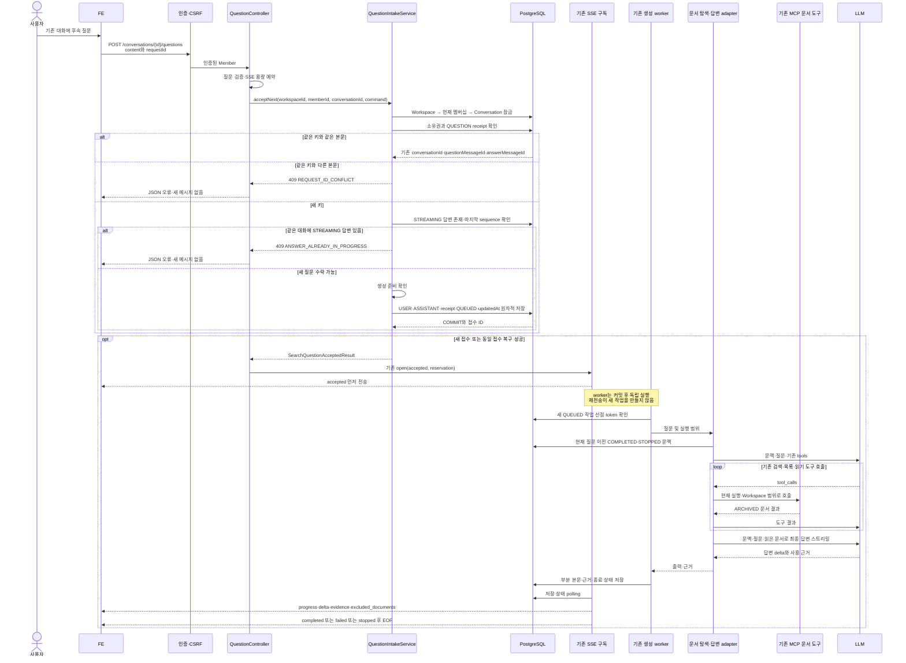

# #566 기존 탐색 대화 질문 접수와 답변 생성 구현 계획

## 2026-10-12 부모 migration 정합성 갱신

#607은 develop `a72b4fa5`에 병합됐다. 녹음 V44를 유지하고 미병합 탐색 migration을 V45 접수·V46 실행·V47 근거 rank·V48 선점 전 중지 제약으로 재배치하여 파일 버전 중복과 V44 적용 DB의 낮은 미적용 버전 문제를 해소했다. PostgreSQL V44→V48 업그레이드와 기존 답변 보존 검증이 통과했다. 아래 V44 충돌 언급은 구현 당시 기록이다. 운영 DB 적용 이력 확인은 이 로컬 검증과 구분하며 outOfOrder는 사용하지 않는다.

## 1. 범위와 브랜치

- 상태: 2026-10-12 승인 계획의 로컬 TDD 구현·제품 검증 완료. 결과는 아래 구현 관측 절에 별도 기록한다. 운영 배포·Persona 전역 인증과 구분한다.
- 확인일: 2026-10-11, Asia/Seoul.
- Issue: [#566 기존 탐색 대화 질문 접수와 답변 생성 API 구현](https://github.com/woowacourse-teams/2026-knot/issues/566). OPEN, 담당자 jyt6640, BE·Feature·흑곰. 메모에 ADR 예정 경로 없음.
- API: `POST /api/v1/workspaces/{workspaceId}/search/conversations/{conversationId}/questions`.
- 목표: 기존 개인 대화에 질문·답변 한 쌍을 추가하고, 완료·중지된 이전 대화 문맥을 사용해 답변을 생성한다. 동시 질문은 하나만 새로 접수하고 동일 요청의 재전송은 기존 접수로 복구한다.
- 선행 기반: #563의 접수·생성 작업·MCP·LLM·SSE, #567의 재연결, #568의 명시적 중지와 늦은 저장 차단을 재사용한다.
- 후속 범위: FAILED 답변 ID를 재사용하는 재시도는 #569다. 새로운 검색 알고리즘·문서 도구·녹음 제어·문맥 요약 기능을 추가하지 않는다.

### 브랜치와 PR 제안

계획 당시 `be/feature/#568`과 [Draft PR #608](https://github.com/woowacourse-teams/2026-knot/pull/608)의 HEAD는 `ce3d40e8`이었다. 시스템 프롬프트 변경을 이어받은 `a63f254e198d16fe25a19a53d840c16ba434fcfc`에서 2026-10-12 `be/feature/#566`을 분기했다. 부모는 `be/feature/#568`이며 개발 변경은 아직 커밋·push하지 않았다.

```text
be/feature/#563  ← Draft PR #583
    └─ be/feature/#567  ← Draft PR #604
          └─ be/feature/#568  ← Draft PR #608
                └─ be/feature/#566  ← 다음 구현 브랜치 제안
```

개발을 시작할 때 아래 순서로 분기한다. 이번 계획 단계에서는 브랜치를 생성하거나 전환하지 않는다.

```bash
git fetch origin
git switch 'be/feature/#568'
git switch -c 'be/feature/#566'
```

분기 전에 #568의 로컬·원격 일치를 다시 확인한다. 부모에 새 커밋이 생겼다면 그 변경을 확인하고 기준을 갱신한다. 사용자 소유의 `backend/docs/notion-api-alignment.md`, `backend/docs/product/current-v2-mvp.md`, 미추적 `backend/docs/implement-plan/563-search-v2-roadmap.md`는 보존하고 #566 커밋에 포함하지 않는다. 이번 계획 파일은 #566 문서 변경으로 가져간다.

후속 PR은 `base=be/feature/#568`, `head=be/feature/#566`, Draft로 제안한다. 제목은 Issue와 같은 `[BE] 기존 탐색 대화 질문 접수와 답변 생성 API 구현`이다. 담당자·라벨은 현재 Issue를 따른다. 실제 commit·push·PR 게시와 `Closes #566`은 해당 작업 요청에서 판정한다. 부모 병합 없이 #566만의 diff를 리뷰할 수 있다.

현재 `origin/develop`을 fetch해 확인한 SHA는 `65501549cacdf996ee23de7bf87a20040d9c77f1`이다. V2 search 패키지는 없고 migration은 V38까지다. #568의 선행 탐색 구현은 열린 PR 스택에 있으며 develop 병합·운영 배포 완료로 취급하지 않는다.

**병합 시 주의:** #568의 `V44__allow_unclaimed_search_execution_finish.sql`과 열린 [녹음 PR #607](https://github.com/woowacourse-teams/2026-knot/pull/607)의 `V44__add_max_duration_to_recording_end_reason.sql`이 번호를 공유한다. #566에 새 migration은 필요하지 않지만 두 스택의 develop 통합 전에는 적용 이력을 확인하고 충돌을 해소해야 한다. 기존 적용 migration의 이름·checksum을 임의로 바꾸거나 outOfOrder로 우회하지 않는다. 이 계획에서 부모·녹음 PR을 수정하지 않는다.

### 선별한 근거

| 출처·확인 시점 | 적용하는 사실 | 판정 |
| --- | --- | --- |
| [Issue #566](https://github.com/woowacourse-teams/2026-knot/issues/566), 10/11 조회 | 권한, 동시 접수, 멱등 확인 우선, STOPPED 문맥, SSE·실패·녹음 보존 | 현재 작업 계약. 메모 없음 |
| [후속 질문 API](https://app.notion.com/p/api-v1-workspaces-workspaceId-search-conversations-conversationId-questions-3ebb43517522802aac84d2f42e968ffe) | 기존 대화의 질문·답변 저장, 첫 질문과 같은 SSE, 접수 전/후 실패 구분 | 사본: 본문·속성 revision 9/30 01:25 UTC, capture 9/30 02:19 UTC, hash `85a2a224`, POST·검색·흑곰·구현 NO. 표 누락은 사용자 제공 전문과 Issue로 보완 |
| [첫 질문 API](https://app.notion.com/p/api-v1-workspaces-workspaceId-search-conversations-3ebb4351752280a39871f288fbc275b6) | accepted/progress/delta/evidence/excluded_documents 및 종료 이벤트 payload | 사본: 본문·속성 revision 10/11 09:59 UTC, capture 10/11 10:26 UTC, hash `59bd4030`. POST 사본이며 GET 목록 사본과 구분 |
| [도메인 규칙 및 UseCase](https://app.notion.com/p/UseCase-3e3b4351752280cd9f06edc2ccdff1d8), 탐색 절 | Workspace·Member 개인 범위, 같은 대화 생성 중 제한, 중지 문맥, 생성·녹음 지속 | 사본: 본문·속성 revision 10/10 12:31 UTC, capture 10/10 13:17 UTC, hash `94e2bc2b` |
| [ERDiagram](https://app.notion.com/p/ERDiagram-3e4b4351752280cd86c7dc92aac63fd1), 탐색 절 | 대화별 sequence UNIQUE, 역할·상태, 본문·근거 관계 | 사본: 본문·속성 revision 10/7 10:45 UTC, capture 10/7 13:07 UTC, hash `f4aa1c8e`. receipt·execution은 실제 코드의 추가 기반 |
| [탐색 · 질문하고 답 받기](https://app.notion.com/p/3edb4351752281b2b973f1190485efd4) | 같은 대화만 생성 중 제한, 중지한 부분 본문 사용, 화면 이탈에도 생성 유지 | 사본: 본문·속성 revision 10/10 08:30 UTC, capture 10/10 09:04 UTC, hash `4c77d66c`. 개발 중 표시는 완료 증거가 아님 |
| [탐색 한눈에 보기](https://app.notion.com/p/SEARCH-3ddb4351752281229c7fca3d4fb798d8) | 접수 전 오류의 입력 복원, 자동 재전송 없음, 현재 API 우선 | 사본: revision 10/10 08:54 UTC, capture 09:04 UTC, hash `afd5c3fb`. 첨부/지원하지 않는 블록 누락. 이미지·Figma는 미확인 |
| 사용자 확정 결정 및 [첫 질문 구현 계약](../api/search-conversation-create.md) | 2,000 코드 포인트, 원문 그대로 저장, 대화와 멱등 기록 함께 보존, ARCHIVED만 검색, count=0, 실제 근거 전체 저장·관련도 높은 카드 3개 | 후속 결정 적용. 과거 원문의 색인·근거 3개 저장 제한과 구분. 팀 원문 동기화·팀 승인으로 표현하지 않음 |
| #568의 intake/receipt/worker/SSE/history 실제 코드, V39~V44, 열린 탐색 PR 목록 | 기존 흐름과 스키마를 재사용할 수 있으나 후속 접수 메서드·route·receipt 조회는 없음 | 브랜치 구현 관측. #566 구현 완료가 아님 |
| [현재 V2 기준](../product/current-v2-mvp.md), Notion 정합성 지침, backend Notion 진입점, Persona profile·개발 지침 | 출처 우선순위, 캐시 freshness, Java 25·Spring Boot 4.1·JPA·PostgreSQL·Flyway·TDD | 저장소·로컬 개발 기준 |

선택한 원문 본문·관련 DB 속성과 manifest의 revision/status를 확인했다. 원격 Notion을 지금 재조회한 결과는 아니다. 한눈에 보기의 누락은 텍스트 API·요구사항으로 보완하며 원문 이미지 검토를 주장하지 않는다. 원격 queue 상태 변경은 이번 계획 범위가 아니다.

### 예상 변경량

부모 #568 대비 additions+deletions의 **구현 전 추정**이다. 기존 파일 전체 길이나 선행 PR diff는 포함하지 않는다.

| 범위 | 예상 줄 수 | 근거 |
| --- | ---: | --- |
| Production | 320~500 | acceptNext와 검증·저장, receipt factory, Repository 조회 3개, Controller/API 메서드, 409 코드. 기존 DTO·worker·SSE·LLM/MCP 재사용 |
| 테스트 | 1,000~1,450 | 실제 DB 순서·멱등·rollback·경합, 실제 HTTP·Security·SSE, STOPPED 후속 질문과 문맥 전달 |
| migration | 0 | QUESTION·target_id·sequence·execution 테이블이 이미 있음 |
| 문서 | 350~420 | 현재 계획 288줄과 구현 후 작성할 후속 질문 API 명세 |
| 전체 | **1,670~2,370** | 코드만 1,320~1,950줄. 테스트 fixture·SSE 도우미 재사용 정도에 따라 변동 |

읽은 기존 intake는 164줄, Controller 73줄, receipt 84줄, Repository adapter 111줄, history query 68줄이다. 기존 첫 질문 DB 통합 테스트는 329줄, HTTP 인수 테스트는 767줄이다. #568에서 새로 만든 공급자 취소 구현과 그 대규모 테스트를 다시 추가하지 않는다. API 하나로 계획하되 실제 전체 diff가 약 2,000줄을 넘으면 관련 없는 중복 테스트·보조 코드부터 검토한다. 테스트를 약화하거나 선행 변경을 섞어 크기를 맞추지 않는다. 필요한 분리는 실제 diff를 확인한 뒤 결정한다.

## 2. 구현할 흐름

### 사용자가 보는 동작

기존 대화의 답변이 끝나거나 사용자가 중지한 뒤 새 질문을 보낸다. FE는 JSON `{content, requestId}`와 access cookie·CSRF를 사용하고 응답을 fetch 스트림으로 읽는다. 서버는 인증과 현재 멤버십·소유권을 확인한다. 잘못된 접수는 일반 JSON HTTP 오류이며, 새 메시지를 남기지 않는다.

접수 서비스의 순서는 **권한 → 기존 receipt → 같은 대화 STREAMING 여부 → 생성 준비 → 새 질문 저장**이다. 같은 receipt와 같은 원문이면 답변 생성 중이어도 기존 ID를 반환한다. 같은 키의 다른 본문은 REQUEST_ID_CONFLICT다. 새로운 requestId만 진행 중 검사 대상이다. 원문 비교에는 trim·공백 정규화·hash 단독 비교를 사용하지 않는다.

새 접수는 마지막 메시지 순서 다음의 USER RECEIVED와 ASSISTANT STREAMING, QUESTION receipt와 QUEUED 작업을 한 트랜잭션으로 저장한다. 기존 대화의 createdAt은 유지하고 updatedAt만 접수 활동 시각으로 갱신한다. 커밋 후 accepted가 첫 SSE 이벤트다. 생성 worker는 SSE 연결과 별도로 실행한다.



예를 들어 sequence 1 질문·2 STOPPED 답변 다음에는 sequence 3 질문·4 STREAMING 답변이 생긴다. 생성 문맥에는 1·2가 포함되고 3의 현재 질문은 별도로 전달한다. 4의 생성 중 본문이나 다른 대화는 포함하지 않는다. 이전 답변이 COMPLETED 또는 FAILED여도 새 질문은 새 USER·ASSISTANT를 만든다. FAILED의 기존 답변을 덮어쓰는 동작은 #569다.

### 재전송·실패·중지

- 접수 키는 `(workspaceId, memberId, QUESTION, conversationId, requestId)`다. 첫 질문의 FIRST_QUESTION/target=0 및 다른 대화의 QUESTION 접수와 분리한다.
- 재전송 SSE는 기존 accepted ID 뒤 **현재 저장된 본문을 delta로 다시 전송**하고 이후 추가분만 전송한다. 이미 종료됐다면 본문·근거·종료 이벤트 후 닫는다. 새 snapshot 이벤트를 POST에 추가하지 않는다. FE는 accepted에서 해당 응답의 답변 버퍼를 교체해야 하며 기존 본문에 무조건 append하면 중복된다.
- 다른 요청의 생성 중 거절은 409 ANSWER_ALREADY_IN_PROGRESS다. QUEUED 단계의 ASSISTANT도 STREAMING이므로 새 질문을 막는다. 작업이 RUNNING인지로만 검사하지 않는다.
- accepted 이후 오류는 기존 failed SSE와 FAILED 저장으로 전달하고 USER를 남긴다. 이후 답변 실패 때문에 이전 성공 대화를 목록에서 숨기지 않는다. 숨김 여부는 첫 답변 규칙을 유지한다.
- 연결을 끊어도 worker는 계속 실행한다. #568 stop은 현재 답변만 종료하며 다음 질문은 별도 answerId·token으로 생성한다. 이전 작업의 늦은 저장·통신 취소가 새 작업에 적용되면 안 된다.
- 기록·문맥·권한의 범위는 현재 Workspace와 본인 대화다. 녹음 세션은 변경하지 않는다.

### 오류 계약

| 상황 | HTTP·code | 저장 결과 |
| --- | --- | --- |
| 공백·필수값 누락·UUID 형식·2,000 코드 포인트 초과 | 400 VALIDATION_ERROR | 신규 접수 0 |
| malformed JSON·문자열 대신 숫자/객체 등 | 기존 공통 400 INVALID_REQUEST_BODY | 신규 접수 0 |
| 경로 타입 오류·양수 범위 오류 | 400 INVALID_PARAMETER | 신규 접수 0 |
| 유효 CSRF를 제공했으나 access cookie 없음 | 401 UNAUTHENTICATED | 신규 접수 0 |
| CSRF 누락·불일치 | 기존 Security 403 FORBIDDEN | 신규 접수 0 |
| 현재 멤버 아님·삭제된 Workspace·다른 소유자/Workspace 대화 | 403 SEARCH_ACCESS_DENIED | 신규 접수 0 |
| 현재 멤버이며 conversationId가 없음 | 404 CONVERSATION_NOT_FOUND | 신규 접수 0 |
| 동일 키·다른 원문 | 409 REQUEST_ID_CONFLICT | 기존 접수만 보존 |
| 새 키·같은 대화 STREAMING 존재 | 409 ANSWER_ALREADY_IN_PROGRESS | 기존 접수만 보존 |
| 신규 접수의 worker/adapter 준비 안 됨·SSE 예약 불가 | 500 ANSWER_GENERATION_UNAVAILABLE | 신규 접수 0 |
| 접수 저장 실패 | 기존 500 INTERNAL_SERVER_ERROR | 전체 rollback |
| 접수 후 생성 실패/시간 초과 | HTTP 200 스트림의 failed | USER·부분 본문·FAILED/code 보존 |

잘못된 JSON과 CSRF의 공통 오류는 기존 첫 질문 구현 계약을 따른다. 인증과 CSRF가 모두 빠진 요청의 우선 응답은 실제 Security 필터로 확인한다. 존재 확인은 멤버십 검사 뒤, 소유 범위 검사는 대화 조회 뒤에 수행하는 제안이다. 같은 대화의 정상 동시 접수는 잠금 안의 판단으로 409를 결정한다. 기존 SSE 예약과 executor 용량은 운영 자원 제한이며 새 Member×Workspace 단일 생성 제품 규칙으로 확대하지 않는다.

## 3. 나올 코드와 메서드 초안

### 현재 코드에서 재사용할 책임

| 기존 코드 | 관측한 책임 | #566 적용 |
| --- | --- | --- |
| `SearchQuestionCommand`, `SearchQuestionRequest`, `SearchQuestionText` | JSON 문자열·엄격한 UUID·공백·2,000 코드 포인트 검증 | 그대로 재사용. 후속 질문 전용 Request/Command를 복제하지 않음 |
| `SearchQuestionIntakeService.acceptFirst` | Workspace/멤버십 잠금, FIRST receipt 복구, 첫 쌍·작업 원자적 저장 | 기존 계약 유지. 같은 클래스에 독립 public acceptNext 추가 |
| `SearchRepositoryAdapter.findConversationForUpdate` | 대화 비관적 잠금 후 refresh | 접수 경쟁을 직렬화하고 최신 활동 상태 재조회 |
| `SearchMessage.receiveQuestion/startAnswer`, `SearchAnswerExecution.queue` | 역할·상태·실행 작업 생성 | 새 sequence와 ID로 재사용 |
| `SearchConversation.recordMessageActivity` | 활동 시각 갱신, createdAt 보존 | 새 접수에서 호출. receipt 복구에서는 호출하지 않음 |
| `SearchAnswerStream.reserve/open`, scheduler·worker·execution service | accepted 우선 SSE, DB 기반 생성, 부분 저장·종료·복구 | 그대로 연결. 새로운 실행기·이벤트 저장소 없음 |
| `SearchHistoryQuery.beforeQuestion` | 같은 소유/Workspace/대화의 이전 COMPLETED·STOPPED와 대응 USER, 최신 20개 메시지 조회·오름차순 반환 | 검색과 생성 adapter가 실제 사용하는지 추가 검증 |
| `SearchMcpDocumentRetriever`, `SearchStreamingAnswerGenerator` | 검색과 최종 생성 각각에 history를 넣음 | 이전 문맥이 양쪽 LLM 요청에 포함되는지 확인 |
| `global/exception/SearchQuestionExceptionHandler` | 현재 QuestionController에 JSON 접수 전 오류, 커밋된 SSE 오류 처리 | Controller를 재사용하므로 적용 범위 변경 불필요 |

### 추가·확장 제안

| 위치·클래스 | 책임 | 메서드 후보 |
| --- | --- | --- |
| `search/domain/SearchRequestReceipt` | 후속 질문 요청 범위를 저장 | `question(workspaceId, memberId, requestId, conversationId, questionMessageId, answerMessageId, acceptedAt)` → operation QUESTION, targetId=conversationId |
| `search/domain/SearchRepository` 및 infrastructure adapter | 접수·활성 답변·마지막 순서 조회 | `findQuestionReceipt(ws, member, conversation, requestId)`, `existsStreamingAnswer(conversationId)`, `findLastMessage(conversationId)` |
| `SearchRequestReceiptJpaRepository` | 정확한 QUESTION·target·UUID 범위 조회 | `findQuestionReceipt(...)` 쿼리 추가. 기존 FIRST 조회 유지 |
| `SearchMessageWriteJpaRepository` | 대화 내 상태와 마지막 메시지 조회 | ASSISTANT STREAMING exists 및 sequence DESC 단건 조회 |
| `search/application/SearchQuestionIntakeService` | 후속 질문 접수의 트랜잭션 경계 | `acceptNext(ws, member, conversation, command)` → 기존 또는 신규 SearchQuestionAcceptedResult |
| 같은 서비스의 private 메서드 | 권한·상태·순서·저장 규칙 분리 | `lockQuestionMembership`, `validateConversationScope`, `requireNoStreamingAnswer`, `nextQuestionSequence`, `appendQuestion` 후보 |
| `search/domain/SearchErrorCode` | 진행 중 접수 거절 | `ANSWER_ALREADY_IN_PROGRESS` CONFLICT 추가 |
| `search/presentation/SearchQuestionController`, `SearchQuestionApi` | 기존 대화 POST SSE route와 Swagger 계약 | `ask(workspaceId, conversationId, request, member)` → acceptNext → 기존 streams.open |
| `backend/docs/api/search-question.md` | FE가 사용하는 실제 계약 | 구현 후 실제 입력·오류·재전송 버퍼·SSE 기준으로 작성 |

`acceptNext`는 외부 LLM/MCP를 호출하지 않는다. 트랜잭션 안에서 Workspace → 현재 WorkspaceMember → Conversation 순으로 잠그고 현재 멤버십·소유 범위를 재검증한다. worker/stop은 Workspace → Conversation → Execution 순서이므로 Workspace를 먼저 얻는 기존 순서를 유지한다. 첫 질문의 WORKSPACE_ACCESS_DENIED와 후속 질문의 SEARCH_ACCESS_DENIED를 섞지 않는다.

receipt 복구를 먼저 수행한 뒤 신규 접수에만 `existsStreamingAnswer`와 생성 준비 검사를 적용한다. 마지막 메시지는 단건으로 읽으며 전체 이력을 로드해 sequence를 계산하지 않는다. 저장된 정상 대화의 마지막 ASSISTANT 뒤에 질문·답변을 붙인다. 빈/깨진 마지막 쌍이나 Integer sequence 범위 초과는 내부 오류로 저장을 중단하며 조용히 sequence를 재사용하지 않는다.

새 Request/Result/Response DTO, 범용 질문 실행 전략, 이벤트 버스는 필요하지 않다. Controller의 동일 SSE 응답 헤더 조립은 회귀 테스트가 확보된 뒤 private 메서드로 공유할 수 있지만 첫 질문 접수·오류 계약을 바꾸는 일괄 리팩터링은 하지 않는다.

## 4. 저장 기반과 주의할 점

| 기존 테이블 | 이번 저장·조회 | 지켜야 하는 제약 |
| --- | --- | --- |
| `search_conversations` | 기존 대화 조회·잠금, 새 접수 updated_at 갱신 | 소유·Workspace·created_at 유지. visible_in_list 임의 변경 없음 |
| `search_messages` | 마지막 sequence 조회, USER RECEIVED와 ASSISTANT STREAMING 두 행 추가 | UNIQUE(conversation_id, sequence), 역할·상태 CHECK, 질문 원문 보존 |
| `search_request_receipts` | QUESTION·target=conversationId 접수 기록 및 기존 ID 조회 | 기존 범위 UNIQUE와 메시지/대화 FK. 같은 대화 보존 기간 동안 유지 |
| `search_answer_executions` | 새 answerId의 QUEUED 의도 추가 | 기존 실행 token·상태·lease·복구 규칙 재사용 |
| `search_evidences` | 해당 새 답변의 실제 사용 문서 저장 | 전체 실제 근거 보존, 질문 관련도 순 상위 3개 카드. 이전 답변 근거를 새 답변 근거로 자동 복사하지 않음 |
| `recording_sessions` | 탐색은 변경하지 않음 | 진행 중 녹음의 행·상태 보존 |

**새 migration은 제안하지 않는다.** V39~V44에 필요한 컬럼·QUESTION enum·scope UNIQUE가 이미 있다. 이번 단계에서 DB partial UNIQUE나 next_sequence 컬럼을 새로 도입하지 않는다. 전체 활성 생성 불변식은 기존 대화 잠금과 새 접수 검사로 보장하고 #569도 같은 순서를 따라야 한다. Testcontainers의 전체 Flyway 적용·실제 DB UNIQUE/FK 동작은 구현 때 검증하며 운영 DB 적용 이력 확인과 구분한다.

주의할 규칙은 다음과 같다.

1. **동시 새 요청:** 서로 다른 UUID 두 요청이 같은 대화에 들어오면 첫 트랜잭션만 한 쌍을 저장한다. 뒤 요청은 잠금 뒤 최신 STREAMING을 읽고 409다. 같은 UUID·본문은 두 요청 모두 같은 ID를 반환한다.
2. **다른 대화:** 같은 멤버가 같은 Workspace의 다른 대화에 질문해도 둘 다 접수 가능해야 한다. Workspace 잠금은 짧은 저장 작업을 직렬화하지만 답변 생성 시간 전체를 잠그지 않는다. 새로운 전역 생성 상한을 추가하지 않는다.
3. **중지와 후속 질문 경합:** 중지 커밋 뒤 접수는 가능하다. 접수가 먼저 STREAMING을 관측하면 409일 수 있다. 기존 답변 STOPPED·새 답변 STREAMING과 각 token을 분리하고 과거 작업이 새 답변을 덮어쓰지 못하게 한다.
4. **rollback:** 메시지·receipt·실행 작업 중 한 저장이 실패하면 새 한 쌍·활동 시각 모두 rollback한다. DB identity 번호에 빈틈이 생기는 것은 허용하며 메시지 sequence의 중복을 허용하지 않는다.
5. **이전 문맥:** 기존 구현은 정상 완료·중지 쌍만 사용하며 FAILED 부분 본문과 그 대응 질문은 history에서 제외한다. 최신 20개 메시지·contextCharacterLimit을 유지한다. 검색·생성 요청 양쪽에 이력과 현재 질문이 한 번씩 들어가는지 검증한다. 과거 전체 대화를 무제한 모델 문맥에 넣거나 자동 요약하는 제품/기술 변경은 이번 범위가 아니다.
6. **첫 실패 숨김:** 후속 실패는 이미 성공한 대화를 숨기지 않는다. 기존 숨김 대화에 서버 이탈 감지·ID 직접 접근 차단을 추가하지 않는다. 현재 화면 재시도 정책과 첫 답변 상태에 따른 목록 표시를 유지한다.
7. **공통 제한:** ARCHIVED만 검색, DRAFT·Job은 검색 제외 수에 포함하지 않으며 count=0을 유지한다. MCP 호출마다 현재 권한·실행 token을 검증한다. 기존 근거 카드의 날짜·중지 패널 UX는 이 API의 신규 요구로 확대하지 않는다.
8. **연결 유실:** commit 후 accepted 전 연결이 끊겨도 저장은 남을 수 있다. 실패했다고 새 requestId로 자동 재접수하면 별도 질문이 될 수 있으므로 복구에는 같은 requestId를 사용한다. SSE 전송 실패를 DB 접수 rollback처럼 설명하지 않는다.

질문 길이·requestId 보존·검색 범위·근거 카드 규칙은 이미 결정되어 재질문하지 않는다. 새로운 필수 제품 결정을 추가할 필요는 현재 근거에서 발견하지 않았다. 문맥 20개·48,000 문자 한도는 기존 구현값이며 실제 모델의 토큰 수·일반 답변 품질을 보장하는 수치가 아니다. V44 충돌과 실제 공급자의 후속 질문 품질은 미검증 사실로 남긴다.

## 5. TDD와 검증 순서

실제 구현 시작 때 `npx ph workflow implement`를 실행하고 프로젝트 profile·Persona rail을 따른다. 이번 계획 작성에는 구현 workflow를 시작하지 않았다. 아래 테스트와 명령은 **예정**이다.

1. **후속 receipt:** QUESTION·target=conversationId·ID·원문 보존 범위를 검증하는 단위 테스트를 먼저 추가한다. 양수 식별자·null UUID/time 실패도 확인한 뒤 `SearchRequestReceipt.question`을 최소 구현한다. FIRST factory의 기존 동작은 회귀로 유지한다.
2. **Repository 조회:** 실제 PostgreSQL에서 QUESTION 접수 범위 분리, FIRST/다른 대화/다른 소유자의 receipt 불일치, 마지막 sequence 단건, QUEUED/RUNNING의 STREAMING 판별 테스트를 먼저 작성한다. 조회 계약 3개와 JPA adapter만 추가한다.
3. **신규 접수 성공:** 기존 COMPLETED/STOPPED/FAILED 뒤 같은 conversationId와 연속 sequence의 새 USER/ASSISTANT·receipt·QUEUED·updatedAt을 검증하는 실패 테스트를 작성한다. `acceptNext`의 한 트랜잭션 저장을 구현한다. 빈/깨진 마지막 쌍과 sequence 범위 초과를 거절한다.
4. **권한·진행 중·가용성:** 현재 멤버십·대화 소유/Workspace·대화 존재, STREAMING 및 생성 불가에 대해 저장 증가 0을 검증한다. 신규 접수에만 검사를 적용한다. lookup 기반 불변식은 의미별 private 메서드로 분리한다.
5. **멱등 우선:** 생성 중/종료 후 동일 requestId·원문은 같은 ID, 다른 원문은 409, 가용성 비활성에도 기존 receipt 복구는 가능함을 검증한다. 재전송이 메시지·작업·updatedAt을 바꾸지 않도록 구현한다.
6. **원자성·경합:** 실제 thread·독립 transaction·PostgreSQL에서 서로 다른 UUID, 같은 UUID, 같은 UUID·다른 본문, 중지와 접수, 같은 Workspace의 다른 대화를 검증한다. receipt/작업 저장 실패 시 rollback도 확인한다. 필요할 때만 잠금·refresh·쿼리를 수정한다.
7. **HTTP 계약:** 실제 cookie·CSRF로 POST route 미구현 실패를 먼저 확인한다. 기존 Controller/API에 ask를 추가하고 Request/Command/Result·SSE open·global 오류 handler를 재사용한다. 400/401/403/404/409·JSON 오류·SSE 헤더·예약 해제를 검증한다. path 검증·직렬화만 필요하면 MVC slice를 사용하고 하위 서비스 규칙을 중복 테스트하지 않는다.
8. **문맥 전달:** COMPLETED·STOPPED 이력을 만드는 DB 테스트와 LLM 요청 capture 테스트를 추가한다. MCP 탐색과 최종 생성 각각에 이전 문맥·현재 질문이 들어가고 현재 생성 중/미래/다른 범위/FAILED가 빠지는지 확인한다. 기존 query·adapter가 통과하면 production을 변경하지 않는다.
9. **전체 사용자 흐름:** 첫 질문 → 부분 답변 중지 → 후속 질문 → 새 답변 완료를 실제 HTTP·PostgreSQL로 검증한다. 접수 후 부분 실패, SSE 재전송/재연결/단절에도 생성 지속, 녹음 보존, 후속 실패의 목록 노출 보존을 확인한다. 모델 요청 문맥 검증에는 실제 HTTP adapter + 로컬 공급자 stub을 사용하며 Mockito와 실모델 평가를 구분한다.
10. **문서·최종 gate:** 실제 계약으로 `backend/docs/api/search-question.md`와 이 계획의 상태·검증 결과를 갱신한다. 부모 대비 diff를 측정하고 Persona 구현/리뷰 보고서 및 `npx ph workflow finish implement` 결과를 기록한다. 전역 미통과가 남으면 제품 테스트 통과와 구분해 보고한다.

### 테스트별 관측 기준

| 테스트 위치·방식 제안 | 검증 동작 | 기대 결과 |
| --- | --- | --- |
| `search/domain/SearchRequestReceiptTest`, 순수 Java | QUESTION factory 성공·잘못된 범위 실패 | QUESTION/대상 대화 보존, 잘못된 ID/null 거절 |
| `search/infrastructure/SearchQuestionReceiptIntegrationTest`, Testcontainers | scope 조회·streaming·최신 순서·기존 UNIQUE/FK | 정확한 범위만 반환, DB 제약 유지 |
| `search/application/SearchFollowupQuestionIntakeIntegrationTest`, 실제 PostgreSQL·필요한 adapter만 Mockito | 새 접수·중복·409·권한·rollback·동시성 | 기존 대화 1개 유지, 새 한 쌍 또는 추가 0, 작업/receipt 정합 |
| `search/presentation/SearchFollowupQuestionAcceptanceTest`, 실제 Security·Tomcat·PostgreSQL | 정상 SSE·모든 HTTP 오류·reservation·입력 경계 | accepted 첫 이벤트, JSON 거절, 2,000/2,001 한글·이모지 경계, 신규 메시지 0 |
| 기존 retriever/generator 단위 테스트, Mockito ArgumentCaptor | 양쪽 모델 요청의 문맥 구성 | 이력·현재 질문·문서 구분, 문맥 한도 실패 시 최종 완료로 위장하지 않음 |
| 기존 문서 도구 통합 테스트 또는 `SearchFollowupHistoryIntegrationTest`, PostgreSQL + 로컬 HTTP stub | 실제 문맥 조회·HTTP 모델 요청 | 이전 COMPLETED/STOPPED 포함, 현재/다른 범위/FAILED 제외 |
| 실제 HTTP 인수 흐름 | stop → ask, 연결 끊김·재접수·재연결, 접수 후 FAILED, 녹음 | 새 ID·옛 본문 유지, delta 합계와 DB 일치, 작업 지속, 녹음 row 불변 |
| 기존 #563/#567/#568 및 목록·메시지 조회 회귀 | 최초/후속 실패의 목록 차이, 중지·재연결·근거 | 기존 공개 계약 보존 |

테스트 클래스명은 제안이다. 기존 준비 코드와 동일 Spring test context를 재사용하며 새 테스트를 위해 production에 범용 유틸·프레임워크를 만들지 않는다. 동시성·commit·Flyway는 mock만으로 증명하지 않는다. HTTP stub에 이력이 포함되는 관측은 통신 계약 검증이며 실모델이 지시어를 잘 해석한다는 품질 평가가 아니다.

### 예정 검증 명령

```bash
./gradlew test --tests '*SearchRequestReceiptTest' --console=plain
./gradlew integrationTest --tests '*SearchQuestionReceiptIntegrationTest' --tests '*SearchFollowupQuestionIntakeIntegrationTest' --console=plain
./gradlew test --tests '*SearchMcpDocumentRetrieverTest' --tests '*SearchStreamingAnswerGeneratorTest' --console=plain
./gradlew acceptanceTest --tests '*SearchFollowupQuestionAcceptanceTest' --console=plain
./gradlew spotlessCheck check bootJar --console=plain
git diff --check 'be/feature/#568'...HEAD
```

Gradle의 단위·integration·acceptance tag 구분과 check의 의존성을 확인했다. 새 test class의 확정 이름을 따라 필터를 조정한다. 구현 중에는 관련 테스트만 실행하고 공통 intake/Controller/Repository를 변경한 최종 시점에 전체 gate를 실행한다. 기존 테스트 수 2,089개는 #568의 결과이며 #566 통과 수로 재사용하지 않는다.

커밋 제안은 receipt → 조회 메서드 → acceptNext 신규/거절/복구 → HTTP ask → 문맥·사용자 흐름 검증 → 문서 순서다. 테스트와 대응 최소 구현을 인접한 test/feat 커밋으로 나누고 schema·adapter·문서를 섞지 않는다. 의미 있는 production 수정이 없는 회귀 테스트는 test 커밋만 만들며 빈 refactor 커밋을 추가하지 않는다. 실제 커밋·push·PR 권한은 별도 요청 범위다.

## 6. 완료 기준과 다음 작업

- 실제 후속 POST가 기존 conversationId에 새 질문·답변을 연속 sequence로 접수하고 현재 멤버십·소유 범위를 검사한다.
- 같은 대화의 신규 동시 질문은 한 요청만 접수되고 동일 요청 재전송은 진행 중 검사보다 먼저 기존 ID로 복구된다. 다른 대화에는 제품상 전역 제한이 없다.
- 새 메시지·receipt·생성 작업·활동 시각은 원자적으로 저장되며 접수 전 거절/저장 실패에 새 한 쌍이 남지 않는다.
- STOPPED 이후 새 질문의 실제 검색·생성 HTTP 요청에 이전 부분 본문이 들어간다. 기존·새 실행 ID와 token은 분리되고 늦은 결과는 덮어쓰지 못한다.
- accepted/delta/근거/종료·실패·재전송·단절·재연결이 기존 SSE 계약을 유지한다. 후속 실패는 USER와 부분 본문을 보존하며 기존 성공 대화를 숨기지 않는다. 녹음 row를 변경하지 않는다.
- 실제 구현 명세와 테스트 결과, 부모 대비 변경량, Persona 종료 결과를 기록한다. 로컬 테스트·실제 공급자 관측·팀 리뷰·운영 배포를 구분한다.

다음 순서는 #566 구현·검증 → [#569 실패 답변 재시도](https://github.com/woowacourse-teams/2026-knot/issues/569)다. #569에서는 FAILED answerId 재사용, 새 실행 token, 진행 중 생성과의 경합, 과거 재시도/후속 질문 문맥을 검증한다. develop 통합 전 V44 충돌도 선행 PR에서 처리해야 한다.

### 2026-10-12 구현 관측

- `be/feature/#568`의 `a63f254e`에서 `be/feature/#566`을 생성했다. 커밋·push·PR 게시 없이 로컬 변경으로 남긴다. 기존 사용자 문서 3건은 보존했다.
- receipt factory 테스트는 미구현 메서드 컴파일 실패부터 시작해 최소 구현으로 통과시켰다. 후속 intake·Repository 테스트도 미구현 조회/접수의 실패를 먼저 확인했다. 실제 HTTP 성공 테스트는 route 미구현 실패 후 Controller/API를 추가해 통과했다.
- QUESTION receipt는 대상 대화와 UUID 범위를 기록한다. `acceptNext`는 Workspace → 현재 멤버십 → Conversation 잠금 아래 소유권·멱등·STREAMING·가용성을 검사하고 새 질문·답변·receipt·QUEUED·updatedAt을 원자적으로 저장한다.
- 실제 PostgreSQL에서 COMPLETED/STOPPED/FAILED 이후 연속 sequence, 원문·createdAt 보존, 범위 분리, 진행 중/권한/가용성 거절, 동일/다른 UUID 경합, 중지와 새 질문 경합, receipt/실행 저장 rollback, 빈 대화·잘못된 마지막 역할·sequence overflow를 검증했다.
- 기존 HTTP/SSE를 재사용해 accepted 우선, 재접수 ID·본문·종료 상태, 400/401/403/404/409/500 JSON, 한글·이모지 2,000 코드 포인트, 중지 후 질문, 재연결 snapshot, 연결 해제 뒤 생성·실패 부분 본문, 목록 노출과 진행 중 RecordingSession 전체 행 보존을 검증했다. 반복 가용성 실패 뒤에도 SSE 예약이 반환된다.
- 실제 MCP/LLM HTTP adapter + 로컬 공급자 stub에서 검색·최종 생성 요청 모두 STOPPED 부분 본문을 포함하고 늦은 옛 token의 append가 무효임을 확인했다. DB 이력에서 현재·미래·FAILED·다른 Workspace/Member를 제외한다. 실모델 답변 품질을 평가한 결과는 아니다.
- 최신 시스템 프롬프트의 실제 참조 문서 최대 3개를 현재 generator가 적용한다. 이전 전체 근거 저장 schema와 상위 3개 카드 반환은 그대로 재사용한다. 별도 색인 없이 제외 수는 0이다.
- 새 migration·dependency·Request/Result DTO·worker·이벤트 저장소는 추가하지 않았다. 첫 질문의 SSE 헤더 조립만 공통 private 메서드로 추출했다.
- 최종 `spotlessCheck check bootJar`: 2m38s PASS. 단위 1,101 + 통합 534 + 인수 510 = **2,145개**, 실패·오류·skip 0. `git diff --check` PASS. 첫 전체 실행의 기존 문서 Job 테스트 11개는 PostgreSQL 초기 연결 Read timed out으로 실패했으며 단독 재실행·전체 재실행 모두 통과했다. 테스트를 비활성화하거나 production으로 우회하지 않았다.
- 부모 대비 코드 additions+deletions: production **323줄**, 테스트 **1,838줄**, 합계 **2,161줄**. 새 API 명세와 이 계획은 별도 문서 변경이다. 구현 전 추정의 테스트 상한을 넘었다. 후속 PR 게시 시 전체 diff 2,000줄 기준의 분리를 검토해야 하며 이번 요청에서는 별도 이슈·PR을 생성하지 않았다.
- 실제 FE 계약은 [후속 질문 API](../api/search-question.md)에 기록했다. 특히 POST 재접수의 답변 버퍼 교체와 GET snapshot 복구를 구분한다.
- Persona 구현/리뷰 보고서·Java read evidence를 기록했고 전역 finish 판정은 제품 gate와 별도로 남긴다. 기존 pending 이력과 V44 충돌을 이번 작업으로 해결했다고 주장하지 않는다.
- Persona 최종 관측: `report-filled implementation/review` PASS, `workflow finish implement` exit 1. 기존 `report-coverage-missing`, `java-role-read-coverage-missing`, `convention-toolchain-missing`, `workflow-loop-state-stale`, `pending-ticket` 5개가 남았다. 제품 검증 2,145개 통과와 전역 인증 실패를 구분한다.
- 게시용 스택은 `be/feature/#568` → `be/refactor/#566`(접수·저장 기반) → `be/feature/#566`(HTTP·SSE 연결·문맥 검증·문서)로 분리했다. 마지막 Draft PR에만 `Closes #566`을 사용한다.
- 중간 브랜치의 별도 worktree에서 `spotlessCheck test integrationTest --tests '*SearchFollowupQuestionIntakeIntegrationTest'` PASS: 단위 1,101개·후속 접수 통합 20개, 실패·오류·skip 0. 분리한 PR head 자체의 빌드·검증 결과이며 마지막 PR의 전체 2,145개 결과와 구분한다.
