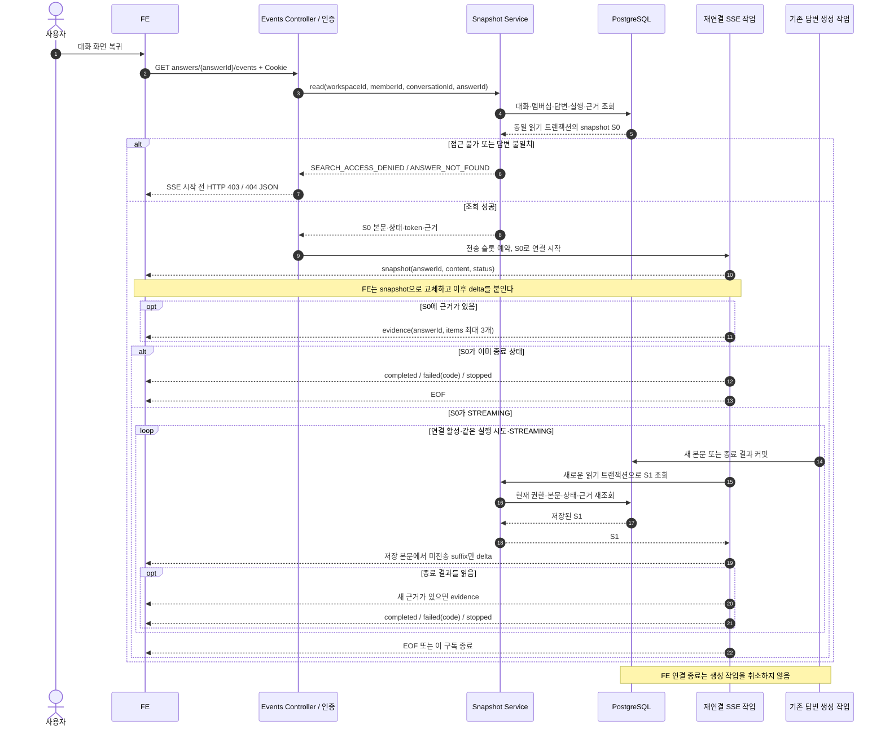

# #567 탐색 답변 SSE 재연결 구현 계획

2026-10-12 정합성 갱신: #607 병합 후 부모 탐색 migration은 V45 접수·V46 실행·V47 근거 rank로 이동했다. 아래 V41/V43 등의 설명은 최초 구현 당시 번호다. 재연결 API는 새 migration 없이 같은 저장 필드와 snapshot/delta 계약을 사용한다.

## 1. 범위와 브랜치

- 상태: `be/feature/#563` HEAD ea08a0d에서 `be/feature/#567`을 만들고 TDD 구현을 진행했다. 최종 검증 결과는 아래 구현 기록에서 구분한다.
- 확인일: 2026-10-11, Asia/Seoul.
- Issue: [#567 탐색 답변 SSE 재연결 API](https://github.com/woowacourse-teams/2026-knot/issues/567).
- API: `GET /api/v1/workspaces/{workspaceId}/search/conversations/{conversationId}/answers/{answerId}/events`.
- 목표: 화면에 돌아온 사용자가 저장된 답변을 복구하고, 생성 중이면 이후 출력까지 중복·누락 없이 받는다. 구독 종료는 생성 작업을 취소하지 않는다.

### 브랜치 기준

현재 `be/feature/#563`의 HEAD는 `ea08a0d6458ae3cacdfb01854bff60d13bd322aa`다. 같은 커밋이 원격에 올라가 있으며 [Draft PR #583](https://github.com/woowacourse-teams/2026-knot/pull/583)의 head다. #583의 base는 `be/feature/#595`다.

최신 원격 `develop`을 fetch해 확인한 커밋은 `ae06d38b389b03e0bd5d2e36e07e48fab4398c53`이며, 이 기준에는 `backend/.../search` 코드가 없다. #567을 develop에서 시작하면 선행 구현을 다시 포함하게 된다. 따라서 구현을 시작할 때 현재 #563 HEAD에서 분기한다.

```text
be/feature/#595
    └─ be/feature/#563  ← Draft PR #583
          └─ be/feature/#567  ← 신규 재연결 API
```

계획 단계에서 준비한 아래 명령을 구현 시작 시 실행해 분기했다.

```bash
git switch 'be/feature/#563'
git switch -c 'be/feature/#567'
```

후속 PR은 `base=be/feature/#563`, `head=be/feature/#567`, Draft로 연다. 부모 PR 병합 없이 개발·리뷰가 가능하다. 부모가 먼저 병합되면 기준 브랜치와 migration 포함 여부를 확인한 뒤 develop 기준으로 정리한다. 부모 파일의 후속 수정은 먼저 차이를 확인해서 반영한다.

사용자는 #567의 예상 변경량을 확인한 뒤 **이번 API는 분리하지 않고 한 PR로 진행**하도록 승인했다. 부모 대비 production·test·docs 전체 additions+deletions를 측정해 보고하되, 2,000줄 초과를 이유로 하위 이슈나 브랜치를 추가하지 않는다. 구현 검증 후 후속 요청으로 메서드·동작 단위 commit, push, `base=be/feature/#563` Draft PR 게시와 `Closes #567`, `BE/Feature/흑곰` 라벨 및 `jyt6640` 담당자 지정이 명시적으로 승인됐다.

### 적용 근거

| 출처·확인 시점 | 적용하는 사실 | 판정 |
| --- | --- | --- |
| 이번 요청의 전체 API 계약, 2026-10-11 | snapshot 우선, `answerId`, 종료 상태 복구, 제외 수 미전송 | 이번 계획의 계약 |
| GitHub #567 본문, 2026-10-11 조회 | 역할·대화 검증, 동시성·느린 연결·실패 code·실제 HTTP 검증 | Issue에 기록된 요구. 별도 ADR 예정 경로 없음 |
| `backend/docs/product/current-v2-mvp.md`, `backend/docs/notion-context.md`, 정합성 워크플로 | 사용자 확정 결정과 적용 범위를 우선하며 캐시를 실제 구현으로 간주하지 않음 | 저장소 지침 |
| [Notion API 원문](https://app.notion.com/p/api-v1-workspaces-workspaceId-search-conversations-conversationId-answers-answerId-events-3ebb4351752280e886cdc57d0fdf292c), 로컬 사본 2026-09-30 캡처 | snapshot 재연결, 연결 종료로 생성 취소하지 않음 | 이번에는 캐시만 읽음. 캐시에는 응답 표 등이 빠져 있어 요청·Issue와 함께 사용. 최신 원격 본문을 재확인한 것은 아님 |
| [ERDiagram](https://app.notion.com/p/ERDiagram-3e4b4351752280cd86c7dc92aac63fd1), 2026-10-07 캡처의 탐색 부분 | Workspace·Member 소유, 순서 있는 USER/ASSISTANT 메시지 | 근거 사본. 근거 최대 3개 저장 규칙은 이후 사용자 결정과 V43에 의해 변경됨 |
| 사용자 확정 결정 및 현재 #563 코드 | 실제 사용 근거 전체 보존, 관련도 순 카드 최대 3개. ARCHIVED만 탐색, 제외 수 0 | 재인터뷰하지 않음. #567에서는 제외 수 자체를 전송하지 않음 |
| 현재 #563 코드와 PR #583 | 저장 snapshot 조회, DB polling SSE, 별도 생성/전송 executor, 실행 token | 브랜치에서 관측한 구현. develop 병합·운영 적용을 의미하지 않음 |
| `.persona/project-profile.jsonc`, 개발 지침, Gradle 설정 | Java 25·Spring Boot·JPA·PostgreSQL·Flyway, 단위/통합/인수 테스트 분리 | 저장소에서 확인 |

## 2. 구현할 흐름

### 사용자가 보는 동작

1. FE가 대화 메시지를 복구한다. STREAMING 답변을 이어 보려면 이 GET API를 연다. 종료된 답변으로 요청해도 서버는 복구 이벤트를 반환한다.
2. 서버가 access cookie 인증, 현재 Workspace 멤버십, 대화 소유권, 답변의 소속 대화와 ASSISTANT 역할을 검사한다.
3. 하나의 짧은 읽기 트랜잭션으로 답변 본문·상태·실패 code·실행 token·근거 카드를 읽는다.
4. `snapshot`을 첫 이벤트로 보낸다. FE는 기존 표시 본문을 이 content로 **교체**한다.
5. 저장된 근거가 있으면 `evidence`를 보낸다. STREAMING이면 다음 DB 조회에서 새로 늘어난 문자열만 `delta`로 보낸다.
6. COMPLETED/FAILED/STOPPED면 필요한 마지막 delta·근거·종료 이벤트를 순서대로 보내고 연결을 닫는다.
7. 탭 이동·연결 오류·구독 timeout은 이 연결 자원만 정리한다. 생성 작업과 DB 상태를 변경하지 않는다.



### snapshot과 delta 사이의 경합 처리

이벤트 bus에 가입하는 방식 대신 **현재 DB polling 기반을 재사용**한다. S0를 읽은 뒤 보내는 동안 생성 작업이 추가 문자열을 저장해도, 다음 독립 트랜잭션의 S1에서 그 문자열을 읽는다.

```text
S0.content = "결정은"           → snapshot "결정은", sentLength = 3
snapshot 전송 중 DB에 " A야" 저장
S1.content = "결정은 A야"       → delta " A야"
다음 조회가 같은 본문             → delta 없음
```

`sentLength`는 Java 문자열 인덱스 기준이며 API에 노출하지 않는다. 전송 성공 후에만 갱신한다. 같은 실행에서는 이전 전송 본문이 새 본문의 prefix여야 한다. 줄어들거나 교체된 본문은 이어 붙이지 않고 해당 구독을 종료한다. 하나의 delta에 여러 공급자 출력 조각이 합쳐질 수 있지만, 연결을 정상적으로 끝까지 받은 경우 **snapshot content + 모든 delta text = 해당 실행의 최종 저장 본문**이어야 한다.

실행 token이 바뀌면 기존 구독을 닫는다. 아직 claim하지 않은 QUEUED의 null token이 최초 RUNNING token으로 바뀌는 것은 정상 진행이다. 이미 고정한 token이 다른 UUID 또는 null로 바뀌면 다른 실행으로 판단한다. 현재 코드에는 retry reset이 없으므로 이 규칙은 현재 실행 생명주기에서 검증한다. #569에서 같은 답변 ID를 재사용할 때는 **QUEUED부터 안정적인 시도 식별자**를 포함해 재시도 경계를 다시 검증해야 한다. 빠른 실패·재접수 전이를 polling이 놓쳐도 구분되어야 하며, token만으로 미래의 모든 retry 경합이 해결됐다고 주장하지 않는다.

### 응답·오류 경계

| 상황 | 결과 |
| --- | --- |
| 쿠키 미인증 | 기존 Security의 `401 UNAUTHENTICATED` |
| 현재 Workspace 멤버가 아니거나 요청 대화의 Workspace/소유자가 다름 | `403 SEARCH_ACCESS_DENIED` |
| 요청 대화 또는 답변 없음, 답변이 USER, 답변이 요청 conversationId에 속하지 않음 | `404 ANSWER_NOT_FOUND`. 다른 대화의 답변을 대신 찾지 않음 |
| 정상 답변인데 실행 metadata가 없거나 연결 슬롯/실행기 사용 불가 | 정상 복구로 위장하지 않고 시작 전 서버 오류. 기존 가용성 오류 `500 ANSWER_GENERATION_UNAVAILABLE` 활용 |
| 잘못된 숫자 path 등 공통 바인딩 실패 | 저장소 공통 400 처리 유지. 새로운 페이지/query 계약을 만들지 않음 |
| SSE 시작 후 권한 상실·조회 실패·실행 변경·전송 실패 | 해당 구독 종료. 생성 FAILED로 변경하거나 JSON 오류를 SSE 뒤에 붙이지 않음 |

모든 데이터 이벤트는 `answerId`를 사용한다. `accepted`, `progress`, `excluded_documents`, `answerMessageId`, 이벤트 이력 replay 및 `Last-Event-ID` 저장은 이 API에 추가하지 않는다. FAILED code는 저장된 `SearchMessage.failureCode`를 사용한다. 기존 코드가 허용한 code 없는 FAILED 복구는 기존 SSE와 같은 `ANSWER_GENERATION_FAILED` fallback으로 계약 테스트한다.

## 3. 나올 코드와 메서드 초안

### 실제 코드에서 재사용할 기반

| 기존 위치·클래스 | 관측한 책임과 차이 |
| --- | --- |
| `search/application/SearchAnswerSnapshotService` | REPEATABLE_READ로 본문·상태·근거 조회. 현재 `read(workspaceId, memberId, answerId)`에는 경로 conversationId와 역할 검증이 없음 |
| `search/infrastructure/SearchAnswerStream` | 전송 executor·슬롯 예약·SseEmitter 구성. 현재 `open(...)`은 첫 질문 accepted를 보내는 전용 진입점 |
| `search/infrastructure/SearchAnswerSseConnection` | DB polling으로 본문 suffix 전송. 첫 질문용 필드명·progress·제외 수 이벤트를 사용 |
| `search/infrastructure/SearchStreamReservation` | close를 여러 번 호출해도 슬롯을 한 번만 반환. 현재 attach 타입은 첫 질문 connection으로 고정됨 |
| `search/application/SearchAnswerExecutionService` | 본문 추가·실패 code·근거·종료 상태 저장. SSE 연결이 생성 트랜잭션을 소유하지 않음 |
| `search/infrastructure/SearchEvidenceReadJpaRepository` | rank 오름차순, `rank <= 3` 카드 조회. 전체 근거 저장과 화면 카드 제한을 이미 분리 |
| `global/exception/SearchQuestionExceptionHandler` | SSE 시작 전 JSON 오류, 이미 commit한 응답 뒤의 JSON 혼입 방지. 현재 첫 질문 Controller만 대상으로 함 |

### 제안하는 코드

| 위치·클래스 | 책임 | 추가·변경할 메서드 후보 |
| --- | --- | --- |
| `search/presentation/SearchAnswerEventsApi` · 신규 | GET 경로·OpenAPI·이벤트와 오류 계약 | `reconnect(workspaceId, conversationId, answerId, member)` |
| `search/presentation/SearchAnswerEventsController` · 신규 | 인증 Member ID 전달, UTF-8 SSE·no-cache·버퍼링 방지 응답 | `reconnect(...) → ResponseEntity<SseEmitter>` |
| `search/application/SearchAnswerSnapshotService` · 확장 | 경로 대화 기준 권한·역할·소속 검증 후 일관된 snapshot 반환 | 4인자 `read(workspaceId, memberId, conversationId, answerId)`; `validateAccess`, `validateAnswer`, `readSnapshot` 등 규칙별 private 메서드 |
| `search/domain/SearchErrorCode` · 확장 | API의 답변 없음 표현 | `ANSWER_NOT_FOUND(404)` 추가 |
| `search/infrastructure/SearchAnswerStream` · 확장 | 초기 snapshot 검증, 슬롯 확보, 새 connection 연결, 실패 시 슬롯 반환 | `reconnect(workspaceId, memberId, conversationId, answerId) → SseEmitter` |
| `search/infrastructure/SearchAnswerReconnectConnection` · 신규 | snapshot 첫 전송, 같은 시도의 suffix 전송, 근거·종료·구독 정리 | `run()`; `sendSnapshot`, `poll`, `validateExecution`, `sendDelta`, `sendEvidenceIfChanged`, `sendTerminal` 후보 |
| `search/infrastructure/SearchStreamReservation` · 최소 확장 | 두 종류의 연결 작업을 같은 슬롯·executor에 연결 | `attach(Runnable)`와 `CompletableFuture<Runnable>`로 변경 |
| `global/exception/SearchQuestionExceptionHandler` · 확장 | 새 SSE Controller의 시작 전 오류도 공통 JSON 처리 | advice 대상에 `SearchAnswerEventsController` 추가. presentation 패키지에 handler를 만들지 않음 |
| `global/config/SearchWorkerProperties` · 필요 범위 확장 | 기존 timeout·poll·capacity 재사용, 무출력 시 연결 감지 | reconnect용 comment heartbeat 간격 설정 후보, 기본 15초 |

새 connection을 첫 질문 connection과 분리해 이벤트 계약 변경이 #563에 섞이지 않게 한다. snapshot 조회·executor·reservation을 재사용한다. transport 모드 인터페이스·event bus·새 UseCase 계층은 먼저 만들지 않는다. 두 polling 루프의 공통 추출은 실제 구현에서 중복 책임이 커질 때 회귀 테스트를 확보한 뒤 검토한다.

4인자 `read`는 요청 conversationId의 대화를 먼저 확인하고 접근을 검증한다. 이어 해당 대화의 ASSISTANT 답변과 실행 metadata를 읽는다. 3인자 기존 public 메서드는 첫 질문 SSE 호출을 유지하며, 공통 조회·검증 부분을 공유한다. 각 poll은 프록시를 통한 별도 짧은 읽기 트랜잭션으로 실행한다. HTTP 연결 수명 전체를 transaction으로 감싸지 않는다.

새 connection은 최초 조회 결과 S0를 전달받는다. snapshot을 다시 읽어 다른 본문 길이를 기준으로 잡지 않는다. 이미 보내 준 근거 목록을 기억해 같은 evidence를 중복 전송하지 않고, 저장 결과가 새로 확보되면 종료 이벤트 전에 보내 준다. 근거가 없으면 가짜 카드나 빈 근거 이벤트를 만들 필요가 없다.

## 4. 저장 기반과 주의할 점

### DB 변경

현재 #563 기반의 저장 필드로 구현한다. **#567에는 새 테이블·컬럼·Flyway migration이 필요하지 않다.** V39~V43 파일 존재를 확인했으며 실제 운영 DB 적용 상태는 관측하지 않았다.

| 기존 모델·테이블 | 사용하는 필드·제약 |
| --- | --- |
| SearchConversation / `search_conversations` | id, workspace_id, member_id. 현재 멤버십은 WorkspaceMember에서 별도 확인 |
| SearchMessage / `search_messages` | conversation_id, role, content, status, failure_code. role/status CHECK, conversation+sequence UNIQUE. failure_code는 V41에서 추가 |
| SearchAnswerExecution / `search_answer_executions` | answer_id PK/FK, conversation_id, execution_token, state. QUEUED는 token null, RUNNING/FINISHED는 token 필수 |
| SearchEvidence / `search_evidences` | 실제 사용 문서 전체 저장, 메시지·문서 중복 금지 및 rank UNIQUE. V43은 rank 상한 3 저장 제약을 확장 |

종료 저장에서 content/status/근거가 일관되게 보이는지 PostgreSQL 테스트로 검증한다. 본문 조회와 근거 조회를 한 번의 REPEATABLE_READ 안에서 수행하는 기존 방법을 유지한다. 다음 poll에는 새 트랜잭션을 사용해 이전 snapshot에 머물지 않게 한다.

### 자원·동시성

- 생성 worker와 SSE 전송 executor는 기존처럼 분리한다. 연결별 offset·token·근거 상태도 공유하지 않는다. 한 연결의 느린 send는 자기 전송 작업만 기다리게 한다.
- 기본 설정은 poll 100ms, stream timeout 3분, 동시 stream 8개다. 실제 배포값을 확인한 것으로 취급하지 않는다. 첫 질문과 재연결은 기존 전송 용량을 공유한다.
- `onCompletion/onTimeout/onError`, 예약 실패, 초기 전송 실패, polling 종료의 모든 경로에서 reservation을 정확히 한 번 해제한다. 무출력 중에는 제안한 15초 간격의 SSE comment heartbeat로 연결 오류 감지를 돕는다. named event가 아니므로 위 데이터 이벤트 계약은 유지한다.
- [Spring MVC 공식 문서](https://docs.spring.io/spring-framework/reference/web/webmvc/mvc-ann-async.html)는 개별 쓰기가 blocking이며, 클라이언트 단절을 쓰기 실패로 감지한다고 설명한다. 따라서 emitter timeout 설정만으로 socket write가 즉시 해제된다고 단정하지 않는다. 실제 컨테이너에서 느린 연결·timeout·슬롯 회수를 검증한다.
- send의 IOException은 애플리케이션 reservation을 정리하고, Servlet/Spring이 연결 오류를 마무리하도록 한다. container가 처리하는 IOException에 중복 `completeWithError`를 호출하지 않는다. 정상 종료는 `complete()`, 애플리케이션 조회/검증 실패는 구독 종료 처리로 구분한다.
- 실제 큰 snapshot 테스트에서 초기 buffered event flush 실패가 committed response + asyncStarted 상태로 global advice에 전달되는 것을 관측했다. 이 초기화 경로는 정상 emitter callback 등록 전에 실패하므로 advice에서 진행 중 AsyncContext를 명시적으로 complete한다. 이후 JSON 본문을 쓰지 않는다. 단순 emitter onCompletion 대신 ServletRequestListener.requestDestroyed로 실제 요청 종료를 검증한다.
- 전송이 막힌 실제 스레드가 종료되기 전에 capacity만 반복 반환하면 대기 작업이 쌓일 수 있다. executor의 실제 가동 작업·예약 해제·후속 요청 수락을 함께 테스트한다. timeout 정리 콜백 호출만으로 자원 회수를 증명하지 않는다.
- 연결당 100ms의 반복 권한·본문 조회 비용을 확인한다. 긴 답변과 최대 동시 연결에서 조회 횟수·메모리·느린 전송을 관측하고, 필요하면 설정을 조정한다. 생성 DB lock을 잡은 채 네트워크 전송하지 않는다.

### 구현 단계에서 확인할 기술 사항

추가 제품 인터뷰가 필요한 미결정 사항은 현재 없다. 아래는 구현 검증 항목이다.

1. 실제 Tomcat HTTP 연결에서 send 오류/timeout 이후 전송 작업이 종료되는지 확인한다.
2. 새 connection에서 membership 재검증, null→최초 claim token, token 교체·본문 대체를 테스트한다.
3. #568의 STOPPED 저장 동작과 #569의 retry 시도 식별자 연결은 후속 Issue에서 검증한다. 지금 STOPPED HTTP fixture가 실제 stop API 구현을 증명하지는 않는다.

## 5. TDD와 검증 순서

구현을 시작할 때 `npx ph workflow implement`와 프로젝트 profile을 확인한다. 아래 각 단계는 **실패하는 테스트 → 최소 구현 → 해당 테스트 통과** 순서다. 기다림은 latch/barrier와 bounded await로 제어하고, 임의의 긴 sleep으로 경합을 추측하지 않는다. 의존성 대역은 Mockito를 사용하고 별도 fake 구현 클래스를 늘리지 않는다.

| 단계 | 테스트 위치·방식 | 먼저 실패시킬 동작 → 최소 구현 | 기대 결과 |
| --- | --- | --- | --- |
| 1. 답변 접근 | 신규 `search/application/SearchAnswerSnapshotServiceTest`, Mockito | 4인자 read의 정상/타인/다른 Workspace/탈퇴/없음/USER/다른 conversation 테스트 → 경로·역할·typed error 검증 | 정상은 일관된 Result, 접근 403, 역할·답변·대화 불일치 404, 쓰기 없음 |
| 2. 초기 snapshot | 신규 `search/infrastructure/SearchAnswerReconnectConnectionTest`, Mockito SseEmitter·snapshot service | 첫 이벤트와 빈 본문, 기존 본문 중복 delta 테스트 → snapshot 초기화와 offset | 첫 named event snapshot, 모든 payload answerId, 최초 본문은 한 번만 전달 |
| 3. 이후 delta·경합 | 같은 connection 단위 테스트 및 신규 `search/application/SearchAnswerSnapshotIntegrationTest`, PostgreSQL | 저장 전/후 연결, snapshot send 대기 중 append 커밋, 중복 read, 두 번 append를 한 번 조회 → suffix polling | snapshot+delta가 저장 본문과 동일. 미커밋 본문 미노출, 다음 poll은 새 커밋 관측 |
| 4. 근거·종료 | connection 단위 + snapshot PostgreSQL 테스트 | 세 종료 상태, 마지막 append와 완료, 저장 failureCode, 근거 0/1/4개 → 근거 변화·종료 처리 | snapshot→필요한 delta→최대 3 evidence 카드→terminal→EOF. FAILED code 복구, 전체 근거 DB 보존 |
| 5. 시도·구독 수명 | connection 단위, 기존 `SearchAnswerStreamTest` 및 신규 `SearchStreamReservationTest` | token 변경/null 복귀, 본문 축소·대체, send 예외, timeout, 중복 close, executor 거절, 한 느린 구독과 정상 구독 → Runnable attach·cleanup·heartbeat | 다른 시도 출력 혼입 없음, permit 한 번 반환, 생성 fail/cancel 호출 없음, 정상 구독은 진행 |
| 6. HTTP 계약 | 신규 `search/presentation/SearchAnswerEventsAcceptanceTest`, 실제 Security·RANDOM_PORT·Java HttpClient·PostgreSQL | GET 200 및 401/403/404, path 바인딩, headers, field names → Api/Controller/global advice 적용 | SSE 시작 전 오류는 JSON, GET에 CSRF 토큰 불필요, 재연결 전용 이벤트만 반환 |
| 7. 실제 HTTP 경합 | 같은 인수 테스트와 기존 `SearchQuestionAcceptanceTest` 회귀 | 실제 POST로 접수→GET 구독 2개→하나 종료→생성 진행→재연결/완료, timeout 후 재접속 → transport 보완 | 살아 있는 구독과 재접속 결과가 저장 본문과 동일, 생성 계속, 전송 작업·슬롯 정리, #563 계약 유지 |

권한 단위 테스트는 서비스 판단만 증명한다. PostgreSQL 테스트는 트랜잭션 가시성·본문/상태/근거 일관성을 증명한다. 실제 HTTP 인수 테스트는 인증 필터, 오류 응답, SSE framing/순서/EOF, 실제 단절·timeout 경로를 증명한다. Mockito send 대기 테스트만으로 실제 socket의 timeout을 증명하지 않는다.

STOPPED 도메인 변경 메서드는 현재 구현되어 있지 않다. #567 인수 테스트에서는 PostgreSQL CHECK가 허용하는 STOPPED 저장 fixture로 복구 계약을 검증한다. 중지 요청 자체는 #568 범위다. 생성은 제어된 retriever/generator를 사용해 시점을 고정하고, 실제 LLM 호출 성공과 구분한다.

### 작업·커밋 경계 제안

1. `read(...)`의 권한·대화·역할·오류 한 동작.
2. `run()`의 snapshot 첫 전송 및 suffix 전송 한 동작.
3. 근거·각 종료 상태 복구 동작.
4. 연결 자원·실행 변경·timeout 처리 adapter 동작.
5. GET Controller·OpenAPI·global handler 적용 및 HTTP 계약.
6. 실제 HTTP 동시성 회귀 검증과 API/구현 문서.

각 경계에서 필요하면 test→feat를 분리한다. 공용 reservation 변경은 별도 refactor로 검증한다. red 테스트 커밋은 TDD 과정을 기록하는 중간 커밋이며 최종 PR HEAD는 해당 테스트가 통과해야 한다. 부모 Issue 전체를 한 번에 커밋하지 않는다. 문서·설정 변경도 독립 concern으로 둔다. 실제 commit/push/게시 권한은 구현 요청 시 확인된 범위에 따른다.

### 예정 검증 명령

아래 Gradle task·tag 분리는 현재 빌드 설정에서 확인했다. 나열한 테스트는 구현 단계에서 생성·확장했다. backend 디렉터리에서 실행한다.

```bash
JAVA_HOME=$(/usr/libexec/java_home -v 25) ./gradlew test \
  --tests '*SearchAnswerSnapshotServiceTest' \
  --tests '*SearchAnswerReconnectConnectionTest' \
  --tests '*SearchAnswerStreamTest' \
  --tests '*SearchStreamReservationTest' \
  --tests '*SearchQuestionExceptionHandlerTest'

JAVA_HOME=$(/usr/libexec/java_home -v 25) ./gradlew integrationTest \
  --tests '*SearchAnswerSnapshotIntegrationTest' \
  --tests '*SearchAnswerExecutionIntegrationTest'

JAVA_HOME=$(/usr/libexec/java_home -v 25) ./gradlew acceptanceTest \
  --tests '*SearchAnswerEventsAcceptanceTest' \
  --tests '*SearchQuestionAcceptanceTest'

JAVA_HOME=$(/usr/libexec/java_home -v 25) ./gradlew spotlessCheck check bootJar
git diff --check
```

실패하는 테스트를 먼저 실행해 실패 원인을 기록한 뒤 최소 구현한다. 단위→해당 DB/HTTP 테스트로 좁게 확인하며 공용 stream/reservation/handler 변경을 마친 뒤 전체 check로 회귀를 확인한다. 마지막으로 Persona implementation/review report와 `npx ph workflow finish implement`를 완료한다. 부모 #563의 기존 테스트 통과 기록을 새 #567 검증 결과로 사용하지 않는다.

## 6. 완료 기준과 다음 작업

- [x] 정상 재연결은 snapshot을 첫 이벤트로 보내고 `answerId` 계약을 지킨다.
- [x] 생성 중 저장 경합과 snapshot 전송 경합에서 본문이 중복·누락되지 않는다.
- [x] COMPLETED/FAILED/STOPPED와 저장 실패 code, 관련도 순 최대 3 카드가 복구되고 EOF로 끝난다.
- [x] 권한·역할·대화 불일치가 HTTP 401/403/404로 검증된다. 시작 전 JSON과 시작 후 구독 종료를 구분한다.
- [x] 한 연결 단절·느린 전송·timeout이 생성 상태나 다른 정상 구독을 막지 않는다. 실제 HTTP에서 전송 작업·슬롯·Servlet 요청 정리까지 관측한다.
- [x] 서로 다른 실행 token과 본문 대체를 이어 붙이지 않는다. #569의 안정적인 retry 식별자 후속 조건을 기록한다.
- [x] accepted/progress/excluded_documents와 이벤트 replay를 재연결에 섞지 않는다.
- [x] #563 첫 질문 SSE 회귀, 필요한 단위/DB/HTTP 검사, formatting/check/bootJar를 통과한다.
- [x] API 명세와 이 문서에 실제 결과 및 남은 운영 검증을 갱신한다. PR 전체 변경량을 부모 기준으로 측정한다.
- [ ] Persona 종료 인증은 미통과: 보고서 작성·filled 처리 및 실제 finish 실행은 완료했으나 아래 기존 전역 blocker 5개가 남았다. 다른 티켓과 증거 상태를 초기화하지 않는다.

구현은 4인자 snapshot 조회 테스트의 컴파일 실패, 새 reconnect connection 부재로 인한 실패, GET 경로 부재로 인한 HTTP 계약 실패를 먼저 확인한 뒤 진행했다. 실제 PostgreSQL snapshot 경합과 실제 HTTP 다중 구독·단절·timeout을 추가로 검증했다. 큰 초기 snapshot 쓰기 중 단절에서는 전송 작업 종료와 Servlet 요청 종료를 별도로 검증한다.

### 구현 결과 · 2026-10-11

| 검증 | 실제 결과 |
| --- | --- |
| 최종 전체 검사 | `spotlessCheck check bootJar`, BUILD SUCCESSFUL in 2m 40s |
| 단위 | 1,060개, 실패·오류·skip 0 |
| PostgreSQL 통합 | 489개, 실패·오류·skip 0 |
| 실제 HTTP 인수 | 492개, 실패·오류·skip 0 |
| 전체 합계 | 2,041개, 실패·오류·skip 0 |
| diff 공백 검사 | `git diff --check` 통과 |
| 초기 쓰기 실패 회귀 | 실제 8MB 미소비 소켓과 다른 구독, RST 뒤 Servlet 요청 종료·executor 회수 확인 |

실소켓 회귀에서는 초기 이벤트 flush 중 `ResponseBodyEmitter.initialize`가 실패하고 global advice에 committed=true/asyncStarted=true가 전달되는 것을 관측했다. 수정 전 requestDestroyed를 5초 내 관측하지 못해 테스트가 실패했고 graceful shutdown도 30초 대기 후 active request를 보고했다. 진행 중 AsyncContext를 명시적으로 complete한 뒤 같은 테스트가 통과하고 종료 로그는 21:47:07.775 시작 → 21:47:07.778 완료였다. 최종 전체 검사에서도 남은 요청 종료 경고는 없었다. 임시 진단 spy·출력은 제거했다.

실제 Spring/Tomcat·Security·HTTP·PostgreSQL로 검증했고 생성 시점은 제어된 adapter로 고정했다. 실제 운영 DB/ingress/LLM 재호출을 이번 #567의 검증으로 주장하지 않는다. STOPPED fixture는 상태 복구만 증명하며 #568 API 구현과 구분한다. 기본 3분 timeout·15초 heartbeat·8개 용량은 설정 기본값이고, HTTP 테스트는 2초·50ms·2개로 바꿔 timeout 및 반복 접속을 확인했다.

부모 ea08a0d 대비 production은 additions+deletions 476줄, 테스트 1,688줄이다. API 명세와 계획 전체를 포함하면 2,556줄이며 사용자의 이번 API 단일 PR 승인에 따라 분리하지 않는다. 기존 사용자 문서 변경 3개는 이 측정에서 제외했다. 후속 게시 요청에서는 snapshot `read`, reservation `run/attach`, reconnect connection `run`, emitter 생성 추출, stream/controller `reconnect`, committed SSE 예외 정리와 HTTP 회귀·문서를 분리하고 테스트→구현을 인접 커밋으로 기록한다. 중간 test 커밋은 red일 수 있으며 최종 HEAD는 전체 검증을 통과한 소스와 일치해야 한다.

Persona 구현·리뷰 보고서를 작성하고 변경 Java17개의 read evidence를 기록했다. 루트 계획서의 `ph evidence read ../docs/...`는 도구 프로젝트 범위 밖이라 실패해 직접 읽기와 구분했다. 보고서 자체의 `ph evidence read`도 `Evidence read unavailable`을 반환했고 task card의 read evidence는 성공했다. 두 보고서는 `ph plan --report-filled implementation/review`에서 모두 Status: filled로 처리됐다.

`npx ph workflow finish implement`는 exit1이며 기존 전역 `report-coverage-missing`, `java-role-read-coverage-missing`, `convention-toolchain-missing`, `workflow-loop-state-stale`, `pending-ticket` 5개를 반환했다. 부모 작업에서도 남아 있던 상태이며 이번 Java/Gradle 제품 gate 통과와 구분한다. 다른 티켓·과거 보고서·증거를 삭제하거나 검사 결과를 바꿔 종료 인증을 통과시키지 않았다.

#567 뒤에는 #568 생성 중지 → #566 후속 질문 → #569 실패 답변 재시도 순서로 연결한다. #568에서는 실제 STOPPED 전환과 재연결 종료를, #569에서는 같은 answerId의 재시도 reset/시도 식별자와 오래된 구독 차단을 함께 검증한다. 실제 모델 호스트·운영 reverse proxy에서의 전송 지연/버퍼링은 로컬 제어 fixture의 통과와 별도로 기록한다.

### 2026-10-11 CI 후속: SSE 테스트 payload 파싱

[Backend CI 실행 38141574125](https://github.com/woowacourse-teams/2026-knot/actions/runs/38141574125)는 복수 구독 인수 테스트의 `payload`에서 StreamReadException으로 실패했다. 포맷·단위·통합 검사는 성공했고 인수 492개 중 1개가 실패했다. 원 실패의 SSE 프레임과 XML은 artifact로 남아 있지 않다. 원 테스트는 로컬 단독 실행 및 CPU 수를 2개로 제한한 12회 실행에서 통과했으므로 CI 당시 프레임을 재현했다고 주장하지 않는다.

기존 parser와 같은 방식에 정상 SSE data 뒤 주석·메타데이터, 여러 data 줄을 입력한 회귀 테스트 6개 중 4개가 실패하는 Red를 관측했다. data 필드만 줄 순서대로 합쳐 JSON으로 읽는 `SearchSseEventPayload`를 적용한 뒤 6개가 모두 통과했다. data 없는 heartbeat와 잘린 JSON은 계속 거절한다. 임시 반복 실행·진단 변경은 제거했으며 제품 코드·CI timeout·실패 판정은 변경하지 않았다.

최종 `JAVA_TOOL_OPTIONS='-XX:ActiveProcessorCount=2' ./gradlew spotlessCheck check bootJar --console=plain`은 2분 50초에 통과했다. XML 결과는 단위 1,066·통합 489·인수 492 = **2,047개**, 실패·오류·skip 0이다. git diff 공백 검사도 통과했다. 원격 CI 결과는 push 이후 별도로 확인하며 이 로컬 결과로 원격 성공을 대신하지 않는다.

별도 브랜치 생성 자동화 [38141558465](https://github.com/woowacourse-teams/2026-knot/actions/runs/38141558465)의 Project 조회는 `KNOT_PROJECT_AUTOMATION` Secret 인증이 HTTP 401이었다. 이는 PR Backend CI 실패와 별개이며 Secret 값·권한 갱신을 코드 수정으로 대신하거나 오류를 무시하지 않는다.
