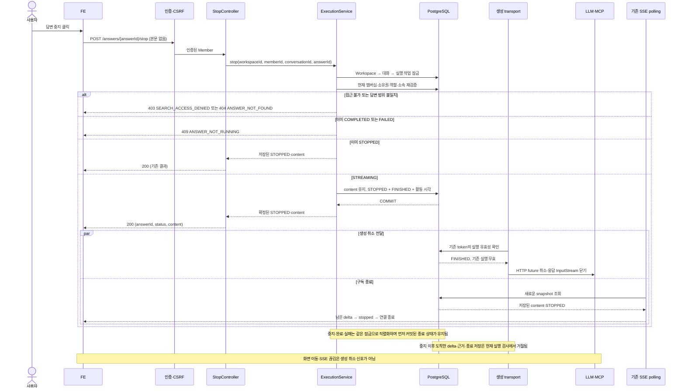

# #568 탐색 답변 생성 중지 구현 계획

## 2026-10-12 migration 리뷰 정합성

#607에서 develop에 녹음 V44가 병합되어 미병합 탐색 접수/실행/근거/중지 migration을 V45/V46/V47/V48로 재배치했다. 중지 제약의 SQL 내용은 그대로이며 이름은 `V48__allow_unclaimed_search_execution_finish.sql`이다. 기존 develop V44나 적용 checksum을 변경하지 않고 outOfOrder도 켜지 않는다. 아래 V42/V44 등은 최초 구현 당시 번호 기록이다. 실제 운영 적용 이력은 미관측이다.

## 1. 범위와 브랜치

- 상태: 승인한 계획에 따라 #568 브랜치에서 구현 및 전체 Gradle 검증 완료. 실제 결과는 아래 구현 결과에 기록한다.
- 확인일: 2026-10-11, Asia/Seoul.
- Issue: [#568 탐색 답변 생성 중지 API 구현](https://github.com/woowacourse-teams/2026-knot/issues/568).
- API: `POST /api/v1/workspaces/{workspaceId}/search/conversations/{conversationId}/answers/{answerId}/stop`.
- 목표: 본인 답변의 생성을 명시적으로 중지하고, 저장된 부분 본문을 보존한다. 중지와 완료·실패·추가 출력의 경합은 DB에서 결정한다.
- 범위: 권한·CSRF, STOPPED 전환, 대기 작업 종료, 공급자 연결 취소 전달, 기존 SSE·문맥·녹음에 대한 회귀 검증.

### 브랜치 기준

구현 브랜치는 `be/feature/#568`이다. #567의 CI 수정까지 반영한 로컬·원격 HEAD `ee9c63ae80fb3d19b6ac7528b522554377c08464`에서 분기했다. 최초 계획 시점의 부모 HEAD는 `ec6e7682cd4cf979ed2917d12aff8cd38f4f2d78`이었다. [Draft PR #604](https://github.com/woowacourse-teams/2026-knot/pull/604)는 `base=be/feature/#563`, `head=be/feature/#567`이다. [Draft PR #583](https://github.com/woowacourse-teams/2026-knot/pull/583)은 `base=be/feature/#595`, `head=be/feature/#563`이며 둘 다 열려 있다.

```text
be/feature/#595
    └─ be/feature/#563  ← Draft PR #583
          └─ be/feature/#567  ← Draft PR #604
                └─ be/feature/#568  ← 구현 브랜치
```

사용자의 개발 승인 후 아래 명령으로 분기했다.

```bash
git switch 'be/feature/#567'
git switch -c 'be/feature/#568'
```

후속 PR 제안은 `base=be/feature/#567`, `head=be/feature/#568`, Draft, `Closes #568`, 담당자 `jyt6640`, 라벨 `BE`·`Feature`·`흑곰`이다. 게시 권한은 이번 계획 요청에 포함되지 않는다. 부모 PR을 병합하지 않아도 구현·리뷰할 수 있다. 부모 병합 후에는 실제 포함된 커밋과 migration을 확인하고 base를 정리한다. 기본 브랜치를 향한 최종 병합에서 Issue가 닫혔는지도 확인한다.

최신 `origin/develop`을 fetch해 확인한 커밋은 `65501549cacdf996ee23de7bf87a20040d9c77f1`이다. 이 기준에는 V2 `search` 패키지가 없고 migration은 V38까지다. #567에는 V39~V43과 앞선 탐색 구현이 있다. #568을 develop에서 바로 시작하면 선행 구현이 PR 변경량에 포함된다.

현재 사용자가 변경한 `backend/docs/notion-api-alignment.md`, `backend/docs/product/current-v2-mvp.md`, 미추적 `backend/docs/implement-plan/563-search-v2-roadmap.md`는 보존한다.

### 적용 근거

| 출처·관측 시점 | 이번 계획에 적용하는 내용 | 판정 |
| --- | --- | --- |
| 이번 요청의 API 전문 및 앞서 확정한 결정 | STOPPED 중복 요청 200, COMPLETED/FAILED 409, 부분 본문 보존, 먼저 확정된 종료 상태 우선 | 사용자 확정 계약. 재인터뷰하지 않음 |
| [Issue #568](https://github.com/woowacourse-teams/2026-knot/issues/568), 10/11 조회 | 현재 멤버십·소유권·답변 범위, 원자적 중지, 공급자 취소, 동시성·실제 HTTP 검증 | Issue 요구사항. 메모에 ADR 예정 경로 없음 |
| [Notion 중지 API](https://app.notion.com/p/api-v1-workspaces-workspaceId-search-conversations-conversationId-answers-answerId-stop-3ebb4351752280599f80c035a5644022) | 명시적 중지, STOPPED와 본문 보존, 종료 경합 | 본문·속성 revision 9/30 01:25 UTC, capture 9/30 02:19 UTC, hash `8508e9df`. POST·검색·흑곰·구현 NO. 표가 빠진 사본이므로 요청 전문과 Issue로 보완 |
| [도메인 규칙 및 UseCase](https://app.notion.com/p/3e3b4351752280cd9f06edc2ccdff1d8), 탐색 절 | 개인 대화, 중지 본문을 다음 문맥에 포함, 화면 이동에도 생성·녹음 유지 | 본문·속성 revision 10/10 12:31 UTC, capture 10/10 13:17 UTC, hash `94e2bc2b`. 이전 근거 최대 3개 규칙은 사용자 후속 결정으로 대체 |
| [ERDiagram](https://app.notion.com/p/ERDiagram-3e4b4351752280cd86c7dc92aac63fd1), 탐색 절 | 메시지 역할·상태, 대화별 순서, content 보존 | 본문·속성 revision 10/7 10:45 UTC, capture 10/7 13:07 UTC, hash `f4aa1c8e`. SearchAnswerExecution은 실제 구현에 추가된 저장 기반 |
| [탐색 · 찾은 기록 패널 · 대화 폭 · 독](https://app.notion.com/p/3edb4351752281eca2c7deaf30666cea) | 탐색 중 녹음 유지, 중지 근거 패널의 제품 정책 확인 항목 | 본문·속성 revision 10/10 08:30 UTC, capture 10/10 09:04 UTC, hash `6df59e53`. 중지 근거 신규 추출·패널 정책은 미확정 범위로 구분 |
| 현재 V2 기준·Notion 정합성 지침·`backend/docs/notion-context.md` | 최신 API와 사용자 결정 우선, 사본과 구현 관측 구분 | 저장소 기준. 원문 사본만 읽었으며 최신 원격 Notion을 재조회한 것은 아님 |
| #567 실제 코드, V39~V43, PR #583·#604 및 탐색 분리 PR 목록 | 공통 DB 잠금, token, SSE polling, 실행 작업, LLM/MCP HTTP 경계 | 브랜치에서 확인한 구현. develop 병합·운영 배포 관측이 아님 |
| `.persona/project-profile.jsonc`, 개발 지침, Gradle 설정 | Java 25·Spring Boot·JPA·PostgreSQL·Flyway, 단위/통합/인수 테스트 | 현재 프로젝트 구조·검증 기준 |

선택한 페이지의 manifest에서 본문·속성 revision과 capture를 확인했다. `coverage.md`는 탐색 한눈에 보기의 첨부/지원하지 않는 블록 누락을 표시한다. 이미지·Figma 원본을 확인했다고 주장하지 않는다. 이번 계약의 응답 표는 사용자가 제공한 전문을 기준으로 한다.

### 예상 변경량

변경량은 부모 #567 대비 Git diff의 additions+deletions로 계산한다. 다음 수치는 구현 전 추정이며 파일 수·전체 길이가 아니다.

| 범위 | 예상 변경 줄 수 | 근거 |
| --- | ---: | --- |
| Production | 450~700 | HTTP 경계·DTO, 기존 실행 서비스·두 도메인 메서드, transport 취소와 설정. 기존 SSE와 문맥 조회 재사용 |
| 테스트 | 900~1,300 | 실제 PostgreSQL 경합·rollback, Security/HTTP, 멈춘 공급자 연결과 자원 해제 검증 |
| migration·문서 | 250~300 | CHECK 보정 migration 하나, 계획·API 명세 |
| 전체 | **1,600~2,300** | 공급자 취소까지 포함한 추정. 인수 테스트 공통 준비 코드 재사용 여부에 따라 변동 |

실제로 읽은 기존 코드 길이는 실행 서비스 309줄, 메시지 149줄, 실행 작업 115줄, transport 248줄, 재연결 Controller 55줄이다. 기존 실행 통합 테스트는 762줄, 재연결 인수 테스트는 683줄이다. API 자체보다 취소·경합 검증의 비중이 크다. 우선 API 하나의 구현 단위로 계획하고, 약 2,000줄을 넘는 실제 diff가 나오면 DB 중지와 transport 취소 경계로 분리를 검토한다. 계획 단계에서 하위 Issue나 추가 PR을 만들지는 않는다.

## 2. 구현할 흐름

### 사용자가 보는 동작

1. FE가 중지 버튼을 누르면 본문 없이 POST를 보낸다. 로그인 cookie와 CSRF cookie/header를 사용한다.
2. 서버가 현재 Workspace 멤버십, 대화 소유권, 답변의 대화 소속과 ASSISTANT 역할을 검사한다.
3. 생성 작업과 동일한 순서로 DB 잠금을 얻고 상태를 다시 읽는다.
4. STREAMING이면 메시지를 STOPPED로 바꾸고 작업을 FINISHED로 종료한다. 기존 content는 변경하지 않는다. 두 변경과 대화 활동 시각을 하나의 트랜잭션으로 커밋한다.
5. 커밋한 본문과 STOPPED를 HTTP 200으로 반환한다. 이미 STOPPED라면 같은 저장 결과를 반환한다. COMPLETED/FAILED라면 409다.
6. 기존 SSE polling이 마지막 저장 본문을 전송하고 stopped로 종료한다. 최초 생성 SSE는 `answerMessageId`, 재연결 SSE는 `answerId`를 사용한다.
7. transport가 DB의 실행 종료를 확인해 해당 요청의 HTTP 교환을 취소하고 응답 스트림을 닫는다. 공급자 응답이 오지 않아도 중지를 감지해야 한다.

DB 커밋이 중지의 확정 시점이다. 공급자 연결 정리는 이후 비동기로 전달하며, 공급자 확인 응답을 기다리면서 DB 잠금을 잡거나 HTTP 200을 지연하지 않는다. 커밋 전 취소를 전달하면 rollback된 중지가 실제 생성만 끊을 수 있으므로 금지한다.



경합에서 중지 전에 저장된 문자열은 200 본문에 포함한다. 아직 저장되지 않은 생성 문자열은 포함하지 않는다. 네트워크상 이미 전송된 delta가 POST 응답보다 늦게 도착할 수 있으므로, FE는 200 content를 기준으로 종료를 확정하고 이후 해당 답변 출력을 추가하지 않아야 한다. BE는 중지 뒤 새로운 저장을 막고 stopped 이벤트 뒤 새 이벤트를 보내지 않는 것을 검증한다.

## 3. 나올 코드와 메서드 초안

### 기존 구현에서 재사용할 책임

- `SearchAnswerExecutionService`: Workspace → Conversation → Execution 잠금, `isCurrent(token, now)` 검사, 활동 시각·종료 상태 저장. append·retrieval·complete·fail·expire가 이 경로를 사용한다.
- `SearchAnswerExecution`: QUEUED/RUNNING/FINISHED, 실행 token과 deadline. 현재 `finish()`는 RUNNING만 종료할 수 있다.
- `SearchAnswerSnapshotService`, 두 SSE Connection: 저장 상태 polling과 stopped 전송. 새로운 구독자 목록이나 이벤트 버스를 추가할 필요가 없다.
- `SearchToolAccess.validate(scope)`: 현재 멤버십·소유·실행 token·lease를 확인한다. 종료 작업의 MCP 호출도 거절한다.
- `SearchHistoryQuery.beforeQuestion(scope)`: 이미 STOPPED 메시지와 대응 질문을 문맥에 포함한다. #566 API 구현 전에도 조회 자체는 통합 테스트할 수 있다.
- `GlobalExceptionHandler`: JSON ProjectException 변환. 중지 API에는 SSE 전용 handler를 새로 만들지 않는다.

### 추가·변경할 코드 후보

경로는 `backend/src/main/java/com/knot/backend/` 아래다. 아래 메서드는 구현 제안이다.

| 위치·클래스 | 상태·책임 | 메서드 후보 |
| --- | --- | --- |
| `search/presentation/SearchAnswerStopApi` | 신규, OpenAPI 계약 | `stop(workspaceId, conversationId, answerId, member)` |
| `search/presentation/SearchAnswerStopController` | 신규, 본문 없는 POST와 JSON 응답 | `stop(...)` → `ResponseEntity<SearchAnswerStopResponse>` |
| `search/application/SearchAnswerExecutionService` | 기존 확장, 권한과 중지 원자적 저장 | `stop(workspaceId, memberId, conversationId, answerId)` → `SearchAnswerStopResult` |
| `search/application/dto/result/SearchAnswerStopResult` | 신규, 저장된 결과 | `answerId`, `status`, `content` |
| `search/presentation/dto/response/SearchAnswerStopResponse` | 신규, FE 응답 | Result의 세 필드 변환 |
| `search/domain/SearchMessage` | 기존 확장, 본문 보존 상태 전환 | `stop()` → STREAMING ASSISTANT를 STOPPED로 변경 |
| `search/domain/SearchAnswerExecution` | 기존 확장, 선점 전·후 작업 종료 | `stop()` → QUEUED 또는 RUNNING을 FINISHED로 변경 |
| `search/domain/SearchErrorCode` | 기존 확장 | `ANSWER_NOT_RUNNING` → 409 |
| `search/infrastructure/SearchTransportCancellation` | 신규 후보, 진행 중 HTTP 요청별 취소 수명 관리 | `watch(scope, responseFuture)` → 등록 객체, `attach(input)` → 취소됐다면 즉시 닫기, `close()` → 감시 해제 |
| `search/infrastructure/SearchAgentHttp` | 기존 확장, 응답 전·본문 수신 중 취소 | `json/stream/notification`의 공통 exchange에 감시·future·stream 정리 적용 |
| `global/config/SearchAgentConfig`, `SearchAgentProperties` | 기존 확장, 감시 주기·의존성 설정 | 취소 감시 bean, 양수 주기 검증. 운영 기본값 후보 250ms |

`ExecutionService.stop`은 외부 호출을 하지 않는다. 먼저 대화를 찾아 #567과 같은 오류 순서를 적용하고, DB 잠금을 얻은 뒤 조회·검증을 다시 수행한다. 실행 metadata가 없거나 답변과 연결이 깨졌다면 STOPPED를 거짓으로 반환하지 않고 기존 `ANSWER_GENERATION_UNAVAILABLE` 500 정책을 따른다. 그 뒤 상태를 분기하고, 새 중지만 활동 시각을 변경한다. 중복 요청은 시각·본문을 변경하지 않는다.

transport 제안은 `sendAsync`의 취소 가능한 future를 유지하고, 응답 본문을 받으면 InputStream을 등록하는 방식이다. 감시가 등록 직전·본문 연결 직전에 취소되더라도 등록된 자원을 즉시 닫아야 한다. 취소 감시는 기존 deadline timer와 분리해 DB 조회 대기가 HTTP timeout 처리를 막지 않게 한다. 각 확인은 새로운 짧은 읽기 트랜잭션으로 `SearchToolAccess.validate(scope)`를 사용한다. 한 HTTP 교환마다 하나만 등록하고 정상·실패·취소 모두 finally에서 해제한다.

기존 application 경계와 scope를 재사용한다. answerId만으로 로컬 worker를 찾아 interrupt하는 방식은 다른 인스턴스에서 실행 중인 작업을 놓칠 수 있어, DB에 저장된 상태와 token을 취소 판단의 기준으로 삼는다. 감시 주기는 운영 설정 후보이며 실제 취소 지연과 조회량을 통합 테스트로 확인한다.

## 4. 저장 기반과 주의할 점

| 저장 대상 | 이번 변경 | 보존·제약 |
| --- | --- | --- |
| `search_messages` | STREAMING → STOPPED | content, role, sequence, createdAt 보존. 기존 V39 CHECK가 STOPPED 허용 |
| `search_answer_executions` | QUEUED/RUNNING → FINISHED | 실행 중 token·deadline·stage는 보존. 선점 전 작업은 세 필드 NULL 유지 |
| `search_conversations` | 새 중지 시 updatedAt 갱신 | 첫 답변 중지는 실패 목록 숨김을 적용하지 않음. 최초 실패 후 재시도 중지는 기존 숨김 정책을 임의로 바꾸지 않음 |
| `search_evidences` | 새 후보를 근거로 저장하지 않음 | 기존 근거 삭제·최대 3개 제한 변경 없음. complete와 evidence 저장이 원자적이어서 현재 최초 중지 성공 경로에는 완료 근거가 없음 |

### Migration이 필요한 이유

현재 V42의 `ck_search_answer_executions_lease`는 RUNNING과 FINISHED 모두 token·deadline·stage가 NOT NULL이어야 한다. 첫 질문 접수 직후에는 답변이 STREAMING이지만 실행은 QUEUED이고 이 필드들이 NULL이다. 그대로 FINISHED로 바꾸면 DB CHECK가 실패한다. 중지를 위해 가짜 실행 token·시각을 만들지 않는다.

새 migration 후보는 `V44__allow_unclaimed_search_execution_finish.sql`이다. #567 파일 목록에서 V43까지, 최신 develop에서 V38까지 확인했고 관련 탐색 열린 PR에 V39~V43이 포함돼 있다. V44 번호는 구현 직전에 최신 열린 PR·파일 목록을 다시 확인해 확정한다. 실제 운영 DB Flyway 적용 이력은 이번에 조회하지 않았다. 공유 환경 적용된 V42를 수정하지 않는다.

새 CHECK는 QUEUED의 세 필드 모두 NULL, RUNNING의 세 필드 모두 NOT NULL, FINISHED의 세 필드 모두 NULL 또는 모두 NOT NULL을 허용한다. 일부 필드만 NULL인 FINISHED는 거절한다. PK/FK·대화 소속·대기/만료 조회 index는 유지한다. 중지한 QUEUED는 FINISHED라서 scheduler 선점·재시작 복구 대상에서 빠진다.

### 동시성·취소에서 지킬 규칙

1. **잠금 순서:** 기존 생성 저장과 동일한 Workspace → Conversation → Execution. 중지 전 상태 조회만으로 판단하지 않고 잠금 후 다시 검사한다.
2. **원자성:** STOPPED, FINISHED, 활동 시각을 함께 커밋한다. 중간 실패는 전부 rollback하며 공급자 취소도 전달하지 않는다.
3. **한 종료 상태:** 완료·실패가 먼저 커밋되면 중지 409. 중지가 먼저면 후속 append·retrieval·evidence·complete·fail·expire는 답변을 바꾸지 못한다.
4. **취소 감지:** LLM 헤더 대기, 비스트리밍 tool_calls 응답 대기, 스트리밍 무출력 구간, MCP 응답 대기 모두 감시한다. 다음 delta가 도착해야만 취소되는 구조로 끝내지 않는다.
5. **실행 격리:** 감시 기준은 전체 scope와 token이다. 이전 실행의 늦은 정리가 다른 답변이나 나중 재시도 연결을 닫지 못하게 한다.
6. **자원 해제:** 공유 HttpClient 전체를 닫지 않는다. 대상 future/response body만 정리하고, 감시 task·stream 등록을 모든 종료 경로에서 해제한다.
7. **공급자 관측의 한계:** HTTP 교환 취소와 본문 닫기를 전달할 수 있지만 공급자 내부 계산의 종료 시점까지 HTTP 200으로 보장하지 않는다. JDK도 HTTP 취소의 정확한 적용 시점을 보장하지 않는다. [Java 25 HttpClient 공식 문서](https://docs.oracle.com/en/java/javase/25/docs/api/java.net.http/java/net/http/HttpClient.html#sendAsync(java.net.http.HttpRequest,java.net.http.HttpResponse.BodyHandler,java.net.http.HttpResponse.PushPromiseHandler))
8. **다른 작업 보존:** SSE 구독 종료에는 취소 감시 등록을 연결하지 않는다. 녹음 서비스를 호출하지 않고 RecordingSession 상태를 보존한다.

### 확정 계약·기술 제안·남은 확인

- 제품 계약은 앞서 확정한 멱등 중지·부분 보존·종료 경합을 그대로 사용한다. 추가 인터뷰 없이 API 구현 계획을 진행할 수 있다.
- 250ms 감시와 취소 가능한 HTTP 교환은 기술 제안이다. 멈춘 로컬 HTTP 서버를 이용한 TDD에서 감지 지연·close 경합·누수를 먼저 검증한다. DB 오류 시 guard를 실패로 처리해 새 출력을 허용하지 않으며, 기존 작업 실패/만료 복구가 상태를 정리하게 한다.
- 중지된 부분 답변에서 실제 근거를 새로 추출·저장하는 방식과 패널 자동 열기 정책은 기획 사본에 미확정으로 남아 있다. #568은 후보를 근거로 승격하거나 기존 근거를 지우는 정책을 추가하지 않는다. 기존 completion 저장과 재연결 계약을 유지하며 해당 제품 변경은 별도 검토한다.
- 실제 `llm-api.knoted.kr`의 연결 종료 처리와 공급자 내부 중단은 아직 검증하지 않았다. 이번 계획에 실토큰·실문서 원문을 넣지 않는다.

## 5. TDD와 검증 순서

구현 시작 시 `npx ph workflow implement`를 실행하고 Persona rail을 따른다. 아래 테스트는 모두 예정이며 이번 계획 단계에서 실행한 결과가 아니다.

1. **메시지 중지:** `SearchMessageTest`에 부분 본문·빈 본문 중지 성공, USER/COMPLETED/FAILED 전환 거절 테스트를 먼저 작성한다. `SearchMessage.stop()`만 최소 구현한다. 중복 HTTP 멱등성은 service에서 판단한다.
2. **대기·실행 작업 종료:** `SearchAnswerExecutionTest`에 QUEUED/RUNNING 중지 후 claim/isCurrent/isExpired가 false인 테스트를 작성한다. `stop()`을 추가하고 기존 완료용 `finish()` 계약은 유지한다.
3. **DB 제약:** PostgreSQL 테스트에서 접수 직후 작업 중지의 CHECK 실패를 먼저 확인한다. 새 migration으로 FINISHED의 미선점 형태를 허용하고, 불완전한 lease 조합 거절·기존 RUNNING/완료 저장 회귀를 검증한다.
4. **원자적 service:** `SearchAnswerStopServiceTest` 후보로 성공·멱등·권한·역할·소속·종료 오류·metadata 불일치 테스트를 작성한다. 기존 실행 service에 `stop(...)`을 구현한다. 필요하면 클래스명은 실제 service 이름에 맞춰 정리한다. Result와 ErrorCode는 별도 행위 없는 테스트를 늘리지 않는다.
5. **실제 DB 경합:** `SearchAnswerStopIntegrationTest`에서 중복 중지, 중지↔claim/append/retrieval/complete/fail/expire를 실제 thread·트랜잭션·latch로 양쪽 선행 순서를 재현한다. 본문 불변·근거 불변·단일 종료·rollback을 확인하며 잠금·재조회 코드를 최소 보정한다.
6. **HTTP 경계:** MVC slice 테스트로 본문 없는 요청·필드 직렬화·409 변환을 먼저 작성하고 Api/Controller/Response를 구현한다. 실제 Security + PostgreSQL 인수 테스트로 cookie·CSRF·401/403/404/409를 확인한다.
7. **공급자 취소:** 로컬 HTTP stub에서 헤더 미응답·JSON 미완료·SSE 무출력·MCP 대기를 만들고 DB 중지 뒤 요청 해제·worker 반환 테스트를 작성한다. `SearchTransportCancellation`과 공통 exchange를 구현한다. 정상 완료·외부 실패·취소 등록 경합·다른 실행 보존·감시 해제를 함께 검증한다.
8. **SSE·문맥·녹음 회귀:** 실제 POST로 중지하면서 최초 SSE와 #567 SSE의 마지막 본문·stopped를 확인한다. 구독만 끊으면 worker는 계속된다. STOPPED 이력을 문맥 query로 읽고, 진행 중 녹음의 상태·행 수가 변하지 않는지 검증한다. 후속 질문 HTTP 전체 흐름은 #566에서 연결한다.
9. **문서·최종 gate:** 실제 구현으로 `backend/docs/api/search-answer-stop.md`를 작성한다. 계획의 상태·검증 결과를 갱신하고 Persona implementation/review report와 finish 결과를 기록한다. 실제 부모 대비 diff를 측정해 PR 범위를 판단한다.

### 테스트가 증명할 범위

| 위치·방식 | 검증할 동작 | 기대 결과 |
| --- | --- | --- |
| domain 단위 | 부분·빈 본문 중지, 실행 상태 전환, 잘못된 역할·종료 상태 | 원본 content 보존, 실행 재선점 불가 |
| application Mockito | 접근·역할·소속, STOPPED 중복, COMPLETED/FAILED, 깨진 metadata | 200 결과 또는 지정 오류, 불필요한 저장 없음 |
| MVC slice | POST·본문 없음·JSON 응답·예외 변환 | `answerId/status/content`, 409 코드 |
| Testcontainers PostgreSQL | CHECK·원자적 저장·rollback·진짜 잠금 경합 | 상태 1개, 마지막 커밋 본문 불변, 늦은 근거 저장 없음 |
| 실제 Security + HTTP + PostgreSQL | access cookie, CSRF, 소유권, USER ID·다른 대화 답변·존재하지 않는 ID | 인증 401, CSRF 403 FORBIDDEN, 접근 403 SEARCH_ACCESS_DENIED, 답변 404, 종료 409 |
| 로컬 공급자 HTTP stub + 실제 transport | headers/body 무응답, 중지·정상·외부 실패, token·자원 격리 | 대상 요청 취소·본문 닫힘·worker 반환·감시 누수 없음 |
| 실제 POST/SSE 인수 | 중지/재연결/연결 종료, 문맥 query, 녹음 보존 | 최종 표시 content와 200 content 일치, stopped 뒤 이벤트 없음, 녹음 유지 |
| 별도 실모델 관측 | 공급자 연결 종료 수용·계산 중단 | 로컬 stub 결과와 구분해 기록. 내부 계산 중단은 공급자 관측이 있어야 주장 |

현재 CSRF handler는 이 탐색 경로의 거절에 `403 FORBIDDEN`을 반환한다. 인증 401 사례는 정상 CSRF를 함께 제공해 인증과 CSRF 실패를 분리한다. 전역 CSRF 오류 정책은 #568에서 바꾸지 않는다.

### 검증 명령

`backend/`에서 아래 순서로 실행한다. Gradle의 단위/통합/인수 task와 tag 분리를 확인했다. 새 테스트 클래스명은 구현하면서 확정한다.

```bash
./gradlew test --tests 'com.knot.backend.search.domain.model.SearchMessageTest' --tests 'com.knot.backend.search.domain.model.SearchAnswerExecutionTest'
./gradlew test --tests 'com.knot.backend.search.*'
./gradlew integrationTest --tests 'com.knot.backend.search.*'
./gradlew acceptanceTest --tests 'com.knot.backend.search.*'
./gradlew spotlessCheck check bootJar
git diff --check
git diff --numstat 'be/feature/#567' -- src/main src/test src/main/resources/db/migration
```

구현 중에는 해당 단계의 테스트만 실행한다. 공통 transport·execution 저장을 변경하므로 최종에는 저장소 전체 gate를 한 번 실행한다. 이후 관련 코드가 바뀌거나 실패가 생겼을 때만 반복한다. docs 변경량은 저장소 루트에서 `git diff --numstat 'be/feature/#567' -- docs backend/docs`로 별도 확인하고 미추적 파일도 집계한다.

### 커밋 경계 제안

`SearchMessage.stop`, `SearchAnswerExecution.stop`, CHECK migration, `ExecutionService.stop`, HTTP 계약, transport 취소, 실제 HTTP/SSE 회귀, 문서 concern을 나눈다. 각 동작은 가능한 `test` → `feat`로 남기며 잠금·취소의 별도 실패를 테스트로 먼저 고정한다. 설정·문서와 독립 메서드를 하나의 큰 feature commit에 합치지 않는다. 이 표는 커밋·푸시 권한을 의미하지 않는다.

## 6. 완료 기준과 다음 작업

- 본문 없는 실제 POST가 cookie·CSRF·현재 멤버십·소유·답변 범위를 검증한다.
- 선점 전/생성 중 중지 모두 저장 성공하며, 200 본문은 확정된 STOPPED와 부분 content다. 중복 요청은 같은 결과다.
- 완료/실패 선행 시 409이며, 실제 PostgreSQL 경합에서 한 종료 상태와 본문·근거 불변이 유지된다.
- LLM/MCP 응답이 멈춰도 취소가 전달되고 로컬 worker/HTTP 자원이 해제된다. 다른 실행과 녹음은 유지된다.
- 최초·재연결 SSE가 마지막 저장 본문 후 stopped로 종료한다. SSE 종료 자체는 생성 작업을 중지하지 않는다.
- STOPPED 문맥 조회와 새 migration을 검증하고, 문서·Persona report·최종 gate를 실제 결과로 갱신한다.

다음 순서는 #568 구현·검증 → [#566 기존 대화 후속 질문](https://github.com/woowacourse-teams/2026-knot/issues/566) → [#569 실패 답변 재시도](https://github.com/woowacourse-teams/2026-knot/issues/569)다. #566에서 중지 이후 다시 질문하는 전체 HTTP 흐름을, #569에서 같은 answerId의 새 token과 이전 연결 격리를 검증한다.

최초 계획 단계에서는 저장소·Issue·PR·선별한 Notion 사본·공식 JDK 문서만 읽었다. 아래는 이후 사용자가 승인한 구현 단계의 관측이다.

## 7. 구현 결과

- `SearchMessage.stop()`과 `SearchAnswerExecution.stop()` 테스트가 미구현 메서드로 컴파일 실패한 뒤 최소 구현으로 통과했다.
- `SearchAnswerExecutionService.stop()` 계약 테스트도 미구현 상태에서 실패했다. 실제 PostgreSQL 테스트에서 선점 전 FINISHED가 V42 lease CHECK로 실패한 것을 확인한 뒤 V44를 추가했다. 기존 migration은 수정하지 않았다. 열린 BE PR 12개의 파일 목록에 V44 충돌은 없었다.
- Workspace → Conversation → Execution의 기존 잠금·refresh를 재사용한다. 현재 멤버십·소유·역할·대화 소속 및 질문 연결을 검증한다. 메시지 STOPPED·실행 FINISHED·활동 시각은 한 transaction이며 trigger 저장 실패 시 전체 rollback을 확인했다.
- 중복 중지는 본문·활동 시각 불변, 선점 경합 및 append/retrieval/complete/fail/expire 경합은 종료 상태 하나를 유지한다. 완료된 답변의 근거 보존과 중지 후 늦은 근거 저장 차단도 검증했다.
- HTTP 테스트는 endpoint 미구현 시 실패한 뒤 실제 Spring Security·Tomcat·PostgreSQL로 200/401/403/404/409를 검증했다. 별도 DTO/MVC mock 테스트를 중복 추가하지 않고 실제 계약 테스트를 사용했다. 예외 변환은 기존 global handler다.
- 최초 생성·재연결 SSE는 저장한 부분 본문 뒤 stopped로 끝난다. 진행 중 RECORDING row 전체 보존과 기존 STOPPED 문맥 query를 검증했다. 기존 #567의 단절·timeout 생성 유지 테스트는 전체 gate에서 함께 검증한다.
- transport 테스트는 취소 경계 미구현 시 실패했다. `sendAsync` future 및 실제 응답 InputStream을 교환마다 등록한다. 별도 감시 pool에서 fresh DB transaction으로 scope·token·lease·권한을 확인하고 종료/확인 실패 시 취소한다. 기본 주기는 250ms, 기존 HTTP deadline timer와 분리했다.
- 로컬 HTTP 공급자의 헤더 미응답·JSON 본문 대기·SSE 무출력·notification 대기 및 실제 MCP client의 initialize 대기 중 중지를 확인했다. 실제 worker가 반환하고 후속 실패 저장이 STOPPED를 덮어쓰지 않았다. 정상 응답, 다른 답변, 등록·본문 연결 경합, 중복 정리, shutdown과 감시 해제를 검증했다.
- 관측 범위는 로컬 PostgreSQL·HTTP·MCP client·제어된 worker다. 운영 DB migration 적용, llm-api.knoted.kr의 내부 계산 중단, 운영 proxy 전송은 관측하지 않았다. provider 내부 계산 종료 시점은 HTTP 교환 취소로 보장하지 않는다.
- FE 전달 명세는 `backend/docs/api/search-answer-stop.md`다. 본문 없는 POST의 실제 Content-Type 비필수 동작, CSRF의 FORBIDDEN, 200 content 기준 화면 확정과 SSE payload ID 차이를 기록했다.
- 최종 Java25 `./gradlew spotlessCheck check bootJar --console=plain`: BUILD SUCCESSFUL, 2m48s. XML 단위1,078·통합513·인수498=2,089, 실패/오류/skip0. `git diff --check` PASS.
- #567 대비 additions+deletions 및 신규 파일 기준: production460줄·test1,921줄·migration9줄. 계획·API 문서는 약360줄이며 기존 사용자 문서 diff는 제외했다. 제품 코드는 추정 범위이며 실제 DB/HTTP 준비 코드로 테스트가 예상보다 늘었다. PR 요청 시 실제 diff를 보고 검토 단위를 결정한다.
- Persona 구현·리뷰 보고서의 report-filled는 성공했다. `npx ph workflow finish implement`는 exit1: 기존 `report-coverage-missing`, `java-role-read-coverage-missing`, `convention-toolchain-missing`, `workflow-loop-state-stale`, `pending-ticket` 다섯 blocker다. 제품 Gradle PASS와 전역 종료 인증 미통과를 구분한다. 과거 pending을 삭제하거나 toolchain 인증을 위조하지 않았다.
- 후속 사용자 요청으로 메서드·기능별 커밋, push 및 `be/feature/#567` 베이스 Draft PR 게시가 승인됐다. 도메인 stop, 서비스 stop, HTTP 계약, 취소 감시, HTTP 교환, 설정 및 문서를 분리하고 테스트를 구현 앞에 배치한다. 게시 전 `./gradlew test spotlessCheck --console=plain`은 BUILD SUCCESSFUL(기존 성공 결과와 입력이 같아 UP-TO-DATE), Governance 단위 테스트 8개는 모두 통과했다.
