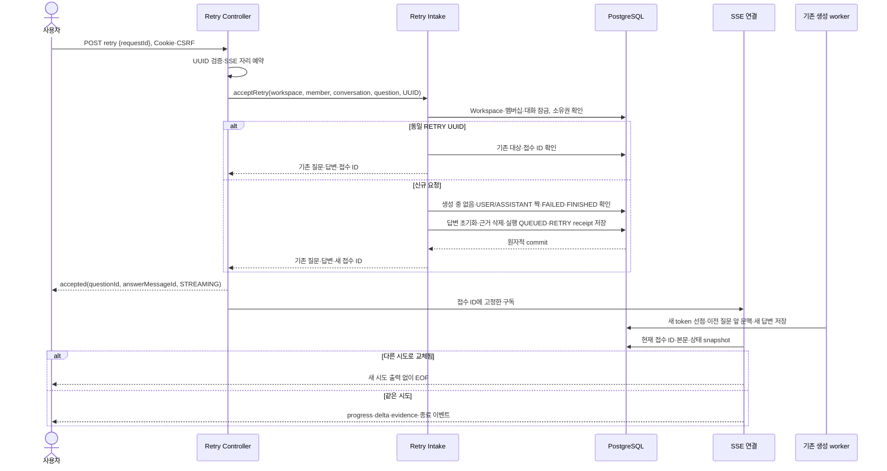

# #569 탐색 실패 답변 재시도 구현 계획

2026-10-12 정합성 갱신: #607 병합 뒤 부모 스택의 미병합 탐색 migration을 V45~V48로 재배치했다. 녹음 V44 적용 DB에서 새 migration을 순서대로 적용하고 실패 답변·부분 본문을 보존하는 PostgreSQL 검증이 통과했다. 아래 V43/V44 충돌 등은 최초 구현 당시 기록이다. 재시도에는 새 migration을 추가하지 않고 outOfOrder도 사용하지 않는다. 운영 DB 적용 상태는 미관측이다.

- 확인일: 2026-10-12
- 상태: TDD 구현·검증 완료. 사용자 승인에 따라 커밋·push·Draft PR 게시까지 진행한다. 실행 관측은 하단 기록을 기준으로 한다.

## 1. 범위와 브랜치

대상은 [Issue #569](https://github.com/woowacourse-teams/2026-knot/issues/569)의 `POST /api/v1/workspaces/{workspaceId}/search/conversations/{conversationId}/questions/{questionId}/retry`다. 실패한 답변의 질문·답변 ID를 재사용하고 새 USER를 만들지 않는다.

`be/feature/#566`의 `a812c835`에서 **`be/feature/#569`**를 분기했다. 부모는 [Draft PR #611](https://github.com/woowacourse-teams/2026-knot/pull/611)이다. 아직 develop에 병합된 구현이 아니다. 기존 main checkout의 미커밋 문서를 보존하고 이미 이 작업에 연결된 `search-pr-split` worktree에서 구현한다.

| 자료·확인 시점 | 적용 사실 | 판정 |
| --- | --- | --- |
| #569 본문, 2026-10-12 조회 | FAILED 답변 재사용, 오류·근거 교체, 동일 요청 복구 우선, 다른 대상 충돌, 과거 질문 이후 문맥 제외, 첫 실패 성공 시 목록 복원 | 이번 구현 계약 |
| [재시도 API 원문](https://app.notion.com/p/3ebb4351752280748205d40eb6f80f99), 본문/속성 revision 2026-09-30 01:25 UTC, capture 02:19 UTC | 기존 질문 재사용·SSE accepted·횟수 제품 제한 없음 | 로컬 캐시 사본. 표의 일부 내용은 수집되지 않아 Issue·사용자 제공 명세로 보완. 운영 원문을 실시간 조회한 결과가 아님 |
| [도메인 규칙](https://app.notion.com/p/3e3b4351752280cd9f06edc2ccdff1d8), manifest revision 2026-10-10 12:31 UTC/capture 13:17 UTC; 탐색 절 확인 | 개인 대화, 생성 중 새 질문 금지, 화면 이동과 녹음 독립 | 현재 범위의 근거 사본 |
| [ERDiagram](https://app.notion.com/p/3e4b4351752280cd86c7dc92aac63fd1), revision 2026-10-07 10:45 UTC/capture 13:07 UTC; 탐색 절 확인 | 대화별 sequence UNIQUE, 질문/답변 역할, Document 근거 연결 | 저장 모델 근거. 기존 근거 3개 저장 제약은 승인한 전체 보존 결정·V43 실제 코드가 대체 |
| SearchMessage·Execution·Receipt·Snapshot·SSE·History와 V41~V44 | 실패 본문/실행 token/접수 ID/현재 snapshot을 이미 저장. 재시도 전이는 없음 | #566 브랜치 구현 관측 |
| develop migration 목록과 열린 #607·탐색 스택, 2026-10-12 조회 | develop 최고 V38, 탐색 부모·녹음 #607에 V44 충돌 | 병합 전 해결할 부모 위험. 이번 작업은 migration을 추가하지 않음 |

현재 코드에서 receipt는 IDENTITY ID를 가지고 같은 답변에 여러 RETRY 접수를 기록할 수 있다. 이를 **시도 식별자**로 쓰면 QUEUED 때부터 이전 시도의 SSE를 구분할 수 있다. 실행 선점 token만 쓰면 재시도 접수 직후 token이 null인 구간과 첫 poll 전에 끝난 시도를 구분하기 어렵다.

예상 변경량은 production 350~500줄, 테스트 800~1,150줄, 문서 180~260줄, 전체 1,330~1,910줄이다. 실제 diff로 최종 측정하며 2,000줄을 넘으면 접수 기반과 HTTP 연결 스택으로 나눈다. 새 검색 기술·LLM 설정·다른 API 기능을 추가하지 않는다.

## 2. 구현할 흐름

화면에 남아 있는 실패 질문에서 재시도를 누르면 UUID를 보낸다. 서버는 현재 멤버와 대화 소유권을 먼저 확인하고 같은 RETRY UUID의 접수를 복구한다. 신규 요청만 생성 중 여부와 USER 다음 sequence의 FAILED ASSISTANT·종료 실행을 확인한다. 본문·오류·근거·실행 진행 정보를 초기화하고 접수 ID와 함께 커밋한다. accepted 뒤 기존 worker와 SSE를 사용한다.

동일 요청 복구는 진행 중 검사와 생성 가용성 검사보다 먼저다. 오래된 접수를 다시 보내도 새 실행은 만들지 않는다. 이미 다음 시도로 교체되면 옛 접수는 accepted 뒤 EOF이며 다른 시도의 본문·종료 상태를 전송하지 않는다. GET events는 현재 시도의 snapshot을 복구한다. UI가 같은 answerId의 버퍼를 초기화해야 하는 계약은 문서에 명시한다.

## 3. 나올 코드와 메서드 초안

| 위치·클래스 | 기존 책임 / 추가 제안 |
| --- | --- |
| SearchMessage | `retry()` 추가: FAILED ASSISTANT만 STREAMING·빈 content·null failureCode로 바꿈. ID·sequence·createdAt 유지 |
| SearchAnswerExecution | `retry()` 추가: FINISHED만 QUEUED로 바꾸고 token·기한·stage·count 초기화. 이후 새 claim token으로 이전 callback 거절 |
| SearchRequestReceipt | `retry(...)` factory: RETRY와 questionId target, 질문·답변 연결 저장 |
| SearchRepository/JPA adapter | RETRY UUID 조회, 답변별 최신 receipt, conversation+sequence의 답변 조회, 답변 근거 삭제 |
| SearchAnswerRetryService(신규) | `acceptRetry`: 권한·멱등·활성 생성·질문 짝 검증과 상태 초기화/접수 저장을 한 트랜잭션으로 실행 |
| SearchQuestionAcceptedResult | JSON에 노출하지 않는 receiptId 추가. 첫/후속/재시도 모두 실제 저장 접수 ID 전달 |
| SearchAnswerSnapshotService/Result | 해당 답변의 최신 receiptId를 내부 snapshot에 포함 |
| SearchAnswerStream/두 Connection | `openRetry`의 accepted payload 구성. 처음부터 receiptId 고정, poll 전에 시도 변경 검사. 공개 GET snapshot payload 유지 |
| SearchAnswerRetryRequest(신규)·SearchQuestionApi/Controller | 엄격한 문자열 UUID와 Content-Type 검증. 기존 질문 Controller의 retry 메서드로 인증·CSRF·JSON 오류 처리·예약 해제·Swagger를 연결 |

검색·LLM adapter·HistoryQuery는 재사용한다. 이력은 retry question의 sequence 앞에 있는 COMPLETED·STOPPED 쌍만 읽으므로 뒤쪽 질문을 근거/문맥으로 끌어오지 않는다. 기존 첫 질문과 후속 질문에는 내부 receiptId만 전달하고 공개 accepted 필드는 유지한다.

## 4. 저장 기반과 주의할 점

| 테이블 | 변경 |
| --- | --- |
| search_messages | 기존 ASSISTANT의 FAILED→STREAMING, content='', failure_code=NULL |
| search_answer_executions | 같은 answer_id 행을 QUEUED로 복구. token/deadline/stage/excluded_count=NULL |
| search_evidences | 대상 answer의 기존 연결만 삭제 |
| search_request_receipts | RETRY 접수 추가. UUID·대상 질문·기존 메시지 ID 저장, 대화 보존 기간 유지 |
| search_conversations | 접수 활동 시각 갱신. 첫 실패 대화는 접수만으로 노출하지 않고 기존 worker가 성공 완료 시 복원 |

잠금 순서는 기존 Workspace→현재 멤버십→Conversation→Execution을 따른다. 멤버 탈퇴·질문 추가·중지·완료와 동일 Conversation 잠금을 공유한다. 같은 UUID의 다른 질문/대화 재사용은 현재 Workspace·Member의 RETRY 조회 후 409로 거절하며 Workspace 잠금으로 접수 경쟁을 직렬화한다. 스키마의 기존 scope UNIQUE와 FK/CHECK를 유지한다.

모든 저장은 한 트랜잭션이며 오류가 나면 본문·근거·작업·receipt가 함께 되돌아간다. FIFO sequence를 새로 만들지 않는다. 과거 질문도 짝이 유효하고 FAILED이며 대화에 실행 중 답변이 없으면 재시도할 수 있다. 실패 code나 receipt ID를 public snapshot 필드로 임의 추가하지 않는다. 운영 공급자 품질·배포와 부모 V44 충돌은 로컬 검증으로 해소됐다고 주장하지 않는다.

## 5. TDD와 검증 순서

1. Message·Execution retry 전이와 Receipt factory 성공·실패 테스트를 먼저 실행해 RED를 확인하고 메서드별 최소 구현한다.
2. PostgreSQL에서 기존 ID/sequence/행 수 유지, 본문/code/근거 초기화, 새 receipt·QUEUED와 원자 rollback을 검증한 뒤 Repository·acceptRetry를 구현한다.
3. 권한·틀린 역할/대화/짝·비FAILED·다른 생성 중·같은 UUID 복구·다른 대상 충돌·동시 retry/후속 질문을 검증한다.
4. SSE 테스트에서 QUEUED 재시도 직후의 옛 연결, 첫 poll 전 교체, 동일 길이 새 본문과 오래된 POST 접수 복구의 누출을 RED로 재현한다. receiptId 고정과 token fencing을 연결한다.
5. 실제 HTTP·cookie·CSRF·SSE의 accepted→완료, 접수 후 실패, 단절 뒤 생성 지속, snapshot 복구·목록 복원을 검증한 뒤 route·Swagger를 연결한다.
6. 재시도 질문 앞의 문맥만 전달하고 이전 token의 delta·완료·실패·근거 저장이 모두 거절되는지 검증한다. 기존 adapter를 바꿀 필요가 없으면 회귀 테스트만 추가한다.
7. 실제 API 문서와 결과를 기록하고 전체 `spotlessCheck check bootJar`, governance·diff 검사를 실행한다. Persona 보고서·finish 관측을 남긴다.

| 테스트 방식 | 관측 기준 |
| --- | --- |
| 도메인 단위 | FAILED/FINISHED만 초기화, 불변 식별자·시각, 기존 token 거절 |
| PostgreSQL 통합 | USER/ASSISTANT 추가 0건, FK·상태 CHECK·receipt 범위, 동시 한 번 접수와 rollback |
| SSE 단위 | 새 시도 본문/근거/종료 이벤트가 옛 연결로 전송되지 않음, 정상 QUEUED→RUNNING 구독 유지 |
| 실제 HTTP 인수 | 400/401/403/404/409/500과 신규 저장 0건, JSON 오류/SSE 성공·예약 해제·종료·단절 |

집중 명령은 `./gradlew test --tests '*Search*Retry*'`, `integrationTest --tests '*SearchAnswerRetryIntegrationTest'`, `acceptanceTest --tests '*SearchAnswerRetryAcceptanceTest'`다. 클래스명은 구현 중 확정한다. 최종 공유 변경에는 전체 check를 사용한다. 테스트→메서드 최소 구현 커밋을 인접하게 두고 adapter·HTTP·문서를 별도 커밋한다.

## 6. 완료 기준과 다음 작업

실패 답변 ID를 재사용해 재시도하고 새 생성 결과를 저장할 수 있어야 한다. 같은 요청은 다시 생성하지 않고 옛 시도는 새 답변을 덮어쓰거나 구독하지 못해야 한다. 첫 실패 성공 후 목록 복원·현재 snapshot·과거 질문 문맥·녹음 독립을 검증한다.

이번 요청은 계획 뒤 구현·커밋·push·Draft PR 게시까지 승인했다. base는 #566, 라벨은 BE·Feature·흑곰, 담당자는 jyt6640을 유지한다. 이후 FE 통합·실제 모델 질문 평가·스택 리뷰와 develop 통합 전 V44 충돌을 처리한다.

### 구현과 PR 분리 기록

- 도메인 전이 미구현·SSE 생성자 미구현·실제 HTTP route 미구현 RED를 관측한 뒤 최소 구현으로 GREEN 처리했다. Domain 5개, 집중 PostgreSQL 15개, 실제 로컬 HTTP 인수 13개가 통과했다.
- 접수 ID를 내부 시도 식별자로 전달하고 첫/후속 요청·재연결도 같은 receipt 경계를 사용한다. 공개 accepted·snapshot에 내부 ID를 노출하지 않는다. 이전 token의 append/retrieval/complete/fail은 거절된다.
- 기존 근거 삭제·새 사용 근거 저장·롤백, 후속 질문과 재시도의 동시 접수, 잘못된 질문 쌍, 완료된 동일 요청 복구, 부분 실패·명시 재시도·연결 종료 후 worker 완료·GET snapshot을 검증했다.
- 테스트 fixture가 기존 Job SUCCEEDED·Document archived_at CHECK를 따르도록 수정했다. 인수 테스트 뒤 남은 접수 작업을 실행해 SSE polling을 정상 종료하며 graceful shutdown을 관측했다.
- 실제 전체 변경량은 최초 추정 상한을 넘는다. 첫 Draft는 `be/refactor/#569`(base `be/feature/#566`, commit `3ce7bc51`)의 접수·시도 분리 기반, 마지막 Draft는 `be/feature/#569`(base `be/refactor/#569`)의 HTTP·추가 인수 검증·명세로 나눈다. 각 PR 전체 diff 2,000줄 이하로 최종 측정한다.
- 첫 분리 HEAD는 spotlessCheck·집중 unit/integration·bootJar 통과. 최종 HEAD의 전체 회귀·Persona 종료·원격 게시 결과는 후속 완료 기록으로 확정한다.
- [프론트엔드 API 계약](../api/search-answer-retry.md)에 버퍼 교체와 오래된 요청 EOF 규칙을 기록했다. 이 작업은 migration을 추가하지 않는다.
- 최종 `./gradlew spotlessCheck check bootJar`는 2분35초에 통과했다. 단위1,109·통합549·인수523=2,181개, 실패·오류·skip0. governance 단위8개와 diffcheck·API 문서 필수 섹션/JSON 예제 검증도 통과했다.
- 검증은 실제 로컬 HTTP/PostgreSQL과 제어된 retrieval/generation adapter 기준이다. 운영 모델 의미 품질·proxy·배포 관측으로 확대하지 않는다.
- Persona implementation/review report-filled는 성공했다. finish implement는 기존 전역 다섯 blocker(report-coverage-missing/java-role-read-coverage-missing/convention-toolchain-missing/workflow-loop-state-stale/pending-ticket)로 exit1이다. 누적 pending을 초기화하지 않았으며 제품 테스트 성공과 종료 인증을 구분한다.
