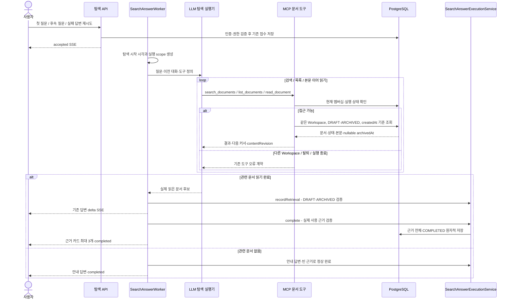

# #670 생성 완료 DRAFT 문서 탐색 구현 계획

- 상태: 구현·로컬 자동 검증 완료. 아래 설계/TDD 순서는 승인 계획이며 실행 결과는 마지막 절에 기록한다. 실제 모델 QA는 미검증이다.
- 확인 날짜: 2026-10-14 KST
- 대상: [#670 탐색 대상에 생성 완료된 DRAFT 문서 포함](https://github.com/woowacourse-teams/2026-knot/issues/670)
- 담당: 흑곰 / jyt6640

## 1. 범위와 브랜치

현재 Workspace 멤버가 문서 화면에서 읽을 수 있는 생성 완료 DRAFT를 탐색에서도 검색·목록 조회·본문 읽기·답변 근거로 사용할 수 있게 한다. 개인 확인 상태와 녹음 참여 여부는 탐색 대상 제한으로 사용하지 않는다. ARCHIVED도 계속 포함한다.

HTTP API를 추가하지 않는다. 첫 질문·후속 질문·재시도가 공통으로 사용하는 MCP 문서 도구와 근거 검증을 변경한다. 메시지 조회·재연결·중지는 저장된 근거를 기존 응답 형식으로 반환한다. 실제 사용 근거 전체 보존과 표시 카드 최대 3개, `excluded_documents.count=0`을 유지한다.

### 브랜치 기준

계획 시 로컬은 `develop`의 `61f635bf`, fetch한 `origin/develop`은 `3a8bded5`다. 로컬이 4커밋 뒤에 있다. 차이는 전사 migration 복구 #667이며 탐색 production 코드는 같다. 구현 브랜치는 최신 develop에서 `be/feature/#670`으로 만든다. 이번 작업은 이전 탐색 스택 브랜치를 기준으로 삼지 않는다.

아래는 구현 시작 시 실행할 순서이며, 계획 작성 중에는 실행하지 않았다.

```bash
git fetch origin develop
git switch develop
git merge --ff-only origin/develop
git switch -c 'be/feature/#670'
cd backend
npx ph workflow implement
```

현재 작업 폴더에는 제품 기준·Notion 정합 문서·FE SSE와 AI 개발 도구 관련 미커밋 변경이 있다. 구현 시작 전에 기존 변경을 보존하고 깨끗한 작업 상태를 확보한다. 기존 수정 위에 바로 pull하거나 변경 전체를 이번 작업으로 커밋하지 않는다.

열린 PR은 #668 FE 실패 표시·재시도 연결과 #527 FE 토스트다. #670의 선행 병합 조건은 아니며, FE 공개 응답 구조도 변경하지 않는다. 구현 시작 시 원격 기준과 열린 PR을 다시 확인한다.

### 근거

| 출처·확인 기준 | 적용 사실 | 판정 |
| --- | --- | --- |
| #670 본문, 2026-10-14 GitHub 조회 | 생성 완료 DRAFT·ARCHIVED 모두 포함, 개인 확인 상태 무관, createdAt 기준, 상태 전환 중 연속 조회 | 사용자 결정이 반영된 구현 계약. Issue OPEN이며 구현·팀 승인 완료를 뜻하지 않음 |
| `backend/docs/product/current-v2-mvp.md`, 문서·접근 범위 | 생성 즉시 DRAFT 읽기 가능, 확인 완료 후 ARCHIVED, 현재 멤버에게 읽기 허용 | 현재 제품 기준. 기존 사용자 수정 보존 |
| [문서 목록 API](https://app.notion.com/p/api-v1-workspaces-workspaceId-documents-3ebb435175228015bf4dc8d04281b461), 캐시 revision 2026-10-12T09:29Z / 수집 16:15:57Z | 생성 완료 DRAFT 즉시 읽기, 확인 의무와 접근 권한 분리 | 운영 원문 캐시 근거. 이번 계획에서 live 재조회하지 않음 |
| [문서 상세 API](https://app.notion.com/p/api-v1-workspaces-workspaceId-documents-documentId-3ebb4351752280289a59e5e52a060471), 캐시 revision 2026-10-08T17:06Z / 수집 17:43:16Z | DRAFT의 archivedAt은 null, 본문은 읽기 전용 | 운영 원문 캐시 근거 |
| [UseCase](https://app.notion.com/p/UseCase-3e3b4351752280cd9f06edc2ccdff1d8), 캐시 revision 2026-10-12T02:06Z / 수집 04:03:37Z | Workspace 범위 분리, 문서 근거, Transcript 직접 검색 제외 | 운영 원문 캐시 근거. 실제 근거 전체 보존·카드 3개·제외 수 0은 후속 사용자 결정 우선 |
| `SearchDocumentQueryAdapter`, `SearchAnswerExecutionService`, 기존 PostgreSQL 테스트 | 조회와 근거 저장이 현재 ARCHIVED만 허용 | 코드 관측. #670에서 변경할 부분 |
| V27 문서 schema, V47 근거 rank 확장, 최신 develop migration 목록 | 이미 DRAFT·nullable archivedAt·전체 근거 저장 지원 | 저장소 정의 관측. 실제 Dev RDS 적용 상태를 조회한 결과는 아님 |

캐시 대상은 관련 API·도메인 본문만 읽었다. 수집 완료나 API 구현 표시를 런타임 동작 검증으로 취급하지 않는다. 과거 ARCHIVED 전용 탐색 결정은 #670 범위에서 교체하며, 문서 확인 상태 자체에 관한 #496 결정은 유지한다.

### 예상 코드 변경량

아래는 추가와 삭제를 합친 diff 줄 수 추정이다. 신규 파일의 전체 길이나 글자 수를 뜻하지 않는다.

| 범위 | 추정 | 근거 |
| --- | ---: | --- |
| Production | 80~160줄 | 조회 SQL 2곳·nullable 매핑·문서 메타데이터·근거 상태 검증·MCP 설명·프롬프트 |
| 테스트 | 300~550줄 | DRAFT 제외 사례 교체, 시각·상태 전환·권한·근거 롤백·실제 MCP 경로 회귀 |
| 계획·ADR·제품/API 문서 | 250~350줄 | 이 계획, Proposed ADR, 현재 명세의 ARCHIVED 전용 문구 정합 |
| 합계 | 약 630~1,060줄 | 기존 작업 기반을 재사용하며 새로운 API·검색 엔진·테이블을 추가하지 않음 |

PR 하나가 적절하다. 구현 diff가 예상보다 커지면 테스트 fixture나 불필요한 구조 변경이 원인인지 먼저 확인한다. 커밋은 아래 동작 단위로 나눈다.

## 2. 구현할 흐름

사용자가 질문을 보내면 기존 인증·CSRF·Workspace 멤버십 검사를 거쳐 생성 작업이 시작된다. 실행기가 만든 `SearchToolScope.startedAt`을 이번 탐색의 기준 시각으로 사용한다. 모델은 검색·목록·읽기 도구를 반복 호출하며, 도구마다 실행 상태와 현재 멤버십을 다시 확인한다.

대상은 같은 Workspace의 `status IN ('DRAFT', 'ARCHIVED')`이고 `created_at <= startedAt`인 Document다. 날짜 필터와 정렬은 기존 녹음 시각 기준을 유지한다. DRAFT는 `archivedAt=null`로 반환하며 내부 MCP 메타데이터에 문서 상태를 전달한다.



탐색은 문서 확인이나 보관 상태를 바꾸지 않는다. `document_confirmations`에 대상 행을 만들거나 확인 시각을 쓰지 않으며, Document를 자동 archive하지 않는다. 쓰기는 기존 질문·답변·생성 작업·SearchEvidence에만 발생한다.

예를 들어 DRAFT인 문서를 읽다가 다른 멤버가 확인을 완료해 ARCHIVED로 바뀌어도, 본문이 같다면 같은 커서로 이어 읽고 근거로 저장할 수 있어야 한다. 탐색 시작 후 생성된 문서는 이번 실행에서 제외하고 다음 질문 또는 재시도의 새 실행에서 조회한다.

## 3. 나올 코드와 메서드 초안

기존 Controller·API DTO·접수 서비스·작업 실행기·MCP 인증 및 전송·검색 점수·본문 분할·SSE 상태 흐름을 재사용한다. 별도 탐색 정책 테이블이나 신규 서비스 계층은 만들지 않는다.

| 기존 위치·클래스 | 변경 책임 | 메서드·입출력과 부작용 |
| --- | --- | --- |
| `search/infrastructure/SearchDocumentQueryAdapter` | 공통 SELECT와 단건 SQL의 상태·시각 조건 변경, nullable 시각 변환 | `searchPage(scope, parameters, cursor)` / `listPage(...)` → DRAFT·ARCHIVED 후보. `find(scope, documentId)` → 동일 정책의 단건 또는 empty. DB 읽기만 수행 |
| 같은 QueryAdapter의 `map(...)` | status 읽기와 archivedAt null 처리 | ResultSet → `SearchDocumentRecord`. null을 임의의 createdAt으로 채우지 않음 |
| `search/application/dto/result/SearchDocumentRecord`, `SearchDocumentCard` | 내부 도구 결과에 `DocumentStatus status` 전달 | 기존 createdAt·archivedAt·recordingStartedAt·contentRevision 유지. FE 근거 카드 응답에 상태 필드 추가하지 않음 |
| `search/application/SearchDocumentToolService` | DTO 상태 매핑 | 기존 `card(...)` 변경. `search`, `list`, `read`의 권한·커서 검증을 재사용 |
| `search/application/SearchAnswerExecutionService` | 검색 후보와 최종 사용 근거에 두 상태 허용 | `recordRetrieval(...)`과 `complete(...)`가 공유하는 `requireDocument(...)` 변경. 멤버십·Workspace·실행 token·후보 ID 검증과 원자적 저장 유지 |
| `search/infrastructure/mcp/SearchMcpTools` | 세 도구의 범위를 정확히 설명 | 기존 `definition(...)` 설명을 생성 완료 DRAFT·ARCHIVED로 갱신. 도구 이름·요청 parameter·통신 경로 유지 |
| `search/infrastructure/SearchMcpDocumentRetriever` | 탐색 instructions 정합 | `retrieve(scope, question)`의 tools → tool_calls → 결과 전달 흐름 유지. 확인 상태를 기록의 사실성이나 회의 결정 여부로 판단하지 않도록 명시 |
| `src/main/resources/prompts/search-answer-system.md` | 최종 답변의 확인 상태 해석 정합 | 이미 존재하는 AI 생성 기록·원본 검증 제한을 재사용. 필요한 경우 DRAFT/ARCHIVED는 확인·보관 상태라는 설명만 보완 |

현재 `requireDocument`는 최종 완료뿐 아니라 `recordRetrieval`에서도 호출된다. 검색 SQL만 수정하면 DRAFT를 찾고도 답변 생성 전에 실패하므로 두 검증 경로를 함께 테스트한다.

새 public 메서드는 필요하지 않다. 상태 허용 여부·nullable 시각 변환이 반복되면 의미가 명확한 private 메서드로 분리한다. enum의 미지원 값이 조회 조건에서 무조건 허용되지 않게 한다. 오류에는 기존 `SearchException`·`SearchToolException`을 사용한다.

## 4. 저장 기반과 주의할 점

| 저장 데이터 | 사용 필드·관계 | #670 처리 |
| --- | --- | --- |
| documents | workspace_id, status, created_at, nullable archived_at, content | DRAFT·ARCHIVED 조회 허용. 상태 변경 없음 |
| recording_sessions | 문서 FK·Workspace·started_at | 문서/녹음 Workspace 일치와 기존 날짜 필터·정렬 유지 |
| document_confirmations | 개인 확인 대상·confirmed_at | 탐색 조건에 사용하지 않고 수정하지 않음 |
| search_evidences | answer message_id, document_id, rank | DRAFT도 FK 근거로 저장. 실제 사용 근거 전체 저장, 표시 최대 3개 |

V27은 이미 `DRAFT + archived_at IS NULL`과 `ARCHIVED + archived_at IS NOT NULL` 조합을 CHECK로 보장한다. `(workspace_id, created_at DESC, id DESC)` 인덱스도 있다. 따라서 이번 계약에는 schema migration이나 기존 문서 backfill이 필요 없다. 최신 원격에 V51 복구 migration이 있으나 이를 변경하거나 번호를 재사용하지 않는다.

큰 fixture에서 실행 계획이 문제를 드러내면 조회 SQL의 `EXPLAIN (ANALYZE, BUFFERS)`로 확인한다. 기존 인덱스가 키워드 ILIKE와 녹음 시각 정렬 전체를 해결한다고 가정하지 않는다. 측정 없이 새 인덱스나 검색 엔진을 이번 작업에 추가하지 않는다.

### 기준 시각과 상태 전환

- 대상 시간 조건은 `created_at <= scope.startedAt`이다. 경계 시각과 바로 이후를 테스트한다. 기준 시각은 HTTP 접수 시각이 아니라 현재 Worker가 생성하는 탐색 실행 시작 시각이다.
- 기존 `archived_at <= cutoff`를 남기면 시작 후 보관된 문서가 빠지므로 검색·목록·단건에서 모두 제거한다.
- 목록/검색 커서는 기존 score·녹음 시각·ID 기준이다. 상태 전환을 정렬키에 넣지 않는다.
- 본문 이어 읽기는 기존 contentRevision과 offset을 검증한다. 보관 전환만으로는 revision이 바뀌지 않으며, 본문이 바뀌면 기존 `DOCUMENT_CHANGED` 검증을 유지한다.
- createdAt 필터는 시간 기준 대상 제한이며 DB 전체의 고정 snapshot을 뜻하지 않는다. 시작 전에 생성 시각을 갖고 늦게 커밋된 행의 가시성을 고정하는 추가 장치는 이번 계약에 없다.
- PostgreSQL timestamp 정밀도에 맞는 fixture로 경계를 검증한다. JVM nanosecond 값만으로 SQL 경계 동작을 단정하지 않는다.

### 근거 저장과 권한

`recordRetrieval`과 `complete`의 현재 멤버십·Workspace·실행 상태 검증을 유지한다. 잘못된 Workspace 문서가 사용 근거에 섞이면 부분 근거와 COMPLETED가 남지 않도록 트랜잭션 전체 롤백을 확인한다. 본문을 실제 읽었는지와 모델의 evidence ID가 허용 후보인지에 관한 기존 검증을 약화하지 않는다.

Transcript·오디오·생성 중/실패 Job은 직접 검색하지 않는다. DRAFT는 생성 완료 Document이므로 정상 대상으로 포함하며, Job 수를 제외 문서 수로 세지 않는다.

### ADR와 문서

Issue가 지정한 `backend/docs/adr/670-search-generated-draft-documents.md`는 구현 시작 시 검증된 결정 snapshot과 실제 Issue 번호로 `harness/materialize_adr.py --implementation`을 통해 Proposed로 생성한다. 계획 작성 단계에는 ADR을 생성하지 않는다. 실제 검토한 대안은 ARCHIVED 전용 유지와 생성 완료 DRAFT·ARCHIVED 포함이며, 팀 리뷰 전 Accepted로 바꾸지 않는다.

제품 기준과 `backend/docs/api/search-conversation-create.md`, `search-question.md`, `search-answer-retry.md`의 현재 탐색 범위를 갱신한다. 과거 계획의 ARCHIVED 결정을 조용히 다시 쓰지 않고 필요 시 #670 후속 변경을 연결한다. 이미 수정 중인 제품 문서는 관련 부분만 추가한다.

## 5. TDD와 검증 순서

각 동작은 실패하는 테스트를 먼저 작성하고 실패 원인을 확인한 뒤 최소 구현한다. 목록과 검색은 공통 SELECT를 사용하므로 두 동작의 DRAFT 포함 테스트를 함께 Red로 확인한 뒤 공통 조건을 변경한다. 그 변경으로 뒤의 사례가 이미 Green이면 회귀 검증으로 기록하며 실패를 만들기 위해 코드를 되돌리지 않는다. 기존 DRAFT 제외 테스트는 승인된 계약 변경에 맞게 성공 사례로 교체한다. 권한·변조·실행 종료·본문 변경·롤백 검증은 그대로 유지한다.

| 단계·위치 | 실패하는 테스트 → 최소 구현 | 기대 결과 |
| --- | --- | --- |
| 1. `SearchDocumentToolServiceIntegrationTest` 목록 | DRAFT·ARCHIVED 혼합 목록과 nullable archivedAt, 개인 확인 여부 무관 사례 → 공통 SELECT 상태/createdAt 조건·nullable 매핑 | 두 상태 모두 반환. 문서·확인 행 변경 없음 |
| 2. 같은 테스트의 검색 | 기존 DRAFT 제외 기대를 변경하고 제목·주제·본문 검색 및 비일치 사례 → 기존 검색 점수/페이지 경로에 새 대상 정책 적용 | DRAFT도 관련 검색에 포함. 관련 없으면 빈 결과, 다른 Workspace는 제외 |
| 3. 같은 테스트의 본문 읽기 | `read_failure_draft`를 DRAFT 읽기 성공으로 교체하고 시작 후 생성 문서 읽기 실패 추가 → `find(...)` 조건 변경 | DRAFT 본문 반환. 범위 밖 ID는 기존 DOCUMENT_NOT_FOUND |
| 4. `SearchAnswerExecutionIntegrationTest` | DRAFT 후보 등록·DRAFT 근거 완료 성공, 유효 DRAFT 뒤 외부 문서가 섞인 롤백 → `requireDocument(...)` 변경 | 후보 등록 후 생성 진행, 근거·완료 원자 저장, 외부 문서 거절 시 부분 저장 없음 |
| 5. MCP·retriever 검증 | 실제 `/internal/mcp`의 세 도구 결과 status/nullable archivedAt와 도구 설명, 제어된 LLM이 읽은 DRAFT 전달 확인 → 내부 DTO·매핑·설명·instructions 정합 | 실제 MCP 직렬화와 tool_calls 왕복에서 DRAFT 읽기 가능. 개인 확인 상태를 회의 결정 상태로 해석하지 않도록 지침 제공 |
| 6. PostgreSQL 시각·전환 검증 | 시작 전/동일/후 생성 시각, 페이지 사이 보관 전환, read continuation 사이 보관 전환 → 누락된 조건만 보완 | 시작 후 문서 제외. 보관 전환으로 문서 누락/중복이나 DOCUMENT_CHANGED 발생 없음 |
| 7. 첫 질문·후속 질문·재시도 인수 | 기존 3개 AcceptanceTest에 DRAFT 검색 후보와 사용 근거 연결 → 공통 흐름의 누락 수정 | accepted·delta·evidence·completed, DRAFT 근거 저장, 이후 메시지/재연결 조회에서 같은 카드 확인 |
| 8. 문서·검증 gate | ADR·제품/API 정합 및 관련 회귀 → 필요한 문서 갱신 | 현재 계약 일치, 포맷·단위·PostgreSQL·인수 검증 완료 |

권한 검증에는 같은 Workspace의 다른 멤버, 생성 후 가입한 NOT_REQUIRED 멤버, PENDING 멤버의 DRAFT 접근 성공과 탈퇴·다른 Workspace 접근 거절을 포함한다. 탐색이 `document_confirmations`의 행 수/확인 시각과 문서 status/archivedAt을 바꾸지 않았는지도 DB로 확인한다.

검색과 목록의 시작 후 문서 제외, archive 전환 중 다음 페이지·본문 이어 읽기는 실제 PostgreSQL 트랜잭션으로 검증한다. 순차 전환 시나리오와 경합 검증을 구분하고, 경합을 주장할 때는 두 스레드·별도 트랜잭션과 latch로 순서를 통제한다.

### 검증이 증명하는 범위

- PostgreSQL/Testcontainers: SQL 대상 제한, nullable 매핑, 페이지 경계, 상태 전환, 근거 FK·롤백, 문서/확인 데이터 부작용.
- 실제 로컬 MCP HTTP + 제어된 LLM 응답: 도구 정의·직렬화·검색/읽기 결과 전달. 외부 모델이 스스로 올바른 문서를 찾는 품질을 증명하지 않음.
- 기존 첫 질문·후속·재시도 AcceptanceTest: 실제 Security·HTTP·SSE·DB 연결, 제어된 retriever/generator로 DRAFT 후보를 받았을 때의 생성·저장 흐름. 이것만으로 실제 검색 SQL을 검증했다고 주장하지 않음.
- 수동 실제 모델 QA: DRAFT/ARCHIVED 혼합 fixture로 실제 선택·검색·읽기·답변 출처 확인. 모델·배포 버전·문서 ID와 상태·질문·도구 호출·종료 상태를 기록하며, synthetic 테스트와 별도 결과로 남김.

### 동작 단위 커밋 후보

1. 목록의 생성 완료 문서 범위와 nullable 시각 매핑.
2. 키워드 검색의 DRAFT 포함과 경계 검증.
3. DRAFT 본문 읽기와 보관 전환 중 이어 읽기.
4. 후보 검증·최종 근거 저장의 DRAFT 허용 및 롤백.
5. MCP 문서 메타데이터·도구 설명·탐색 지침.
6. 첫 질문·후속·재시도 및 저장 근거 조회 회귀.
7. ADR·제품/API 명세 정합.

동작마다 가능한 `test → feat` 순서로 명시적인 path/hunk만 stage한다. Red 테스트 커밋은 의도와 다음 구현을 명확히 한다. 구조 개선이 실제 필요할 때만 refactor 커밋을 추가한다. 이 목록은 커밋·푸시·PR 게시 권한을 뜻하지 않는다.

### 검증 명령

아래는 `backend/build.gradle`의 실제 `test`/`integrationTest`/`acceptanceTest` 구분을 확인한 예정 명령이다. backend 디렉터리에서 Java 25와 Docker/Testcontainers 환경으로 실행한다.

```bash
./gradlew integrationTest --tests '*SearchDocumentToolServiceIntegrationTest' --tests '*SearchAnswerExecutionIntegrationTest'
./gradlew test --tests '*SearchMcpDocumentRetrieverTest' --tests '*SearchStreamingAnswerGeneratorTest' --tests '*SearchMcpClientTest'
./gradlew acceptanceTest --tests '*SearchQuestionAcceptanceTest' --tests '*SearchFollowupQuestionAcceptanceTest' --tests '*SearchAnswerRetryAcceptanceTest'
./gradlew acceptanceTest --tests '*SearchMessageListAcceptanceTest' --tests '*SearchAnswerEventsAcceptanceTest' --tests '*SearchAnswerStopAcceptanceTest'
./gradlew spotlessCheck check
git diff --check
npx ph workflow finish implement
```

MCP HTTP 검증은 기존 `SearchDocumentToolServiceIntegrationTest`에서 실행한다. 새 테스트를 별도 클래스로 분리하면 해당 focused 명령을 추가한다.

최종 Persona gate 전에 `.persona/workflow/implementation-report.md`와 `review-report.md`를 작성한다. 테스트 결과와 외부 모델 관측을 구분하고 미실행 항목을 성공으로 기록하지 않는다.

## 6. 완료 기준과 다음 작업

- 생성 완료 DRAFT·ARCHIVED가 멤버 확인 여부와 관계없이 검색·목록·읽기·실제 답변 근거로 사용된다.
- 권한 밖 문서와 탐색 시작 후 생성된 문서는 기존 오류·제외 계약을 따른다.
- DRAFT의 null archivedAt, 보관 전환 중 페이지·본문 이어 읽기·근거 저장이 PostgreSQL에서 검증된다.
- 문서 확인/보관 데이터는 탐색으로 바뀌지 않는다. 실제 사용 근거 전체 보존·표시 카드 3개·제외 수 0이 유지된다.
- 첫 질문·후속 질문·재시도와 메시지·재연결·중지 회귀가 통과하고 제품/API/ADR이 새 정책과 일치한다.
- 실제 모델 QA 결과와 코드 테스트 결과를 분리하여 기록한다. 모델이나 Dev 배포 접근이 없어 실행하지 못하면 해당 결과를 미검증으로 남긴다.

현재 추가 제품 결정은 필요 없다. 아래 실행 결과대로 로컬 구현과 자동 검증을 완료했다. 사용자가 커밋·푸시·PR 게시를 요청했으므로 develop 베이스 PR 하나로 제출하고, 외부 모델 수동 QA는 미검증 항목으로 명시한다.

### 2026-10-14 실행 결과

- 구현 시작 때 최신 develop은 `22608131`이었다. FE #668도 병합된 이 커밋에서 `be/feature/#670`을 생성했다.
- 기존 변경은 `preserve before issue 670 implementation` stash `ce64c95d40bc595300c4a41ba3774080765cb543`에 보존했다. 이번 변경에 기존 사용자 변경을 섞거나 stash를 삭제하지 않았다.
- DRAFT 목록·검색·읽기·후보/근거 저장 4개 Red를 먼저 확인하고 최소 구현했다. 공통 SQL과 단건 조회에 createdAt cutoff를 적용하고 nullable archivedAt와 내부 문서 상태를 매핑했다.
- 두 상태의 생성 시각 경계, 단계 사이 보관 전환 중 목록/검색/본문 이어 읽기/근거 저장, 개인 확인 의무와 무관한 다른 작성자 문서 접근, 확인/보관 데이터 무변경 및 외부 문서 근거 롤백을 PostgreSQL에서 검증했다. 새 2-thread 보관 경합 실험은 수행하지 않았다.
- 실제 로컬 MCP HTTP의 메타데이터와 제어된 LLM HTTP 연결, 첫·후속·재시도의 DRAFT 근거 완료 및 재연결 복구를 검증했다.
- 최종 `./gradlew spotlessCheck check bootJar`: PASS, 4분47초. XML 합계 2,625개(단위1,408·통합655·인수562), 실패·오류·skip0. `git diff --check`도 통과했다.
- 로컬 실제 모델 인증 설정이 없어 외부 공급자 QA는 미실행이다. 실제 Qwen 검색 품질·Dev 배포·RDS 동작은 이 테스트로 확인한 것이 아니다.
- Proposed ADR·제품/API 정합을 기록했으며 새 migration·라이브러리·공개 HTTP 응답 필드 추가는 없다. 구현 검증 시점에는 커밋·푸시·PR·배포를 수행하지 않았다. 이후 사용자 요청에 따라 동작 단위 커밋·푸시·Draft PR을 준비하며 배포는 이번 범위에 포함하지 않는다.
- Persona 두 report-filled는 성공했으나 finish는 기존 전역 verification·coverage·Java role·toolchain·stale workflow·pending 조건으로 exit1이다. 실제 제품 Gradle 성공과 구분하며 과거 workflow 이력을 보존했다.
