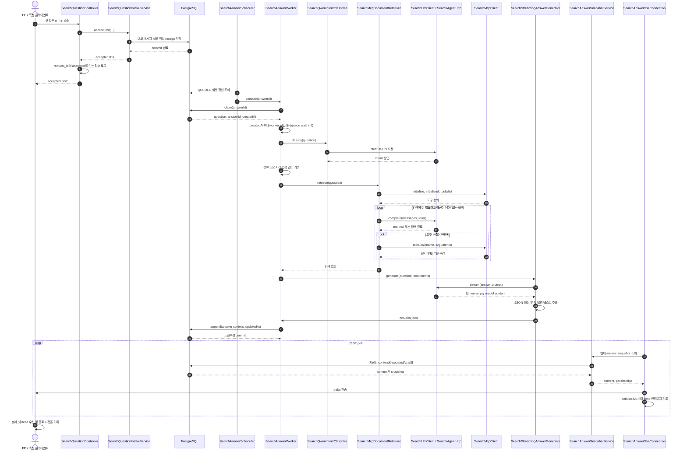

# #722 탐색 첫 delta 지연 구간 계측 계획

- 이슈: [#722 탐색 첫 delta 지연 구간 계측](https://github.com/woowacourse-teams/2026-knot/issues/722)
- 담당자: 흑곰 (`jyt6640`)
- 계획 기준일: 2026-10-16
- 계획 상태: 구현 착수 가능
- 구현 브랜치 제안: 최신 `origin/develop`에서 `be/feature/#722`

## 1. 목표와 범위

첫 질문 요청부터 클라이언트가 첫 `delta`를 받기까지 어느 구간에서 시간이 걸리는지 재구성할 수 있도록 안전한 로그와 반복 측정 기준을 추가한다. 분류, LLM 문서 탐색, MCP 초기화·도구 호출, 답변 생성, 메시지 저장, SSE 전송 시간을 구분하고 기존 `request_id`와 `answerId`로 연결한다.

이 이슈에서는 검색 알고리즘, 프롬프트, 모델·서버 설정을 최적화하지 않는다. 새 검색 fast path나 tracing·metrics 제품을 도입하지 않고, API 이벤트 계약과 DB 스키마도 바꾸지 않는다. 측정 결과를 근거로 성능 개선안을 고르는 일은 계측 이슈 이후 작업이다.

### 조사 근거

| 근거 | 확인한 내용 | 계획에 미치는 영향 |
| --- | --- | --- |
| GitHub Issue [#722](https://github.com/woowacourse-teams/2026-knot/issues/722) | 단계별 시간, 호출 수, prompt 크기, 제공되는 모델 사용량을 기록하고 고정 질문으로 p50/p95를 비교한다. 질문·문서 본문은 기록하지 않는다. | 이 계획의 요구사항과 완료 기준으로 사용한다. |
| `origin/develop` `5f789ab6b1908f96857a797fa751ce0a5dcbbb17` | 현재 탐색 구현과 기존 테스트를 해당 커밋 기준으로 조사했다. 현재 작업 트리는 `be/refactor/#715`이며 `origin/develop`보다 75커밋 뒤이고 다른 변경이 남아 있다. | 구현은 최신 develop에서 분리된 worktree에서 시작한다. 기존 #715 변경은 건드리지 않는다. |
| `backend/docs/qa/697-latency/results.csv`, `backend/docs/qa/697-latency/README.md` | `after` 측정은 워밍업 1회 후 5회다. 분류 p50 947ms, 첫 delta p50 36,120ms, 전체 종료 p50 37,647ms였다. 전체 표본은 COMPLETED였고 예상 사실을 맞췄다. | 분류 이후 약 35초가 아직 어느 단계에서 발생하는지 구분되지 않는다. 작은 표본의 단일 회의 결과이므로 운영 p95나 원인으로 해석하지 않는다. |
| `backend/docs/adr/672-request-id-log-correlation-first.md` 및 PR #673 | 먼저 request ID와 로그를 연결하고 필요한 구간은 수동 계측하며, Java Agent/Tempo는 후속 검토로 둔 방향이다. | 이 이슈는 기존 방향의 검색 단계 적용이다. 새 관측성 플랫폼이나 별도 ADR을 범위에 넣지 않는다. ADR의 Proposed 상태를 이 계획만으로 Accepted로 바꾸지 않는다. |
| `backend/docs/product/current-v2-mvp.md` 및 Notion의 Search Answer Events 계약 | Search V2는 개인·Workspace 범위와 기존 SSE 이벤트를 정의하지만 내부 성능 SLA나 로그 필드를 정의하지 않는다. | 계측은 서버 내부에 한정하고 `accepted`, `progress`, `delta`, 종료 이벤트의 공개 payload를 유지한다. |
| `.persona/project-profile.jsonc`, `.persona/development-guideline.md` | Java 25, Spring Boot 4.1, Gradle, PostgreSQL/JPA, 도메인 우선 단순 계층 구조다. | 기존 로깅·테스트 패턴을 사용하고 라이브 모델은 수동 테스트로 분리한다. |

현재 실측의 `before`와 `after`는 MCP 요청 수가 4회에서 5회로 달라지는 등 흐름이 다르다. 두 수치 차이만으로 분류 호출이 지연을 만들었다거나 다른 단계가 병목이라고 단정할 수 없다. #722는 이 원인을 판단할 관측점을 만드는 작업이다.

## 2. 브랜치와 구현 경계

현재 checkout은 dirty한 #715 작업을 보유하고 `origin/develop`보다 뒤에 있다. 최신 커밋을 직접 pull하거나 이 checkout에서 브랜치를 전환하지 않는다. 구현 시점에 최신 원격을 갱신한 뒤 저장소 루트에서 별도 worktree를 만든다.

```bash
git fetch origin
git worktree add -b 'be/feature/#722' ../knot-722 origin/develop
cd ../knot-722/backend
```

계획 조사 시점의 `origin/develop`은 `5f789ab6b`였다. 구현 착수 때는 `git fetch` 뒤 새 최신 `origin/develop`을 사용한다. 이 계획 작업에서는 브랜치나 worktree를 만들지 않는다.

변경 경계는 검색 도메인 내부 로그, 내부 결과 DTO, 기존 수동 실측 하네스와 QA 결과 문서다. 공개 API 스펙·프론트엔드·Flyway migration은 변경 대상이 아니다.

## 3. 사용자 요청부터 첫 delta까지



HTTP 요청의 `request_id`는 동기 접수 로그에서 `answerId`와 연결한다. 스케줄러가 실행하는 worker 로그는 요청 thread의 MDC가 보존된다고 가정하지 않고 `answerId`를 기본 상관 키로 쓴다. SSE의 `send()` 반환은 서버 측 전송 호출 완료일 뿐 클라이언트 수신 확인이 아니므로, 실제 수신 시각은 수동 측정 클라이언트가 별도로 기록한다.

## 4. 현재 코드와 변경 제안

| 현재 코드 경계 (`origin/develop`) | 현재 동작 | 제안 변경 |
| --- | --- | --- |
| `SearchQuestionController.create`, `ask`, `retry` | 요청을 접수하고 accepted SSE를 연다. 기존 HTTP 로그에는 request ID가 있으나 answer ID와 연결하는 로그가 없다. | 접수 성공 시 `request_id`, `answerId`, 작업 종류를 가진 연결 로그를 남긴다. 내용이나 request body는 남기지 않는다. |
| `SearchAnswerWorker.execute`, `generate`, `append` | 작업을 claim하고 분류 시간만 기록한다. retriever·generator에 단계별 누적 계측은 없다. | worker 시작 시각과 work result의 `createdAt`으로 queue wait를 계산한다. 분류·retrieval 시작/종료, 생성 시작, 영속화 횟수·누적 시간을 기록한다. 실패도 기존 실패 코드를 기준으로 마감 기록하고 질문·예외 본문은 제외한다. |
| `SearchAnswerExecutionService.claim` 및 `SearchAnswerWorkResult` | 실행 entity의 `createdAt`이 있으나 worker result에 전달하지 않는다. | `createdAt`만 내부 DTO에 추가해 접수 commit 근사 시각부터 worker 진입까지 계산한다. 새 DB 필드는 만들지 않는다. |
| `SearchLlmClient.intent`, `complete`, `evidence`, `stream`; `SearchAgentHttp.json`, `stream` | 요청/응답 교환과 SSE content callback을 처리한다. 요청별 경과 시간, prompt 크기, 첫 content 시간이 없다. | 호출 종류·시도 번호·경과 시간·결과·메시지 입력 문자 수를 기록한다. 가능할 때만 제공자 usage의 숫자 토큰 필드를 기록한다. stream은 첫 non-empty content와 전체 요청 완료를 각각 한 번 기록한다. HTTP 전송/본문 수신 구간은 내부 모델 대기·prompt 평가 시간으로 오인하지 않는다. |
| `SearchMcpDocumentRetriever.retrieve`, `recordCall` 및 `SearchMcpClient.definitions`, `call` | MCP 초기 handshake, 도구 목록, 각 도구 호출을 수행한다. | `initialize`, notification, `tools/list`, `tools/call`의 횟수·경과 시간·제한된 도구명·결과 코드를 기록한다. arguments, 검색어, 문서 내용, 도구 응답은 기록하지 않는다. |
| `SearchConversation.updatedAt`, `SearchAnswerSnapshotService.readSnapshot`, `SearchAnswerSnapshotResult` | 본문 append 시 `updatedAt`을 갱신하지만 SSE snapshot DTO에는 이를 전달하지 않는다. | 내부 snapshot DTO에 저장 본문 활동 시각을 포함한다. 이미 저장된 row가 관찰되는 시점이 commit 이후임을 이용해, timestamp부터 send까지의 근사 지연을 계산한다. 응답 payload에는 새 필드를 노출하지 않는다. |
| `SearchAnswerSseConnection.sendContent`, `send` | 변경된 본문을 delta 이벤트로 보낸다. | 첫 delta의 persisted activity 시각부터 `emitter.send()` 반환까지를 기록한다. 이후 delta별 로그를 무제한 남기지 않고 필요한 전송 횟수/경과 합계만 terminal 요약에 포함한다. |
| `backend/docs/qa/697-latency/SearchIntentLatencyTest.java`와 `backend/docs/qa/697-latency/latency.gradle` | 실제 모델과 DB를 쓰는 수동 `intentLatency` 테스트가 있으나 단일 회의 질문 위주로 e2e를 기록한다. | 동일한 고정 측정 환경에서 단일 회의와 여러 회의 종합 fixture를 반복 실행해 단계별 로그, 첫 delta, 전체 완료를 수집한다. 기본 `check`/CI는 외부 모델을 호출하지 않는다. |

### 계측 필드와 개인정보 경계

각 이벤트는 공통으로 `answerId`, `phase`, `elapsedMs`, `outcome`을 담고, HTTP 접수 anchor에는 기존 `request_id`와 `answerId`를 함께 남긴다. 필요한 경우 `operation`, 제한된 `toolName`, `callIndex`, `promptChars`, `requestBytes`, provider가 실제 반환한 `promptTokens`/`completionTokens`, `excludedDocumentCount`를 추가한다. 식별자는 로그 상관을 위해서만 쓰고 metric label로 사용하지 않는다.

질문·답변·문서 제목·Transcript·검색어·tool arguments/result·LLM 요청/응답·모델 reasoning·credential은 로그에 기록하지 않는다. provider 내부 대기와 prompt-eval 시간은 공식적인 수치 필드가 반환되는 경우에만 숫자 allowlist로 기록한다. 값이 없으면 `unavailable`로 두고 HTTP 왕복 시간을 그 값으로 대체하지 않는다. 토큰 사용량이 없는 streaming 응답은 누락 상태로 기록한다.

지속 시간은 프로세스 안에서 `System.nanoTime()` 기준으로 계산하고, 요청 간 경과 계산에는 DB row에 남아 snapshot으로 되돌아오는 `SearchConversation.updatedAt` 같은 `Instant`만 쓴다. 해당 시각은 DB commit 시각과 완전히 같지는 않으므로 로그 이름을 `contentPersistedAtToSseSendMs`처럼 표시하고 엄밀한 DB 서버 commit timestamp라고 주장하지 않는다. DB 쓰기 호출 자체는 worker가 transactional service proxy에서 돌아온 후 경과 시간을 별도로 기록한다.

## 5. TDD 순서와 검증

각 단계는 실패하는 테스트를 먼저 추가하고 최소 구현한 뒤 해당 테스트를 통과시킨다. 로그는 의미 있는 phase 경계에서만 남기고 모델 token이나 모든 본문 append마다 로그를 생성하지 않는다.

| 순서 | 먼저 추가할 테스트 | 그다음 최소 구현 | 집중 검증 |
| --- | --- | --- | --- |
| 1. 접수와 개인정보 안전 | controller/검색 로그 테스트에서 accepted `answerId`가 기존 `request_id`와 이어지고, private question·provider 메시지가 로그에 없는지 확인한다. 기존 `LogCapture` 기반을 따른다. | 접수 anchor 한 줄과 공통 key=value 필드를 추가한다. 새 logger framework나 DB correlation field는 도입하지 않는다. | `SearchQuestionController` 관련 acceptance test, `SearchAnswerWorkerLoggingTest` |
| 2. queue wait와 분류 | worker가 `createdAt`보다 뒤에 시작한 경우 queue wait가 계산되고 분류 로그가 기존 결과와 동일한지 테스트한다. 실패·취소에도 최종 상태 기록이 안전한지 확인한다. | `SearchAnswerWorkResult`에 execution `createdAt`을 전달하고 worker entry, classification, retrieval 구간을 계측한다. | `SearchAnswerWorkerIntentTest`, `SearchAnswerWorkerLoggingTest`, `SearchAnswerExecutionIntegrationTest` |
| 3. LLM 호출과 첫 model content | `intent`/`complete`/`evidence` 호출 횟수와 안전한 prompt 길이, provider usage가 있을 때/없을 때를 테스트한다. stream의 빈 frame은 첫 content로 계산하지 않고 첫 non-empty content만 한 번 기록한다. | `SearchLlmClient` 호출 경계에서 구분된 작업명·호출 횟수·elapsed·usage를 기록하고 stream의 첫 content 시간을 추가한다. | `SearchLlmClientTest`, `SearchQwenIntentClassifierTest`, `SearchMcpDocumentRetrieverTest` |
| 4. MCP 왕복 | MCP initialization의 각 왕복과 제한된 tool name별 호출이 각각 계수되는지, arguments와 반환 본문이 로그에 없는지 테스트한다. 실패가 기존 MCP 오류와 답변 상태를 바꾸지 않는지 확인한다. | `SearchMcpClient`의 `definitions` handshake 및 `call` 경계를 계측한다. | `SearchMcpClientTest`, `SearchMcpDocumentRetrieverTest` |
| 5. 본문 저장에서 SSE send까지 | 통합 테스트에서 DB에 commit되어 snapshot으로 읽힌 본문 timestamp가 연결에 전달되고, 성공적인 첫 delta send에만 첫 전송 지연이 기록되는지 검증한다. emitter 오류가 생성·저장 상태를 바꾸지 않아야 한다. 공개 SSE JSON에 내부 timestamp가 없는지도 확인한다. | `SearchAnswerSnapshotResult`에 내부 활동 시각을 추가하고 `SearchAnswerSseConnection`이 첫 delta send 지연을 기록한다. worker의 persistence 시간은 transaction service 호출 반환 기준으로 집계한다. | `SearchAnswerSnapshotIntegrationTest`, `SearchAnswerStreamTest`, `SearchAnswerReconnectConnectionTest`, SSE acceptance test |
| 6. 고정 실측 | 수동 테스트가 두 fixture 각각의 accepted·phase/call 수·첫 client delta·전체 완료를 모으고, 기대된 사실과 종료 상태를 확인하는지 실행한다. | 기존 `manual-live-model` 측정 하네스를 확장하고 결과 CSV/QA 문서를 갱신한다. 3회 warm-up 후 시나리오별 30회 이상 측정하며 순차 실행해 동시 부하를 섞지 않는다. | 아래 수동 명령, 결과의 p50/p95 및 호출 수/문맥 크기 |

구현 중 집중 테스트는 `backend/`에서 해당 테스트를 선택해 실행하고, 마지막에 `./gradlew check`와 `./gradlew bootJar`를 수행한다. 기존 통합 테스트 패턴상 Docker/Testcontainers가 필요할 수 있다. 실제 모델 측정은 별도 수동 테스트로만 수행하며 일반 CI에는 연결하지 않는다.

```bash
JAVA_HOME=$(/usr/libexec/java_home -v 25) ./gradlew --no-daemon \
  -I docs/qa/697-latency/latency.gradle \
  -Dlatency.source="$(cd docs/qa/697-latency && pwd)" \
  -Dlatency.variant=after -Dlatency.samples=30 intentLatency
```

현재 스크립트는 `latency.samples=5` 기본값과 단일 테스트 task를 사용한다. 구현 때 warm-up 3회와 측정 표본 30회가 실제 CSV에 반영되도록 수동 테스트 하네스를 함께 수정한다. 모델 주소·버전·서버 설정·fixture·질문은 before/after 비교에서 고정하고, 단일 회의와 다중 회의 시나리오를 섞지 않는다. 측정 클라이언트에서 수신한 첫 delta와 종료 event를 기록해 서버 send 시간과 구분한다.

## 6. 위험과 완료 기준

### 위험과 제한

- `request_id`는 HTTP 요청에 연결되고, 비동기 worker에서는 `answerId`가 안정적인 상관 키다. MDC 전파가 된다고 가정하지 않는다. 접수 anchor 로그가 둘을 연결해야 한다.
- OpenAI-compatible 서버가 queue/prompt-eval 내부 시간을 반환하지 않을 수 있다. 그때는 연결 시간과 첫 content 시간만 기록하며 서버 내부 시간을 추정하지 않는다.
- SSE `emitter.send()` 성공은 실제 브라우저 수신을 증명하지 않는다. client 측 반복 측정이 end-to-end 첫 delta의 기준이다.
- 대용량 로그와 영향 방지를 위해 content chunk 단위 기록을 피하고, 호출 경계와 첫 content/SSE delta에 한정한다. 로그 수집 실패는 답변 생성·저장·종료 상태를 바꾸지 않아야 한다.
- p95의 신뢰도는 표본 수·서버 부하에 달려 있다. 고정 환경에서 반복하되 결과를 운영 SLO로 해석하지 않는다.
- 새 column·index·migration은 없다. internal DTO timestamp만 늘어나며 API response shape는 그대로다.

### 완료 기준

1. 한 `answerId`에 대해 HTTP 접수부터 worker queue, 분류, 각 검색 LLM/MCP 호출, 답변 stream 첫 content, persistence, 첫 SSE send 기록을 순서대로 연결할 수 있다.
2. 호출 횟수·elapsed·안전한 입력 크기와 사용 가능한 provider token 수가 기록되며 민감 본문은 로그에 남지 않는다.
3. 누락된 provider timing/token 정보를 다른 duration으로 대신하지 않고 `unavailable`로 구분한다.
4. 기존 API/SSE 이벤트, 권한 검사, 답변 상태, reconnect 동작이 보존되고 기본 CI는 외부 모델에 의존하지 않는다.
5. 수동 고정 fixture에서 단일 회의·여러 회의 각각의 첫 client delta 및 전체 종료 p50/p95와 단계별 횟수·소요 시간을 보고한다.

### 변경량 추정

대략 production 7~9개 Java 파일에 120~220줄, 집중 테스트 6~8개 파일에 200~350줄, 수동 QA 문서·측정 코드 수정이 예상된다. 주된 변경은 기존 logger 경계와 DTO·SSE 내부 snapshot 연결이며, migration·공개 API 변경·새 의존성은 없다. 정확한 양은 사용량 필드와 현재 manual test 구조를 구현 시 확인한 뒤 조정한다.

## 7. 완료 후 다음 작업

계측 결과에서 단일 회의와 다중 회의의 시간이 실제로 쓰인 구간을 비교한 뒤, 병목이 확인된 구간만 별도 성능 이슈로 제안한다. 측정 결과만으로 fast path, 모델 교체, 프롬프트 축소 또는 MCP 흐름 변경을 자동 채택하지 않는다.

## 참고 경로

- `backend/src/main/java/com/knot/backend/search/presentation/SearchQuestionController.java`
- `backend/src/main/java/com/knot/backend/search/application/SearchAnswerWorker.java`
- `backend/src/main/java/com/knot/backend/search/application/SearchAnswerExecutionService.java`
- `backend/src/main/java/com/knot/backend/search/application/SearchAnswerSnapshotService.java`
- `backend/src/main/java/com/knot/backend/search/infrastructure/SearchLlmClient.java`
- `backend/src/main/java/com/knot/backend/search/infrastructure/SearchAgentHttp.java`
- `backend/src/main/java/com/knot/backend/search/infrastructure/SearchMcpDocumentRetriever.java`
- `backend/src/main/java/com/knot/backend/search/infrastructure/mcp/SearchMcpClient.java`
- `backend/src/main/java/com/knot/backend/search/presentation/stream/SearchAnswerSseConnection.java`
- `backend/src/test/java/com/knot/backend/search/application/SearchAnswerWorkerLoggingTest.java`
- `backend/src/test/java/com/knot/backend/search/infrastructure/SearchLlmClientTest.java`
- `backend/src/test/java/com/knot/backend/search/infrastructure/mcp/SearchMcpClientTest.java`
- `backend/src/test/java/com/knot/backend/search/application/SearchAnswerSnapshotIntegrationTest.java`
- `backend/src/test/java/com/knot/backend/search/presentation/stream/SearchAnswerReconnectConnectionTest.java`
- `backend/docs/qa/697-latency/README.md`
- `backend/docs/adr/672-request-id-log-correlation-first.md`
