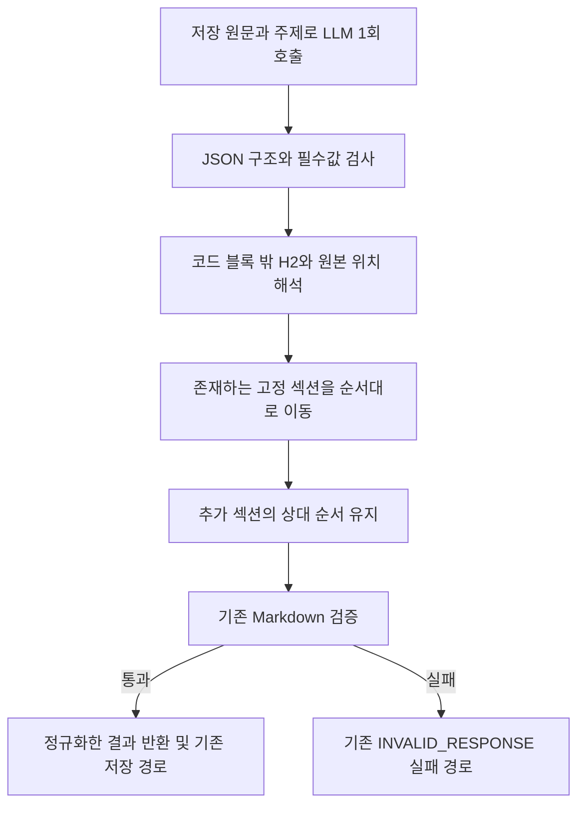

# 문서 생성 Markdown 섹션 순서 정규화 Hotfix

확인일: 2026-10-20
상태: 구현 완료, PR 분리 후 로컬 검증 통과

## 1. 범위와 브랜치

- Issue [#873](https://github.com/woowacourse-teams/2026-knot/issues/873), PR [#874](https://github.com/woowacourse-teams/2026-knot/pull/874).
- 기준: `origin/main`의 `30f3de304`. 브랜치 `be/hotfix/#873`, PR 대상 `main`.
- 이 PR은 섹션 본문을 보존하면서 순서를 정규화한다. 자동 재시도 정책은 별도 [#875](https://github.com/woowacourse-teams/2026-knot/issues/875)에서 변경한다.
- 사용자 작업 폴더의 미커밋 변경을 보존하기 위해 별도 worktree를 사용한다.

| 근거 | 출처와 확인 내용 | 적용 |
| --- | --- | --- |
| 사용자 결정 | 10/20: 서버 순서 정규화, main Hotfix, 이슈·PR 2개로 분리 | 현재 PR은 정규화만 포함 |
| 운영 관측 | 10/20 Grafana: Job 120·119·134·202가 validateSectionOrder에서 INVALID_RESPONSE | 실제 응답 본문이 없어 합성 입력으로 검증 |
| 작성 계약 | `backend/src/main/resources/llm/document/generation-system.txt` | 핵심 요약 다음 고정 섹션 순서, 없는 섹션 생략 |
| 기획 근거 | [작성 형식 실험](https://www.notion.so/3b1b4351752280459e37ef3b4def51c1), 10/18 로컬 캡처 | 배경 자료이며 사용자 확정·코드와 구분 |
| 코드 | `DocumentMarkdownValidator`, `DocumentMarkdownSectionReader`, `LlmDocumentGenerator` | 기존 엄격한 거절 규칙을 보존하고 생성 결과 반환 전에 정규화 |

## 2. 사용자 흐름과 처리 순서



표시 순서는 핵심 요약 → 결정 → 보류 → 미결정 → 할 일 → 추가 섹션이다. 없는 섹션을 만들거나 내용을 다른 분류로 바꾸지 않는다.

원본 문자열의 섹션 전체를 잘라 이동해 코드 블록·CRLF·들여쓰기·줄 끝 공백·표를 보존한다. 끝 개행이 없던 마지막 블록을 중간으로 옮길 때만 다음 제목과 붙지 않게 구분 개행을 추가한다. 이미 올바른 순서이면 원문을 그대로 반환한다.

중복 제목·핵심 요약 누락·빈 본문·placeholder·링크·미완성 코드 블록은 계속 거절한다. 정규화는 네트워크 호출을 추가하지 않는다.

## 3. 클래스와 메서드

| 클래스 | 변경 메서드와 책임 | 입력·출력 |
| --- | --- | --- |
| `DocumentMarkdownSectionReader` | 원본 offset 추적, `readBlocks`, `sectionEnd` | Markdown → 제목별 원본 블록 |
| `DocumentMarkdownSectionOrderNormalizer` | `normalize`, `appendPresentSection`, `joinBlocks` | 원본 블록 → 순서만 바꾼 Markdown |
| `DocumentMarkdownValidator` | `normalizeAndValidate`; 기존 strict `validate` 유지 | 생성 결과 → 정규화·검증한 결과 |
| `LlmDocumentGenerator.generate` | 생성 결과 반환 전 정규화·검증 호출 | 기존 LLM 1회 호출 후 보정 결과 반환 |

## 4. 저장과 트랜잭션

새 DB·마이그레이션·트랜잭션은 없다. 외부 호출은 기존처럼 DB 트랜잭션 밖에서 실행하고 정상 결과를 기존 Document·Job 저장 경로로 전달한다.

재시도 정책·횟수·큐 소비·기존 FAILED 작업 상태는 변경하지 않는다. 배포 후 선별 복구와 자동 재시도는 #875 계획에서 구분한다.

## 5. TDD와 검증

1. 생성 경계에 순서 회귀 사례를 먼저 추가했다. 기존 main에서 총 60건 중 25건이 순서 검증으로 실패했다.
2. 원본 블록 정규화와 실제 반환 결과 연결을 구현했다.
3. 고정 섹션 24개 순열, 추가 섹션 상대 순서, 코드 안 H2, CRLF·들여쓰기·줄 끝 공백·표·metadata, 끝 개행과 멱등성을 검증한다.
4. 잘못된 내용의 기존 거절 규칙과 전체 단위·포맷·기존 재시도 통합 경로를 검증한다.

```sh
./gradlew test spotlessCheck integrationTest --tests '*DocumentGenerationExecutionIntegrationTest' --tests '*DocumentGenerationJobRetryTransactionIntegrationTest'
python3 -m unittest discover ../.github/scripts -p 'test_*.py' -q
git diff --check
```

분리한 현재 브랜치에서 단위 2,008건·관련 PostgreSQL 통합 27건·Governance 10건이 통과했다. 실패·오류·건너뜀은 없으며 Spotless와 diff 검사도 통과했다. 합성 입력·로컬 Testcontainers 결과로 운영 LLM 품질이나 운영 복구 완료를 주장하지 않는다.

Persona 초기 실행은 미초기화·gate 비활성으로 구현을 차단하지 않았다. 로컬 보고서 작성 후 finish는 `plan-not-accepted`로 완료 인증을 주지 않았다. 기존 사용자 환경을 재초기화하지 않는다.

## 6. 완료 기준과 병합 순서

순서만 잘못된 유효 본문이 기존의 한 번 호출 결과로 정상 반환되어야 한다. 본문 보존과 기존 거절 규칙, 관련 검증을 통과하면 정규화 Hotfix 범위가 완료된다.

#874와 #875의 PR은 모두 main에서 독립 분기한다. 운영 반영은 정규화 PR을 먼저 적용해 불필요한 LLM 재호출 원인을 줄이고 자동 재시도 PR을 뒤에 적용하는 순서를 권장한다. 기존 FAILED 복구는 사용자가 별도로 요청했으며 현재 상태·입력·중복 문서와 수정 배포를 확인한 뒤 선별 처리한다. 이 문서의 로컬 테스트 결과는 병합·배포·운영 복구 완료의 증거가 아니다.
