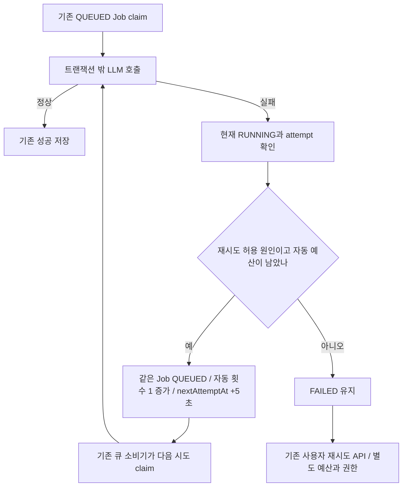

# 예외적인 문서 생성 응답 자동 1회 재시도 Hotfix

확인일: 2026-10-20. 상태: 구현 및 로컬 검증 완료.

## 범위와 근거

- Issue [#875](https://github.com/woowacourse-teams/2026-knot/issues/875), `be/hotfix/#875` → `main`.
- `origin/main`의 `30f3de304`에서 독립 분기했다. 섹션 순서 정규화 [#874](https://github.com/woowacourse-teams/2026-knot/pull/874)는 이 브랜치에 포함하지 않는다.
- 사용자 결정: 수동 다시 시도가 있으므로 예외적인 응답에만 자동 1회를 추가하고 기존 큐·기본 5초 대기를 사용한다. 이슈와 PR을 정규화/자동 재시도 두 개로 나눈다.
- 운영 근거: 10/20 Grafana에서 Job 119·120·134·202의 `validateSectionOrder` → `INVALID_RESPONSE`를 확인했다. 생성 응답 본문은 로그에 없어 운영 원문을 재현 입력으로 사용하지 않았다.
- 코드 근거: `DocumentGenerationRetryPolicy`, `DocumentGenerationFailureService`, `DocumentGenerationWorker`, `DocumentGenerationJob`, 기존 사용자 재시도 서비스와 실행 통합 테스트.
- 제품 근거: 저장소의 현재 V2 기준과 원문·문서 생성 API 계약. 사용자 재시도는 최대 3회·마지막 실패 후 168시간·녹음 소유자 권한과 저장 원문을 사용한다.

## 유즈케이스와 흐름



`INVALID_RESPONSE`를 기존 `TIMEOUT`, `RATE_LIMITED`, `UNAVAILABLE`, `EXECUTION_EXPIRED`, `STORAGE` 허용 목록에 추가한다. 이 목록의 원인들이 Job 생애 자동 예산 총 1회를 공유한다. 사용자 재시도로 자동 예산을 초기화하지 않는다. 분류·주제별 생성에서 같은 정책을 사용한다.

`AUTHENTICATION`, `INVALID_INPUT`, `INPUT_LIMIT`, `OUTPUT_LIMIT`, `WORKSPACE_DELETED`, `INTERNAL`, `LEGACY_FAILURE`는 허용하지 않는다. 어떤 오류든 재시도하는 정책이 아니다. 재호출 성공을 보장하지 않으며 다시 잘못된 응답이면 FAILED로 남긴다.

## 클래스와 메서드

| 클래스 | 메서드 | 변경/기존 책임 |
| --- | --- | --- |
| `DocumentGenerationRetryPolicy` | `isAutomaticallyRetryable` | 변경: INVALID_RESPONSE 한 항목 추가 |
| `DocumentGenerationFailureService` | 실패 기록 경로 | 기존: 잠금·시도 번호 확인·실패 및 재접수·Batch 전환 |
| `DocumentGenerationJob` | 자동 재접수 경로 | 기존: Job당 자동 총 1회, 누적 attempt, nextAttemptAt |
| `DocumentGenerationWorker` | 실행/실패 변환 | 기존: LLM과 생성 응답 검증 실패를 INVALID_RESPONSE로 매핑 |
| 기존 scheduler | QUEUED dispatch | 기존: nextAttemptAt 이전 claim 금지. FAILED 전체 스캔 없음 |

## 트랜잭션과 대안

기존 READ_COMMITTED 트랜잭션이 Workspace·Job·Batch를 잠그고 현재 RUNNING/attempt를 확인한다. 실패 기록·QUEUED 전환·자동 횟수·다음 실행 시각·Batch 상태를 함께 반영하며 중복 실패 통지는 재접수를 중복하지 않는다. 성공한 다른 주제의 문서를 유지한다. 외부 LLM 호출을 이 트랜잭션에 넣지 않는다. 새 테이블·마이그레이션은 없다.

호출 중 즉시 LLM을 다시 호출하는 대안도 비교했다. 즉시 호출은 구현 경로가 짧지만 긴 요청이 슬롯을 계속 점유하고 큐의 횟수·중단 복구와 별도 호출 예산이 생긴다. 기존 큐는 짧은 대기가 추가되지만 한 경로에서 횟수와 중단 복구를 관리하므로 선택했다. 5초는 품질 개선 장치가 아니라 기존 대기 설정이다.

이미 FAILED인 작업은 이 코드가 자동 탐색하지 않는다. 사용자가 기존 실패 작업 복구도 별도로 요청했으므로 현재 Job·입력·기존 성공 문서와 수정 배포를 확인해 선별 복구한다. 수동 사용자 재시도 API를 사용하면 사용자 기회 1회를 소모한다. 운영 재접수 결과는 별도 실제 관측으로 기록한다.

## TDD 및 검증

- 정책 테스트를 먼저 실행: 13건 중 INVALID_RESPONSE 한 건이 기존 코드에서 실패했다.
- 허용 목록을 수정하고 6개 허용·7개 제외 원인, 자동 1회·5초 대기·중복 통지·조기 claim 거절·부분 성공 보존·수동 재시도와 예산 분리를 검증했다.
- 독립 브랜치에서 단위 1,990건, 실제 PostgreSQL Testcontainers 통합 28건, Governance 10건 통과. 실패·오류·건너뜀 0건. Spotless와 diff 검사 통과.

```sh
./gradlew test spotlessCheck integrationTest --tests '*DocumentGenerationExecutionIntegrationTest' --tests '*DocumentGenerationJobRetryTransactionIntegrationTest'
python3 -m unittest discover ../.github/scripts -p 'test_*.py' -q
git diff --check
```

Persona 초기 실행은 worktree 미초기화·gate 비활성으로 구현을 차단하지 않았다. 로컬 보고서 작성 후 `finish implement`는 `plan-not-accepted`로 완료 인증을 주지 않았다. 기존 사용자 환경을 새로 초기화하지 않는다. 도구 완료 인증과 위 실제 테스트 증거를 구분한다.

## 반영 순서

정규화 #874를 먼저 반영해 불필요한 재호출 원인을 줄이고 이 PR을 뒤에 적용한다. 두 PR은 main에서 독립적으로 검증했다. 이번 테스트 결과는 운영 배포·기존 작업 복구 성공의 증거가 아니다.
