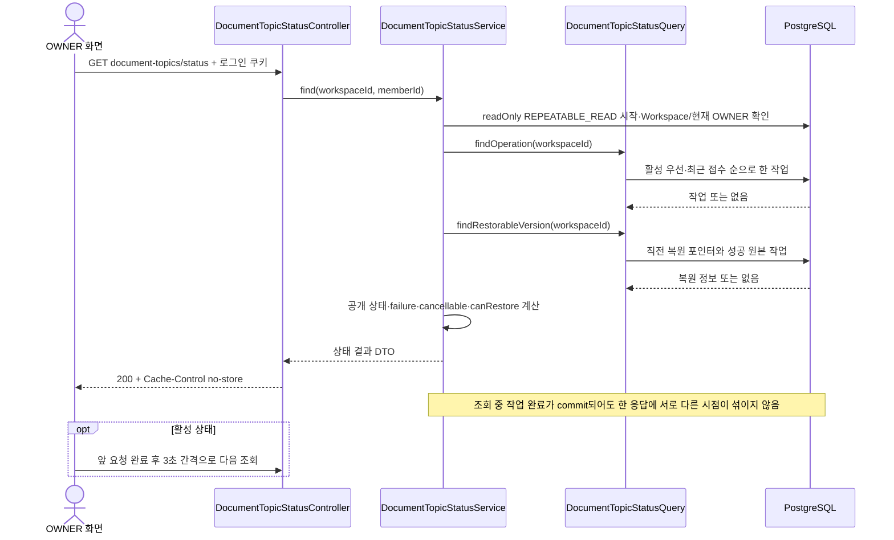

# #935 주제 정리 상태 조회 구현 계획

상태: 계획 승인 후 로컬 구현·전체 검증 완료. 확인일: 2026-10-23 KST.
실행 기록은 [로컬 검증 결과](../qa/935-document-topic-status.md)를 따른다. 아래 내용은 계획 당시의 범위·설계 근거이며 원격 게시나 배포 완료를 의미하지 않는다.
대상: [#935](https://github.com/woowacourse-teams/2026-knot/issues/935).
이 문서는 실제 코드에 연결한 구현 계획이며 Notion API 명세의 사본이나 구현 완료 증거가 아니다.

최신 사용자 지시: Notion 명세가 우선이다. 공개 작업·복원 버전 ID는 Long, requestId는 UUID로 구현한다. 이전 UUID 유지 답변과 시작 응답 보존 계획을 대체한다. 시작 API는 명세의 operationId/workspaceId/type/status/createdAt만 반환하고, 빈 대상409·진행 충돌/요청 충돌 구분·Workspace404를 적용한다. 내부 UUID·큐 FK는 보존한다. V65는 복원 포인터에 독립적인 숫자 id를 추가하고 실제 복원본 교체 때만 새 id를 사용한다. 취소·되돌리기 실행은 #936·#937 범위다.

## 1. 범위와 브랜치

`GET /api/v1/workspaces/{workspaceId}/document-topics/status`를 추가한다. 현재 OWNER가 작업 ID 없이 진행 중 작업 또는 최근 종료 작업과 직전 복원 가능 여부를 확인한다. 조회는 작업을 실행·복구·취소·만료시키지 않는다. LLM도 호출하지 않는다.

초기 조사 기준은 #934의 `266239b84`였다. 2026-10-24 사용자 승인으로 `be/feature/#935`에 최신 #934 `4aa3d7e44d6bbb081ac33febf1ab0bdf4f2baa0c`를 fast-forward로 반영했다. 선행 PR [#938](https://github.com/woowacourse-teams/2026-knot/pull/938)은 확인 시 OPEN이다. 시작 응답·입력 검증·인증 분기·ADR 이동은 선행 브랜치에 포함되며 이번 PR에서 중복 구현하지 않는다.

개발 브랜치는 `be/feature/#935`이고 별도 PR의 base는 `be/feature/#934`다. #938 병합 전에도 GET 상태 조회 하나의 변경만 리뷰하도록 분리한다. 선행 PR 병합 뒤 develop 기준 차이를 다시 확인해 base를 변경해야 한다. 기존 미커밋 변경은 백업한 뒤 상태 조회 전용22파일을 해시 일치로 복원했다. 계획·QA 기록은 #935 PR에만 포함한다.

### 읽은 근거

| 출처 | 확인 시점·리비전 | 적용 내용 | 판정 |
| --- | --- | --- | --- |
| #935 본문 | 2026-10-23 실조회 | OWNER 조회, 활성 작업 우선, 복원 정보와 일관된 조회, 실패도 HTTP 200 | 구현 대상 |
| 사용자 전달 FE 합의 및 최신 Notion 우선 지시 | 이번 대화 | 3초 폴링·재진입·목록 갱신·실패 문구·공개 Long ID | 이전 UUID 답변을 최신 지시가 대체 |
| [상태 조회 Notion](https://app.notion.com/p/402b43517522809da2c5e07a3d879867) | 실시간 본문 전체 읽음 | 필드·Long ID·null·자동 재시도 표시·실패 안내 | 코드가 따라야 하는 계약 |
| [재정리 시작](https://app.notion.com/p/402b435175228047af72ef7205e6c21a)·[취소](https://app.notion.com/p/402b43517522804a9009eeb1bbfb88bb)·[복원](https://app.notion.com/p/402b4351752280f98461daf983e86fdd) | 수정 2026-10-23 02:48~02:49 UTC, 본문 전체 읽음 | 공통 상태·공개 식별자·복원 버전 연결 | 연동 계약. 취소·복원 구현은 후속 |
| [기능 요구사항](https://app.notion.com/p/402b4351752280be95e5eee9325ee464)·[도메인 규칙](https://app.notion.com/p/402b4351752280099fe0eb92c5c03858) | 수정 2026-10-23 02:07·02:13 UTC, 본문 전체 읽음 | 기존 목록 유지·전체 적용·실패/취소 시 복원 보존 | 이후 사용자 결정과 구분. 오래된 미정 항목은 재질문하지 않음 |
| #934 Operation·Checkpoint·Apply·StoreAdapter·V63 및 #936·#937 이슈 | 위 #934 HEAD | 영속 큐, 내부 상태, 복원 포인터·changed_count 원자 저장 | 열린 PR 코드 관측, 배포 완료 아님 |
| DocumentListService·DocumentListSnapshotIntegrationTest·Workspace repository | 같은 checkout | REPEATABLE_READ 조회, 실제 PostgreSQL 동시성 검증, 활성 멤버십 확인 | 재사용 패턴 |
| 현재 V2 기준·notion-context·정합성 지침·AGENTS·Persona profile/guideline·build.gradle | 2026-10-23 로컬 읽음 | Java 25·Spring·JPA·Flyway·Security·Testcontainers 및 근거 구분 | 구현 규칙 |

API 원문과 속성을 실시간 조회했다. Notion의 구현 표시는 코드 완료 증거로 사용하지 않는다. 이슈·Notion·FE 문서의 원격 수정은 이번 계획 요청에 포함하지 않는다.

### FE 합의 적용

- OWNER만 관리 UI를 사용한다. 일반 멤버의 작업 진행 표시는 이번 범위에서 제외하며 서버도 OWNER만 허용한다.
- 화면 진입 시 1회 조회한다. 활성 상태에서만 앞 요청 완료 후 3초마다 조회하며 종료 상태면 중단한다. API 자체에 polling timer를 만들지 않는다.
- 기존에 관찰하던 작업이 SUCCEEDED로 바뀌면 목록을 갱신한다. operationId가 다른 새 작업의 숫자를 이전 작업 진행률과 비교하지 않는다. 첫 진입에서 이미 SUCCEEDED면 완료 알림을 재생하지 않고 일반 목록 로딩을 한다.
- FAILED·CANCELLED는 공개 배정이 바뀌지 않으므로 그 이유로 목록을 재조회하지 않는다. GET 실패는 Job 실패가 아니다.
- 사라진 폴더 선택 정리는 FE가 담당한다. 서버는 목록 필터·선택을 변경하지 않는다.
- requestId는 새로운 실행 클릭마다 생성하고 불명확한 접수 실패 재전송에서만 재사용한다. 브라우저 저장 없이 새로고침 시 이 API로 확인한다. 서버 중복 방지 기록은 기존 결정대로 Workspace 수명 동안 유지한다.
- 문서 0개의 빈 화면 버튼 숨김은 FE 책임이다. 서버도 명세에 따라 TOPIC_REORGANIZATION_TARGET_EMPTY로 접수를 거절하고 저장을 롤백한다.

## 2. 구현할 흐름



### 권한과 응답 경계

인증은 기존 Security를 사용한다. Workspace 존재·삭제 여부, 활성 멤버십, 현재 OWNER를 순서대로 확인한다. 존재하지 않거나 삭제된 Workspace는 시작·조회 모두 404 WORKSPACE_NOT_FOUND, 비멤버는 403 WORKSPACE_ACCESS_DENIED, 활성 MEMBER는 403 WORKSPACE_OWNER_REQUIRED다. 탈퇴한 이전 OWNER는 접근할 수 없고 새 OWNER는 이전 요청자의 작업도 관리한다. 주제 정리 경로의 미인증은 UNAUTHENTICATED, 인증 쿠키가 있지만 인증되지 못한 요청은 INVALID_JWT로 구분한다. 다른 경로는 기존 인증 entry point를 유지한다.

GET은 CSRF를 요구하지 않는다. 전역 CSRF를 비활성화하거나 새 permitAll 규칙을 추가하지 않는다. 작업 없음·FAILED·CANCELLED도 정상 조회면 HTTP 200이다. DB 조회 오류만 HTTP 500 등 기존 예외 계약으로 처리하며 가짜 작업 없음/가짜 실패로 바꾸지 않는다. 브라우저에 관리 상태를 남기지 않도록 응답은 no-store로 제안한다.

### 선택·진행 수·복원 규칙

1. 내부 상태 QUEUED/RUNNING/CANCEL_REQUESTED/APPLYING인 작업을 먼저 선택한다. 없으면 `created_at DESC, id DESC`로 가장 최근 접수 작업을 하나 선택한다. 같은 접수 시각은 내부 PK로 결정하고 공개 UUID 정렬에 의존하지 않는다.
2. operation이 없으면 null이다. targetDocumentCount는 원문 계약의 nullable을 유지하지만 #934는 접수 TX에서 대상을 확정하므로 현재 값은 0 이상의 확정 수다. 0을 null로 바꾸지 않는다.
3. processedDocumentCount는 저장 완료된 준비 결과 수다. 재시도 호출 수·모델 토큰 수·최종 공개 문서 수가 아니다. 1000/1000이어도 통합·전체 적용이 남으면 진행 중이다. 완료는 SUCCEEDED만 의미한다.
4. changedDocumentCount는 SUCCEEDED일 때만 실제 changed_count를 반환하고 그 외는 null이다. 성공 무변경은 0이다.
5. restorableVersion은 포인터가 남아 있으면 진행 중에도 반환한다. `canRestore = 복원 정보 존재 && 활성 작업 없음`이다. 최근 실행이 실패/취소/무변경 성공이어도 이전 복원 정보가 남으면 true다. 실패한 최근 operation과 복원 원본 operation이 달라도 정상이다.
6. 복원 가능 여부·취소 가능 여부는 조회 시점의 안내다. 실제 POST는 현재 상태를 다시 검증한다. 플래그가 true였다는 이유로 취소·복원을 보장하지 않는다.
7. #937 성공 시 복원 포인터 소진을 관찰하면 restorableVersion=null/canRestore=false가 된다. GET에서 소진하지 않는다.

### 상태 공통화

| 외부 status | 의미 | 종료 | cancellable |
| --- | --- | --- | --- |
| QUEUED | 최초 실행 또는 다음 처리 단계 대기 | 아니오 | true |
| RUNNING | 결과 준비 중 또는 제한 자동 재시도 대기 | 아니오 | true |
| APPLYING | 최종 결과 반영 단계 | 아니오 | false |
| CANCEL_REQUESTED | 취소 접수 후 종료 처리 대기 | 아니오 | false |
| CANCELLED | 취소 완료 | 예 | false |
| SUCCEEDED | 전체 적용 완료 | 예 | false |
| FAILED | 최종 실패, 기존 공개 배정 보존 | 예 | false |

상태 조회는 7개 모두 읽고 직렬화할 수 있게 한다. 단 #934는 아직 APPLYING·CANCEL_REQUESTED 상태로 전환하지 않는다. #936에서 도입할 취소 상태를 조회가 먼저 지원하며, APPLYING이 최종 TX 안에서만 바뀌는 설계라면 GET에서 관찰되지 않을 수 있다. 상태마다 반드시 화면에서 관측된다고 보장하지 않는다.

**재시도 차이의 적용안:** Notion은 자동 재시도 중 외부 RUNNING을 요구하지만 DB는 QUEUED/retry_count>0로 대기한다. 내부 큐·dispatch 규칙을 바꾸지 않고 이 조합만 공개 RUNNING으로 변환한다. 최초 대기와 정상 배치 간 QUEUED는 그대로다. 변환은 공통 메서드 한 곳에 두고 #934 동일 요청 재전송 응답에도 적용한다. 조회별 제각각 구현하지 않는다. public status 의미가 같아야 한다는 FE 요청의 구현 항목이다.

### 공개 DTO 조립 방향

Notion 전문은 링크를 기준으로 한다. 여기서는 실제 저장값과 변환 책임만 정한다.

- operationId/versionId/reorganizationOperationId/targetVersionId는 최신 지시와 Notion에 따라 Long이다. requestId만 UUID다. 작업은 기존 DB id, 복원 버전은 V65의 독립 id로 식별한다.
- 외부 type은 원문대로 REORGANIZATION/RESTORATION이며 내부 kind REORGANIZE/RESTORE를 명시적으로 변환한다.
- startedAt은 최초 claim 저장 시각이다. createdAt/leaseUntil로 추정하지 않는다. finishedAt은 저장한 종료 시각을 쓴다.
- operation.targetVersionId는 재정리일 때 null. 복원 작업의 연결 버전은 #937에서 영속화한 값으로 채운다. #935가 아직 없는 복원 실행을 구현했다고 주장하지 않는다.
- restorableVersion의 completedAt은 원본 성공 operation.finished_at, affectedDocumentCount는 원본 changed_count다. 포인터의 created_at을 완료 시각으로 추정하지 않는다.
- failure는 FAILED일 때만 반환한다. 내부 LLM/SQL 오류 코드는 보내지 않고 작업 종류에 따라 원문 TOPIC_REORGANIZATION_FAILED 또는 TOPIC_RESTORATION_FAILED와 원문의 사용자 안내를 사용한다. 자동 재시도 중 failure_code가 있어도 failure=null이다. 알 수 없는 내부 오류도 안전한 동일 안내로 수렴한다.
- 중첩 객체가 null이면 그 자식 필드의 non-null 조건은 적용하지 않는다. 실패 전역 예외와 operation.failure를 구분한다.

## 3. 나올 코드와 메서드 초안

### 기존 책임 재사용

`DocumentTopicOperation`은 작업 생명주기, `DocumentTopicOperationRepository`는 쓰기·claim 저장, `DocumentTopicStoreAdapter`는 준비 자료 및 복원 포인터 저장을 맡는다. 조회를 위해 이 쓰기 서비스의 lock·recover·prune을 호출하지 않는다. `DocumentListService`의 REPEATABLE_READ와 application Query → persistence Adapter 분리를 따른다.

| 제안 위치·클래스 | 책임 | 메서드 후보 |
| --- | --- | --- |
| presentation/DocumentTopicStatusApi | OpenAPI 권한·전체 상태표·null·진행 수·실패 계약 설명 | `find(long workspaceId, AuthenticatedMember member)` |
| presentation/DocumentTopicStatusController | GET 경로·양수 검증·인증 사용자 전달·no-store HTTP 200 | `find(workspaceId, member)` → ResponseEntity<DocumentTopicStatusResponse> |
| application/DocumentTopicStatusService | 현재 OWNER 검증, 두 조회를 같은 snapshot으로 묶고 UI 의미 조립 | `find(workspaceId, memberId)` → DocumentTopicStatusResult; `requireOwner`, `createOperationResult`, `createFailure`, `canRestore` |
| application/DocumentTopicStatusQuery | 읽기 계약, 문서 본문·분류 임시 자료를 읽지 않음 | `findOperation(workspaceId)` → Optional<작업 snapshot>; `findRestorableVersion(workspaceId)` → Optional<복원 snapshot> |
| infrastructure/persistence/DocumentTopicStatusQueryAdapter | 작업 하나·복원 포인터/원본 작업 조회. JdbcClient 또는 기존 ReadJpaRepository 방식 중 구현 시 가장 작은 경로 사용 | 위 두 메서드 구현. SQL을 Service에 넣지 않음 |
| application/dto/result의 Snapshot·Result record | DB 읽기 값과 외부 표시 결과 분리 | 작업 snapshot은 내부 status/kind/retry_count 포함; 복원 snapshot은 version Long·원본 작업 Long·changed_count 포함. 중첩 DTO 없이 파일별 타입 분리 |
| presentation/dto/response/DocumentTopicStatusResponse 및 중첩 record | 외부 필드와 null을 직렬화 | `from(result)`. 중첩 record는 필요한 3개 구조(operation/restorableVersion/failure)만 사용 |
| 기존 DocumentTopicOperation | 최초 실행 시각 저장 | `claim(now)`에서 startedAt이 null일 때만 설정. 재시도·lease 회복 시 보존 |
| 기존 DocumentTopicOperationStatus | 공통 공개 상태 변환 후보 | `reportedStatus(int retryCount)`로 내부 QUEUED/재시도 대기 → 공개 RUNNING. 최종 enum 동일 유지 |
| 기존 DocumentTopicOperationResult.from 및 시작 응답 설명 | 재전송 status 의미를 조회와 일치 | 공통 변환 호출. 시작 응답의 기존 필드명까지 한꺼번에 변경하지 않음 |

서비스의 `find`는 `@Transactional(readOnly=true, isolation=REPEATABLE_READ)`다. 반환 전 DTO를 완성하고 TX 종료 후 lazy-loading하지 않는다. DB 잠금 없이 snapshot을 읽고 권한도 그 snapshot 기준으로 판단한다. 같은 요청 중 OWNER 승계가 commit돼도 다음 요청부터 새 권한이 적용된다.

시작 응답은 Notion에 없는 counts/deadlineAt을 노출하지 않는다. FE 진행 화면은 GET의 targetDocumentCount/processedDocumentCount를 사용하고 changedDocumentCount는 성공 전 null이다.

## 4. 저장 기반과 주의할 점

| 저장 기반 | 이번 사용·변경 | 주의점 |
| --- | --- | --- |
| document_topic_operations | 상태·종류·counts·retry_count·시각 조회, nullable started_at 추가 | 최초 claim에서만 저장. 과거 작업의 미기록 시각은 null, created_at으로 backfill하지 않음 |
| document_topic_recoveries | workspace_id 포인터와 source_operation_id join | 다른 Workspace join 금지. 유지된 복원 포인터가 오래된 operation을 참조해도 반환 |
| operation_targets/categories | GET에서는 읽지 않음 | prune돼도 counts·복원 여부 조회 가능. 매 폴링마다 수천 targets count하지 않음 |
| Workspace/WorkspaceMember | 활성 여부·현재 OWNER 확인 | requester_id로 접근을 허용하지 않음 |

**migration은 started_at 저장 때문에 필요하다.** V63을 수정하지 않고 후속 migration을 만든다. 확인한 develop에는 V62까지, #938에는 V63이 있다. `V64__...`는 현재 후보일 뿐이며 구현 직전 develop·열린 PR과 충돌을 확인해서 번호를 확정한다. 운영 DB의 실제 적용 버전은 이번에 조회하지 않았다. #937의 target_version_id·#936의 cancel_requested_at 저장은 각 후속 이슈의 migration으로 분리한다.

이미 끝난 작업의 startedAt=null은 과거 미기록 예외로 설명한다. 새 작업은 최초 실행 전 null, 최초 실행 후에는 재시도 대기 중에도 보존한다. 이력 조작으로 시간을 채우지 않는다.

단순 READ_COMMITTED에서 operation 조회 후 recovery가 교체되면 실행 상태는 옛것·복원 버전은 새것이 될 수 있다. REPEATABLE_READ를 사용하고 실제 두 DB 트랜잭션으로 교체 경합을 검증한다. 폴링은 Workspace FOR UPDATE를 사용하지 않으므로 긴 적용 작업을 기다리거나 차단하지 않는다. 과거 완료 상태를 읽으면 다음 폴링에서 새 commit을 읽는다.

쿼리는 반환 1건·복원 1건으로 제한한다. 실행계획에서 Workspace 이력이 누적될 때 비용을 확인하고 필요한 경우에만 `(workspace_id, created_at DESC, id DESC)` 또는 활성 우선 조회에 맞는 index를 추가한다. 기존 UNIQUE(workspace_id, request_id)는 Workspace 범위 탐색에는 도움 되지만 원하는 정렬을 보장하지 않는다. 인덱스를 추측으로 추가하지 않는다.

### 배포와 남은 연결

- 조회 controller의 기능 플래그는 #934의 `knot.document-topic-reorganization.enabled`와 맞춘다. 배정 LLM의 동작 여부와 읽기 경로를 직접 결합하지 않는다.
- #935만 배포됐다고 #936 취소와 #937 복원 버튼의 실제 호출까지 동작하는 것은 아니다. FE 전체 관리 화면 활성화는 네 엔드포인트 준비와 함께 확인한다. canRestore에 후속 API 구현 여부를 임의로 섞지 않는다.
- 최신 지시로 공개 ID는 Notion의 Long을 따른다. 원격 명세를 UUID로 수정하지 않는다. 후속 취소 path·복원 versionId도 Long 계약을 따른다.
- TARGET_EMPTY는 이번 시작 API 정합 수정에 포함한다. 상세/검색 topic 설명과 문서 분류·목록 API 변경은 이번 범위에 포함하지 않는다.
- FE 정책은 확정됐고 자동 재시도 공개 RUNNING은 읽은 API 계약을 따른다. 새 제품 인터뷰를 반복하지 않는다. SQL 구현·migration 번호·실제 비용은 구현 중 검증할 기술 항목이다.

## 5. TDD와 검증 순서

아래는 앞으로 실행할 계획이며 테스트 완료 기록이 아니다. JUnit/Mockito·실제 Security·PostgreSQL의 증명 범위를 구분한다.

| 테스트 후보·방식 | 검증할 동작 | 기대 결과 |
| --- | --- | --- |
| DocumentTopicOperationTest · 단위 | 최초 claim·checkpoint·재시도·lease 회복 | 최초 startedAt 보존, 고정 시계 사용 |
| DocumentTopicOperationStatusTest · 단위 | 7상태와 재시도 공개 표시 | QUEUED/retry_count>0만 RUNNING으로 변환, 최종 상태 보존 |
| DocumentTopicStatusServiceTest · Mockito | Workspace 없음/삭제·비멤버·MEMBER·이전 OWNER | 계약 오류. 권한 실패 시 작업 Query 호출 안 함 |
| 같은 서비스 단위 | 이력 없음·진행·실패·취소·성공 0건·복원 정보 있음/없음 | operation/restorableVersion null과 canRestore 조합 일치 |
| 같은 서비스 단위 | transient failure_code·최종 실패·미지 내부 code·RESTORE 실패 | 진행 중 failure=null. FAILED만 종류별 안전 문구, 내부 오류 미노출 |
| DocumentTopicStatusSnapshotIntegrationTest · PostgreSQL | Workspace 격리·활성 우선·같은 created_at 동률·최근 실패 뒤 이전 복원 | 정확한 작업·버전 Long·원본 finished_at/changed_count 반환, 교체 시 숫자 버전 갱신 |
| 같은 DB 테스트 | 준비 자료 prune 후 조회·장기 작업 이력 | targets 없이 요약 조회 가능, 제한 결과·실행계획 확인 |
| DocumentTopicStatusSnapshotIntegrationTest · PostgreSQL | 작업 읽기 후 writer가 성공·복원 포인터 교체 commit | 응답은 옛 상태+옛 복원, 다음 GET은 새 상태+새 복원. 혼합 금지 |
| 같은 snapshot 테스트 | 이전 canRestore=true 시점 후 새 작업 접수·복원 소진·권한 변경 | 한 응답의 계산은 동일 snapshot, 다음 요청에 변경 반영 |
| DocumentTopicStatusAcceptanceTest · 실제 Security/MockMvc | OWNER GET·미인증·MEMBER·삭제 Workspace·잘못된 path·CSRF 없음 | 200/401/403/404/400, GET CSRF 불필요, Cache-Control no-store |
| 같은 인수 테스트 | 7상태 JSON·종류 변환·Long ID·counts null·작업 없음·실패 응답 | 외부 필드명/타입 일치, FAILED 조회도 HTTP 200, 부모 null 처리 |
| 같은 인수 테스트 | 재정리 접수→분류→완료→조회, 같은 requestId 재전송 | 공개 ID·status 의미 일치, SUCCEEDED와 복원 정보 일관 |
| 기존 #934 인수·통합 회귀 | 공통 상태 변환·startedAt 추가 영향 | 접수/재시도/반영/중단 복구 계약 유지 |

동시성 테스트는 기존 DocumentListSnapshotIntegrationTest처럼 Query 경계에서 별도 트랜잭션의 commit을 기다린다. sleep으로 실행 순서를 맞추지 않는다. scheduler는 테스트가 명시적으로 제어하고 실제 운영 timer를 기다리지 않는다. 고정 Clock은 PostgreSQL과 같은 MICROS 정밀도로 맞춰 #938의 나노초 반올림 실패를 반복하지 않는다.

### 작은 구현 단위

1. **최초 실행 시각**: claim/retry 시각 보존 테스트 RED → startedAt 모델·후속 migration 구현 → PostgreSQL 왕복·과거 null 검증. test → feat 경계.
2. **공통 공개 상태**: 재시도 중 RUNNING과 최종 실패 변환 테스트 RED → 상태 공통 메서드·기존 시작 결과 연결. 다른 #934 필드는 변경하지 않는다.
3. **조회 선택**: Workspace 격리·활성 우선·최근 종료·복원 원본 join 통합 테스트 RED → Query/Adapter와 snapshot record 최소 구현.
4. **권한·표시 정책**: 서비스 단위 테스트 RED → OWNER 검증·failure 안전 안내·null/count/canRestore 조립.
5. **동시 조회 일관성**: 조회 사이 writer commit 혼합 재현 RED → readOnly REPEATABLE_READ 경계 적용. 필요 없는 쓰기 잠금은 추가하지 않는다.
6. **HTTP 계약**: 실제 Security 인수 RED → Api/Controller/Response 구현. GET 무CSRF·Long ID·no-store·실패 조회200까지 검증한다. 시작 응답 5개 필드와 분리된 409·404·입력 오류도 검증한다.
7. **회귀와 전달**: #934 관련 회귀 → 전체 test/integrationTest/acceptanceTest/spotlessCheck/bootJar → 실제 런타임 OpenAPI와 네 API의 ID·상태 설명 대조. Notion 수정·커밋·푸시는 별도 승인 범위다.

각 단계의 테스트와 최소 구현은 인접한 원자적 커밋 후보로 나누며, 계획 작성만으로 실제 커밋을 수행하지 않는다. 기능 하나 전체를 하나의 거대 커밋 경계로 삼지 않는다. 리팩터링은 동작이 통과한 뒤 필요할 때만 분리한다.

확인한 Gradle task를 사용하는 예정 명령:

```bash
./gradlew test --tests '*DocumentTopicOperationTest' --tests '*DocumentTopicOperationStatusTest' --tests '*DocumentTopicStatusServiceTest'
./gradlew integrationTest --tests '*DocumentTopicStatus*IntegrationTest' --tests '*DocumentTopicReorganizationIntegrationTest'
./gradlew acceptanceTest --tests '*DocumentTopicStatusAcceptanceTest' --tests '*DocumentTopicReorganizationAcceptanceTest'
./gradlew spotlessCheck check bootJar
```

Java 25를 설정하고 Docker PostgreSQL/Flyway로 실행한다. 없는 테스트를 필터에 넣어 실행 완료라고 기록하지 않는다. 계획만 작성하는 이번 요청에서는 Persona 구현 workflow나 테스트를 새로 시작하지 않는다.

## 6. 완료 기준과 다음 작업

- OWNER가 작업 ID 없이 이력을 복원하고, 활성 우선·최근 종료·직전 복원 가능 정보를 정확히 받는다.
- 자동 재시도는 최종 실패로 노출하지 않고, 최종 실패 안내는 FE가 그대로 표시해도 내부 정보가 드러나지 않는다.
- 문서 수가 모두 준비되어도 상태가 완료되지 않았으면 계속 폴링한다. 조회 실패로 작업을 변경하지 않는다.
- 실제 PostgreSQL 경합에서 공개 상태·복원 포인터·canRestore가 같은 snapshot을 유지한다. 작업 없음·각 상태·null·권한·CSRF 계약을 실제 Security 인수 테스트로 증명한다.
- Notion의 Long ID와 7개 상태표, startedAt 과거 null 예외 및 3초 폴링 정책을 전달할 준비가 된다. 노션 원문 갱신 자체는 이 계획의 산출물이 아니다.
- 후속은 #936 취소, #937 복원이다. #935가 읽기 계약을 마련하고 각 후속 이슈가 쓰기 전환·버전 연결을 구현한다. LLM 품질·1,000개 처리 SLA는 이 조회 API 테스트가 증명하지 않는다.

이번 산출물은 계획서 하나다. 구현·브랜치 생성·Issue 수정·commit/push/PR은 아직 수행하지 않는다.
