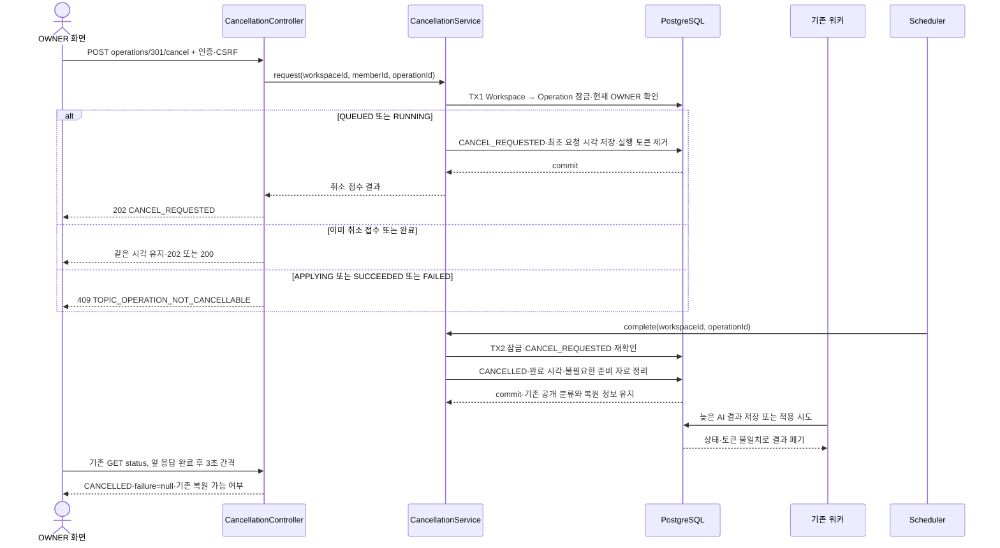

# #936 진행 중 주제 정리 작업 취소 구현 계획

상태: 계획 승인 후 #936 구현·Docker HTTP·최종 전체 검증 완료. 확인일: 2026-10-24 KST.
대상: [#936](https://github.com/woowacourse-teams/2026-knot/issues/936).
아래는 계획 당시 설계 기록이다. 후속 사용자 요청으로 `be/feature/#936`에서 테스트 우선 구현을 진행했다. 실제 실행 결과와 설계 보완은 [#936 검증 기록](../qa/936-document-topic-cancellation.md)을 따른다. 이후 사용자 승인으로 #935 기반 commit·push·별도 PR 게시를 진행하며, 게시 상태는 GitHub PR을 따른다. 운영 배포 완료를 의미하지 않는다.

## 1. 범위와 브랜치

`POST /api/v1/workspaces/{workspaceId}/document-topics/operations/{operationId}/cancel` 하나를 구현한다. 현재 OWNER가 재정리 또는 되돌리기의 최종 적용 전 취소를 접수하고, 서버가 공개 분류와 직전 복원 정보를 유지하면서 작업을 끝낸다. 요청 본문과 requestId는 없다.

계획 작성 시 checkout은 `be/feature/#935`, HEAD는 `8e301205d`였다. 후속 개발 승인으로 이 기반을 그대로 보존한 `be/feature/#936`을 만들었다. 선행 PR이 열려 있어 #935를 base로 비교하고 별도 PR을 게시한다. 자동 종료 대상은 #936 하나이며 #934·#935는 선행 의존성으로만 참조한다.

- [#938 / #934](https://github.com/woowacourse-teams/2026-knot/pull/938)은 OPEN, develop 대상, HEAD `4aa3d7e44`다. 공통 Operation·큐·시작 API·인증 분기를 제공한다.
- [#942 / #935](https://github.com/woowacourse-teams/2026-knot/pull/942)는 OPEN, #934 대상, HEAD `8e301205d`다. Long 공개 ID·7개 상태·OWNER 조회·복원 숫자 ID를 제공한다.
- 원격 develop은 확인 시 `38fe79a4f`, migration은 V62까지다. #934의 V63, #935의 V64·V65는 열린 PR의 자산이며 배포 완료로 취급하지 않는다.
- 게시 전 develop `91e479885`의 문서 경로 이전 #941을 반영했다. #934 `9a4ede0cc` → #935 `fbd325b2a` → #936 순서로 병합했고 Java·테스트 소스는 최종 전체 검증본과 동일하다. 위 최초 조사 SHA와 구분한다.
- 병합은 #938 → #942 → #936 순서로 검토한다. 선행 병합 후에는 develop과 migration 번호·공통 파일 차이를 다시 확인한다.
- #937의 되돌리기 시작·실행은 포함하지 않는다. 취소 상태 전이는 내부 kind=RESTORE에도 동일하게 동작하도록 검증하되, 실제 복원 처리 전체 흐름은 #937에서 연결한다.

### 확인한 근거

| 출처 | 확인 시점·리비전 | 적용 사실 | 구분 |
| --- | --- | --- | --- |
| [#936 Issue](https://github.com/woowacourse-teams/2026-knot/issues/936) | 2026-10-24 실조회, OPEN | POST 경로, 취소 접수·완료, 적용 경합, 지연 결과 차단, PostgreSQL 검증 | 구현 대상 |
| [취소 API](https://app.notion.com/p/402b43517522804a9009eeb1bbfb88bb) | 본문 전체·DB 속성 실조회, 수정 2026-10-23 02:49 UTC、truncated=false | POST, Long 경로 ID, 202/200, 최초 취소 시각, 오류 구분 | 사용자 지정 우선 계약. 구현 속성 NO는 런타임 증거 아님 |
| [상태 조회 API](https://app.notion.com/p/402b43517522809da2c5e07a3d879867) | 본문 전체·DB 속성 실조회, 수정 2026-10-23 02:49 UTC、truncated=false | 공개 필드명, 현재 OWNER, 실패 안내·복원 가능 여부 | 연동 계약 |
| [관련 도메인 규칙](https://app.notion.com/p/402b4351752280099fe0eb92c5c03858) | 2026-10-24 본문 전체 실조회、truncated=false | 취소는 결과 미적용·기존 분류/복원 정보 보존 | 기본 규칙. 원문의 오래된 미정 항목은 후속 사용자 결정과 구분 |
| 사용자 전달 FE 합의·기존 확정 결정 | 이번 대화 | 3초 비중첩 폴링, CANCELLED/FAILED 목록 미갱신, 현 OWNER 관리, 대상 고정 | 이번 작업에 적용하는 합의 |
| Operation·Checkpoint·Apply·Worker·Scheduler·Repository·Store·Status 및 테스트 | 현재 HEAD, 아래 코드 관찰 | 잠금 순서, claim token, lease, 삭제/보존, 누락된 상태 전이 | 열린 PR 코드 관측 |
| [#935 구현 계획](935-document-topic-status.md), [공통 ADR](../adr/934-document-topic-reorganization.md) | 현재 checkout | GET 범위와 후속 의존성, 비공개 준비·일괄 적용 | 재사용 근거, ADR은 Proposed |
| 루트 AGENTS·현재 V2 기준·정합성 지침·backend/docs/notion-context·Persona profile/guideline·build.gradle | 2026-10-24 로컬 읽음 | Notion 우선, Java 25, 실제 PostgreSQL 검증, 코드·문서 관례 | 작업 지침 |

Notion 원문 전문과 DB 속성 JSON은 이 문서에 복사하지 않는다. API·Issue·Notion·기획 문서를 원격 수정하지 않는다. 이번 API만의 별도 제품 정책 ADR은 만들지 않고 공통 ADR을 참조한다.

## 2. 구현할 흐름

OWNER가 취소를 누르면 로그인·CSRF·현재 OWNER·작업 소속을 확인한다. Workspace → Operation 순서로 잠그고 취소 의도를 먼저 영속화한다. 대기와 처리 중 모두 첫 요청은 CANCEL_REQUESTED/202로 통일한다. 외부 AI 응답이 끝나는 것은 기다리지 않는다. 후속 정리 트랜잭션이 CANCELLED로 바꾼다.



실제 GET은 #935의 StatusController가 처리한다. 그림의 H는 HTTP 경계를 합쳐 나타낸다. 취소 접수와 후속 완료는 별도 commit이므로 202 응답 직후 다른 조회에서는 이미 CANCELLED일 수 있다.

### 상태별 공개 동작

| 잠금 후 실제 상태 | POST 결과 | 저장 변경 | #935 조회 연결 |
| --- | --- | --- | --- |
| QUEUED | 202 CANCEL_REQUESTED | 최초 시각 저장, token/lease 제거 | active, cancellable=false, canRestore=false |
| RUNNING | 202 CANCEL_REQUESTED | 동일. 자동 재시도 대기 중 내부 QUEUED도 접수 | 동일 |
| CANCEL_REQUESTED | 202 | 최초 시각·완료 시각을 덮어쓰지 않음 | 취소 완료까지 폴링 |
| CANCELLED | 200 | 상태·최초 시각·완료 시각 유지 | terminal, failure=null |
| APPLYING | 409 NOT_CANCELLABLE | 없음 | 적용 완료까지 폴링 |
| SUCCEEDED / FAILED | 409 NOT_CANCELLABLE | 없음. 취소를 복원으로 해석하지 않음 | 현재 상태 재조회 |

성공 응답은 `operationId`, `workspaceId`, `type`, `status`, `cancelRequestedAt`, `finishedAt`만 제공한다. 공개 ID는 Long, type은 REORGANIZATION/RESTORATION이다. counts·내부 UUID·claim token은 추가하지 않는다. cancelRequestedAt은 최초 접수 시각, finishedAt은 CANCELLED일 때만 채운다.

401·403은 #934의 인증·Security를 재사용한다. 본문 없는 POST에도 CSRF를 요구한다. Workspace 없거나 삭제됨은 WORKSPACE_NOT_FOUND/404, 비멤버와 MEMBER는 각각 접근 거절/OWNER 거절이다. 현재 Workspace에서 찾지 못한 operationId와 다른 Workspace의 ID는 같은 TOPIC_OPERATION_NOT_FOUND/404다. 양수가 아닌 경로는 VALIDATION_ERROR/400, Long 변환 실패는 INVALID_PARAMETER/400이다.

### 프론트 합의 적용

- OWNER만 진행·취소 UI를 사용한다. 버튼은 GET의 cancellable을 따르되 서버가 상태를 다시 검사한다.
- 202는 접수이며 취소 완료 알림으로 해석하지 않는다. CANCEL_REQUESTED에서도 앞 요청 완료 후 3초마다 GET을 이어간다.
- 200 또는 GET의 CANCELLED에서 종료한다. CANCELLED·FAILED 때문에 문서 목록을 재조회하지 않는다. 기존 공개 분류가 유지되기 때문이다.
- 409이면 상태를 재조회한다. 관찰 중이던 작업이 SUCCEEDED로 바뀌면 기존 합의대로 목록을 갱신한다.
- 응답 유실·타임아웃·500이면 같은 operationId로 재요청하거나 GET으로 확인한다. 별도 requestId나 브라우저 저장을 추가하지 않는다.
- 화면 재진입은 기존 GET 1회로 복구한다. 취소 요청자의 화면 종료는 작업을 바꾸지 않는다.
- 이전 복원 정보가 있으면 취소 완료 후 canRestore=true다. 복원 정보가 없으면 false다. 직후 새 작업이 접수되면 다시 false일 수 있다.

## 3. 나올 코드와 메서드 초안

### 현재 코드에서 확인한 책임과 빈 부분

| 기존 클래스·파일 | 현재 동작 | #936에서 필요한 보완 |
| --- | --- | --- |
| domain/model/DocumentTopicOperation | claim token·90초 lease·30분 deadline·재시도·checkpoint 관리 | 취소 시각·전환 없음. owns는 RUNNING만 허용. fail/expire는 CANCEL_REQUESTED도 실패로 바꿀 수 있음 |
| application/DocumentTopicCheckpointService | Workspace → Operation 잠금, claim·진척 저장·실패 처리 | 취소 결과 폐기, 취소를 FAILED로 덮지 않기, APPLYING 진입·복구 |
| application/DocumentTopicApplyService | 문서 배정·주제·복원 포인터·성공을 한 TX로 저장 | 현재 RUNNING에서 바로 SUCCEEDED. APPLYING 경계 없음 |
| application/DocumentTopicWorker | LLM은 TX 밖 실행. 마지막 단계는 빈 pending으로 apply 호출 | 최종 적용 전 별도 beginApply 호출. 오래된 실행은 정상 폐기 |
| infrastructure/DocumentTopicScheduler | 1초 기본 조회 후 별도 executor에 실행 위임 | 취소 완료를 LLM executor와 분리. 현재 executor는 1개 스레드·queueCapacity=0 |
| OperationJpaRepository / RepositoryAdapter | QUEUED·RUNNING 만료만 조회, 페이지 32 | 취소 요청 조회와 APPLYING 만료 복구 후보 조회 추가 |
| DocumentTopicStoreAdapter.prune | terminal 중 현재 recovery가 참조하지 않는 준비 자료만 삭제 | 취소 완료 TX에서 재사용. recovery와 Operation 식별 기록은 삭제하지 않음 |
| StatusService / StatusQueryAdapter | 7개 상태 조회·active 판단·취소 가능 여부 제공 | 필드 추가 없이 실제 취소·적용 전이와 회귀 검증 |

### 추가·수정할 코드 제안

아래 경로는 모두 `backend/src/main/java/com/knot/backend/document/` 기준이다.

| 클래스·위치 | 중요한 메서드 후보 | 입력·판단·부작용·결과 |
| --- | --- | --- |
| presentation/DocumentTopicCancellationApi, Controller — 신규 | `cancel(workspaceId, operationId, authenticatedMember)` | 양수 경로·인증 주체 수신, service 호출, 반환 상태에 따라 202/200 |
| presentation/dto/response/DocumentTopicCancellationResponse — 신규 | `from(result)` | 공개 계약 6필드만 변환 |
| application/dto/result/DocumentTopicCancellationResult — 신규 | `from(operation)` | 공개 Long ID·종류·상태·시각 반환. 영속 Entity를 Controller에 전달하지 않음 |
| application/DocumentTopicCancellationService — 신규 | `request(workspaceId, memberId, operationId)` | READ_COMMITTED. Workspace 잠금→삭제/현재 OWNER 검증→소속 Operation 잠금→도메인 전환→결과 |
| 같은 Service | `complete(workspaceId, operationId)` | 별도 TX. 내부 취소 정리이며 사용자 권한을 재요구하지 않음. CANCEL_REQUESTED만 CANCELLED+prune, 그 외는 no-op |
| domain/model/DocumentTopicOperation — 수정 | `requestCancellation(now)`, `completeCancellation(now)` | 최초 시각 고정·token/lease 제거, 중복은 무변경. 완료는 finishedAt 저장·failureCode 제거 |
| 같은 Entity | `beginApplying(token, now)`, `validateApplyingClaim(token, now)` | 준비 완료·현재 claim 확인 후 APPLYING, 기존 또는 재인계된 적용 token만 허용 |
| 같은 Entity | `reclaimApplying(now)`, `deferApplyingRetry(token, now)` | APPLYING을 QUEUED로 되돌리지 않고 만료 실행권 재인계·5초 대기. 이전 실행권 폐기 |
| 같은 Entity | `succeed(...)`, `fail(...)`, `expire(...)` | 성공은 적용 claim 검사. 취소 접수/완료를 일반 실패·deadline 처리로 덮지 않음 |
| application/DocumentTopicCheckpointService — 수정 | `beginApply(execution)` | 별도 proxy TX로 잠금·검증·APPLYING commit. 취소 또는 오래된 token은 false, 정상·동일 적용 claim은 true |
| 같은 Service | `claim(...)`, `complete(...)`, `fail(...)` | 취소 상태는 claim 금지·준비 결과 폐기. APPLYING 복구는 LLM 없이 최종 적용 경로로 반환. 실패 처리는 단계별로 분리 |
| application/DocumentTopicApplyService — 수정 | `apply(execution)` | APPLYING claim을 다시 검증하고 기존 일괄 저장 재사용. 성공 직전 token·lease·deadline 재검사 |
| infrastructure/DocumentTopicScheduler — 수정 | `dispatch()`, 취소 정리용 private 메서드 | 먼저 제한된 취소 후보를 complete로 종료하고, 기존 계산 후보를 executor에 제출. 건별 실패를 로깅하고 다음 polling에서 재처리 |
| domain/repository 및 infrastructure/persistence Repository — 수정 | `findCancellationRequested()`, `findDispatchable(now)` | 취소 시각·ID 순 제한 조회, APPLYING은 lease 만료+대기 시각 또는 deadline 만료 시 조회 |
| domain/DocumentErrorCode — 수정 | 신규 오류 2개 | TOPIC_OPERATION_NOT_FOUND/404, TOPIC_OPERATION_NOT_CANCELLABLE/409. 기존 내부 conflict와 구분 |

새 Request DTO·외부 AI API·별도 메시지 브로커·새 executor·일반 멤버용 진행 API는 추가하지 않는다. 기존 private requireOwner의 검증 순서를 따르며 이번 작업을 공통 권한 프레임워크 리팩터링으로 확장하지 않는다. 종류 이름 변환은 #935와 JSON 계약 테스트로 일치시킨다.

`complete()`는 오래된 실행권이나 취소 상태를 **저장 전에** 확인한다. 예상된 취소 폐기는 일반 실패 경고·retry를 발생시키지 않도록 워커의 처리 결과와 지표도 구분한다. 정상 실행권에서 잘못된 plan은 기존 오류로 처리한다. 모든 Optional의 부재는 API의 명시 오류 또는 내부 no-op 규칙으로 처리하며 의미 없는 NoSuchElementException에 맡기지 않는다.

코드 작성 시 else·중첩 조건을 사용하지 않고 상태별 메서드와 조기 반환으로 나눈다. 상수는 class 선언 바로 다음 줄, enum 값도 첫 줄에 붙인다. 체인 줄바꿈만으로 객체 내부 탐색 문제를 숨기지 않고 책임을 나눈다.

## 4. 저장 기반과 주의할 점

### 잠금과 최종 적용 경합

모든 쓰기는 기존과 같은 **Workspace → Operation → 대상 자료** 순서를 따른다. 취소 접수와 beginApply는 각각 짧은 READ_COMMITTED 트랜잭션이며, DB commit이 서버의 확정 시점이다. HTTP 도착 순서·AI 계산 종료 시각이 승자를 정하지 않는다.

1. 취소 commit이 먼저면 CANCEL_REQUESTED와 token 제거가 확정된다. 이후 beginApply·checkpoint·기존 실패 콜백은 결과를 반영하지 못한다.
2. beginApply commit이 먼저면 APPLYING이 보인다. 이후 취소는 명확한 409다. 실제 문서 배정은 다음 일괄 TX까지 이전 상태다.
3. beginApply는 외부 Worker에서 다른 Spring bean의 메서드로 호출한다. 같은 클래스 내부 호출로 트랜잭션을 나눈 것처럼 구현하지 않는다.
4. apply는 동일 잠금을 잡고 APPLYING token을 검증한 뒤 기존 변경안만 적용한다. 모든 배정·주제 가용성·복원 포인터·SUCCEEDED를 함께 commit한다. 일부 UPDATE 실패는 전부 rollback한다.
5. apply TX가 잠금을 잡은 동안 취소 요청이 기다릴 수 있다. 롤백 후에도 앞서 commit된 APPLYING은 유지되므로 409가 맞다. 기다림이 HTTP 타임아웃이 되면 FE는 동일 ID 재요청/GET으로 확인한다.

**비교한 대안:** 현재 apply TX 안에서만 APPLYING으로 바꾸면 작업량은 작지만 외부에서 적용 단계가 보이지 않고, 취소 경계가 긴 전체 저장 잠금에 묶인다. 별도 beginApply commit을 제안한다. 대신 APPLYING 자체의 재시작·실패 복구가 반드시 필요하므로 아래와 함께 구현한다.

### APPLYING 복구와 자동 재시도

- beginApplying은 준비 완료(processed=target, consolidated=true)와 유효한 RUNNING token을 검증하고 90초 적용 lease를 시작한다. createdAt·startedAt·전체 deadline은 유지한다.
- APPLYING 중 서버가 중단되면 만료 lease 후보를 기존 스케줄러가 찾는다. 잠금 후 재검사하고 token을 새로 발급하되 상태는 APPLYING을 유지한다. 이전 실행자는 새 token으로 갱신된 이후 저장할 수 없다.
- 현재 Execution DTO의 마지막 단계 표현(빈 targets·consolidate=false)을 재사용한다. APPLYING 재인계 시에도 준비된 계획을 보존하고 같은 최종 적용 경로로 보낸다. LLM을 다시 호출하거나 준비 단계를 다시 하지 않는다. 이 경로에는 준비 완료 검증을 반드시 둔다.
- 적용 TX의 일시 저장 오류는 기존 전체 마감 내에서 5초 후 1회 더 시도한다. 단계별 실패 처리를 분리하여 일반 retry가 APPLYING을 QUEUED로 바꾸지 못하게 한다.
- 제안한 카운트 방식: 첫 적용의 retryCount=0. 오류 처리에서 lease를 만료시키고 nextAttemptAt=now+5초로 설정한다. 이후 실제 재인계 때만 retryCount를 1 올리고 token을 교체한다. 오류 콜백과 claim 양쪽에서 중복 증가시키지 않는다. 예기치 않은 lease 상실도 같은 1회 한도를 사용한다. 두 번째 실패/상실 또는 30분 deadline이면 FAILED로 끝내며 배정·기존 복원 정보를 보존한다.
- 오류 처리에서도 상태·token·lease를 검사한다. 다른 실행자의 lease나 이미 성공한 작업을 실패 콜백이 만료시키지 못하게 한다. commit 성공 후 응답 유실도 SUCCEEDED 재확인으로 끝내며 다시 적용하지 않는다.
- 최종 저장 TX의 기존 statement_timeout·lock_timeout을 유지하고 마지막 시각을 다시 검증한다. lease가 만료되면 변경 TX 전체를 롤백한다. DB 잠금이 잡힌 동안 새 실행자가 임의로 병렬 적용하는 구조는 허용하지 않는다.

### 취소 완료와 보존

취소 접수 TX는 작은 상태 변경만 한다. CANCEL_REQUESTED 상태에서 새 실행권을 주지 않으며, 기존 token은 즉시 무효다. 스케줄러는 LLM executor 제출보다 먼저 취소 후보를 별도로 처리한다. AI HTTP 요청을 강제로 중단하거나 GPU 메모리를 즉시 회수한다고 보장하지 않는다. 늦은 결과를 저장·공개하지 않는 것이 필수 보장이다.

complete TX는 CANCELLED 전환과 기존 Store.prune을 함께 처리한다. 준비 target을 먼저, category를 나중에 지우는 현재 FK 순서를 유지한다. recovery가 참조하는 이전 작업 자료와 현재 문서·주제·복원 숫자 ID는 건드리지 않는다. Operation/requestId 식별 기록은 Workspace 수명 동안 보존한다.

취소가 접수된 뒤 deadline이 지나도 이미 접수한 취소를 FAILED로 바꾸지 않는다. 늦은 실패 콜백·일반 expire·Workspace 삭제 처리에서 CANCEL_REQUESTED/CANCELLED를 덮지 않도록 한다. Workspace 삭제 후 공개 API는 404지만 내부 finalizer는 includingDeleted 잠금으로 접수된 취소를 끝낼 수 있다. 새 OWNER는 취소할 수 있고 이전 OWNER는 응답 재전송에도 권한 검사를 통과해야 한다.

취소 정리 DB 오류는 전체 rollback하여 CANCEL_REQUESTED를 남긴다. 다음 tick·재시작에서 다시 정리하며 정상 완료 전 canRestore=true나 CANCELLED를 반환하지 않는다. 정리 경과와 반복 오류를 기존 로그/지표로 남긴다. DB·서비스·스케줄러가 계속 중지된 상황의 즉시 완료를 약속하지 않는다. 이 경우 접수 사실과 결과 미반영을 보존하고 서비스 복구 후 재개한다.

### Migration 제안

| 저장 항목 | 변경 | 주의점 |
| --- | --- | --- |
| document_topic_operations.cancel_requested_at | nullable TIMESTAMPTZ 추가 | 정상 상태는 null. 취소 접수·완료는 최초 값 보존. 추정 시각 backfill 금지 |
| 취소 상태/시각 CHECK | 취소 상태에는 최초 시각 필수라는 제약 추가 | 기존 취소 데이터 존재 여부를 적용 전에 확인. 기존 값 근거 없으면 임의 시각을 채우지 않고 migration 방안을 재검토 |
| 기존 claim/lease CHECK | 유지 | CANCEL_REQUESTED/CANCELLED는 token·lease null. APPLYING은 둘 다 필수 |
| dispatch index | APPLYING 만료 후보 포함하도록 조정 | 실제 후보 query와 predicate 일치, 기존 QUEUED/RUNNING 동작 유지 |
| 취소 후보 index | CANCEL_REQUESTED의 cancel_requested_at, id | 32건 등 제한 조회, 전체 이력 스캔 회피 |

현재 브랜치 파일 기준 V66을 후보로 한다. V63·V64·V65는 수정하지 않고, 구현 직전 열린 PR·develop에서 번호 충돌을 재확인한다. 실제 배포 DB의 flyway_schema_history와 기존 취소 행은 이번 계획에서 조회하지 않았다. source에 취소 writer가 없다는 사실만으로 운영 DB에 취소 행이 없다고 단정하지 않는다. #935 테스트가 SQL로 만드는 상태 fixture도 시각 제약에 맞춰 갱신해야 한다.

## 5. TDD와 검증 순서

각 항목을 실패하는 테스트 → 최소 구현 순서로 진행한다. 아래는 예정된 검증이며 이번 계획 작성에서 실행한 테스트 결과가 아니다.

1. **취소 도메인 전이:** OperationTest에 접수·중복·완료·불가 상태·시각 고정·token 제거·deadline/실패 콜백 비덮기 테스트를 먼저 추가한다. 메서드를 동작별로 구현한다.
2. **저장 왕복:** PostgreSQL 통합 테스트에서 취소 시각과 상태 제약의 미구현을 확인하고 migration/JPA를 추가한다. 기존 7상태 fixture를 보정한다.
3. **취소 접수 서비스:** 현재 OWNER·소속·202/200·404/409·DB 실패 rollback을 먼저 테스트하고 request를 구현한다. 인증 실패에는 작업 저장을 호출하지 않는다.
4. **후속 완료:** 요청 상태 영속화 뒤 스케줄러/서비스를 새로 호출하는 테스트를 추가한다. complete와 별도 취소 후보 조회를 구현한다. LLM executor 포화·동일 작업 다중 dispatch·prune 실패 후 재개를 검증한다.
5. **적용 진입:** 취소와 beginApply를 두 트랜잭션으로 경합시키는 RED를 만들고 APPLYING commit·적용 token 검사·최종 succeed를 연결한다. 기존 Apply의 rollback 테스트는 beginApply 이후 상태가 APPLYING으로 남는 계약으로 수정한다.
6. **적용 복구:** APPLYING 직후 재시작·lease 만료·token 교체·5초 재시도1회·기한 유지·저장 완료 응답 유실을 테스트하고 dispatch/claim/fail을 단계별로 구현한다.
7. **실제 HTTP:** Security 인수 테스트를 먼저 추가하고 Controller·Api·Result·Response·오류 코드를 구현한다. 실제 GET/시작 API 회귀로 #934·#935 계약을 유지한다.
8. **검증 기록:** 코드가 통과한 뒤에만 `backend/docs/qa/936-document-topic-cancellation.md`에 실행 명령·결과·관측 한계를 기록한다. commit 권한이 주어지면 각 동작의 test → feat/fix 경계를 유지하며 이번 계획을 원격 쓰기 권한으로 해석하지 않는다.

### 테스트 단위와 기대 결과

| 테스트 위치·방식 | 주요 시나리오 | 기대 결과 |
| --- | --- | --- |
| domain/model/DocumentTopicOperationTest — 단위 | QUEUED/RUNNING/내부 retry 대기 취소, 중복 요청·완료 | 최초 시각 고정, token/lease null, cancel 완료 시각 고정 |
| 같은 단위 | 7상태 취소 가능 여부, expire/fail/retry/checkpoint/succeed 늦은 호출 | 적용·성공·실패는 불가. 접수한 취소가 RUNNING/FAILED/SUCCEEDED로 되살아나지 않음 |
| 같은 단위 | beginApply 준비 미완료·잘못된 token·만료·중복 동일 token | 무권한 진입 차단, 준비 완료 claim만 적용 진입 |
| application/DocumentTopicCancellationServiceTest — Mockito | 권한·소속·중복·repo 오류 | 명시 오류, 거절 시 무저장, DB 오류를 가짜 완료로 감추지 않음 |
| application/DocumentTopicCancellationIntegrationTest — PostgreSQL | 접수·완료·중복 요청의 실제 저장 왕복 | 202→CANCELLED, 최초 시각 유지, raw DB 제약 만족 |
| 같은 DB 통합 | 서로 다른 Workspace operationId, 현재 OWNER 승계·이전 OWNER 탈퇴 | 다른 작업 미노출, 현재 OWNER만 요청 가능 |
| 같은 DB 통합 | 취소 commit → 지연 AI 성공/실패/입력한도 분할 | prepare/save/apply 미발생. 기존 문서·복원본 동일 |
| 같은 DB 통합 | 취소 vs beginApply, 각각의 commit 순서를 latch로 강제 | 취소 선행은 적용0건, 적용 선행은 취소409. 둘 다 성공하지 않음 |
| 같은 DB 통합 | 취소 접수 직후 서버 재시작을 모사한 재조회·새 finalizer 호출 | 기존 메모리 없이 CANCELLED 수렴, LLM0회 |
| 같은 DB 통합 | finalizer 정리 DELETE 실패, 기존 복원 자료 FK 보호 | 취소 완료 TX rollback, 재실행 성공, 과거 recovery 포인터 불변 |
| 같은 DB 통합 | 취소 완료 후 새 작업 접수·오래된 worker 도착 | 활성 unique 해제, 새 작업·그 복원 정보에 영향 없음 |
| 같은 DB 통합 | 새 문서 생성·취소, RESTORE kind 취소 | 시작 스냅샷·새 문서·기존 분류·복원 기회 보존. 복원 엔진 전체 검증은 #937 |
| application/DocumentTopicReorganizationIntegrationTest — PostgreSQL 회귀 | APPLYING 저장 후 lease 인계, 이전 token·중복 실행 | LLM 재호출0, 한 번만 전체 적용·복원 포인터 교체 |
| 같은 DB 통합 | 적용 중 두 번째 문서 UPDATE 오류·commit 직후 호출 실패 | 부분 적용0, 이전 recovery 유지 또는 이미 성공한 결과 재사용 |
| 같은 DB 통합 | 적용 retry 5초 경계·2번째 실패·30분 기한 | APPLYING 유지, 한도·기한 준수, 실패 시 기존 분류 유지 |
| infrastructure/DocumentTopicSchedulerTest — 단위 + DB 후보 통합 | executor 거절/포화, 취소 후보 우선 처리, 중복 scheduler | 계산 슬롯과 독립적으로 취소 완료. 단위 mock만으로 DB 잠금을 증명하지 않음 |
| presentation/DocumentTopicCancellationAcceptanceTest — 실제 Security/MockMvc | 본문 없이202/200, Long ID, 6필드, 공개 type2종, OpenAPI | 명세 JSON·상태 코드 일치, requestId 불필요 |
| 같은 인수 | 무쿠키/invalid JWT, CSRF 누락·불일치, MEMBER·비멤버, workspace404, operation404, 409, 음수·문자·Long 초과 | 기존 Security/예외 계약과 일치. CSRF 정상인 요청에서 인증 오류를 독립 검증 |
| #935 상태 조회 인수·snapshot 회귀 | CANCEL_REQUESTED/APPLYING/CANCELLED 실제 전이와 기존 복원본 | cancellable·canRestore·failure·changedDocumentCount의 null 규칙 유지, 조회 무부작용 |

동시성은 TransactionTemplate·서로 다른 연결·CountDownLatch로 commit 순서를 통제하고, 각 wait에는 timeout을 둔다. sleep이나 executor 실행 순서에 기대지 않는다. PostgreSQL 시간 fixture는 기존과 같이 MICRO 정밀도를 사용한다. 외부 LLM은 제어 가능한 지연 fixture로 검증하며 실모델 중단 능력을 증명했다고 표현하지 않는다.

### 확인한 검증 명령

Java 25와 Docker/Testcontainers가 준비된 구현 환경에서 backend 디렉터리 기준으로 실행한다. Gradle은 단위·integration·acceptance 태그를 분리하고 check가 후자의 두 태스크에도 의존한다.

```bash
./gradlew test --tests '*DocumentTopicOperationTest' --tests '*DocumentTopicCancellationServiceTest' --tests '*DocumentTopicSchedulerTest'
./gradlew integrationTest --tests '*DocumentTopicCancellationIntegrationTest' --tests '*DocumentTopicReorganizationIntegrationTest' --tests '*DocumentTopicStatusSnapshotIntegrationTest'
./gradlew acceptanceTest --tests '*DocumentTopicCancellationAcceptanceTest' --tests '*DocumentTopicStatusAcceptanceTest' --tests '*DocumentTopicReorganizationAcceptanceTest'
./gradlew spotlessApply check bootJar
git diff --check
```

테스트 파일명은 이번 제안이다. 실제 추가한 이름과 맞춘 뒤 실행한다. 기능별 검증 후 공유 실행 상태·migration을 바꾸는 최종 단계에서 전체 check를 실행한다. 무관한 환경변수·테스트용 Docker·토큰을 커밋하지 않는다.

## 6. 완료 기준과 다음 작업

- 취소 POST의 성공·중복·권한·CSRF·소속·오류 계약이 실 Security 인수 테스트를 통과한다.
- 취소 접수 이후 늦은 성공/실패 결과가 공개 배정·복원 정보를 변경하지 않는다. PostgreSQL에서 취소와 적용의 승자가 하나임을 검증한다.
- CANCEL_REQUESTED와 APPLYING 모두 restart·lease·deadline·DB rollback 뒤 멈춰 남지 않는 복구 경로가 있고, 일시 DB 장애를 제외한 정상 복구 시 최종 상태로 수렴한다.
- #934 시작 응답·멱등성·빈 대상 오류, #935 필드·Long 식별자·현재 OWNER·조회 일관성을 유지한다.
- 성공 문서·새 문서·직전 복원본·Workspace 수명 동안의 requestId 기록이 보존된다.
- migration은 실제 선행 배포 순서를 확인한 신규 파일로 적용하고 전체 check·bootJar·문서 경로/링크 검증을 완료한다.

현재 남은 사항은 제품 재인터뷰 대상이 아니라 구현·배포 시 확인할 사실이다. V66 번호 충돌과 기존 취소 행 유무는 migration 확정 전에, 적용 단계의 실제 저장 시간·lease 여유는 DB 통합/부하 검증 때, HTTP 대기 시간과 사용자 화면은 FE 연동 때 확인한다. 1,000개·5분 목표나 실제 GPU 작업 즉시 종료를 이 취소 테스트로 검증했다고 주장하지 않는다.

다음은 #937 되돌리기 시작·실행을 같은 취소/적용 경계에 연결하는 작업이다. #935의 targetVersionId 영속 연결도 #937 책임이다. 후속 구현에서 주제 정리만 켠 설정의 EnableScheduling 누락과 최초 취소 응답의 나노초/DB 마이크로초 차이를 추가로 재현·보완했다. Issue·Notion 원문은 변경하지 않고, 후속 게시 요청에 따라 이 구현의 별도 PR을 작성한다.
