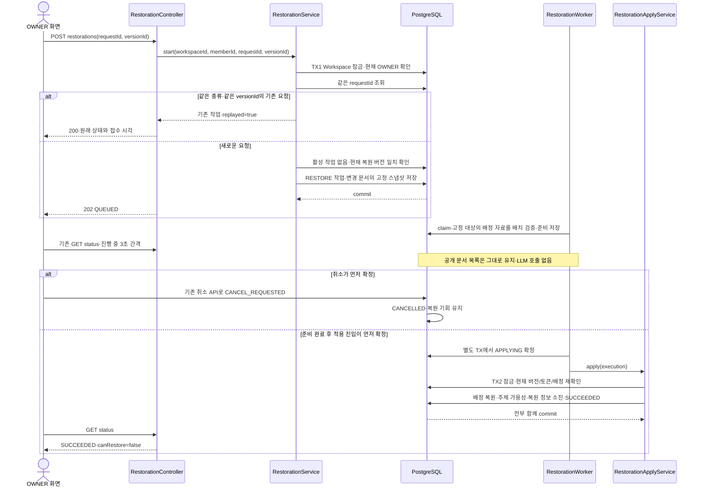

# #937 직전 주제 정리 되돌리기 구현 계획

상태: #937 구현·로컬 검증 완료. 최초 계획·구현 확인일: 2026-10-24 KST.
대상: [#937](https://github.com/woowacourse-teams/2026-knot/issues/937).
Notion 명세와 #934~#936 코드를 대조한 개발 계획이다. 최초 제안과 구현 결과를 구분하며 실제 검증 결과는 [#937 QA](../qa/937-document-topic-selective-restoration.md)에 기록한다.

## 1. 범위와 브랜치

`POST /api/v1/workspaces/{workspaceId}/document-topics/restorations` 하나를 추가한다. OWNER가 직전 재정리의 변경 문서만 이전 배정으로 복원하고, 이후 문서와 기존 문서 내용을 보존한다. 복원 성공 시 직전 복원 정보를 소진한다.

최초 계획 작성 시 checkout은 `be/feature/#936`, HEAD `052f75131`이었다. #934의 [#938](https://github.com/woowacourse-teams/2026-knot/pull/938)과 #935의 [#942](https://github.com/woowacourse-teams/2026-knot/pull/942)는 병합됐고 develop 확인 기준은 `78c79b683`이다. #936의 [#943](https://github.com/woowacourse-teams/2026-knot/pull/943)은 계획 당시 OPEN이었다. 구현 시작 시 다시 확인한 결과 #943도 병합됐으므로 develop `45d6b9999`에서 `be/feature/#937`을 생성했다. 병합을 운영 배포로 해석하지 않는다.

구현 브랜치는 `be/feature/#937`, 비교 기준은 develop이다. #934~#936은 기반에 포함한다. 최초 구현 범위는 브랜치·제품 코드·테스트·ADR·Docker 검증이었다. 이후 사용자의 명시 요청으로 commit/push/PR도 같은 브랜치에서 진행하며 merge는 포함하지 않는다.

### 읽은 근거와 우선순위

| 출처 | 확인 시점·리비전 | 적용 내용 | 판정 |
| --- | --- | --- | --- |
| [#937 Issue](https://github.com/woowacourse-teams/2026-knot/issues/937) | 2026-10-24 실조회, OPEN | 복원 접수부터 실제 실행·소진·실패/취소 복구까지 | 구현 대상. 제목의 ‘시작’만 구현하고 끝내지 않음 |
| [복원 API](https://app.notion.com/p/402b4351752280f98461daf983e86fdd) | 본문 전체·DB 속성 실조회, 수정 2026-10-23 02:49 UTC, truncated=false | POST 경로·UUID requestId·Long versionId·응답6필드·202/200·409 구분 | 사용자 지정 우선 계약. 구현 속성 NO는 런타임 증거 아님 |
| [상태 조회 API](https://app.notion.com/p/402b43517522809da2c5e07a3d879867) | 본문 전체·DB 속성 실조회, 수정 2026-10-23 02:49 UTC | targetVersionId·진행 수·최종 실패 안내·canRestore | 연동 계약 |
| [취소 API](https://app.notion.com/p/402b43517522804a9009eeb1bbfb88bb) | 2026-10-24 본문 전체 실조회, truncated=false | 취소 후 미적용, APPLYING 경합, 복원 정보 보존 | #936과 공유하는 계약 |
| [기능 요구사항](https://app.notion.com/p/402b4351752280be95e5eee9325ee464)·[도메인 규칙](https://app.notion.com/p/402b4351752280099fe0eb92c5c03858) | 본문 전체·필요 속성 실조회, 수정 2026-10-23 02:07/02:13 UTC | 내용 보존·선택적 복원·직전1건·이후 문서 유지 | 원문의 오래된 미정 항목은 후속 사용자 결정과 구분 |
| 이번 대화의 확정 결정·FE 합의 | 현재 작업에 재사용 | 시작 시 대상 고정, 변경0건의 이전 복원본 유지, Workspace 수명 동안 requestId 보존, OWNER 승계, 재시도1회/5초·전체30분, FE3초 조회 | 확정. 다시 인터뷰하지 않음 |
| V62~V66, Operation·StoreAdapter·Apply·Checkpoint·Worker·Scheduler·Status·Document·Category 및 테스트 | #936 `052f75131` | 실제 보존 자료·claim/lease·누락된 복원 구현 | 코드 관측. #936 부분은 열린 PR |
| DocumentGenerationResultService·CategoryCatalogService·DocumentListJpaRepository | 같은 HEAD | 신규 문서 공개 시 Workspace 잠금·카탈로그 재검증, 목록 coalesce(category.name,topic) | 동시성·LEGACY 표시의 재사용 근거 |
| 루트 AGENTS·backend/docs/product/current-v2-mvp·notion-context·정합성 지침·Persona profile/guideline·build.gradle·ADR 하네스 | 2026-10-24 로컬 읽음 | Java25·PostgreSQL·문서 경로·테스트·ADR 생명주기 | 구현 규칙 |

Notion 원문 전문이나 DB 속성 JSON을 이 문서에 복제하지 않는다. 기획 문서·화면·API 원문은 수정하지 않는다. 사용자가 요청한 #937 Issue의 ADR 예정 경로만 `backend/docs/adr/937-document-topic-selective-restoration.md`로 보정했다.

### 범위에서 제외하는 것

문서 내용 재작성, 재전사, 복원을 위한 LLM 재분류, 수동 이동, 여러 버전 선택, redo, 새 조회/취소 엔드포인트, 과거 문서 전체를 시간 기준으로 재선정하는 작업은 하지 않는다. 원래 재정리 대상 중 변경되지 않은 문서도 복원 대상에 넣지 않는다.

## 2. 구현할 흐름

예를 들어 재정리 시작 때 1,000개 중 실제 배정이 바뀐 문서가700개이고 그 뒤 문서10개가 생성됐다면, 복원 대상은 저장된 변경700개다. 이후10개뿐 아니라 원래 변경되지 않은300개도 건드리지 않는다. 문서 생성 시각으로 대상을 추정하지 않는다.



그림에서 H는 상태 조회까지 포함한 HTTP 경계를 간략히 나타낸다. 실제 GET과 취소는 기존 Controller를 사용한다. 외부 요청이나 메모리 큐 성공을 저장 완료로 해석하지 않는다.

### 접수 검사 순서와 멱등성

1. Security의 로그인 쿠키·CSRF, 경로 양수 및 JSON validation을 적용한다.
2. READ_COMMITTED 트랜잭션에서 Workspace를 잠그고 존재/삭제·활성 멤버십·현재 OWNER를 확인한다. 중복 요청도 권한 검사를 생략하지 않는다.
3. Workspace 안의 requestId를 조회한다. 같은 RESTORE·같은 targetVersionId면 작업 상태와 관계없이200이다. 다른 종류 또는 다른 버전이면 TOPIC_REQUEST_ID_CONFLICT/409다.
4. 새 요청만 활성 작업을 검사해 TOPIC_OPERATION_IN_PROGRESS/409로 구분한다.
5. 현재 복원 포인터가 없으면 TOPIC_RESTORATION_NOT_AVAILABLE/409, 있되 요청 버전과 다르면 TOPIC_RESTORATION_VERSION_CONFLICT/409다. 다른 Workspace의 버전을 전역 조회하지 않는다.
6. 복원 원본이 같은 Workspace의 성공한 REORGANIZE인지 확인하고, 원본의 changed=true 문서만 복원 스냅샷으로 고정한다. 작업과 스냅샷 저장은 같은 TX다.

성공 후 포인터가 소진돼도 3번에서 과거 작업을 반환한다. 실패·취소된 요청도 같은 UUID 재전송으로 새 작업을 만들지 않는다. 사용자가 다시 실행하려면 새 UUID를 사용한다. 접수 중 DB 오류는 작업·대상 저장을 함께 롤백하며, FE는 동일 UUID 재요청 또는 상태 조회로 접수 여부를 확인한다.

### HTTP와 FE 계약

Request는 #934와 같은 strict UUID 문자열 validation, `@NotNull @Positive Long versionId`를 사용한다. 응답은 operationId·workspaceId·type=RESTORATION·status·targetVersionId·createdAt의6필드다. 공개 식별자는 Long, requestId만 UUID다. 새 접수202·재전송200은 현재 상태가 아니라 신규 접수 여부로 나눈다. 접수 시각은 MICRO 정밀도로 저장해 최초 응답과 DB 재조회가 일치하게 한다.

401/403·잘못된 JSON400·파라미터400·Workspace404는 기존 Security/예외 handler를 재사용한다. 신규 복원 오류3개는 NOT_AVAILABLE·VERSION_CONFLICT 및 내부 자료 오류이며, requestId/활성 충돌은 기존 코드를 사용한다. 내부 자료 손상은 버전 충돌로 위장하거나 잘못된 복원을 수행하지 않는다.

- 진행 중에만 앞 요청 완료 후 3초 간격으로 기존 GET을 조회한다. 최초 진입은1회 조회하며 브라우저에 작업 ID를 저장하지 않는다.
- operation.targetVersionId는 복원 중·성공·실패·취소 모두 접수한 Long 값을 유지한다. 재정리 작업은 null이다.
- targetDocumentCount는 고정한 변경 문서 수, processedDocumentCount는 준비 완료 수다. 준비100%여도 SUCCEEDED 전에는 완료가 아니다.
- 관찰하던 작업이 SUCCEEDED로 바뀌면 기존 목록을 갱신한다. CANCELLED/FAILED에서는 갱신하지 않는다.
- 복원 성공 후 restorableVersion=null·canRestore=false다. 실패·취소 후에는 기존 포인터가 남고 다른 활성 작업이 없으면 canRestore=true다.
- 실패 조회는 HTTP200이며 TOPIC_RESTORATION_FAILED와 “직전 정리를 되돌리지 못해 현재 분류를 유지했어요. 다시 시도해 주세요.”만 제공한다. 내부 SQL·원문·모델 응답은 노출하지 않는다.

## 3. 나올 코드와 메서드 초안

### 선행 #934~#936 코드와 필요한 차이

| 현재 코드 | 관측한 동작 | #937에서 필요한 변경 |
| --- | --- | --- |
| DocumentTopicOperation | RESTORE enum만 존재. factory는 reorganize뿐이고 복원 대상 필드 없음 | restoration factory·버전/원본 식별자 영속화 |
| DocumentTopicStoreAdapter | 원본 대상에 before_*·after_key·changed 보존, 복원 포인터 유지, terminal 자료 prune | 변경 문서의 선택적 스냅샷·성공 시 포인터 소진·복원 임시 자료 정리 |
| DocumentTopicCheckpointService.claim | REORGANIZE만 claim, LLM 배치/통합 자료 반환 | RESTORE를 이 경로에 억지로 넣지 않음 |
| DocumentTopicWorker | 항상 재정리 planner 실행 또는 재정리 apply | Scheduler에서 별도 복원 Worker로 명확히 분기 |
| DocumentTopicStatusQueryAdapter·Snapshot·StatusService | 공개 버전 ID는 Long이나 operation.targetVersionId는 literal null | 저장된 target_version_id 조회·응답 연결 |
| DocumentTopicCancellationService | kind와 관계없이 상태·토큰 취소, 공통 Store.prune 호출 | 기존 API 유지. 공통 prune이 복원 임시 자료도 정리하도록 보완 |
| Document.reassignCategory | BROAD·NORMAL 주제로 변경, source=REORGANIZATION 강제 | LEGACY·FALLBACK·기존 source/rule의 정확한 복원 메서드 필요 |
| DocumentCategory | 이름·정규화 이름·설명 불변, activeForAssignment만 변경 | 이름으로 다시 만들지 않고 기존 ID 사용·가용성만 조정 |
| DocumentGenerationResultService·CategoryCatalogService | 공개 저장 시 Workspace 잠금·퇴역 후보 재검증 | 복원과 신규 생성의 경합에 그대로 사용·회귀 테스트 |

### 구현한 클래스와 공개 메서드

경로는 `backend/src/main/java/com/knot/backend/document/` 기준이다. 최초 설계의 타입을 구현했고, 아래 표는 실제 명칭으로 맞췄다.

| 클래스·위치 | 메서드 후보 | 입력·판단·저장·출력 |
| --- | --- | --- |
| presentation/DocumentTopicRestorationApi, Controller — 신규 | `start(workspaceId, member, request)` | validation·인증 주체 수신, service 호출, replay 여부로202/200 |
| presentation/DocumentTopicRestorationExceptionHandler — 신규 | `handleDocumentException(exception)` | 복원 API의 내부 자료 오류만 공통500으로 변환하고 기존 비즈니스 오류는 공통 handler에 위임 |
| presentation/dto/request/DocumentTopicRestorationRequest — 신규 | requestId, versionId | #934 UUID validation 재사용·Long 필수/양수 |
| application/DocumentTopicRestorationService — 신규 | `start(workspaceId, memberId, requestId, versionId)` | 위 순서대로 권한·중복·활성·버전 확인, 작업/대상 원자 접수 |
| application/dto/result/DocumentTopicRestorationResult, presentation/dto/response/DocumentTopicRestorationResponse — 신규 | `Result.from(operation, replayed)`, `Response.from(result)` | 외부6필드 변환. 내부 replayed는 응답에 추가하지 않음 |
| domain/model/DocumentTopicOperation — 변경 | `restoration(...versionId, sourceOperationId, now)` | RESTORE factory, 공통 최초 시각·deadline·claim 규칙 재사용 |
| domain/model/DocumentTopicAssignment — 신규 값 | 생성자 검증, 값 비교 | scheme·categoryId·source·ruleVersion. 기존 DB와 같은 유효 튜플 표현, 독립 Entity 아님 |
| domain/model/Document — 변경 | `restoreTopicAssignment(assignment, category)` | LEGACY이면 category=null, BROAD이면 같은 Workspace 엔티티를 검증. 기타와 과거 source/rule도 복원하고 실제 변경 여부 반환 |
| application/DocumentTopicRestorationStore — 신규 port | `findSourceForUpdate(workspaceId)`, `capture(operationId, workspaceId, sourceOperationId)`, `pending(id, limit)`, `markPrepared(...)`, `targets(id)`, `consumeRecovery(...)` | 복원 자료만 관리. 이름/본문을 AI에 전달하지 않음 |
| infrastructure/persistence/DocumentTopicRestorationStoreAdapter — 신규 | 위 port 구현 | JdbcTemplate으로 고정 대상·작업 자료·현재 포인터를 조회·저장 |
| application/dto/result/DocumentTopicRestorationSource — 신규 | versionId, sourceOperationId, changedCount | 현재 복원 가능한 원본의 식별·수. 포인터 검증 결과 |
| application/dto/result/DocumentTopicRestorationTarget — 신규 | documentId, expected, restored, prepared | 접수 당시 현재 배정과 복원할 과거 배정의 두 값. 문서 본문 없음 |
| application/DocumentTopicRestorationCheckpointService — 신규 | `claim(workspaceId, operationId)`, `prepare(execution)`, `beginApply(execution)`, `fail(execution, code, retryable)` | RESTORE만 claim, DB 배치 검증·준비 집계, #936의 도메인 상태/lease 규칙 재사용 |
| application/dto/result/DocumentTopicRestorationExecution — 신규 | workspaceId, operationId, token, readyToApply | 실행권과 다음 단계만 전달. 빈 LLM DTO로 복원 작업을 위장하지 않음 |
| application/DocumentTopicRestorationWorker — 신규 | `execute(workspaceId, operationId)` | TX 밖 단계 조율. 준비 또는 beginApply→apply, DB 오류 재시도. LLM 주입·호출 없음 |
| application/DocumentTopicRestorationApplyService — 신규 | `apply(execution)` | 적용 token·버전·현재 배정 재확인, 문서/주제·포인터 소진·성공을 한 TX로 저장 |
| infrastructure/DocumentTopicScheduler — 변경 | `submit(...)`의 kind별 private 실행 메서드 | 기존 executor를 공유하고 RESTORE는 복원 Worker에 위임. 취소 우선 실행 유지 |
| StatusQueryAdapter·OperationSnapshot·StatusService — 변경 | `findOperation(...)`, 응답 변환 | targetVersionId만 실제 영속값 연결. 기존 필드·권한·REPEATABLE_READ 유지 |
| DocumentTopicStoreAdapter — 변경 | `prune(workspaceId)` | terminal 복원 임시 자료를 먼저 정리하고 기존 원본 준비 자료 정리 |
| DocumentErrorCode — 변경 | 복원 관련 오류 | NOT_AVAILABLE/409, VERSION_CONFLICT/409, 내부 INVALID_TOPIC_RESTORATION_DATA/500. public failure는 기존 안전한 고정 안내 |

새 Worker를 두되 공통 상태 정책은 DocumentTopicOperation을 사용한다. 별도 executor·스케줄러·메시지 브로커·LLM 전략은 추가하지 않는다. 두 kind만 처리하는 명확한 메서드 분기로 시작하고, 이 작업을 범용 Job 프레임워크 리팩터링으로 확장하지 않는다.

### 준비와 실행권 흐름

claim은 Workspace → Operation 순서로 잠그고 RESTORE·삭제·기한·lease를 검사한다. 준비 배치는 기존 batchSize=25를 우선 재사용한다. prepare는 pending 자료의 유효 튜플·Workspace 주제 참조를 검증하고 prepared를 표시한 실제 행 수만 누적한다. 준비100%이면 consolidated=true로 checkpoint하고, 다음 claim에서 readyToApply=true를 반환한다. pending이 없는데 집계가 부족하면 정상 완료로 꾸미지 않는다.

beginApply는 준비 완료와 token을 확인해 별도 TX에서 APPLYING을 확정한다. 적용 재인계는 APPLYING 상태를 유지하며 새 token만 발급한다. 준비 재시도는 기존 retry, 적용 오류는 deferApplyingRetry/reclaimApplying을 사용한다. 기존 재정리 claim은 REORGANIZE 전용으로 유지해 복원 작업이 LLM에 들어가는 것을 막는다.

## 4. 저장 기반과 주의할 점

### 무엇을 복원하고 무엇을 유지하는가

- 원본 S는 현재 document_topic_recoveries.source_operation_id로 찾는다. 대상은 S의 document_topic_operation_targets 중 changed=true뿐이다.
- 각 복원 대상에는 접수 당시 실제 배정(expected)과 S가 보존한 이전 배정(restored)을 별도로 고정한다. 이후 새 문서를 이 테이블에 추가하지 않는다.
- 복원 값은 categoryId·groupingScheme·assignmentSource·assignmentRuleVersion이다. LEGACY는 category/source가 null인 상태로 돌아가며, 원래 규칙 버전도 임의로 새 값으로 바꾸지 않는다. BROAD의 기타/FALLBACK도 보존한다.
- title·summary·content·topic·연결 원문·문서 상태·확인 대상/확인 시각은 스냅샷으로 덮어쓰지 않는다. 적용 시 최신 Document를 잠그고 배정 필드만 바꿔, 준비 중 발생한 확인/보관도 유지한다.
- 새 RESTORATION assignment source를 만들지 않는다. ‘언제 복원됐는가’는 RESTORE Operation에 남기고 문서에는 과거 provenance를 복원한다.

### 주제 이름·참조·후속 문서

현재 Category 이름·설명은 불변이고 `(workspace_id, normalized_name)`은 unique다. 원본 before_category_id FK와 복원 포인터가 자료를 보호한다. 그러므로 동일 이름의 주제를 새로 INSERT하거나 이름으로 다른 ID를 추정하지 않고 원래 ID를 사용한다. 필요한 주제가 누락되거나 다른 Workspace라면 자료 오류로 중단한다. 향후 이름 수정 기능이 생기면 이 전제를 다시 검토한다.

주제 row는 복원 과정에서 물리 삭제하지 않는다. 다음 activeForAssignment 제안은 목록 표시 여부와 구분한다. 목록은 문서 참조와 coalesce(category.name,topic)로 결정된다.

1. 원본 S의 was_candidate=true 주제는 재정리 전 활성 후보였으므로 다시 활성화한다.
2. S의 적용으로 생성/재활성화된 주제 중, 복원 대상 밖 문서가 참조하는 주제는 현재 가용성을 유지한다. 복원 중 새로 생성된 문서도 적용 시점의 참조 검사에 포함한다.
3. 그 외 S의 적용 주제는 신규 배정 후보에서 제외한다. 원래 후보도 아니고 S가 적용한 주제도 아닌 후속 주제는 변경하지 않는다. FALLBACK은 이 NORMAL 후보 조정에서 제외한다.

현재 원본 categories의 was_candidate와 selected/해결된 existing_category_id로 영향 범위를 구분할 수 있다. 실제 분류 대상에 안 쓰인 AI 임시 주제(existing_category_id=null)는 무시한다. 이 정책은 작업 대상 밖 문서와 향후 주제 재사용을 보존하기 위한 구현 제안이며, 새 문서를 이전 체계로 재분류하는 제품 변경이 아니다.

신규 문서 공개와 복원은 같은 Workspace 잠금을 사용한다. 먼저 공개된 새 문서는 참조 보호 계산에 포함되고, 먼저 복원이 적용되면 아직 비공개인 PreparedDocument는 기존 CatalogService의 퇴역 후보/카탈로그 재검증을 따른다. 생성 준비 단계의 선택을 이미 공개된 새 문서와 동일하게 취급하지 않는다.

### 스키마 제안

| 위치 | 추가/변경 | 이유와 제약 |
| --- | --- | --- |
| document_topic_operations.target_version_id | nullable BIGINT, RESTORE에서는 필수 양수 | 소진 뒤 GET·중복 요청에서도 버전 ID 유지. 일시적인 recovery 행에 FK를 걸지 않음 |
| document_topic_operations.restoration_source_operation_id | nullable BIGINT | 원본 작업 식별. `(source_operation_id, workspace_id)`가 Operation의 `(id,workspace_id)`를 참조, ON DELETE RESTRICT |
| Operation kind/복원 필드 CHECK | REORGANIZE는 두 필드 null, RESTORE는 둘 다 양수 | 새 factory·DB가 같이 보호. 원본 kind/status는 source 조회와 서비스에서 검증 |
| document_topic_restoration_targets | 신규 기술 저장 테이블 | PK(operation_id,document_id), workspace_id, expected_*4개, restored_*4개, prepared boolean default false |
| 위 테이블 FK·CHECK | Operation·Document·두 Category 참조 모두 Workspace 복합 FK, ON DELETE 정책 명시 | 다른 Workspace 연결 차단. 배정 튜플 제약은 기존 documents와 같은 기준 |
| 복원 pending index | operation_id, document_id의 prepared=false 부분 인덱스 | 정해진 배치만 읽고 재시작 뒤 미처리부터 이어감 |
| 상태 조회 SELECT/DTO | target_version_id 포함 | 공개 계약을 바꾸지 않고 기존 미연결 필드를 완성 |
| 기존 recovery·원본 target | 성공 전 보존, 성공 시 포인터 조건부 DELETE | 별도 다중 버전/문서 본문 복제 테이블을 만들지 않음 |

원본 임시 테이블을 그대로 재사용하는 대안도 확인했다. 그러나 after_key는 큰 주제 키만 표현하고, pending 조건은 after_key IS NULL이라 LEGACY 복원을 ‘미처리’와 구분하지 못한다. 복원에는 기대 배정과 과거 배정도 함께 필요하다. 따라서 별도 복원 target 테이블을 제안한다.

최초 계획 때 checkout은 V66·원격 develop은 V65까지였다. 계획 시 신규 migration은 V67 후보였고, 구현 직전 #943 병합·develop V66까지를 확인해 **V67로 확정**했다. 실제 운영 flyway_schema_history와 기존 RESTORE 행은 이번에 조회하지 않았다. 과거/수동 RESTORE 행이 있다면 version/source를 추정해 채우지 말고 적용 전 근거를 확인한다. #934~#936 테스트의 raw RESTORE fixture도 새 메타데이터 제약에 맞춰 갱신해야 한다.

### 원자적 적용·소진·정리 순서

1. Workspace → 복원 Operation → 현재 recovery → 문서 ID 오름차순으로 잠근다. 다른 쓰기 경로도 Workspace를 먼저 잡는 현재 순서를 유지한다.
2. APPLYING의 현재 token·lease·최초30분 기한, 현재 포인터의 versionId/sourceOperationId를 다시 검사한다.
3. 모든 대상이 prepared이고 수가 targetCount와 같으며, 각 문서의 현재 배정이 expected와 같은지 검증한다. 뒤에서 불일치해도 앞선 UPDATE를 포함해 전체 rollback한다.
4. 배정 복원, 영향 범위의 후보 가용성 계산, Document flush를 수행한다.
5. `WHERE workspace_id=? AND id=targetVersionId AND source_operation_id=?`로 recovery를 삭제하고 영향 행 수1을 검사한다. 다른 버전을 소진하거나 포인터 없음도 성공으로 처리하지 않는다.
6. token·시각을 다시 검증해 SUCCEEDED·changedCount·finishedAt을 저장한다. 복원 임시 target을 먼저 정리하고 기존 TopicStore.prune으로 더 이상 필요 없는 원본 target/categories를 정리한다. 모두 같은 TX다.

targetVersionId와 sourceOperationId는 Operation에 남으므로 source 준비 자료와 recovery가 삭제돼도 최초 requestId의 재전송 응답은 재구성할 수 있다. Operation 자체와 requestId 기록은 Workspace 수명 동안 유지한다. 새 recovery를 만들지 않아 redo는 제공되지 않는다.

### 실패·취소·재시작

| 상황 | 서버 처리 | 공개 상태/자료 |
| --- | --- | --- |
| 동일 요청 재전송 | 현재 권한 확인 후 기존 작업 반환 | 200, 상태·버전·createdAt 고정 |
| 다른 작업/오래된 화면/소진 | 명세의 409로 구분 | 접수·배정 변경 없음 |
| 준비 중 취소 | #936이 token 제거·CANCEL_REQUESTED를 확정 | prepared 자료만 정리, recovery 유지 |
| 취소 vs beginApply | 같은 잠금에서 먼저 commit한 상태만 인정 | 취소 선행 미적용, APPLYING 선행409 |
| 준비·적용 중 서버 재시작 | 저장한 prepared와 lease로 재개 | 중복 집계·부분 공개 없음 |
| 적용 저장 오류 | 전체 TX rollback, 5초 후1회 재시도 | 기존 분류·recovery 유지, APPLYING 경계 유지 |
| 두 번째 오류/최초 접수30분 초과 | FAILED, 안전한 복원 실패 안내 | 원문·분류·복원 기회 보존 |
| commit 성공 후 응답 유실 | 같은 requestId 조회, 완료 token 재적용 불가 | 200 SUCCEEDED, 같은 targetVersionId |
| OWNER 승계/탈퇴 | Workspace 작업은 계속, 현재 OWNER만 관리 | 이전 OWNER는 중복 요청도 접근 불가 |
| Workspace 삭제 | 신규 공개/적용 중단, 기존 정책으로 종료 | API404, 새 배정 미적용 |
| 정리 DELETE 실패 | 소진·성공·배정을 포함해 rollback | 다음 재시도에서 일관된 자료 사용 |

DB/서버가 계속 중지된 동안 즉시 완료를 약속하지 않는다. 이미 접수된 취소는 deadline 처리로 FAILED로 덮지 않는다. 공통 prune이 복원 target도 처리하도록 보완해 취소/실패 후 고아 임시 자료가 남지 않게 한다. 작업이 참조하는 주제와 현재 문서의 주제는 정리 대상에서 제외한다.

### ADR 경로와 생성 절차

최종 경로는 `backend/docs/adr/937-document-topic-selective-restoration.md`다. 이번에 Issue의 이전 `docs/adr/...` 예정 경로를 이 값으로 수정했다. 실제 파일은 #937 구현 시작 후 검증된 결정 snapshot과 아래 명령으로 생성했다. 판정은 pass/created였고 snapshot은 처리 후 삭제했다. 상태는 Proposed이며 팀 리뷰 전 Accepted로 바꾸지 않는다.

```bash
# 저장소 루트에서, OS 임시 위치의 검증된 snapshot을 사용한다.
python3 harness/materialize_adr.py <snapshot.json> --issue-number 937 --implementation --pretty
```

snapshot은 저장소 밖·현재 사용자 전용 권한으로 두고 처리 후 삭제한다. 원본 snapshot을 복구하지 못하면 이번 대화에서 실제 비교한 두 대안만 사용해 재구성한다. 전체 체계와 이후 새 문서까지 원복하는 안과, 직전 재정리의 변경 문서만 복원하는 안을 비교했고 최종 선택은 후자다. 새 문서 배정·참조 보존이 선택 이유다. 확인하지 않은 대안을 지어내지 않는다. 경로는 하네스 validate_planned_path로 검증하고 상태는 Proposed로 생성하며 팀 리뷰 전 Accepted로 바꾸지 않는다. 공통 #934 ADR은 대체하거나 수정하지 않고 참조한다.

## 5. TDD와 검증 순서

아래 테스트명은 제안이다. 이번 계획 작성에서 제품 테스트를 실행한 결과가 아니다. 커밋 권한이 주어지면 각 동작의 test → feat/fix를 인접한 단위로 나누고, schema·adapter·문서 concern을 분리한다.

1. **배정 값과 문서 복원:** DocumentTopicAssignmentTest·DocumentTest의 LEGACY/BROAD/FALLBACK·잘못된 Workspace·메타데이터 보존 RED부터 작성한다. 기존 reassignCategory의 source 강제 동작을 우회해 쓰지 않는다.
2. **복원 작업 식별:** OperationTest에서 RESTORE factory·targetVersionId 불변·시각 정밀도·deadline/취소/lease 공통 계약을 검증한 뒤 factory와 필드를 추가한다.
3. **저장 구조·대상 고정:** 실제 PostgreSQL에서 source lookup·changed 대상만 capture·expected/restored 왕복·다른 Workspace FK·준비 상태를 먼저 검증하고 신규 migration/adapter를 만든다.
4. **접수 서비스:** 권한·requestId replay 선행·버전/활성 충돌·접수 rollback 테스트 뒤 start를 구현한다. 성공한 복원 소진 뒤 replay와 다른 활성 작업이 있는 상태의 과거 replay도 포함한다.
5. **준비·재시작:** 배치 집계·두 실행자·취소 후 결과 폐기·만료 lease·준비 자료 오류 RED 뒤 RestorationCheckpoint/Worker를 구현한다. LLM 무호출을 검증한다.
6. **최종 적용:** LEGACY 포함 선택적 복원·신규 문서 참조·가용성·소진 원자성·중간 SQL 실패를 DB로 검증한 뒤 ApplyService를 만든다.
7. **공통 연결:** Scheduler kind 분기·#936 취소/적용 경합·prune 순서·#935 targetVersionId snapshot을 검증하고 기존 코드를 최소 변경한다. #934~#936 회귀를 함께 돌린다.
8. **HTTP 계약:** 실제 Security 인수 RED 뒤 Controller·Api·Request/Response를 연결한다. 6필드·202/200·오류·CSRF·OpenAPI를 검증한다.
9. **Docker 사용자 흐름:** 별도 로컬 DB/앱에서 재정리→새 문서 생성→복원→상태 조회→원문/확인 상태 유지·소진 후 동일 요청 재전송을 실행한다. 취소/재시작·저장 실패도 검증하고 `backend/docs/qa/937-document-topic-selective-restoration.md`에 실제 결과만 기록한다.

### 테스트 단위와 기대 결과

| 테스트 위치·방식 | 검증할 동작 | 기대 결과 |
| --- | --- | --- |
| domain/model/DocumentTopicAssignmentTest·DocumentTest — 순수 단위 | LEGACY null·BROAD·FALLBACK·원래 source/rule·외부 Workspace 주제 | 유효 배정만 정확히 복원, 내용·상태 미변경 |
| domain/model/DocumentTopicOperationTest — 단위 | restore 생성·버전 유지·준비 수·최초 시각·취소·적용 재인계 | #936과 같은 상태 정책, deadline 연장 없음 |
| application/DocumentTopicRestorationServiceTest — Mockito | 권한 거절·검사 순서·동일/다른 UUID·현재 포인터 없음/불일치 | 명세 오류, 부당한 저장·자료 조회 없음 |
| application/DocumentTopicRestorationRegistrationIntegrationTest — PostgreSQL | replay가 소진 검사보다 선행, 다른 작업이 있어도 같은 과거 요청 반환 | 새 작업/스냅샷/포인터 변경 없음 |
| 같은 DB 통합 | requestId 동시 접수·kind/version 충돌·대상 저장 오류 | unique/Workspace lock 보장, 작업과 대상 rollback |
| 같은 DB 통합 | 변경700·미변경300·이후10 fixture, timestamp가 같거나 더 과거인 새 문서 | 저장된 changed 집합700만 대상. 시간 추정 없음 |
| application/DocumentTopicRestorationExecutionIntegrationTest — PostgreSQL | prepare 재실행·서버 재시작·구 token·집계 불일치 | 중복 진척 없음, DB에서 이어가고 늦은 결과 차단 |
| 같은 DB 통합 | prepare 중 잘못된 enum/참조/원본 count | 현재 분류 보존, 자료 오류를 정상 성공으로 숨기지 않음 |
| application/DocumentTopicRestorationApplyIntegrationTest — PostgreSQL | 이전 LEGACY·NORMAL·FALLBACK·원래 메타데이터 | 정확한 튜플 복원, 문서 내용/원문/확인/보관 유지 |
| 같은 DB 통합 | 복원 중 문서 확인·ARCHIVED 전환 | 최신 상태를 보존하고 배정만 복원 |
| 같은 DB 통합 | 재정리 뒤·복원 중 생성된 문서와 같은 이름 주제 | 새 문서/주제 ID 유지, 중복 Category INSERT 없음 |
| 같은 DB 통합 | 원래 활성/비활성·새 주제·후속 무관 주제·기타 | 영향 범위만 가용성 조정, 새 참조 보호 |
| 같은 DB 통합 | 신규 문서 공개 vs 복원, 퇴역 후보를 선택한 PreparedDocument | Workspace lock으로 일관화, 공개 전 카탈로그 재검증 |
| 같은 DB 통합 | 두 번째 문서 UPDATE·포인터 DELETE·prune 실패 | 배정·소진·성공 전부 rollback, 복원 기회 유지 |
| 같은 DB 통합 | APPLYING 뒤 중단·5초 retry·두 번째 실패·30분 초과 | 같은 계획으로1회 재시도, 구 token 차단, 최종 실패 시 소진 없음 |
| 같은 DB 통합 | 성공 commit 뒤 응답 유실·같은 requestId 재전송 | 기존 SUCCEEDED·동일 버전/시각200, 복원 재실행 없음 |
| #936 취소 통합 회귀 | 취소 vs 적용 양쪽 commit 순서·중복 취소·정리 실패 | 취소 선행은 분류/포인터 보존, 적용 선행409 |
| infrastructure/DocumentTopicSchedulerTest — 단위 | RESTORE routing·기존 REORGANIZE·executor 포화·취소 우선 | 정확한 Worker 호출, LLM Worker에 RESTORE를 보내지 않음 |
| #935 StatusService/Snapshot/Acceptance 회귀 | 포인터 소진과 작업 완료 동시 조회, targetVersionId 지속 | REPEATABLE_READ 일관성, 성공 후 복원본 null, 실패/취소 후 유지 |
| presentation/DocumentTopicRestorationAcceptanceTest — 실제 Security/MockMvc | 신규202·재전송200·6필드·Long·RESTORATION·OpenAPI | 명세 JSON 일치, replayed/내부 UUID 미노출 |
| 같은 인수 | 로그인·invalid JWT·CSRF·OWNER 승계/탈퇴·Workspace 삭제·타 Workspace 버전 | 기존 권한 계약·Workspace 격리·안전한 오류 |
| 같은 인수 | requestId 누락/비정상 UUID·versionId 누락/0/음수/범위 초과·JSON 오류 | validation400/본문400, 작업 접수 없음 |
| 같은 인수 | 진행 중·소진·버전 변경·UUID 내용 충돌 | 서로 다른 명세409 코드, FE 재조회 가능 |
| Docker HTTP — 실제 앱·PostgreSQL | 성공·취소·앱 restart·동일 요청 replay·LLM 공급자 중지 | 분류와 복원 기회 보존/소진이 일치. 실제 모델은 필요하지 않음 |

동시성은 별도 DB 연결·TransactionTemplate·CountDownLatch로 순서를 강제하고 bounded timeout을 둔다. Mockito만으로 lock·FK·migration·commit을 증명하지 않는다. MICRO fixture뿐 아니라 나노초 Clock의 실제 저장 왕복도 검증한다. 실제 공급자가 내려간 검증과 단순 mock 무호출 검증을 구분한다.

### 확인한 검증 명령

Java25·Docker 준비 후 backend 디렉터리에서 실행한다. 테스트명은 실제 추가한 파일명에 맞춘다. Gradle 단위·integration·acceptance 태그 분리와 check 의존성을 확인했다.

```bash
./gradlew test --tests '*DocumentTopicAssignmentTest' --tests '*DocumentTest' --tests '*DocumentTopicOperationTest' --tests '*DocumentTopicRestorationServiceTest' --tests '*DocumentTopicSchedulerTest'
./gradlew integrationTest --tests '*DocumentTopicRestoration*IntegrationTest' --tests '*DocumentTopicReorganizationIntegrationTest' --tests '*DocumentTopicCancellationIntegrationTest' --tests '*DocumentTopicStatusSnapshotIntegrationTest'
./gradlew acceptanceTest --tests '*DocumentTopicRestorationAcceptanceTest' --tests '*DocumentTopicReorganizationAcceptanceTest' --tests '*DocumentTopicStatusAcceptanceTest' --tests '*DocumentTopicCancellationAcceptanceTest'
./gradlew clean spotlessCheck check bootJar
git diff --check
```

같은 checkout에서 Gradle 검증을 겹쳐 실행하지 않는다. #936에서 결과 파일이 충돌했던 관측을 반영해 최종 판정은 단일 실행 결과만 사용한다. 로컬 Docker·환경·원시 결과는 기존 ignored 경로인 `backend/ops/document-topic-local/937/` 등에 두고, 공용 Docker 설정을 광범위하게 ignore하지 않는다.

## 6. 완료 기준과 다음 작업

- 신규 접수·재전송·권한·UUID/Long·오류를 실제 Security로 검증하고 기존 문서/목록/상태/취소 계약을 유지한다.
- 변경 문서만 복원하고 LEGACY·FALLBACK·과거 메타데이터·이후 문서·확인 상태 보존을 PostgreSQL로 검증한다.
- 적용·포인터 소진·성공이 원자적이며, 실패/취소/재시작이 복원 기회를 소진하거나 같은 requestId가 복원을 반복하지 않는다.
- #936의 적용 경계·lease·재시도 규칙을 지키며 복원은 LLM을 호출하지 않는다. 실제 Docker HTTP 시나리오도 기록한다.
- migration 적용 순서·기존 RESTORE 행·문서 참조·전체 check를 확인하고 Proposed ADR을 backend/docs/adr에 포함한다. 리뷰 전에 Accepted로 바꾸지 않는다.

남은 확인은 구현 직전의 V67 충돌/기존 RESTORE 데이터, 실제 DB의 준비·일괄 적용 시간과 lease 여유, 신규 문서 공개 전 카탈로그 재검증의 실제 동작이다. 측정하지 않은 값을 성능 보장으로 쓰지 않는다. 새로운 사용자 선택이 필요한 명세 충돌을 발견한 경우에만 해당 지점을 설명하고 확인한다.

구현 결과: 별도 RestorationService·CheckpointService·ApplyService·Worker와 저장 adapter, 배정 값 객체 및 HTTP API를 추가했다. 상태 조회의 targetVersionId와 스케줄러 종류 분기를 연결했다. V67 migration으로 버전/원본 식별과 expected/restored 스냅샷을 보존한다. 실행 DTO에는 Workspace·작업·token·적용 준비 여부만 싣고, deadline은 DB의 Operation에서 다시 검증한다. 복원 HTTP 경계에만 기존 GlobalExceptionHandler를 재사용하는 scoped advice를 두어 내부 자료 오류를 명세의 INTERNAL_SERVER_ERROR로 변환한다. 다른 API의 오류 계약은 바꾸지 않는다. 로컬 실행 파일과 원시 결과는 기존 ignored 경로에 둔다. 실제 결과·실패 주입 범위와 실제 LM Studio 연동 결과는 QA 문서를 따른다. 실제 모델8개 재정리와1,000개 무LLM 복원 측정을 구분하고1,000개 LLM 재정리의5분 목표 달성으로 일반화하지 않는다.
