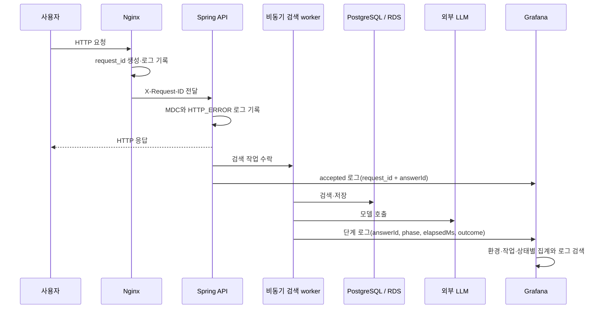

# Grafana 관측 신뢰도 개선·도입 계획

상태: 01 상태 표현·02 API 오류 분류·03 로그 수집 가시성을 DEV·PROD 운영 반영 완료; PROD 앱 로그 공백·request_id 경보 firing과 Discord 실제 수신 확인; DEV 정상·실패 검색을 request_id→answerId→worker 로그로 연결; DEV 24시간 파일시스템 Tempo canary 설정은 로컬 검증 완료, 원격 설치·실 trace 확인 대기; PROD 로그 원천·Tempo·RDS 세션 수집 후속
확인일: 2026-10-23
현재 브랜치: `be/refactor/#715`
대상 Issue: 없음

## 1. 범위와 근거

기존 DEV·PROD 분리와 각 환경의 8개 대시보드 탭을 유지하면서, 현재 화면이 실제로 아는 것과 수집하지 않는 것을 구별한다. 새 Grafana 폴더나 별도 대시보드는 기본적으로 만들지 않는다. API 분류는 `02 API 요청·오류`, 로그 검색은 `03 로그`, 처리 경로와 추적은 `08 요청 추적·처리시간`, 전체 상태·연결 흐름은 `01 전체 상태` 안에서 개선한다.

이번 요청으로 1차 안전 변경을 DEV·PROD 운영 대시보드에 반영했다. `01 전체 상태`의 요약 pill은 서비스 지표에 알려진 수집 공백이 있으면 초록색 “All Systems Healthy” 대신 “Service OK · Partial Coverage”를 표시하고, 좁은 화면에서는 “Partial Data”로 줄인다. 실제 장애 징후가 있으면 그 상태를 우선 표시하고, 핵심 상태 데이터가 비면 별도로 표시한다. probe 값이 없을 때 장애로 오판하던 조건도 수정해 수집 누락과 측정된 비정상을 구분한다. 운영의 DEV·PROD 파일을 사전 대조해 panel 100 외 패널이 로컬과 동일한 것을 확인한 뒤, 두 overview panel 100만 원자적으로 교체했다. 기존 파일 백업은 `/opt/knot-observability/environment-backup-codex-20261023T043416Z/`에 보존했다. Grafana 브라우저를 새로고침한 PROD 01에서 실제 “Partial Data” 표시를 확인했다. 다른 탭과 나머지 패널은 변경하지 않았다.

2차로 `02 API 요청·오류`를 DEV·PROD에 반영했다. 기존 요청률·오류율·지연 패널을 `/api/v1` namespace로 제한하고, API 4xx 비율에서 401/403을 제외했다. 선택 기간 4xx 분류 카드에서 API 4xx(인증 제외), 인증 401/403, 비API 4xx를 각각 보여준다. API 오류 URI TOP 20, 인증 URI TOP 20, 비API 오류 URI TOP 20 표도 분리했다. 비API URI의 24시간 쿼리는 Loki 500-series 제한에 걸려 최근 1시간만 보여주며, 선택 기간 API 쿼리는 상위 20개로 제한했다. `/api/v1`은 정확한 업무 endpoint allowlist가 아니라 namespace이므로 내부 미등록 경로·리소스 404가 남을 수 있다. 비API 4xx는 scanner로 단정하지 않고 후보로 표시한다. 운영 파일은 표 전용 ID를 제외한 패널·메타데이터 불변을 확인한 뒤 교체했고, 배포 직전 파일은 `/opt/knot-observability/environment-backup-codex-20261023T043416Z-api-table-v3/`에 보존했다. PROD 02 화면에서 분류 카드와 세 표의 실제 값 및 URI·상태별 행을 확인했다.

3차로 `03 로그` 상단에 선택 시간 범위의 앱 로그 줄 수, Nginx 요청 로그 수, Nginx JSON `request_id` 포함률을 표시하는 세 카드를 DEV·PROD에 추가했다. PROD 24시간 조회에서 Loki app log stream은 없고 Nginx `request_id` 필드도 0건이었다. 같은 시점 Prometheus `up{env="prod",job="spring"}`은 1로, Spring metrics scrape는 살아 있지만 앱 로그 전달은 별도 공백임을 확인했다. 1시간 Grafana 화면에서는 PROD 앱 로그 `표본 없음`, Nginx 8,453건, 포함률 0.0%가 보였다. DEV 화면은 앱 로그 688줄, Nginx 293건, 포함률 97.3%를 표시했다. 값은 관측 시점의 1시간 표본이며 계속 바뀐다. 앱 표본 없음만으로 수집 장애를 단정하지 않도록 Nginx 요청 건수와 함께 읽는 설명을 넣었다. 운영의 DEV·PROD 로그 dashboard 파일은 배포 직전 `/opt/knot-observability/environment-backup-codex-20261023T-log-coverage-v1/`에 보존했다. Loki 실제 쿼리와 PROD·DEV UI에서 패널 값을 확인했다. 이는 Grafana 화면의 공백을 드러낸 것이며 PROD 앱 로그 원천이나 `request_id` 전달 문제를 해결한 것은 아니다.

| 자료 | 확인한 사실 | 판정 |
| --- | --- | --- |
| 사용자 제공 PROD 화면·감사 내용, 2026-10-23 | `All Systems Healthy`와 함께 PostgreSQL SQL QPS/세션이 미수집이고 LLM 지표가 표본 없음으로 보인다. PROD 로그 한 건에는 `request_id`가 없었다. | 실제 화면 및 로그 표본 관측; 전체 수집 상태를 확정하지는 않음 |
| `ops/observability/build-environment-dashboards.mjs` | 기존 전체 상태 조건은 API health·요청률·호스트 자원·Hikari 용량 중심이고, PostgreSQL QPS/세션 및 LLM 오류율 수집 범위를 검사하지 않았다. 1차 수정에서 부분 관측 상태를 분리했다. | 현재 로컬 구현 관측 |
| `ops/observability/provisioning/environment-dashboards/{dev,prod}/knot-*-overview.json`, 운영 `/opt/knot-observability/provisioning/environment-dashboards/{dev,prod}` | 01 흐름 패널은 실제 요청률에 따라 움직이고, PostgreSQL SQL QPS/세션과 LLM 오류율은 미수집 범위다. 운영 provider는 `Knot-dev`·`Knot-prod` 파일 경로를 30초 주기로 읽고 삭제 방지가 켜져 있다. 배포 전 DEV·PROD 각각 panel 100 이외의 모든 패널 객체가 로컬과 운영에서 같음을 비교했다. | 운영 파일에 panel 100만 반영; PROD 브라우저에서 “Partial Data” 표시 확인 |
| `ops/observability/provisioning/environment-dashboards/{dev,prod}/knot-*-api.json` | `/api/v1` 요청/오류율과 인증 401/403 및 비API 4xx 집계를 분리했다. 경로 표는 API 오류(인증 제외), 인증, 비API 최근 1시간 TOP 20이며 비API scanner 여부는 URI로 확인해야 한다. | DEV·PROD 원격 JSON 대조/백업 후 반영; Loki 실제 조회와 PROD 02 표 행 확인 |
| `ops/observability/provisioning/environment-dashboards/{dev,prod}/knot-*-logs.json`, NCP Loki 1시간/24시간 집계 | 상단 카드가 앱 로그 줄, Nginx access 로그 수, JSON `request_id` 포함률을 현재 대시보드 시간 범위로 계산한다. PROD 24h에 Spring/prototype stream과 request_id 일치가 없었고, 1h 화면은 앱 표본 없음·Nginx 8,453·request_id 0.0%; DEV는 앱 688·Nginx 293·request_id 97.3%였다. | 두 로그 대시보드에 panel 90을 추가하고 remote provider가 읽은 뒤 실제 DEV·PROD UI 확인; 배포 직전 파일은 `environment-backup-codex-20261023T-log-coverage-v1/`에 보존. PROD 애플리케이션 로그 원천 문제 해결은 미완료 |
| `src/main/java/com/knot/backend/global/exception/GlobalExceptionHandler.java`, `ServerErrorLogger.java`, NCP Loki | `ProjectException`은 error code와 함께 기록한다. PROD 24시간 Loki에서 Spring/prototype app stream은 검색되지 않았다. | 코드상 오류 기록은 존재하지만, PROD stream 부재의 원인과 앱 오류 로그 유입은 확인되지 않음 |
| `ops/observability/nginx/{request-id-proxy.conf,access-log.conf}`, `RequestIdFilter.java`, `application.properties`, NCP Loki/Prometheus | 저장소 Nginx JSON format은 `request_id`를 기록하고 proxy에도 전달하지만 PROD access log 실측에는 필드가 없다. PROD Spring Prometheus scrape는 `up=1`인데 Loki 앱 stream은 없다. | 앱 metrics/agent 전부 중단된 것은 아니며, 실행 중 Nginx log_format·Alloy journald/file source 중 어느 단계의 설정 불일치인지는 앱 호스트에서 확인해야 함 |
| `SearchAnswerStream.open`, `SearchAnswerWorker`, 검색 처리 로그 | accepted 로그에는 `answerId`가 기록되고 Spring 로그 패턴의 `request_id`가 함께 붙는다. 이후 worker 단계는 `answerId` 기준 로그가 있으나 분산 span waterfall은 아니다. | 현재 코드 관측 |
| `ops/observability/provisioning/alerting/knot.json` | 24개 규칙이 있다. 기존 비율형 5xx는 최근 API 요청 수 최소 20건·5% 초과·5분 지속 조건을 유지한다. 보완 규칙은 5분 내 저트래픽 5xx 2건, API 요청 20건 초과 상태에서 Spring 완료 로그 전부 누락, 15분 request_id 누락률 5% 초과를 환경별로 감지한다. | 운영 alert API에서 24개를 확인; Loki queryType 오류를 수정한 뒤 PROD 앱 로그 공백·request_id 누락 규칙은 firing/health ok, DEV 신규 규칙은 inactive/health ok; Discord `#서버-장애-알람`의 firing/resolved 실제 수신을 확인했으며 저트래픽 5xx는 발생을 유도하지 않음 |
| `ops/observability/compose.tempo-canary.yml`, `ops/observability/tempo/tempo.yml`, `ops/observability/provisioning/datasources/tempo-canary.yml`, Grafana `/api/datasources` | 저장소에 DEV 전용 profile의 Tempo local backend와 24시간 보존 설정을 추가했고 pinned Tempo 3.1.0 이미지가 설정을 검증했다. 마지막 실제 Grafana API 관측에는 Loki와 Prometheus만 있었으며 신규 Tempo 설정은 아직 원격에 배포하지 않았다. Prometheus 보존은 14일·8GB다. | 설정 파일과 Compose overlay를 로컬 검증; NCP SSH key 인증 실패로 원격 설치와 현재 Tempo datasource 상태 재확인은 미완료 |
| `backend/docs/product/current-v2-mvp.md`, `docs/notion-context.md` | 이번 작업에 직접 적용할 사용자 관측 기능 계약은 찾지 않았다. 이 계획은 제품 API 요구사항이 아니라 운영 가시성 범위다. | 제품 계약 근거로 사용하지 않음 |

현재 워킹트리에는 대시보드·알림 및 다른 백엔드 작업의 미커밋 변경이 함께 있다. 이번 수정은 그 변경을 되돌리거나 전체 provider/alert bundle을 재생성하지 않는다. DB migration은 없다. 운영 적용은 01 전체 상태 단일 패널 변경을 포함한 대상 범위 export·backup 후 별도 배포 절차에서 확인한다.

## 2. 구현할 흐름

오류를 볼 때는 **요청 수 → 업무 API/인증/알 수 없는 경로별 오류 → request_id 로그 → answerId 검색 단계 → 앱·풀·DB·LLM 및 호스트 상태** 순으로 좁힌다. Nginx access log와 Spring span/로그, 비동기 worker 결과는 서로 다른 시간 경계일 수 있다. 검색 작업의 비동기 완료 시간을 HTTP 응답시간에 더하지 않는다.

전체 상태는 네 가지 의미를 분리한다.

- 측정한 신호에서 장애 징후가 있으면 `Attention Required`.
- API health·핵심 호스트/Hikari 같은 기준 신호가 비면 `Core Monitoring Data Missing`.
- 기준 신호는 양호해도 알려진 지표 공백이 있으면 `Service OK · Partial Coverage`.
- 알려진 공백까지 계측되고 위험이 없을 때만 `All Systems Healthy`.

4xx는 전부 장애로 세지 않는다. 업무 API의 입력 오류, 401/403 인증·권한 거절, 업무 API가 아닌 scanner/unknown 경로를 분리하고 각 비율 옆에 요청 건수를 둔다. 알림은 정상 인증 거절이나 외부 스캐너 요청을 장애로 오인하지 않도록 실제 기준선을 확인한 뒤 추가한다.

## 3. 코드·설정 변경안

| 단계 | 기존 위치와 책임 | 변경안 |
| --- | --- | --- |
| 0 · 완료 | `build-environment-dashboards.mjs`의 `missionControlChart`와 DEV/PROD overview JSON이 전체 상태 흐름을 제공한다. | 알려진 DB·LLM 지표 공백, 핵심 수집 누락, 측정된 위험을 서로 다른 상태로 표시한다. 좁은 화면은 짧은 상태명으로 쓴다. PROD 화면에서 amber `Partial Data`를 직접 확인했다. |
| 1 · 반영 | DEV/PROD `knot-*-api.json`이 Nginx 로그를 분류한다. | `/api/v1` namespace 요청과 오류율에서 401/403을 분리하고 선택 기간 건수 카드를 추가했다. 오류 URI 표를 API 비인증 TOP 20, 인증 TOP 20, 비API 최근 1시간 TOP 20으로 나눴다. `/api/v1` 내부 미등록 URI는 업무 API와 여전히 섞이며 비API 경로는 scanner 후보로만 해석한다. Loki 500-series 오류를 재현하고 시간 범위 제한/상위 20개 쿼리를 live 검증한 뒤 DEV·PROD에 반영했다. |
| 2 · 로그 수집 가시성 반영, 연결 검증 대기 | `03 로그` 상단에 앱 로그 줄 수, Nginx 요청 수, request_id 포함률을 선택 시간 범위로 표시한다. Loki 관측에서 PROD 앱 stream은 없고 request_id 포함률은 0%; DEV에서는 두 종류 로그가 들어온다. | PROD 애플리케이션 journal/Alloy가 실제로 수집되는지와 Nginx→Spring request_id 전달을 앱 호스트 설정·같은 실제 요청으로 확인한다. 앱 로그가 없는 상태는 오류 원인을 보여주는 것이 아니며 요청 ID end-to-end 연결도 증명하지 않는다. |
| 3 · 작업별 처리시간 | `SearchAnswerWorker.execute`, `SearchAnswerStream.open`, `SearchLlmClient`, `SearchMcpClient`는 queue/검색/외부 호출/stream phase 로그를 남긴다. | 성공·실패·취소·완료를 구분하고 핵심 작업별 첫 응답 및 최종 완료 시간을 안정된 이름으로 정리한다. per-answer DB 구간은 계측을 확인하기 전까지 미수집으로 유지한다. |
| 4 · 보완 알림 반영 | `provisioning/alerting/knot.json`은 비율형 5xx·지연 및 수집 누락 규칙을 제공한다. | DEV·PROD 양쪽에 저트래픽 5xx(5분 2건, 총 API 요청 20건 미만), 앱 로그 완전 공백(15분 API 요청 20건 초과), request_id 누락률(15분 요청 20건 이상, 누락 5% 초과) 규칙을 추가했다. 운영은 총 24개 규칙을 확인했다. PROD 앱 로그 공백 규칙은 Loki model의 `queryType: instant`를 누락해 평가 오류가 있었고 수정·reload 후 `health=ok`, 오류 없음, `firing`을 확인했다. 실제 Discord 수신과 저트래픽 경보는 발생을 유발하지 않고 관측한다. |
| 5 · 분산 추적 | NCP에 Tempo가 없고 기존 DEV 로그 상관관계는 request_id→answerId→worker 로그까지다. | 선택된 DEV 전용 24시간 파일시스템 canary 설정을 로컬에 준비했다. Java Agent 2.32.0은 HTTP/DB 호출을 계측하고, tracecontext만 전파한다. DEV Alloy는 loopback OTLP/HTTP 수신 뒤 URL·사용자·SQL·프롬프트·예외 내용을 제거하고 DEV mTLS 경로로 전달한다. Nginx는 DEV Alloy 인증서만 `/dev/otlp/v1/traces`에 허용한다. 실제 trace와 비동기 worker 연결은 원격 설치 후 확인한다. PROD 적용은 별도 판단으로 둔다. |

Prometheus label에는 `request_id`, `answerId`, 사용자 ID, 원시 URI처럼 값이 계속 늘어나는 식별자를 넣지 않는다. 고정된 operation·outcome·environment 레이블과 histogram을 사용하고 상세 ID는 로그/trace에서 찾는다. Metrics naming 및 cardinality 원칙은 [Prometheus 지침](https://prometheus.io/docs/practices/naming/#labels)을 따른다.

DB migration은 없다. 현재 Hikari pool은 Spring 애플리케이션 연결 수이고 RDS CloudWatch `DatabaseConnections`는 인스턴스 수준 값이다. PostgreSQL QPS/session/max_connections를 실측하려면 RDS 네트워크 접근, 전용 read-only 모니터링 계정, exporter 또는 동등 수집 방식과 권한을 확인해야 한다. 권한과 접근성을 확인하기 전에는 0으로 채우지 않고 미수집으로 둔다.

## 4. 저장·운영 위험과 남은 결정

분산 trace를 켜면 호출 메타데이터와 disk 사용량이 늘어난다. DEV canary는 선택에 따라 Tempo filesystem backend와 24시간 보존으로 한정했다. Tempo의 filesystem backend는 단일 노드 평가·개발용이며 Grafana는 운영 환경에서 object storage 사용을 안내한다. 실제 설치 전 NCP 가용 disk를 확인하고, DEV trace 수신량과 저장량을 확인해야 한다. [Tempo 배포 문서](https://grafana.com/docs/tempo/latest/set-up-for-tracing/setup-tempo/deploy/locally/linux/)를 근거로 두었다.

확정되지 않은 결정은 세 가지다.

1. PROD Tempo 저장소와 trace 보존 기간·예산. DEV canary의 24시간 filesystem 선택은 PROD 저장 결정이 아니다.
2. 4xx 인증 거절 및 저트래픽 5xx 경보를 켤 기준선과 최소 실패 건수.
3. RDS `pg_stat_activity`를 읽을 수 있는 네트워크/권한 및 exporter 위치.

이 결정이 없어도 상태 표현, API 분류, 현재 로그 검증은 진행할 수 있다. 요청 내용, 프롬프트, 토큰, 사용자 식별자를 trace attributes에 담지 않는다. `request_id`/`answerId`는 로그·trace 검색 키이지 metric label이 아니다.

## 5. 설정 검증과 도입 순서

사용자가 TDD는 필요 없다고 명시했으므로 테스트 우선 개발이나 새 테스트 스위트는 이번 범위에 추가하지 않는다. 설정 파일 파싱, 생성 결과·기존 패널 보존 확인, Grafana 실제 화면 검토와 DEV의 정상/실패 요청 시나리오로 확인한다. 운영 5xx 요청이나 실제 LLM 프롬프트를 만들지 않는다.

| 단계 | 확인 방법 | 기대 결과 |
| --- | --- | --- |
| 현재 로컬 변경 | `node --check` 및 DEV/PROD overview JSON 파싱; panel 100에 부분 관측 문구와 설명이 있는지 확인 | 생성기 구문과 JSON이 유효하고 다른 flow 외 패널을 덮어쓰지 않음 |
| DEV/PROD 01 적용 | 운영 DEV·PROD overview 파일과 로컬 JSON을 대조하고 백업 후 panel 100만 원자적으로 반영. 기존 PROD 브라우저를 새로고침해 compact 레이아웃 확인 | DEV·PROD 파일의 panel 100에 상태 규칙이 반영되고, PROD 좁은 화면에서 DB/LLM 공백이 `Partial Data`로 보여 초록 전체 정상으로 오인되지 않음 |
| API 분류 · 완료 | DEV·PROD Loki에서 `/api/v1` 비인증 오류 및 401/403 URI 상위 20개를 선택 기간으로 조회하고, 비API URI 상위 20개를 최근 1시간으로 조회한다. PROD 02 표 렌더와 상태 코드를 확인한다. | 두 환경 쿼리는 성공한다. 비API 24h는 Loki 500-series 제한 때문에 recent 1h로 제한한다. `/api/v1`은 namespace라 미등록 route를 제거하지 못한다. |
| 03 로그 수집 가시성 · 완료; 원천 복구와 요청 연결 · 대기 | 선택 시간 범위에 앱 로그 줄, Nginx 로그 수, Nginx JSON request_id 포함률을 보여준다. 실제 1시간 PROD 화면은 앱 표본 없음·Nginx 8,453·request_id 0.0%, DEV는 앱 688·Nginx 293·97.3%였다. | PROD 앱 journal/Alloy 수집을 별도 앱 호스트에서 확인·복구하고 같은 요청의 Nginx request_id와 Spring 오류 로그를 연결한다. 현재 카드만으로 연결을 증명하지 않는다. |
| async 연결 검증 · 일부 완료 | DEV Loki에서 정상 검색과 실패 검색의 accepted 로그를 각각 request_id로 찾고, panel 108이 반환한 answerId로 worker 로그를 조회했다. | 정상 표본(2026-10-20 10:47 UTC)은 Spring 로그 10건·성공 outcome·처리 phase 9종이다. 실패 표본(2026-10-19 10:41 KST)은 `answerId=808`, `INVALID_MODEL_ANSWER`; LLM stream은 성공했고 worker 로그는 request_id 없이 answerId로만 연결됐다. 이는 비동기 로그 상관관계 확인이며 분산 trace 증명이 아니다. 2026-10-23 17:46 KST의 최근 30분 accepted 검색은 0건이고 새 요청은 만들지 않았다. |
| alert 확인 · 완료 | 운영 rule API에서 24개 및 DEV·PROD 각 3개 신규 규칙을 확인하고, Loki app-log alert `queryType=instant`와 live ruler의 `health`/`lastError`, Discord 채널 수신을 확인한다. | 관측 당시 PROD 앱 로그 공백과 request_id 누락률 규칙은 `firing`, `health=ok`, `lastError=null`; DEV 신규 규칙과 양 환경 저트래픽 5xx는 `inactive`, `health=ok`였다. 2026-10-23 16:30:50 KST PROD app-log-missing firing이 Discord에 도착했다. 이후 resolved 메시지의 `rule changed`는 서비스 복구 확인이 아니다. 저트래픽 5xx 실발생은 유도하지 않았다. |
| Tempo canary · 로컬 설정 검증 완료, 원격 설치 대기 | pinned Tempo 이미지 `-config.verify`, Compose overlay `config --no-env-resolution --quiet`, Alloy pinned 이미지 `validate` 성공. NCP/DEV host에 설정을 배포하고 정상 요청 trace 1건의 Grafana waterfall, 로그 상관관계, 24시간 보존 및 저장량을 확인한다. | Nginx access log의 request_id와 Spring→JDBC/외부 호출→worker 사이에서 실제 생성된 span·미계측 구간이 확인됨. 현재는 live trace 증거가 없음 |
| PROD 확장 | DEV 결과, 저장소/보존 결정, 운영 export·backup·rollback 확인 후 단계적으로 적용 | 정상 1건과 실패 1건을 하나의 요청 흐름으로 설명할 수 있음. 관측되지 않은 구간은 명시됨 |

Grafana의 No Data는 성공적으로 실행한 쿼리가 표본을 반환하지 않은 상태이고 Error는 쿼리 평가 실패다. 둘은 같은 정상 상태로 합치지 말고 지표별 의미에 맞게 설정한다. [Grafana No Data/Error 안내](https://grafana.com/docs/grafana/latest/alerting/fundamentals/alert-rule-evaluation/nodata-and-error-states/)를 참고한다. 이번 단계에서는 새 테스트나 실제 장애 요청은 실행하지 않았다.

2026-10-23 DEV Tempo canary 설정 준비: `ops/observability/tempo/tempo.yml`은 Tempo 3.1.0 pinned image의 `-config.verify=true`를 통과했고, retention은 backend scheduler/worker 양쪽에 24h로 설정했다. `compose.tempo-canary.yml`은 기존 Compose와 병합 검증을 통과했으며 Tempo는 `dev-tracing` profile로만 켜진다. 별도 Tempo datasource, 127.0.0.1 OTLP 수신 전용 Alloy process, DEV mTLS OTLP route, DEV Blue/Green systemd drop-in과 Java Agent 설정을 추가했다. Alloy `validate`는 pinned Alloy image에서 통과했으며 검증 시 exporter endpoint 환경 변수에는 `https://invalid.local`을 넣어 파싱만 확인했다. 실제 endpoint, host 인증서·키, NCP/DEV의 여유 disk, systemd/Nginx 설치 상태는 검증하지 않았다. NCP SSH key 인증이 거부됐고 기존 interactive SSH session이 닫혀 있어 원격 변경, service 재시작, 실제 DEV 요청, Grafana trace waterfall, 저장량 확인은 아직 하지 않았다. 이 작업에 테스트 스위트는 실행하지 않았다.

## 6. 완료 기준과 다음 단계

전체 개선의 완료는 다음을 모두 만족할 때다.

- 01에서 서비스 상태와 관측 범위가 구분되고, 일부 미수집 상태를 전체 정상으로 오해하지 않는다.
- 02에서 `/api/v1` namespace 4xx(401/403 제외), 인증 응답, 비API 4xx 건수가 분리되고 URI 상위 표에서 상태를 확인한다. 정확한 Controller endpoint allowlist와 scanner 판정은 후속이다.
- 03 상단에서 앱 로그 표본·Nginx 요청량·request_id 포함률을 볼 수 있다. DEV에서는 실제 정상·실패 검색을 request_id에서 answerId와 worker 최종 상태까지 연결했다. worker 로그 자체에는 request_id가 없어 직접 전파가 이어진 것은 아니며 분산 span도 없다. PROD는 앱 표본 없음과 request_id 0%가 확인됐고 로그 원천 복구와 요청 연결은 남아 있다.
- 핵심 작업의 성공·실패·첫 응답·최종 완료·취소를 구분하고, 비동기 구간을 HTTP 시간에 더하지 않는다.
- 저트래픽 오류와 signal 수집 중단에 각기 맞는 경보가 있고 No Data 정책과 실제 Discord 전달 경로가 검증된다.
- DEV Tempo trace에서 계측된 구간과 미계측 구간이 확인된 뒤, 저장/보존 결정에 따라 PROD에 확장된다.

01 전체 상태, 02 API 오류 분류와 03 로그 수집 가시성의 1–3차 변경은 로컬 builder 및 DEV·PROD JSON에 반영해 NCP에 배포했다. PROD 03에서는 선택 1시간 동안 앱 로그 표본 없음, Nginx 8,453건, request_id 포함률 0.0%를, DEV에서는 앱 로그 688줄, Nginx 293건, 97.3%를 직접 확인했다. 이는 해당 시간의 집계이며 PROD 로그 수집 경로의 원인이나 오류 원인을 밝힌 것은 아니다. API URI 표는 PROD 02에서 확인했고 비API 24h 쿼리의 Loki 500-series 제한에 따라 최근 1시간으로 좁혔다. `node --check`, 변경 대상 JSON 파싱·ID 중복 검사와 `git diff --check`를 확인했다. 테스트 스위트와 장애 유발 요청은 실행하지 않았다. 다음은 PROD Spring metrics up=1과 Loki 앱 stream 부재를 대조해 Alloy journald 수집·실행 Nginx log_format/request_id 전달을 앱 호스트에서 확인하고, 이후 answerId 연결·저트래픽 알림·Tempo를 진행하는 것이다. 이번 단계로 전체 요청 추적이 완료된 것은 아니다.

2026-10-23 알림·비동기 연결 후속: 두 trace 대시보드에 request_id로 검색 요청을 찾은 뒤 비동기 검색 `answerId`를 복사할 수 있는 panel 108을 배포했다. 기존 trace panels 102·103을 y=4로 내려 intro와 겹치지 않게 했으며, API에서 두 환경의 위치를 확인했다. DEV Loki 14일 조회에서 실제 정상 검색의 request_id 입력이 answerId를 반환하고, 해당 answerId로 Spring 로그 10건·성공 outcome·처리 phase 9종을 확인했다. 표본은 2026-10-20 10:47 UTC다. 추가로 2026-10-19 10:41 KST 실패 표본은 request_id 검색에서 `answerId=808`로 이어졌고 worker 결과는 `INVALID_MODEL_ANSWER`였다. LLM stream은 성공했고 worker 로그의 request_id는 `none`이어서 비동기 상관은 answerId 기준이다. 2026-10-23 17:46 KST 최근 30분 accepted 쿼리는 0건이었다. 알림은 DEV·PROD 각각 저트래픽 5xx, 앱 완료 로그 공백, request_id 누락률을 추가해 24개가 됐다. PROD 앱 로그 공백 규칙의 Loki instant `queryType` 오류 수정 뒤 reload `200`, 운영 provisioning `queryType=instant`, ruler `health=ok`, `lastError=null`, `firing`을 확인했다. Discord `#서버-장애-알람`에서 2026-10-23 16:30:50 KST PROD app-log-missing firing과 firing/resolved 메시지 수신을 확인했다. resolved의 `rule changed`는 서비스 복구를 의미하지 않으며 저트래픽 경보 발생을 유도하지 않았다. Grafana `/api/datasources`에는 `knot-loki`와 `knot-prometheus`만 있어 Tempo는 운영에도 없다. 원본 알림 파일 백업은 `/opt/knot-observability/environment-backup-codex-20261023T-app-querytype-v1/`이며 SHA-256은 `59cd00923f4840fa3462b781a8c8dde126b6148394dcfd3b961f0f35c4b0fd1c`다. PROD 앱 호스트 SSH는 22번 연결 시간 초과, AWS CLI는 `NoCredentials`라 로그 수집 설정을 원격 확인하지 못했다. PROD app log 수집 경로의 근본 원인·Tempo tracing·RDS `pg_stat_activity` 수집이 남아 있다.
