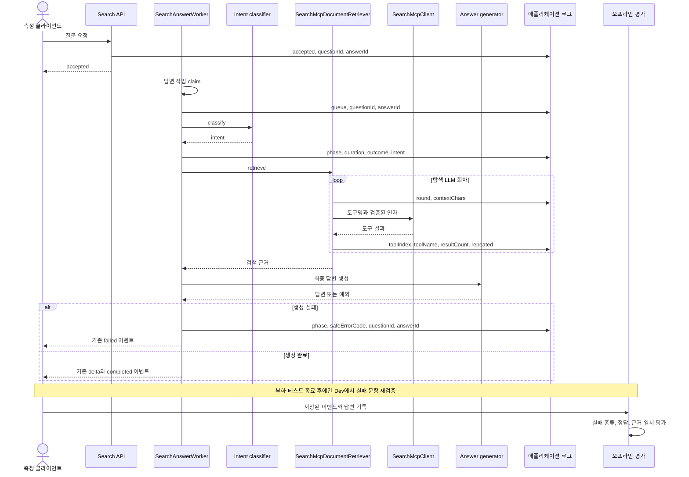

# 탐색 B 테스트 실패 및 오답 진단 계획

- 계획 기준일: 2026-10-18
- 상태: 계획
- 대상 Issue: 미정
- 현재 작업 브랜치: `be/refactor/#715` (사용자 변경이 남아 있음)
- 구현 브랜치 제안: 이 작업의 Issue를 정한 뒤 최신 `origin/develop`에서 `be/feature/#<issue-number>`를 새 worktree로 생성
- 이번 범위: 이미 수집한 B 결과를 보존하고, 다음 Dev 검증에서 각 질문의 실패 원인과 도구 흐름을 안전하게 연결할 수 있도록 진단 로그를 보완함
- 제외 범위: 부하 테스트 중 Dev API 호출, 배포, 검색, 프롬프트, 모델 동작 변경, SSE 계약 변경, DB migration, 동시성 실험

## 1. 범위와 근거

### 목표

B 측정에서 확인한 생성 실패와 오답을 분리해 분석한다. 현재 로그가 실패 원인을 예외 종류와 stack 위치로만 남겨 질문별 원인 분류에 한계가 있으므로, 로컬 코드에서 `questionId`, `answerId`, 실행 단계, 안전한 오류 코드를 연결한다. 탐색 도구 흐름은 도구 이름과 순서, 반복 여부 정도만 기록한다.

이 작업은 먼저 실패 원인을 관찰 가능하게 만드는 진단 작업이다. 측정 결과만으로 검색 방식, 모델, 프롬프트 또는 API 동작을 바꾸지 않는다.

### 현재까지의 관측

| 근거 | 확인한 사실 | 판정 |
| --- | --- | --- |
| Dev Workspace 31 B 측정 기록 | 30개 질문 요청에서 14건 완료, 15건은 접수 후 `ANSWER_GENERATION_FAILED`, 1건은 `accepted` 전 HTTP 502로 기록됨 | 런타임 관측 |
| 완료 답변 평가 기록 | 완료됐지만 기대 결과와 다른 12건을 확인함. 고정 안내 응답 10건, 불충분한 확인 질문 1건, 근거 없음 안내 1건으로 분류함 | 런타임 평가 |
| Grafana에서 내보낸 생성 실패 로그 | 여러 백엔드 PID에 걸친 38개 실패 로그를 확인함. 3건은 하위 원인에 `EOFException`이 있고, 나머지는 구체 코드 없이 `SearchToolException`과 제한된 stack만 남음 | 런타임 관측 |
| `SearchAnswerStream` | `accepted` 로그에 `workspaceId`, `answerId`, `conversationId`, `questionId`가 이미 기록됨 | 코드 관측 |
| `SearchAnswerWorker` | queue, intent classification, retrieval, answer generation, persistence 단계의 시간 로그가 이미 존재함. 성공한 intent 값도 기록함. Worker 단계 로그에는 `questionId`가 없고 실패 로그에는 안정적인 오류 코드가 없음 | 코드 관측 |
| `SafeExceptionDiagnostics`와 `ServerErrorLogger` | 예외 메시지를 남기지 않고 예외 종류와 제한된 stack frame을 기록함. 내부적으로 오류 코드를 판별하지만 로그 출력에는 넣지 않음 | 코드 관측 |
| `SearchMcpClient`와 `SearchMcpDocumentRetriever` | MCP 도구 이름, `answerId`, 수행 시간과 성공 여부는 기록함. 탐색 회차, 도구 호출 순번, 반복 여부, 결과 개수는 한 로그 행에서 연결되지 않음 | 코드 관측 |
| [#722 탐색 지연 계측 계획](722-search-latency-instrumentation.md) | 단계별 시간 계측은 이미 구현된 코드에 존재함 | 중복 계측을 추가하지 않음 |

기존 수집분은 다음처럼 구분해 보존한다.

- `accepted` 이전 HTTP 502는 서버 답변 생성 실패가 아니라 접수 실패로 집계한다.
- `accepted` 이후 `failed`는 답변 생성 실패로 집계한다.
- `completed`는 답변의 정확성 및 근거 일치 여부를 별도로 평가한다.
- 기존 Grafana 로그 38건은 재시도와 로그 중복 가능성을 제거해 각 질문과 1:1로 연결할 수 없으므로, 15개 답변 실패의 세부 원인으로 간주하지 않는다.
- 이미 확인된 Q17의 `answerId=690` 외의 질문 매핑이나 오류 원인은 기존 자료에서 확인된 범위만 사용한다.

현재 checkout은 dirty한 `be/refactor/#715`다. 이 브랜치의 파일과 산출물은 수정하거나 되돌리지 않는다. 구현을 시작할 때 Issue와 현재 `develop` 상태를 다시 확인하고 별도 worktree를 사용한다.

## 2. 구현할 흐름

다음 로컬 변경은 검색 결과나 클라이언트 응답을 바꾸지 않는다. Worker가 이미 가진 식별자를 단계 로그에 넣고, 예외의 안전한 코드만 추가한다. 탐색 루프는 본문이나 인자를 남기지 않고 회차와 도구 호출 흐름만 기록한다.

## 3. 코드와 메서드 초안

| 위치 | 현재 책임 | 계획하는 변경 |
| --- | --- | --- |
| `search/application/SearchAnswerWorker.java` | 답변 작업, 의도 분류, 검색, 생성과 상태 저장을 조정함 | 기존 단계 로그에 `questionId`를 추가하고 실패 로그에 안전한 `failureCode`를 기록함. 사용자 질문, 문서 본문, provider 메시지는 기록하지 않음 |
| `global/logging/ServerErrorLogger.java` | 예외의 예상 여부와 기록 레벨을 판별함 | `SearchToolException` 및 `ProjectException`에서 허용 가능한 고정 오류 코드만 추출하는 로깅용 메서드 후보를 검토함. 알 수 없는 예외는 `UNCLASSIFIED`로 기록함 |
| `global/logging/SafeExceptionDiagnostics.java` | 예외 종류와 제한된 stack frame을 안전하게 출력함 | 현재 메시지 비기록 원칙을 유지함. 오류 코드가 필요한 경우 원문 진단 문자열에 섞지 않고 명시적인 구조 필드로 기록함 |
| `search/infrastructure/llm/SearchMcpDocumentRetriever.java` | 제한된 횟수로 LLM 도구 호출을 반복하고 MCP를 실행함 | 탐색 회차, 도구 호출 순번, 제한된 도구 이름, 반복 여부, 안전한 결과 개수를 기록하는 지점 후보를 추가함. query와 도구 인자 원문은 기록하지 않음 |
| `search/application/SearchAnswerWorkerLoggingTest.java` | Worker 단계 로그와 개인정보 비노출을 검증함 | `questionId`, 실패 코드, phase가 함께 기록되고 민감 문자열이 남지 않는 테스트를 추가함 |
| `search/infrastructure/llm/SearchMcpDocumentRetrieverTest.java` | 도구 호출 순서, 반복 처리, 호출 한도를 검증함 | 회차, 순번, 도구명, 반복 여부 로그를 검증하고 질문, 인자, 결과 본문은 비노출인지 확인함 |
| `global/logging/ServerErrorLoggerTest.java` 또는 기존 로깅 테스트 위치 | 안전 오류 진단을 검증함 | 고정 코드 추출과 미분류 예외 처리, 예외 메시지 비노출을 검증함. 실제 테스트 파일 위치는 구현 시 기존 패턴을 확인해 결정함 |

운영 코드에서 오류 코드는 `SearchToolException.getCode()` 또는 `ProjectException.getErrorCode().getCode()`처럼 이미 제한된 코드만 사용한다. 예외 메시지, stack 전체, LLM 요청과 응답, 도구 arguments, 검색어, 문서 제목과 본문, 토큰은 로그에 추가하지 않는다.

대략 production 3개 클래스와 테스트 2~3개 파일을 수정하는 범위로 예상한다. 코드량은 대략 production 40~100줄, 테스트 80~160줄이며 실제 로깅 패턴을 확인한 뒤 조정한다. 타이밍 계측, 공개 API, DB schema는 변경하지 않는다.

## 4. 저장 기반과 주의할 점

DB 변경은 없다. `SearchAnswerWorkResult`에 이미 `workspaceId`, `conversationId`, `questionId`, `answerId`가 있으므로 별도 저장 컬럼이나 migration 없이 로그 상관 키로 사용할 수 있다.

로그 상관관계는 `questionId`와 `answerId`를 기준으로 한다. SSE 응답의 기존 `failed` payload는 계속 일반 실패 상태를 반환한다. 내부 오류 코드를 외부 응답에 노출하지 않는다.

검색어, 요청 본문, LLM 응답, MCP arguments와 문서 본문을 로그에 남기지 않는다. 회차 및 결과 개수는 관측 목적에 필요한 제한된 수치만 기록한다. 로그 기록 실패가 답변 상태와 전송 흐름을 바꾸지 않아야 한다.

## 5. TDD와 검증 순서

각 변경은 먼저 실패하는 테스트를 작성하고 최소 구현한다. Dev API를 호출하지 않는 로컬 검증만 수행한다.

| 순서 | 먼저 작성할 검증 | 최소 구현과 기대 결과 |
| --- | --- | --- |
| 1. 오류 코드 추출 | `SearchToolException`과 `ProjectException`의 고정 코드가 기록 가능하고, 예외 메시지나 provider 내용은 출력되지 않는 단위 테스트 | 로깅 전용 안전 코드 추출을 추가함. 알 수 없는 오류는 `UNCLASSIFIED`로 남김 |
| 2. Worker 상관 키 | classification, retrieval, answer generation 성공 또는 실패 로그에 `questionId`와 `answerId`가 포함되고, 기존 private question/provider 문자열은 없는 테스트 | Worker 단계 로그에 작업 결과의 식별자와 phase별 safe error code를 추가함 |
| 3. 탐색 회차와 도구 흐름 | 다회차 검색 및 반복 호출 테스트에서 round/index/name/repeated가 맞고, 인자와 본문이 빠지는지 검증 | Retriever의 도구 호출 경계에 제한된 진행 로그를 추가함. 기존 호출 한도와 반복 안내 동작을 유지함 |
| 4. 전체 회귀 | 관련 테스트와 로그 캡처 검증에서 이벤트, 저장 상태, 검색 결과가 변하지 않는지 확인 | `SearchAnswerWorkerLoggingTest`, `SearchMcpDocumentRetrieverTest`, 로깅 테스트를 통과시킴 |
| 5. 로컬 전체 검증 | 저장소에 설정된 전체 테스트와 포맷 검증 실행 | `./gradlew check` 및 `git diff --check` 통과를 확인함. 실제 모델 동작은 증명하지 않음 |
| 6. Dev 재검증 | 부하 테스트 종료 확인 후, 기존 30문항 세트 중 접수 실패와 답변 실패 문항을 순차 실행하고 각 `questionId`를 저장함 | 502 접수 실패, 접수 후 FAILED, 완료 오답을 별도 집계함. 같은 환경에서 원인 코드, 실패 단계, 답변, 근거를 대조함 |
| 7. 전체 B 반복 | 실패 문항 분석과 수정이 끝난 뒤 기존 30문항을 같은 순서와 조건으로 실행함 | 실패율, 첫 delta, 전체 완료 시간, 정답률, 근거 일치율을 이전 기록과 나란히 비교함 |

6단계와 7단계는 Dev 부하 테스트가 끝난 뒤에만 실행한다. 현재는 어느 Dev 요청도 수행하지 않는다. CI의 fixture 및 mock 검증은 운영 Qwen과 MCP 동작을 증명하지 않으며, 실제 Dev 결과는 별도 런타임 관측으로 기록한다.

## 6. 완료 기준과 다음 작업

이번 로컬 변경은 다음을 모두 만족하면 완료로 본다.

1. `questionId`, `answerId`, phase, outcome, safe error code로 실패 요청을 추적할 수 있음.
2. 탐색 LLM 회차와 도구 호출 순서 및 반복 여부를 요청별로 재구성할 수 있음.
3. 개인정보와 문서 원문이 로그에 포함되지 않는 테스트가 통과함.
4. 기존 SSE 계약, 저장 상태, 모델 호출 흐름과 검색 결과가 유지됨.
5. 관련 단위 테스트, 전체 `./gradlew check`, `git diff --check`가 통과함.

Dev 검증 완료는 별도 기준으로 판단한다. 30개 모든 요청을 접수 여부, 종료 상태, 답변 정확성, 근거 일치율까지 분류하고, 재현 가능한 원인에만 별도 TDD 수정안을 만든다. 한 번의 성공 재시도만으로 전체 B 테스트가 통과했다고 판정하지 않는다.

이 계획 작성 단계에서는 Issue, branch, 코드, Dev 배포와 Notion 페이지를 변경하지 않았다. 구현 전에는 이 작업을 추적할 Issue를 확인하고, 최신 `origin/develop` 기반 별도 worktree에서 진행한다.

## 참고 경로

- [02. 속도 개선 실험](https://app.notion.com/p/3fc0691a002381899022e9a2f7e320d7)
- [#722 탐색 지연 계측 계획](722-search-latency-instrumentation.md)
- [기존 반복 도구 호출 실패 조사](search-tool-repeat-failure-investigation.md)
- `backend/src/main/java/com/knot/backend/search/application/SearchAnswerWorker.java`
- `backend/src/main/java/com/knot/backend/search/infrastructure/llm/SearchMcpDocumentRetriever.java`
- `backend/src/main/java/com/knot/backend/search/infrastructure/mcp/SearchMcpClient.java`
- `backend/src/main/java/com/knot/backend/global/logging/ServerErrorLogger.java`
- `backend/src/main/java/com/knot/backend/global/logging/SafeExceptionDiagnostics.java`
- `backend/src/test/java/com/knot/backend/search/application/SearchAnswerWorkerLoggingTest.java`
- `backend/src/test/java/com/knot/backend/search/infrastructure/llm/SearchMcpDocumentRetrieverTest.java`
