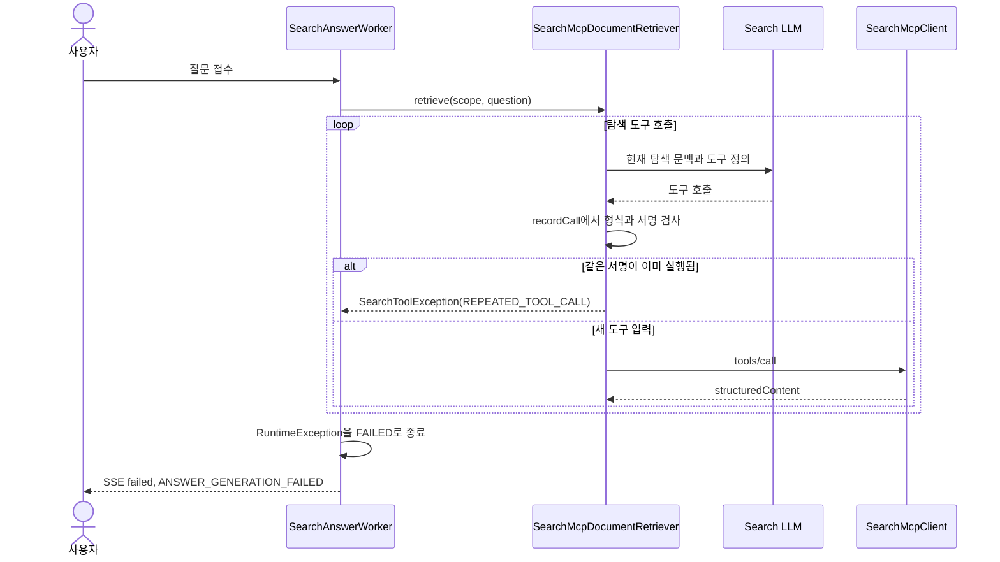

# 탐색 도구 반복 호출 실패 조사 계획

- 상태: 13건 원인 분류 완료, 반복 입력 처리 정책 결정 대기
- 확인일: 2026-10-17
- 대상: Dev Workspace 31의 B 측정 재실행에서 발생한 탐색 답변 실패
- GitHub Issue: 아직 없음

## 1. 범위와 브랜치

### 목표

실패한 질문 13건이 왜 `ANSWER_GENERATION_FAILED`로 끝났는지 로그와 실제 호출 흐름으로 분류한다. Q27에서 관측한 반복 도구 호출 차단이 다른 실패에도 나타나는지 확인한다. 공통 원인이 확인되면 최소 수정 방향과 회귀 검증을 정한다.

이번 단계는 원인 조사 계획이다. 검색 정책, 모델, 프롬프트, API 이벤트 계약은 바꾸지 않는다. 코드 수정, Dev 재배포, 전체 30문항 재측정은 원인 그룹과 수정안을 확인한 다음 별도로 진행한다.

### 작업 트리

현재 checkout은 `be/refactor/#715`, HEAD `10b207a70f04c247054448725f936275d5baa4a0`이며, 원격 추적 브랜치보다 147커밋 앞서 있고 여러 기존 변경이 남아 있다. 이 변경은 보존한다. 이번 계획 파일만 새 파일로 추가한다.

이번 조사 계획에서 코드 브랜치나 worktree를 만들지 않는다. 구현 단계에 들어갈 경우 현재 checkout을 재사용하지 않고, 당시 최신 `origin/develop`과 관련 Issue 및 PR 상태를 확인한 뒤 별도 worktree에서 작업한다. 아직 이 후속 수정 Issue는 만들지 않았다.

### 근거와 상태

| 근거 | 확인한 사실 | 판정 |
| --- | --- | --- |
| Dev B 재실행, 2026-10-17 | 처음 실패한 15건을 재실행했고 13건은 `ANSWER_GENERATION_FAILED`, 2건은 완료됐지만 정답 통과는 0건임 | 런타임 관측 |
| Dev 배포 커밋 `af75017cef168abc2cbfd94c24f6137dd0469882` | health와 OpenAPI 문서가 HTTP 200으로 응답함. 이 커밋에서 retriever 코드를 직접 확인함 | 런타임 및 배포 상태 관측 |
| Grafana Q27 로그 | `SearchToolException`이 `SearchMcpDocumentRetriever.recordCall` 220행에서 발생함. 직전 `search_documents` 호출은 약 38ms로 성공함 | 런타임 관측 |
| 배포 커밋의 `SearchMcpDocumentRetriever.java:218-220` | 도구 이름과 정렬된 인수로 서명을 만들고 같은 서명이 다시 나오면 `REPEATED_TOOL_CALL`을 던짐 | 코드 관측. Q27의 실패 위치와 일치 |
| `SearchAnswerWorker.java:68-78` | 생성 중 RuntimeException을 `ANSWER_GENERATION_FAILED`로 종료해 SSE에는 구체 원인이 노출되지 않음 | 코드 관측 |
| `ServerErrorLogger`와 `SafeExceptionDiagnostics` | 오류 코드는 출력하지 않고 예외 클래스와 제한된 stack frame을 기록함 | 코드 관측. 각 실패의 원인 코드는 로그 위치와 코드 매핑으로 확인해야 함 |
| `SearchMcpDocumentRetrieverTest.java:707-740` | 같은 도구 입력 반복을 실패시키는 단위 테스트가 이미 있음 | 기존 테스트 관측 |
| [02. 속도 개선 실험](https://app.notion.com/p/3fc0691a002381899022e9a2f7e320d7) | 기존 B 측정과 재실행 결과가 관리되는 작업 기록임 | 조사 계획과 결과를 같은 페이지에 추가 |

계획 작성 당시에는 Q27 이외 12건의 예외 발생 위치가 분류되지 않았다. 2026-10-17 후속 조사에서 13건 모두 같은 반복 호출 예외 위치로 확인했다. 반복된 도구명과 인자, 모델이 반복한 이유는 로그에 없어 미확정이다.

## 2. 실패 흐름

사용자 질문 접수 이후 worker가 의도를 분류한다. 탐색 대상이면 `SearchMcpDocumentRetriever.retrieve`가 LLM 도구 호출을 반복한다. `recordCall`은 도구 호출 형식과 입력을 검사하고, 동일 서명을 다시 만나면 MCP를 다시 호출하기 전에 예외를 던진다. worker는 이 예외를 일반 실패 코드로 저장하고 SSE `failed`를 보낸다.

## 3. 조사 대상 코드와 책임

| 위치 | 현재 책임 | 조사할 내용 |
| --- | --- | --- |
| `search/application/SearchAnswerWorker.java` | 탐색 호출과 실패 상태 저장을 조정함 | 각 answerId의 실패 단계와 일반 오류 코드 매핑 확인 |
| `search/infrastructure/SearchMcpDocumentRetriever.java` | LLM 도구 호출을 검증하고 MCP 도구를 실행함 | 각 실패 stack frame을 throw site와 대조. 도구 이름, 호출 순서, 같은 서명 반복 여부 확인 |
| `search/infrastructure/SearchExploration.java` | MCP 결과 구조를 검사하고 읽은 문서 근거를 모음 | `INVALID_MCP_RESPONSE`, `INCOMPLETE_DOCUMENT_EXPLORATION` 경로 대조 |
| `search/infrastructure/mcp/SearchMcpClient.java` | MCP 도구 요청과 JSON-RPC 결과를 처리함 | `mcp_call` 로그 성공이 RPC 성공인지, 결과 구조 검사까지 성공했는지 구분 |
| `global/logging/ServerErrorLogger.java`, `SafeExceptionDiagnostics.java` | 예외를 제한된 안전 진단으로 기록함 | 원문 질문과 도구 인수를 노출하지 않으면서 오류 코드를 구분할 수 있는지 검토 |
| `search/infrastructure/SearchMcpDocumentRetrieverTest.java` | 도구 호출 루프의 단위 동작을 검증함 | 기존 반복 호출 실패 테스트가 Dev에서 관측한 호출 순서를 재현하는지 확인 |

현재는 새 클래스나 DB 변경을 제안하지 않는다. 우선 로그와 기존 코드로 실패 유형을 분류한다. 로그로 구분할 수 없는 항목이 확인되면 민감 본문을 기록하지 않는 내부 오류 코드 계측을 별도 최소 변경으로 제안한다.

## 4. 가설과 구분 증거

| 가설 | 현재 근거 | 확인 또는 반증할 증거 |
| --- | --- | --- |
| LLM이 앞서 실행한 도구와 같은 정규화 입력을 다시 요청해 반복 호출 guard가 실패시킴 | Q27 stack이 배포 코드의 `REPEATED_TOOL_CALL` throw line과 일치함 | 13건 각각의 stack line을 배포 커밋과 대조하고, 반복된 도구 이름과 안전한 입력 fingerprint를 확인함 |
| B에서 이전 도구 교환 기록을 축약한 방식이 탐색 진행 정보를 줄여 반복 호출을 유발함 | B 변경은 직전 도구 교환만 다음 LLM 요청에 남김. 인과는 미확인임 | 실패 직전의 도구 호출 순서, MCP 결과 요약과 다음 LLM 도구 호출을 비교함. A 기록이 있으면 같은 질문의 이전 호출 흐름과 대조함 |
| MCP 결과의 구조나 의미가 모델의 다음 행동에 충분하지 않아 같은 도구를 다시 요청함 | Q27의 첫 `search_documents` RPC는 성공했지만 그 결과가 반복을 막았는지는 미확인임 | 응답 본문 대신 결과 항목 수, 읽기 여부, cursor 유무, 결과 검증 통과 여부를 확인함 |
| 일부 실패는 반복 호출과 무관한 malformed tool call, context 한도 또는 MCP 결과 오류임 | `recordCall`, `SearchAgentContext`, `SearchExploration`, `SearchMcpClient`에 별도 실패 경로가 있음 | 각 answerId의 stack line과 error code를 throw site에 매핑하고 실패 수를 원인별로 집계함 |

Q27은 throw site 기준으로 반복 호출 guard에 걸린 것이 확인됐다. 다만 LLM이 왜 같은 서명을 다시 냈는지, 다른 12건도 같은 이유인지는 미확정이다.

## 5. TDD와 검증 순서

| 순서 | 실패하는 검증 또는 조사 | 최소 다음 단계 | 통과 조건 |
| --- | --- | --- | --- |
| 1. 실패 그룹 분류 | Dev 재실행 기록의 13개 answerId를 Grafana 로그에서 찾고 각 stack line을 배포 커밋과 매핑함 | 원인별 건수를 표로 정리함. Q27은 `REPEATED_TOOL_CALL`로 기록함 | 13건 각각에 확인된 원인 또는 미확정 사유가 있음 |
| 2. 재현 고정 | 기존 `retrieve_failure_repeatedToolCall` 테스트의 LLM 응답 순서가 Q27의 호출 흐름과 같은지 확인함 | 필요한 경우 실제 호출 순서를 가진 최소 fixture 테스트를 먼저 추가함 | 현재 배포 동작의 반복 실패를 로컬 단위 테스트로 재현함 |
| 3. 동작 선택 | 반복 입력에서 실패, 이전 MCP 결과 재사용, 또는 모델에 반복 금지 안내 중 동작과 실패 제한을 비교함 | 안전성과 검색 품질을 고려한 하나의 변경안을 확정한 뒤에만 기대 테스트를 작성함 | 도구 무한 반복은 제한하면서 이미 확보한 근거를 잃지 않는 정책이 명확함 |
| 4. 회귀 테스트 | 확정된 변경안에 대한 반복 호출 성공·실패·호출 한도 테스트를 추가함 | 최소 구현을 적용함 | 같은 입력 반복만으로 전체 답변이 FAILED 되지 않고, 한도 초과는 여전히 안전하게 종료됨 |
| 5. 나머지 실패 그룹 | 단계 1에서 다른 코드로 분류된 경우 해당 throw site별 실패 테스트를 추가함 | 원인별 최소 수정과 테스트를 분리함 | 수정하지 않은 원인 그룹의 동작이 바뀌지 않음 |
| 6. 회귀 검증 | `SearchMcpDocumentRetrieverTest` 및 영향받은 탐색 테스트를 실행함 | 포맷과 전체 `./gradlew check`를 확인함 | 단위 및 관련 통합 검증 통과. API SSE 계약과 저장 상태가 보존됨 |
| 7. Dev 검증 | 배포 승인 후 실패 질문을 순차 실행함 | 원인이 고쳐지면 동일한 30개 질문을 다시 측정함 | 실패율, 첫 delta, 전체 완료, 답변 정확성, 근거 일치율을 A와 함께 비교함 |

4단계의 기대 동작은 3단계의 동작 선택 이후 확정한다. 현재 테스트는 반복 입력을 실패시키는 동작을 명시하므로, 테스트를 먼저 약화하거나 삭제하지 않는다.

저장소 변경이 계측 또는 도구 루프 내부에 한정되면 migration은 필요하지 않을 것으로 예상한다. SearchMessage의 FAILED 기록과 SSE 이벤트 구조는 유지한다. DB 및 외부 모델 없는 단위 테스트로 제어 흐름을 검증하고, 실제 Dev 재실행으로 배포 모델과 MCP 조합을 별도로 확인한다.

## 6. 완료 기준과 다음 작업

이번 조사 계획을 실행해 완료하려면 다음이 필요하다.

1. 재실행 실패 13건을 원인별로 집계하고, 코드 관측과 런타임 관측을 구분함.
2. Q27의 반복 호출이 어떤 도구와 입력 서명에서 발생했는지 로그 또는 재현 fixture로 확인함.
3. 반복 입력을 어떻게 처리할지 선택하고 해당 선택을 실패 테스트로 고정함.
4. 해결 후 같은 30문항으로 성능, 실패율, 정확성, 근거 일치율을 재측정함.
5. 결과와 미확정 사항을 이 계획 문서와 Notion의 기존 `02. 속도 개선 실험` 페이지에 이어서 기록함.

계획 작성 시점에는 제품 코드, 브랜치, Dev 설정을 변경하지 않았다. 이후 구현 결과는 아래에 기록함.

## 관련 자료

- [02. 속도 개선 실험](https://app.notion.com/p/3fc0691a002381899022e9a2f7e320d7)
- [#722 탐색 첫 delta 지연 구간 계측 계획](722-search-latency-instrumentation.md)
- `backend/src/main/java/com/knot/backend/search/application/SearchAnswerWorker.java`
- `backend/src/main/java/com/knot/backend/search/infrastructure/SearchMcpDocumentRetriever.java`
- `backend/src/main/java/com/knot/backend/search/infrastructure/SearchExploration.java`
- `backend/src/main/java/com/knot/backend/search/infrastructure/mcp/SearchMcpClient.java`
- `backend/src/test/java/com/knot/backend/search/infrastructure/SearchMcpDocumentRetrieverTest.java`

## 실제 조사 결과 (2026-10-17)

### 실패 원인 분류

Dev Workspace 31 재실행에서 실패한 13건의 answerId는 `554, 556, 558, 560, 562, 566, 568, 570, 572, 574, 578, 580, 582`임.

Grafana의 `Search generation failed` 로그에서 13건 모두 같은 stack 위치를 확인함. `SearchMcpDocumentRetriever.recordCall` 220행에서 `SearchToolException`이 발생했고, 배포 커밋 `af75017cef168abc2cbfd94c24f6137dd0469882`의 해당 위치는 `REPEATED_TOOL_CALL` 예외를 던짐.

따라서 13건은 반복 호출 방어 로직에서 종료된 것으로 분류함. 호출 한도, 탐색 문맥 한도, MCP 전송 실패, SSE 전달 실패로 분류하지 않음.

### 원인 해석의 한계

현재 운영 로그는 예외의 메시지와 원문 도구 입력을 남기지 않음. 따라서 요청별로 반복된 도구명과 인자, 모델이 이를 반복한 이유는 확인할 수 없음.

같은 서명은 도구명과 페이지 크기 제한을 적용한 정렬 JSON 인자의 조합임. 반복 호출 자체가 직접적인 실패 원인인 점은 코드 위치로 확인했으나, B의 문맥 축약이 반복 호출을 유발했는지는 아직 가설임.

B 변경 커밋 `f49427adb191e75d98756486d87e99e41883cc25`는 각 LLM 요청에 초기 문맥과 직전 도구 교환만 남김. 이 변경 이후 재실행 실패가 관측됐지만, 요청별 도구 입력이 기록되지 않아 인과관계는 확정할 수 없음.

Q27에서는 `search_documents` MCP 호출이 약 38ms에 성공했고 탐색 구간은 약 11.1초 뒤 실패함. 이는 MCP 호출 자체보다 모델의 다음 탐색 단계에서 실패가 결정됐다는 기존 관측과 일치함.

### 현재 판정과 다음 단계

13건의 직접 실패 조건 분류는 완료함. 모델의 반복 호출이 발생한 세부 흐름과 B 문맥 축약의 인과는 미확정으로 남김.

다음 구현 전에 반복 입력을 전체 답변 실패로 처리할지, 이미 확보한 결과를 재사용하거나 모델에 반복 안내를 돌려줄지 동작을 결정해야 함. 어느 동작에서도 전체 도구 호출 한도는 유지해 반복 루프를 제한해야 함.

정책이 결정되면 해당 동작을 기존 반복 호출 테스트에서 새 회귀 기대값으로 먼저 작성하고 최소 구현함. 기존 테스트를 삭제하거나 약화하지 않음.

이 기록은 조사 계획을 보완함. 앞선 A/B 측정과 재실행 결과는 수정하거나 삭제하지 않음.

## 실제 구현 및 검증 결과 (2026-10-17)

### 결정

같은 도구명과 정규화된 인자가 반복되면 MCP를 다시 실행하지 않고, 해당 도구 호출 ID에 반복 안내 결과를 연결해 모델에 반환함.

안내에는 이미 실행된 요청임을 알리고 입력을 바꾸거나 탐색을 마치도록 포함함.

반복 시도도 기존 전체 도구 호출 한도에 포함함. 한 번 반복했다고 전체 답변을 즉시 실패시키지는 않음.

### 변경과 TDD

`SearchMcpDocumentRetriever.recordCall`에서 반복 호출 예외 대신
`REPEATED_TOOL_CALL` 안내를 담은 도구 결과를 다음 LLM 요청에 추가함.

반복 안내가 다음 요청에 실리는지, 같은 MCP 동작이 재실행되지 않는지 검증하는 테스트를 먼저 추가함. 기존 코드에서 테스트가 반복 호출 예외로 실패하는 것을 확인한 뒤 최소 구현함.

반복 시도도 호출 한도에 포함되어 한도 초과 시 `SEARCH_TOOL_LIMIT_EXCEEDED`가 유지되는 테스트를 추가함.

### 로컬 검증 결과

`SearchMcpDocumentRetrieverTest` 22건 통과함.

`./gradlew check bootJar` 통과함. 단위 테스트, 통합 테스트, 인수 테스트, Spotless와 bootJar를 포함함.

`git diff --check` 통과함. 변경 파일은 `SearchMcpDocumentRetriever.java`와 `SearchMcpDocumentRetrieverTest.java` 두 개임.

실제 Dev 모델과 MCP 조합의 동작은 아직 검증하지 않음. 운영 LLM 로그는 반복된 도구명과 입력을 보존하지 않아 모델이 반복한 이유도 확인 불가 상태임.

### 다음 단계

Dev에 반영한 뒤 기존 실패 13개 질문을 순차 재실행함. 각 요청의 실패 여부, 첫 delta, 완료 시간, 답변 정확성, 근거 문서 일치율을 기록함.

동일한 문서와 모델 설정에서 실패 재실행을 먼저 확인한 뒤, 결과가 안정적일 때 고정 질문 30개 전체 B 측정을 다시 수행함.

앞선 계획, A/B 결과, 13건 원인 조사 결과는 수정하거나 삭제하지 않음.
