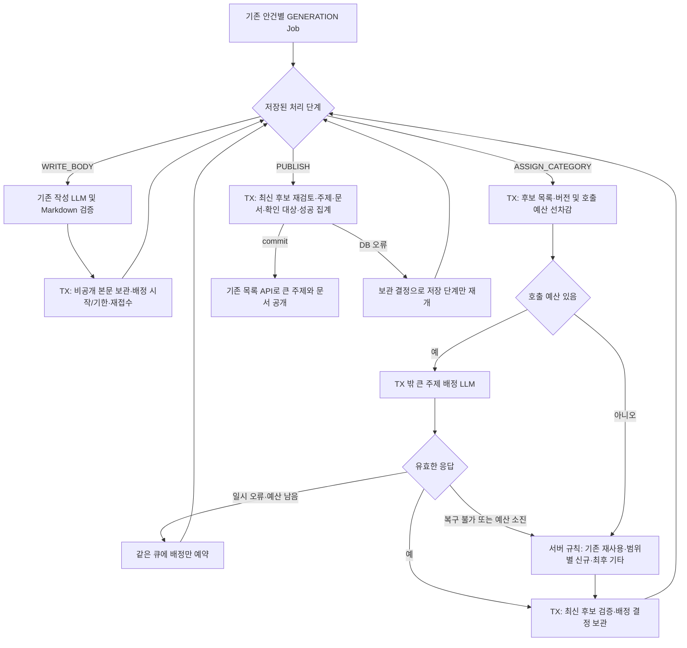

# 새 문서의 큰 주제 자동 배정 구현 계획

갱신: 2026-10-22 KST. [Issue #913](https://github.com/woowacourse-teams/2026-Knot/issues/913), 브랜치 `be/feature/#913`.
이 문서는 사용자 확정 결정과 실제 구현을 대조한 계획이다. 실행 증거는 [로컬 QA 결과](../qa/913-document-broad-topic.md)에 별도로 기록한다.

## 1. 확정 범위와 변경 결정

- 문서는 기존처럼 회의의 안건별로 만든다. 서로 다른 회의의 관련 문서를 Workspace의 큰 주제 하나로 묶는다.
- AI는 기존 큰 주제를 우선 재사용한다. 실제로 맞는 후보가 없을 때만 새 큰 주제를 제안한다.
- 기존 문서의 본문·안건·확인 상태·큰 주제 소속을 변경하지 않는다. 기존 세부 주제를 AI 후보로 편입하지 않는다.
- 공개 전 유효 본문을 보관하고, 큰 주제와 문서를 같은 트랜잭션으로 공개한다. 임시 본문·미분류 상태는 조회에 노출하지 않는다.
- 배정 AI 실패는 제한 재시도 → 서버 규칙 → 최후 `기타`로 완료한다. 이는 사용자에게 확인받은 방지책이며, 이전의 기타 금지·AI 무기한 대기 결정을 대체한다.
- 배정만 실패한 경우 본문 재생성, 사용자 재시도 횟수 소모, 최종 FAILED 표시를 하지 않는다.
- 완료 경계는 문서 한 개다. 같은 녹음의 다른 안건이 진행 중이어도 완료 문서는 제공한다.
- **기존 API 경로·요청·응답 구조와 화면을 그대로 사용한다.** 추가 폴더 API·응답 필드·FE 작업은 이번 범위에서 제외한다. 이전 계획의 `folders`, `folderKey`, `folderName` 추가 제안은 폐기했다.

기존 문서 재정리·미리보기·수동 이동, 주제 이름 변경·병합, 복수 주제 소속, 완료된 기타 문서의 자동 재배정은 후속 기능이다.

### 기존 API에 적용할 의미

`GET /api/v1/workspaces/{workspaceId}/documents`의 `topics[].topic`과 `items[].topic`은 기존 화면이 사용하는 표시용 폴더 이름이다.

| 문서 | 기존 필드에 내려줄 값 | 내부 저장 |
| --- | --- | --- |
| 큰 주제 배정을 완료한 새 문서 | 연결된 큰 주제 이름 | `Document.topic`은 원래 안건, `categoryId`는 큰 주제 |
| 기존 문서 또는 기능 OFF로 완료한 문서 | 원래 topic | LEGACY·category null |

응답 최상위는 기존 `topics/items/nextCursor`, 카드는 기존 10개 필드다. 집계와 카드 조회가 모두 같은 `coalesce(category.name, d.topic)`을 사용한다. 페이지 크기·커서와 관계없이 전체 필터의 주제 개수를 센다. 확인 상태·녹음 필터·정렬·인증 계약은 기존 방식이다.

화면은 문자열로 그룹화한다. 기존 세부 주제와 새 큰 주제의 표시 이름이 정확히 같으면 **화면에서는 한 그룹과 합산 개수**로 보인다. 기존 문서를 DB에서 이동하거나 AI 후보에 추가하는 것은 아니다. API 구조와 화면을 유지하는 선택에 따른 동작이다. 상세·검색의 기존 안건 필드와 생성 중복 방지 식별값은 변경하지 않는다.

## 2. 근거와 작업 위치

| 근거 | 관측·결정 | 적용 |
| --- | --- | --- |
| 이번 사용자 인터뷰 및 마지막 API 유지 지시 | 2026-10-22 확정 | 새 문서만 큰 주제 배정, 본문과 동시 공개, 제한 재시도·서버 규칙·최후 기타, 기존 API·화면 사용 |
| Issue #913 | 본문·담당자·라벨 조회 완료 | 담당 흑곰(jyt6640), BE·Feature·흑곰. Issue 존재와 구현 완료는 구분 |
| `docs/product/current-v2-mvp.md`, `backend/docs/notion-context.md` | 관련 원문 탐색 및 코드 대조 | 기획 출처 우선순위 적용. Notion을 이번에 실시간 수집한 것은 아님 |
| [목록 API 원문](https://app.notion.com/p/api-v1-workspaces-workspaceId-documents-3ebb435175228015bf4dc8d04281b461) | 캐시 원문 수정 10/12 09:29 UTC, 수집 16:15 UTC | 전체 필터의 개수·빈 폴더 제외·문서별 공개. 별도 Category 금지 규칙은 이번 사용자 결정으로 새 문서에 한해 대체 |
| [도메인 규칙 및 UseCase](https://www.notion.so/3e3b4351752280cd9f06edc2ccdff1d8) | 캐시 원문 수정 10/12 02:06 UTC, 수집 04:03 UTC | 안건별 문서·Job과 기존 성공 결과 보존 |
| Document·Job·Batch·V27/V32, 기존 큐·lease·recovery·retention | 실제 코드 | topic을 큰 주제로 덮어쓰지 않음. 저장 단계와 실행 횟수 분리 |
| 목록 Controller/DTO/Query, FE `groupDocumentsByTopic`·DocumentTree·DocumentList | 실제 코드 | 두 topic 필드의 표시 이름만 바꾸면 기존 화면에서 묶임. FE 수정 없음 |
| Java/Spring/JPA/PostgreSQL/Flyway 및 Gradle 설정 | 프로젝트 profile·build.gradle | 단위·PostgreSQL 통합·Security 인수 검증 |

원본 `be/refactor/#715`의 사용자 변경은 보존한다. 구현은 별도 worktree
`/Users/yongtae/.codex/worktrees/document-broad-topic-913/knot`에서 수행한다.
시작 기준 develop은 `67254974ef349f8d053c490b766c0e8a305e42ce`다. V61까지의 기반 위에 V62를 추가하며 기존 migration은 수정하지 않는다.
ADR은 [913-document-broad-topic-publication.md](../adr/913-document-broad-topic-publication.md)의 **Proposed** 상태다.

## 3. 실행 흐름과 유스케이스

기존 전사 접수·안건 분류는 그대로 사용한다. 안건별 GENERATION Job 안에 처리 단계 `WRITE_BODY → ASSIGN_CATEGORY → PUBLISH`를 저장한다. 이는 CLASSIFICATION/GENERATION stage와 별개다. 한 claim에서는 한 단계만 실행하고, 외부 LLM 호출 동안 DB 트랜잭션과 락을 유지하지 않는다.



- 여러 회의의 녹음 안정성·전사 품질 문서: 안건별 문서는 유지하고 기존 `녹음·전사`를 재사용한다.
- 첫 관련 문서: 일반 후보에 적합한 주제가 없으면 AI가 새 큰 주제를 제안하고 최종 공개 TX에서 생성한다.
- 배정 서버 503·인증/설정 오류: 의미 없는 대기 없이 서버 규칙을 적용한다.
- 잘못된 JSON·429·timeout: 횟수와 최초 배정 deadline 안에서 배정만 다시 호출한다.
- 본문 보관 후 서버 종료: 저장된 단계·본문·호출 횟수·deadline으로 재개한다. deadline은 재시작으로 연장하지 않는다.
- 최종 저장 실패: category·Document·확인 대상·Job 성공·집계 모두 롤백하며 저장 단계만 다시 실행한다.
- 최신 catalog 변경: 같은 이름이 있으면 재사용한다. 새 제안의 의미 재검토는 남은 동일 예산만 사용하며 예산이 끝나면 최신 후보로 서버 대체한다.
- 배정 근거 부족: Workspace당 한 개의 `기타`를 문서 공개 TX에서 지연 생성한다. AI 후보에서는 제외한다.

## 4. 클래스와 메서드의 실제 경계

아래는 backend 기준이며, 기존 공급자 전략 `LlmClient`를 재사용한다.

| 클래스 | 메서드·책임 |
| --- | --- |
| `DocumentGenerationWorker` | `execute`로 claim 후 저장 phase별 실행. WRITE_BODY만 기존 generator 호출 |
| `DocumentCategoryCheckpointService` | `prepare(execution,result)`: 유효 본문 저장·배정 예산 시작. `reserve(execution)`: DB에 호출 횟수 선반영 후 입력/timeout/catalogVersion 반환. `decide`: 후보 검증·결정 저장. `failAssignment`: 별도 재접수 또는 대체 결정 |
| `DocumentCategoryAssignmentService` | `assign(execution)`: reserve → TX 밖 assigner → decide. 외부 호출 오류만 제한 재시도·서버 대체로 전환; DB/인가 오류를 분류 불가로 삼키지 않음 |
| `DocumentCategoryAssigner` | `assign(input,timeout)` 공급자 독립 계약. 응답은 기존 ID 재사용 또는 신규 이름·범위 |
| `LlmDocumentCategoryAssigner` | strict JSON·중복 키·추가 필드·타입·모드·요청 후보 ID·예약 이름·제목 복사 검증 |
| `DocumentCategoryPrompt` | system/user/schema 구성, 입력 한도 검증. 기존 작성 프롬프트와 3필드 응답은 그대로 사용 |
| `DocumentCategoryCatalogService` | `normalCategories/version/validateDecision`, `resolveForPublication`: 최신 목록의 재사용·신규·fallback 확정 및 제한된 catalog 재검토 |
| `DocumentCategoryFallbackClassifier` | `classify`: 외부 호출 없이 규칙으로 분류. 규칙 버전 `2026-10-22-v1` |
| `DocumentGenerationResultService` | `completePreparedGeneration`: Workspace→Job→입력→Batch 순서로 잠금. 큰 주제·DRAFT·확인 대상·성공·집계·임시 본문 제거를 한 TX로 처리 |
| `DocumentGenerationJob` | `beginCategoryAssignment/reserveCategoryAttempt/resumeGeneration`: 최초 deadline·호출 예산·phase·attempt fencing 관리 |
| `DocumentGenerationClaimService/FailureService/RecoveryService` | phase와 lease를 이어받아 재개. 본문 이후 복구는 사용자·본문 자동 재시도 한도를 차감하지 않음. Workspace 삭제는 기존 종료 정책 |
| `DocumentCategory/DocumentCategoryDecision/PreparedDocument` | JPA 저장 모델과 불변식. 기존 Document/Job의 안건 식별값 유지 |
| Category·Prepared domain repository 및 persistence adapter | 기존 domain repository → JPA adapter 계층 사용 |
| `DocumentListJpaRepository` | 기존 집계·카드 쿼리에서 표시 topic만 category 이름 우선 선택. DTO·Controller 수정 없음 |
| `DocumentCategoryPublicationMetrics` | AFTER_COMMIT 이벤트에서 출처별 완료 수·배정 소요 시간·메타데이터 로그 기록 |

`completeGeneration`은 기존 WRITE_BODY 경로만 허용하여 보관 본문의 큰 주제 배정을 우회할 수 없게 한다. 이미 성공한 동일 Job은 기존 문서 ID를 반환한다. 과거 attempt·만료된 응답은 새 실행을 덮어쓰지 못한다.

### 대체 규칙과 프롬프트

규칙은 `녹음·전사/배포·운영/문서·검색/알림/사용자·권한` 범위를 관리한다. **안건을 우선하고 안건에 일치가 없을 때만 제목**을 본다. 본문의 배경 단어가 분류를 오염시키지 않도록 전체 본문 키워드는 사용하지 않는다. 하나의 범위와 하나의 기존 후보가 명확하면 재사용하고, 후보가 없으면 규칙의 정해진 이름을 생성한다. 다중 일치·처음 보는 내용은 기타다.

외부 호출 없는 규칙 계산 자체가 예외를 내면 RULE_CLASSIFICATION_ERROR를 기록하고 기타로 수렴한다. 이 경계는 순수 계산만 감싸며 DB·인가 오류를 숨기지 않는다. 해당 장애를 먼저 테스트로 재현한 뒤 완료 경로를 검증했다.

실제 system prompt는 [category-system.txt](../../backend/src/main/resources/llm/document/category-system.txt), JSON schema는 [category-schema.json](../../backend/src/main/resources/llm/document/category-schema.json)이다. 입력은 `agendaTopic/document:{title,summary,content}/categories:[{id,name,description}]`이며 모든 일반 후보를 제공한다. 링크 삽입·안건/본문 수정·사람/날짜/제목 복사를 금지한다.

```json
{"existingCategoryId":12,"newName":null,"newDescription":null}
```

```json
{"existingCategoryId":null,"newName":"녹음·전사","newDescription":"녹음, 업로드와 STT 품질"}
```

정확히 세 필드만 허용하며 두 모드는 배타적이다. 일반 이름은 NFC·공통 공백 정규화 후 최대 80자, 설명은 최대 500자다. 기타·미분류·일반은 AI가 제안할 수 없다. 추론 OFF, temperature 0.2, top-p 0.9, top-k 20, 반복 패널티 1.0, 출력 상한 512토큰은 배정 전용 초기 설정이다. 본문 작성 한도와는 별개다.

## 5. 저장과 복구 불변식

| 대상 | 구현 |
| --- | --- |
| `document_categories` | Workspace·이름/정규화 이름·범위 설명·NORMAL/FALLBACK. (Workspace, 정규화 이름) unique, Workspace당 FALLBACK 한 행 |
| `documents` | nullable category_id, LEGACY/BROAD, 출처·규칙 버전. 기존 행은 LEGACY. BROAD는 category·출처·규칙 필수 |
| `prepared_documents` | job_id PK, Workspace·원문·녹음·불변 본문·배정 결정·catalog/rule version. 실제 종료 Job 삭제 시 CASCADE, 그 전에는 보존 |
| `document_generation_jobs` | phase, category_attempt_count, phase_resume_count, started/deadline/last_failure. attempt=1+user+automatic+phase_resume |
| V62 | 기존 migration 수정 없이 확장. 복합 FK로 Workspace·원문 연결을 보호. nullable CHECK는 `IS TRUE`로 잘못된 조합의 NULL 통과를 막음 |

최종 공개에서 Workspace 락을 공유하고 정규화 unique를 함께 적용한다. 같은 이름의 동시 생성·기타 중복을 막으며, 카탈로그가 달라졌다면 최신 후보와 남은 예산으로 다시 검토한다. **DB unique가 동의어의 의미상 중복까지 보장하지는 않는다.** 실제 모델 평가는 별도다.

사용자 최대 3회·본문 자동 최대 1회 정책은 유지한다. phase 이동/복구의 별도 카운터는 이 할당량을 소비하지 않는다. 외부 호출 전에 category_attempt_count를 저장해 강제 종료 후 횟수가 초기화되지 않게 한다. 호출 timeout은 요청 한도·전체 남은 예산·lease 잔여 시간에서 가장 짧은 값이다.

진행 중 Job은 QUEUED/RUNNING으로 남겨 기존 7일 실패 정리에서 보존한다. Workspace 삭제로 실제 종료한 Job은 기존 보존 기간 뒤 삭제하며 PreparedDocument도 함께 정리한다. 오디오 보존 정책은 연장하지 않는다.

본문 LLM 응답 직후 임시 저장 전의 crash까지 호출 exactly-once를 약속하지 않는다. **보관 완료된 본문**은 재생성하지 않는다. DB·백엔드가 꺼진 동안 즉시 성공하거나, 본문 작성 자체의 실패를 빈 문서/기타로 성공 처리하지 않는다.

## 6. 설정·관측·배포

| 환경 변수 | 기본값 |
| --- | --- |
| `DOCUMENT_CATEGORY_ENABLED` | false |
| `DOCUMENT_CATEGORY_MAX_RETRIES` | 1 (추가 재시도, 최대 3) |
| `DOCUMENT_CATEGORY_RETRY_BACKOFF` | PT5S |
| `DOCUMENT_CATEGORY_REQUEST_TIMEOUT` | PT20S |
| `DOCUMENT_CATEGORY_TOTAL_BUDGET` | PT45S |
| `DOCUMENT_CATEGORY_MAX_INPUT_CHARACTERS` | 40000 |

입력 한도는 모델 토큰 한도가 아닌 안전용 직렬화 문자 한도다. 후보나 본문을 몰래 잘라 보내지 않으며 초과하면 서버 규칙으로 배정한다. 후보가 커질 때의 검색/선별, 실제 모델 의미 분류 정확도·지연은 운영 호스트 평가 대상이다.

완료 후 `knot.document.category.publications` counter와 `knot.document.category.assignment.duration` timer를 출처 enum으로 나눈다. jobId·source·reason·attempts·elapsed·ruleVersion만 로그에 남기고 원문·프롬프트·본문·토큰은 남기지 않는다. DB 롤백은 완료 지표에 집계하지 않는다. 프로세스 재시작 시 메모리 지표는 초기화되므로 영속 감사 원장은 아니다. 기타 비율 급증과 반복 복구는 완료 로그·Job 상태로 추적한다.

배포는 V62 확장 → 기능 OFF로 새 backend 배포 → 기본 QA·별도 실제 모델 평가 → flag 활성화다. **FE 배포와 API 변경은 필요 없다.** 활성화 전 구버전 worker를 drain한다. 새 코드에서 flag를 꺼도 이미 보관한 문서는 현재 단계부터 마무리한다. PreparedDocument가 남은 채 구버전 worker로 롤백하지 않는다.

## 7. TDD와 검증

| 검증 계층 | 시나리오 |
| --- | --- |
| 단위 | Unicode 공백·길이·예약 이름·규칙 재사용/신규/모호함·배경 오염 차단·phase 검증·strict 응답·HTTP 요청 timeout |
| PostgreSQL 통합 | 임시 본문 비공개·호출 선차감·stale attempt·복구·catalog 변경/반복·동시 동일 이름·타 Workspace ID/FK·DB 롤백과 저장만 재시도·after-commit 지표·기능 OFF 중 마무리·보존/Workspace 삭제 |
| migration | V61→V62 기존 본문/topic/ID 보존, 잘못된 nullable 조합 거절 |
| 목록 통합·Security 인수 | 기존 응답 필드 정확히 유지, 큰 주제/legacy 동명 집계, 확인/녹음 필터·전체 개수·cursor·401/403 |
| Docker 실제 앱·PostgreSQL·HTTP 장애 주입 | 정상 신규/재사용, 503·429·오응답·지연, 본문 배정 중 프로세스 강제 종료 후 재기동. 작성 1회·예산 유지·자동/사용자 횟수 0 |
| 실제 모델 | 이번 로컬 fault stub으로 증명하지 않음. 프롬프트·후보 재사용 품질과 실제 처리 시간은 활성화 전 별도 평가 |

새 목록 기대값을 먼저 적용해 기존 query에서 두 테스트가 실패함을 확인한 뒤 표시 topic query를 수정했고, 목록 통합·인수 테스트를 통과했다. 기능 테스트 역시 구현 전 실패를 확인하면서 단계별로 추가했다. 최종 명령과 실제 결과는 QA 문서를 따른다.

```bash
./gradlew spotlessApply check bootJar --console=plain
```

Docker 검증은 backend의 전용 빈 DB·실제 앱·HTTP 장애 fixture로 수행했다. 실제 STT 호출이나 운영 데이터 변경은 포함하지 않는다.
Docker 실행 자료는 사용자 요청으로 로컬에만 보관하고 Git 추적에서 제외하며, 관측 결과는 [QA 문서](../qa/913-document-broad-topic.md)에 유지한다.

사용자 요청에 따라 #913 브랜치의 구현·테스트·문서를 commit·push하고 develop 대상 PR로 제출한다. 운영 배포·merge는 포함하지 않는다.
