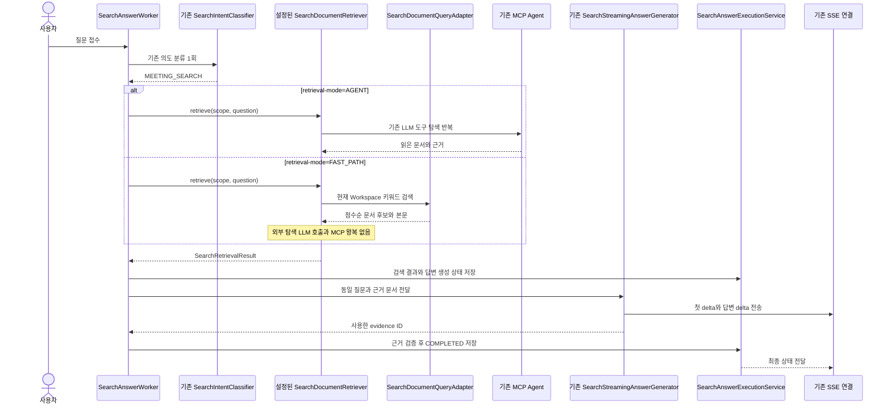

# Fast Path 탐색 경로 비교 실험 계획

- 계획 기준일: 2026-10-18
- 계획 상태: 구현 및 로컬 검증 완료
- 연결 기록: [Notion 02. 속도 개선 실험](https://app.notion.com/p/3fc0691a002381899022e9a2f7e320d7)

## 현재 결정 (2026-10-19)

- Fast Path를 기본 문서 검색 경로로 도입함. `SEARCH_RETRIEVAL_MODE`를 지정하지 않으면 `FAST_PATH`를 사용함.
- 기존 Agent/MCP 경로는 `SEARCH_RETRIEVAL_MODE=AGENT`로 선택 가능하게 유지함. 자동 fallback은 이번 변경에 포함하지 않음.
- 로컬 Q01-Q30 실행은 30/30 완료했고 기대 근거 일치도 30/30이었음. 첫 `delta` 중앙값 3.805초, 전체 완료 중앙값 6.178초였음.
- 이번 측정만으로 운영 환경의 속도 개선을 확정하지 않음. Dev 배포 뒤 동일 질문과 문서 범위로 지연, 완료율, 답변 및 근거 품질을 확인해야 함.

## 1. 목표와 범위

기존 MCP Agent 탐색과 PostgreSQL 직접 검색 Fast Path를 같은 로컬 문서와 고정 질문으로 비교한다. 목표는 반복적인 탐색 LLM 호출을 줄였을 때 첫 `delta`가 빨라지는지, 답변 정확성과 실제 근거가 유지되는지 확인하는 것이다.

첫 단계는 비교 실험이며 제품 기본 경로를 바꾸지 않는다. 기존 Agent를 기본값으로 유지하고 로컬 설정으로만 Fast Path를 선택한다. 자동 fallback의 기준은 이 실험 결과를 확인한 뒤 정한다.

이번 범위:

- 기존 분류와 최종 답변 생성 흐름을 재사용한다.
- Fast Path는 기존 `SearchDocumentQuery.searchPage`를 직접 호출해 문서 후보를 가져온다.
- 기존 `SearchStreamingAnswerGenerator`와 답변 저장, SSE 전달, 근거 ID 검증을 재사용한다.
- 설정에서 `AGENT`와 `FAST_PATH`를 전환해 같은 질문 세트로 비교한다.
- Workspace 31의 로컬 Docker 문서 100건과 고정 Q01-Q30을 사용한다.
- Dev API와 Dev RDS는 호출하지 않는다.

이번 범위에서 제외:

- 벡터 색인, 임베딩 모델, 외부 검색 서비스, 새 LLM 호출을 추가하지 않는다.
- 공개 API, SSE 이벤트, DB 스키마와 SearchEvidence 저장 계약을 바꾸지 않는다.
- 운영 기본값을 Fast Path로 바꾸거나 Dev에 배포하지 않는다.
- Agent fallback의 자동 라우팅 기준을 미리 확정하지 않는다.

## 2. 조사 근거와 현재 코드

| 근거 | 확인 내용 | 계획에 미치는 영향 |
| --- | --- | --- |
| Notion `02. 속도 개선 실험` | A 테스트 30건 중 첫 `delta` 25건, 중앙값 25.57초, 잠정 P95 44.39초. 초기 B는 정답 3/30이며 속도 개선 판단이 불가함. | 기존 Dev A/B 값은 배경 자료로만 사용하고, 효과 판단은 동일 로컬 환경에서 실행한 Agent 대 Fast Path 결과로 함. |
| Notion 로컬 실 LLM 추적 | 단일 문서 질문과 교차 문서 질문 각 1회가 첫 `delta` 전에 실패함. 탐색 LLM 호출은 각각 13회와 9회였고, MCP 호출은 각각 40ms와 92ms였음. | LLM 탐색 왕복을 줄이는 가설을 시험하되 표본 2건만으로 일반화하지 않음. |
| `SearchAnswerWorker.generate` | 검색 의도 분류 뒤 `SearchDocumentRetriever.retrieve`를 부르고, 반환 결과를 저장한 후 같은 답변 생성기로 연결함. 검색 결과가 비면 고정 안내로 완료함. | 검색기 선택만 바꾸고 공통 저장 및 SSE 경로를 유지함. 빈 결과는 빠른 응답으로 성공 처리하지 않고 품질 실패로 채점함. |
| `SearchDocumentRetriever` | 검색 구현을 감싸는 애플리케이션 인터페이스임. | 기존 Agent와 새 Fast Path를 같은 worker 경계에 연결할 수 있음. |
| `SearchMcpDocumentRetriever` | LLM 도구 호출과 MCP 문서 도구 호출을 반복하고, 읽은 문서를 `SearchRetrievalResult`로 반환함. | Agent 비교군은 현재 구현을 그대로 유지함. |
| `SearchDocumentQueryAdapter.searchPage` | Workspace, 문서 생성 시점, DRAFT와 ARCHIVED 상태, 녹음 시각 범위를 SQL에서 제한하고 제목, 주제, 요약, 본문 키워드 점수순으로 조회함. 검색어는 최대 8개 공백 분리 항목을 사용함. | Fast Path는 이 검색 동작을 재사용함. 한국어 조사, 긴 문장, 구어체의 검색 누락 가능성을 별도 품질 지표로 기록함. |
| `SearchDocumentParameters` | 검색어 최대 200 코드 포인트, 페이지 크기 1-100 검증을 제공함. | 200자를 넘는 질문을 자르거나 조용히 변형하지 않음. 고정 질문의 길이를 사전에 확인하고, 초과 문항은 Fast Path 비교 결과에서 별도 표시함. |
| `SearchStreamingAnswerGenerator`와 `SearchAgentContext` | 동일한 JSON 근거 입력으로 답변을 스트리밍하며 전체 입력은 현재 48,000자 한도를 검증함. | Fast Path도 같은 컨텍스트 한도를 지켜야 함. 초과 시 문서를 조용히 자르지 않고 해당 실행을 제한 초과로 집계함. |
| `docs/product/current-v2-mvp.md`의 탐색 기준 | 탐색은 현재 Workspace의 DRAFT와 ARCHIVED 문서를 읽고, 실제 답변에 사용한 문서를 근거로 남김. | 기존 범위와 권한을 유지하고 Transcript, 오디오, Job을 검색하지 않음. |
| 현재 Git 작업 트리 | `be/refactor/#715`에 추적 중인 변경과 새 파일이 다수 있음. | 현재 브랜치에서 실험 코드를 시작하지 않음. 기존 변경을 보존함. |

`SearchDocumentQueryAdapter`는 직접 DB 검색 경계지만, Fast Path가 충분한 근거를 선택한다는 점은 아직 검증되지 않았다. 검색 점수 임계값, 질문 재작성, 복수 문서 질문의 라우팅은 확정된 제품 계약이 아니라 후속 실험 후보임.

## 3. 브랜치와 구현 경계

현재 체크아웃은 `be/refactor/#715`이며 수정 및 미추적 파일이 다수 있음. 이 계획 작업에서는 해당 파일을 바꾸지 않는다.

구현 시작 전 별도 탐색 성능 이슈를 준비하고, 최신 `origin/develop`을 기준으로 별도 worktree와 `be/feature/#<이슈번호>` 브랜치를 만든다. 현재 `#715` 브랜치에서 분기하거나 그 변경을 실험에 섞지 않는다.

예상 설정 이름은 `knot.search.agent.retrieval-mode`이며 허용 값은 `AGENT`, `FAST_PATH`로 제안한다. 기본값은 `AGENT`로 둔다. 설정 이름과 이슈 범위는 구현 전 저장소 최신 상태에서 다시 확인한다.

## 4. 구현 흐름



Fast Path에서 기존 의도 분류와 최종 답변 생성은 계속 LLM을 사용한다. 제거하는 대상은 문서 탐색을 위한 반복적인 LLM 계획 호출이다. 따라서 Fast Path의 첫 `delta`가 즉시 도착한다고 가정하지 않는다.

## 5. 나올 코드와 메서드 초안

| 위치 | 초안 | 책임 |
| --- | --- | --- |
| `search/application/SearchRetrievalMode.java` | `AGENT`, `FAST_PATH` | 실험 경로를 명시적으로 선택함. |
| `global/config/SearchAgentProperties.java` | `retrievalMode`, 기본 `AGENT` | 로컬 설정으로 실험 경로를 전환함. 잘못된 설정은 기존 커스텀 설정 오류로 거절함. |
| `global/config/SearchAgentConfig.java` | `searchDocumentRetriever(...)` | 기본 Agent와 Fast Path 구현 중 하나를 설정에 따라 주입함. |
| `search/infrastructure/persistence/SearchFastPathDocumentRetriever.java` | `retrieve(scope, question)` | 권한을 검사하고 기존 검색 쿼리를 호출해 점수순 결과를 `SearchDocumentResult`로 변환함. MCP와 탐색 LLM은 호출하지 않음. |
| 기존 `SearchDocumentQueryAdapter` | `searchPage(...)` 재사용 | 직접 SQL 검색과 Workspace, 생성 시점, DRAFT와 ARCHIVED 범위를 유지함. |
| 기존 `SearchAnswerWorker` | 동작 유지 | 두 검색기가 같은 저장, 근거 검증, SSE, 중지와 재연결 계약을 통과하게 함. |
| 기존 `SearchStreamingAnswerGenerator` | 동작 유지 | 실험 간 답변 생성 프롬프트와 스트리밍 조건을 동일하게 유지함. |

실험용 Fast Path는 원 질문을 키워드 검색어로 사용함. 질의 재작성은 탐색 호출을 추가하거나 분류 계약을 바꾸는 별도 변수가 되므로 첫 비교에는 포함하지 않는다. 200 코드 포인트 초과 질문은 자르지 않고 사전에 표시함. 전체 문서 근거가 48,000자 제한을 넘는 경우도 자동 절단하지 않으며 별도 실패로 집계함.

초기 비교에서는 검색어 무결과를 Agent로 자동 fallback하지 않는다. 그렇게 하면 Fast Path 누락이 숨겨져 경로별 정확성을 비교할 수 없기 때문이다. 로컬 비교 뒤 결과를 확인하고 `무결과`, `복수 회의`, `후속 질문`, `긴 문맥`, `약한 검색 점수` 중 어느 조건에서 Agent로 넘길지 별도 결정함. 운영 기본 경로는 해당 결정 전까지 Agent로 유지함.

## 6. 저장 기반과 주의할 점

- 새 테이블, 컬럼, 인덱스, Flyway migration은 계획하지 않음.
- 새 API, SSE 이벤트, 공개 응답 필드는 계획하지 않음.
- Fast Path 결과도 기존 `SearchRetrievalResult`와 `SearchDocumentResult`로 전달함.
- `SearchAnswerWorker`가 후보 문서 ID를 사용한 근거만 저장하는 기존 검증을 유지함.
- 권한은 `SearchToolAccess.validate(scope)`와 쿼리의 Workspace 조건을 모두 유지함.
- DRAFT와 ARCHIVED는 모두 대상이며, 문서 생성 시점 cutoff와 실행 중단 검사도 기존 계약을 유지함.
- 검색 제외 수는 직접 DB 검색 경로에서 0으로 유지함. 검색 누락은 색인 제외 수로 위장하지 않음.
- 문서 전체 본문 전달은 `SearchAgentContext`의 48,000자 제한을 넘지 않아야 함. 제한을 넘는 문서는 묵시적으로 자르지 않음.
- 질문, 본문과 LLM 토큰은 로그에 추가하지 않음. 실험 결과표에는 질문 ID, 경로, 후보 document ID, 지연, 종료 상태, 채점 결과만 기록함.
- 동일 로컬 DB와 고정 문서 데이터로 실행함. 로컬 DB seed가 Dev Workspace 31과 완전히 같은 복제본인지 검증되지 않았으므로 Dev A 결과와 직접 통계 비교하지 않음.
- 실제 모델 평가가 필요하면 기존 로컬 Docker와 승인된 LLM 연결을 사용함. 연결 실패 시 synthetic/mock 결과로 정확도나 실시간 모델 성능을 주장하지 않음.

## 7. TDD와 검증 순서

| 순서 | 먼저 작성할 실패 테스트 | 그다음 구현 | 검증 경계 |
| --- | --- | --- | --- |
| 1. Fast Path 검색 계약 | 문서 검색 쿼리가 검색 점수 순 결과와 전체 문서 내용을 반환하는지, 빈 결과와 최대 후보 수가 어떻게 처리되는지 실패 테스트로 고정함. | `SearchFastPathDocumentRetriever`의 기존 query adapter 호출과 DTO 변환을 추가함. | 새 검색기 단위 테스트. |
| 2. 접근 범위 | 잘못된 scope에서 query를 실행하지 않는지, Workspace 경계와 DRAFT 및 ARCHIVED 범위가 동일하게 적용되는지 테스트함. | 기존 `SearchToolAccess`와 query adapter의 scope 조건을 재사용함. | 검색기 단위 테스트와 기존 DB 통합 테스트. |
| 3. Fast Path 부작용 제한 | Fast Path가 `SearchLlmClient` 탐색 `complete`와 `SearchMcpClient`를 호출하지 않는지 테스트함. | 검색 실행은 DB query만 호출하도록 구현함. | Mock 기반 검색기 테스트. 분류와 최종 생성은 별도 공통 경로임을 확인함. |
| 4. 설정과 기본 경로 | 설정 기본값이 `AGENT`이고 `FAST_PATH` 선택 시 Fast Path가, 기본 선택 시 기존 Agent가 주입되는지 테스트함. 잘못된 값은 부팅 검증에서 거절되는지 확인함. | enum, properties, bean 선택을 추가함. | 설정 바인딩 및 Spring context 테스트. |
| 5. 공통 답변 처리 | 두 검색기가 반환한 결과가 동일한 `recordRetrieval`, 답변 생성, 후보 evidence 검증과 `COMPLETED` 흐름을 통과하는지 테스트함. 빈 결과는 기존 안내 처리로 종료되고 정확도 평가에서는 오답으로 집계되는지 확인함. | worker 변경을 최소화하고 필요한 seam만 추가함. | `SearchAnswerWorkerIntentTest` 및 관련 통합 테스트. |
| 6. 문맥 한도 | Fast Path 근거 payload가 한도를 넘으면 숨은 truncation이나 성공으로 바뀌지 않는지 테스트함. 200자 초과 검색어의 처리도 확인함. | 초과 조건을 명시적으로 실패 또는 실험 결과 상태로 기록함. | Fast Path와 `SearchAgentContext` 테스트. |
| 7. 고정 질문 실험 | Agent와 Fast Path 양쪽에서 같은 Q01-Q30 순서와 같은 Workspace 31 로컬 corpus를 사용하고, 응답이 ID, 상태, delta와 완료 시각, 후보 ID, evidence ID를 기록하는지 수동 하네스로 검증함. | 실험 실행 옵션과 결과 기록을 QA 문서에 연결함. | 외부 LLM은 수동 테스트에서만 호출하고 기본 CI에서는 호출하지 않음. |

집중 검증:

```bash
./gradlew test --tests '*SearchFastPathDocumentRetrieverTest'
./gradlew test --tests '*SearchAnswerWorkerIntentTest'
./gradlew test --tests '*SearchDocumentToolServiceIntegrationTest'
./gradlew check
```

실제 모델 비교는 로컬 Docker에서 순차 실행함. 각 경로별 워밍업 1회 후 같은 Q01-Q30을 같은 순서로 실행하고, 동시 요청은 보내지 않음. 질문 전송부터 첫 `delta`, `completed`까지의 시간을 따로 기록함. 접수만 된 `accepted`는 첫 답변으로 세지 않음. 실패, 무응답, 빈 검색 안내는 별도 집계하고 정확도 통과로 세지 않음.

## 8. 판정 기준

| 지표 | 기록 방식 | 판단 규칙 |
| --- | --- | --- |
| 첫 `delta` | 경로별 평균, 중앙값, 잠정 P95 | 더 빠른 경로인지 비교함. 30건 표본의 P95는 잠정값으로 표기함. |
| 전체 완료 | 경로별 평균, 중앙값, 잠정 P95 | 답변 생성 완료까지 사용자 대기 시간 비교에 사용함. |
| 실패율 | FAILED, timeout, 미접수 502를 분리 집계 | 실패를 속도 성공으로 세지 않음. |
| 답변 정확성 | 기존 문항별 기대 답변 기준으로 판정 | Fast Path가 더 빠르더라도 정답 수가 낮아지면 개선으로 판정하지 않음. |
| 근거 일치 | 실제 evidence document ID와 기대 문서 ID 비교 | 근거가 맞지 않거나 근거 없는 고정 안내면 정답으로 세지 않음. |
| 탐색 왕복 | 분류, 탐색 LLM 횟수, MCP 실제 호출 수 기록 | Fast Path에서 탐색 LLM과 MCP 도구 호출이 제거됐는지 확인함. |

이 실험은 운영 SLO를 설정하지 않음. 성능 판단은 동일한 로컬 모델, 설정, 코드 버전, DB corpus에서 수행한 Agent와 Fast Path의 짝 비교로 제한함. 정확도나 근거 일치가 후퇴하면 자동 라우팅을 도입하지 않고 원인 분석을 먼저 진행함.

## 9. 완료 기준과 다음 단계

1. 기본 설정은 기존 Agent이며 Fast Path는 명시적 로컬 설정에서만 선택됨.
2. Fast Path의 권한, DRAFT와 ARCHIVED 범위, 생성 시점 cutoff와 근거 ID 검증이 기존 계약을 보존함.
3. Fast Path가 탐색용 LLM 도구 계획 호출과 MCP 왕복을 실행하지 않음.
4. 단위, 통합, 설정 테스트와 `./gradlew check`가 통과함.
5. 로컬 실 모델 비교 결과에 속도, 실패율, 답변 정확성, 근거 일치율과 실행 경로가 함께 기록됨.
6. Fast Path가 품질 기준을 충족하기 전까지 운영 기본값 변경이나 Dev 배포를 하지 않음.

비교 후에는 실제 오답과 무결과 사례를 바탕으로 Agent fallback 조건을 정한다. 그때 복수 문서 종합, 후속 질문, 모호한 자연어, 무결과, context 초과, 검색 점수 임계값을 각각 평가한다. 해당 기준이 정해지기 전에는 이 계획만으로 하이브리드 라우팅을 제품 결정으로 간주하지 않음.

## 10. 예상 변경량

- Production: 설정 enum과 binding, 새 Fast Path 검색기, 설정 선택 연결 등 약 4-6개 Java 파일, 120-220줄 예상함.
- Tests: 검색기, 설정, worker와 DB 통합 검증 약 4-6개 파일, 180-320줄 예상함.
- QA 문서: 고정 비교 실행과 결과표 연결 약 1-2개 문서, 60-120줄 예상함.
- DB migration, 공개 API 변경, 새 검색 인프라 의존성은 예상하지 않음.

실제 변경량은 최신 develop의 bean wiring과 검색 통합 테스트 구조를 구현 전에 다시 확인한 뒤 조정함.

## 11. 관련 자료

- [Notion 02. 속도 개선 실험](https://app.notion.com/p/3fc0691a002381899022e9a2f7e320d7)
- [#722 탐색 첫 delta 지연 구간 계측 계획](722-search-latency-instrumentation.md)
- [#742 탐색 문맥 축소 계획](742-search-context-window.md)
- [B 측정 진단 계획](search-b-diagnostics-plan.md)
- `backend/src/main/java/com/knot/backend/search/application/SearchAnswerWorker.java`
- `backend/src/main/java/com/knot/backend/search/application/SearchDocumentRetriever.java`
- `backend/src/main/java/com/knot/backend/search/infrastructure/llm/SearchMcpDocumentRetriever.java`
- `backend/src/main/java/com/knot/backend/search/infrastructure/persistence/SearchDocumentQueryAdapter.java`
- `backend/src/main/java/com/knot/backend/search/infrastructure/llm/SearchStreamingAnswerGenerator.java`
- `backend/src/test/java/com/knot/backend/search/application/SearchAnswerWorkerIntentTest.java`
- `backend/src/test/java/com/knot/backend/search/infrastructure/llm/SearchMcpDocumentRetrieverTest.java`

## 12. 구현 및 로컬 검증 결과 (2026-10-18)

- `SearchQueryNormalizer`를 Fast Path의 DB 검색어에만 적용함. 최종 답변 생성기에는 사용자의 원 질문을 그대로 전달함.
- `SearchFastPathDocumentRetriever`가 기존 `SearchDocumentQuery`를 호출하도록 연결하고, `knot.search.agent.retrieval-mode`에서 `FAST_PATH`를 선택할 수 있게 함. 이후 2026-10-19 결정으로 기본값을 `FAST_PATH`로 변경함.
- Q11은 `운영 로그 며칠 보관 기록` 검색어로 문서 41, 42, 40을 회수함. 답변은 30일과 90일 기록 충돌 및 최종 결정 미확정 상태를 구분했고, 저장 근거도 세 문서와 일치함.
- Q30은 문서 60 하나에 담당자, 기한, 90분 규칙이 모두 있어 기대 문서 목록을 기존 [58, 60]에서 [60]으로 보정함. 이는 검색 코드 수정 대상이 아니라 채점 기준 오류였음.
- 로컬 Docker PostgreSQL, Workspace 31의 ARCHIVED 문서 100건, 고정 Q01-Q30, 실제 Qwen 3.8 27B API로 예열 1회 후 직렬 실행함. Dev API와 Dev RDS는 호출하지 않음.
- 보정 후 30/30 요청이 `COMPLETED`였고 답변에 필요한 근거 일치도 30/30임. 첫 delta 평균 3.710초, 중앙값 3.805초, 잠정 P95 4.006초. 전체 완료 평균 6.510초, 중앙값 6.178초, 잠정 P95 8.752초임. 30건 P95는 nearest-rank 잠정값임.
- 기존 정규화 실험의 중앙값과 비교해 첫 delta는 0.009초 짧고 전체 완료는 0.033초 길었음. 단일 실행 비교이므로 유의미한 속도 개선으로 판단하지 않음.
- 관련 단위 및 설정 테스트와 `spotlessCheck`, `bootJar`, `git diff --check` 통과함. 전체 `check`는 기존 문서 목록 통합 테스트 2건이 구체 `DocumentListQueryAdapter` 대신 JDK 프록시가 주입되어 실패함. 해당 테스트와 계측 코드는 이번 변경 범위가 아니므로 수정하지 않음.
- 기본 경로는 Fast Path로 설정하고, Agent/MCP는 `SEARCH_RETRIEVAL_MODE=AGENT`로 선택할 수 있게 함. Dev 배포 및 실제 환경 확인은 아직 진행하지 않음.
